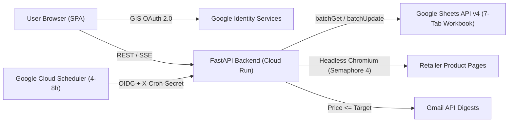

# PricePulse Architecture

> **Version:** `0.6.0` · **Canonical Spec:** [SRS.md](SRS.md) · **Data Model:** [docs/GSHEETS_DATA_MODEL.md](docs/GSHEETS_DATA_MODEL.md) · **Decisions:** [docs/PROJECT_DISCUSSION_AND_DECISIONS.md](docs/PROJECT_DISCUSSION_AND_DECISIONS.md)

## 1. Hexagonal Clean Architecture

Both `frontend/` (React 19 + TypeScript + Tailwind CSS) and `backend/` (Python 3.12+ FastAPI + Playwright) follow **Hexagonal Clean Architecture**:

1. **Domain Layer (`domain/`):** Pure entities, value objects, and business rules (`TrackedItem`, `BoughtItem`, `Tag`, `PriceSnapshot`, `TelemetryRun`, normalized `%` delta, `saved_cost`, `status` evaluation) with zero framework or I/O imports.
2. **Ports Layer (`ports/`):** Abstract interfaces (`ItemRepositoryPort`, `TagRepositoryPort`, `ScraperPort`, `NotificationPort`, `TelemetryPort`).
3. **Adapters Layer (`adapters/`):**
   - **Google Sheets Adapter:** `batchGet`, `batchUpdate`, `append`, and `DeleteDimensionRequest` over Google Sheets API v4 (7-tab workbook).
   - **Playwright Waterfall Scraper Adapter:** Headless Chromium executing a 3-tier extraction heuristic (JSON-LD -> OpenGraph/microdata -> DOM currency RegEx) with optional Webshare proxy rotation and Gemini Search grounding fallback (`REQ-SCRAPE-01`..`REQ-SCRAPE-05`).
   - **Gmail API Adapter:** OAuth 2.0 consolidated discount digest and daily CAPTCHA report sender.
   - **Local JSON / Deterministic Adapters:** Air-gapped adapters for offline local development (`127.0.0.1`) and Playwright E2E testing.
4. **Presentation Layer (`ui/` / `cli/`):** React 19 SPA with canonical URL routing (`frontend/src/shared/routes.ts`), BEM landmark registry (`frontend/src/shared/anchors.ts`), English/Ukrainian i18n (`frontend/src/shared/locales/`), and FastAPI HTTP + SSE streaming endpoints.

## 2. System Topology & Data Flow

## 3. Deployment & Routing

- **Frontend SPA:** Built with Vite (`VITE_BASE_PATH=/price-pulse/`) and deployed to GitHub Pages via [deploy-pages.yml](.github/workflows/deploy-pages.yml) (`build` and `deploy` jobs, with `dist/404.html` SPA fallback).
- **Backend Service:** Containerized FastAPI + Playwright service deployed to Google Cloud Run (`europe-central2`, `1Gi` RAM), triggered interactively by the SPA or unattended by Cloud Scheduler (`POST /api/cron/run-check`).
- **Offline Dev Parity:** Configured via `.env` (`STORAGE_ADAPTER=local_json`, `SCRAPER_ADAPTER=deterministic`, `AUTH_MODE=local_dev`) on loopback `127.0.0.1`.
