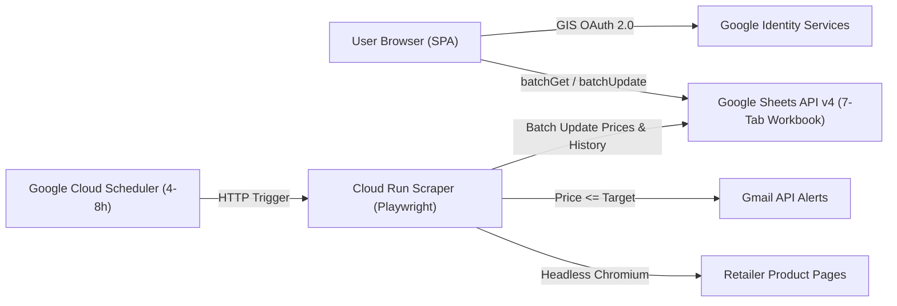

<p align="center">
  
</p>

# PricePulse

> **Version:** `0.3.38` · **Architecture:** Hexagonal Clean Architecture (`frontend/` + `backend/`) · **Spec:** [SRS.md](SRS.md)

**PricePulse** is a personal, automated e-commerce price intelligence and deal-tracking application. It monitors arbitrary retailer product URLs, records historical price trajectories, alerts users when target prices are reached, and tracks realized savings when items are purchased.

---

## Core Principles & Scale

- **Target Scale:** Optimized for **100–300 concurrent tracked URLs** (prototype-validated at 99 active positions + 12 archived bought items).
- **Zero-Cost Infrastructure:** Powered by **Google Sheets API v4** (7-tab workbook database), **Google Cloud Run + Cloud Scheduler** (headless Playwright scraper), **Gmail API** (consolidated deal alerts), and a **React 19 SPA** authenticated via **Google Identity Services (GIS) OAuth 2.0**.
- **Unified 1-Level Flat Tag Model:** No separate Categories, Retailers, or Taxonomy Types anywhere in the data model, UI, filters, or grouping logic.
- **Offline Dev & E2E Parity:** Deterministic In-Memory / Local JSON adapters allow full local development and Playwright E2E testing without live Google credentials.

---

## System Architecture

Both `frontend/` and `backend/` follow **Hexagonal Clean Architecture**:

1. **Domain Layer (`domain/`):** Pure entities, value objects, and business rules (`TrackedItem`, `BoughtItem`, `Tag`, `PriceSnapshot`, `TelemetryRun`, normalized `%` delta, `saved_cost`, `status` evaluation) with zero framework or I/O imports.
2. **Ports Layer (`ports/`):** Abstract interfaces (`ItemRepositoryPort`, `TagRepositoryPort`, `ScraperPort`, `NotificationPort`, `TelemetryPort`).
3. **Adapters Layer (`adapters/`):**
   - **Google Sheets Adapter:** `batchGet`, `batchUpdate`, `append`, and `DeleteDimensionRequest` over Sheets API v4.
   - **Playwright Waterfall Scraper Adapter:** Headless Chromium executing a 3-tier extraction heuristic.
   - **Gmail API Adapter:** OAuth 2.0 consolidated digest sender.
   - **Local JSON / Deterministic Adapters:** Air-gapped adapters for offline dev and E2E suites.
4. **Presentation Layer (`ui/` / `cli/`):** React 19 + TypeScript + Tailwind CSS SPA and FastAPI HTTP API.



### Repository Layout

```text
price-pulse/
├── frontend/               # Vite + React 19 + TypeScript + Tailwind CSS SPA
├── backend/                # Python 3.12+ FastAPI + Playwright service
│   ├── src/pricepulse/     # Hexagonal backend modules
│   ├── tests/              # Automated unit tests
│   └── scripts/            # Static analysis & quality gate (quality_check.py)
├── docs/                   # Data model & architectural decision records
├── SRS.md                  # Software Requirements Specification (v0.3.38)
└── ui_prototype.html       # Primary reference UI prototype
```

---

## Key Features

### Dashboard & Price Trajectory Chart
- **KPI Summary Cards:** Active Monitoring count, Total Saved Costs (grouped per currency symbol without external FX APIs), and Engine Health status.
- **Normalized `%` Price Dynamic Chart:** Compares items at different price points on a single `0.0%` baseline chart with `5%`-step gridlines, timestamp-aligned X coordinates, interactive tooltips, **Top 5 Drops** / **All in View** presets, keyboard focus isolation, and bi-directional **Chart ↔ Grid** tag filtering.

### Data Grid & Bought Items Sheet
- **Active Positions & Bought Items Views:** Sortable columns (`Product Name`, `Tags`, `Baseline`, `Current Price`, `Target Alert`, `Trend Dynamic` sparkline, `Drop %`, `Actions`), 15-items-per-page pagination, search, clickable tag chips, and collapsible **Group By: Tag** mode.
- **Mobile-First Responsive Layout:** Zero horizontal overflow across `320px+` viewports; data grids render as stacked touch-friendly cards on `< 768px` (`md:hidden`) with a collapsible header navigation menu.

### Modals & Lifecycle Management
- **Track New URL (`+ Track New URL`):** Supports both **Single URL** mode (paste a URL, click **Fetch Preview** to auto-populate title, price, image, and suggested tags) and **Bulk URL List** mode (`/items/new?mode=bulk`, paste up to 20 URLs with shared tags and target discount %, inspect fetched items in a horizontal swipeable validation deck `(1/K)`, save in one batched Google Sheets write, and recover failed URLs in the Final Recovery Window with **Configure Manually →**).
- **Item Card Details:** View product metadata, edit title and `Alert Target Price`, manage tags inline (`+ Add Tag`), inspect the SVG `Price Dynamics` chart with `Target Threshold` line, **Confirm Buy** to archive to `Bought_Items` (or **Resume Tracking** to restore), or **Delete Position** with two-step confirmation.

### Tag Manager, System Health & Settings
- **Tag Manager:** Create, search, recolor (`purple`, `amber`, `emerald`, `blue`, `rose`, `cyan`), rename, or delete tags with atomic cascading updates across `Tags`, `Item_Tags`, `Items`, and `Bought_Items`.
- **System Health:** View `Telemetry_Logs` (`Run ID`, `Timestamp`, `Status`, `Checked`, `Breakdown`, `Duration`, JSON logs), runtime diagnostics, and trigger a manual **Run Check**.
- **G-Sync & Configuration:** Configure Spreadsheet ID, Gmail alert recipient, and polling interval; auto-bootstraps missing tabs, headers, and formulas on new Google Sheets.
- **Canonical URL Deep-Linking:** All views (`/dashboard`, `/tags`, `/health`, `/settings`), modals, and filters sync with `window.location` and History API (`pushState`/`popstate`).

---

## Data Architecture (Google Sheets Backend)

The workbook consists of **7 tabs** (see [docs/GSHEETS_DATA_MODEL.md](docs/GSHEETS_DATA_MODEL.md) for full schemas and formulas):

| Tab | Purpose |
| :--- | :--- |
| `Items` | Active tracked positions (`item_id`, prices, `status`, `drop_pct`) |
| `Bought_Items` | Archived purchased items with `saved_cost` |
| `Tags` | 1-level flat tag registry (`tag_id`, `name`, `color`, `created_at`) |
| `Item_Tags` | Many-to-many junction linking `item_id` and `tag_id` |
| `Price_History` | Historical price snapshots linked by preserved `item_id` |
| `Telemetry_Logs` | Batch scraper execution logs (`SUCCESS` / `PARTIAL` / `ERROR`) |
| `Config` | Spreadsheet, Gmail alert, and polling schedule settings |

---

## Scraping, Alerting & Auth

- **3-Tier Waterfall Extraction:**
  1. **Tier 1:** `application/ld+json` (`schema.org/Product` / `Offer`)
  2. **Tier 2:** OpenGraph / Meta & Schema.org `itemprop="price"` / `priceCurrency`
  3. **Tier 3:** DOM prefix/suffix currency RegEx (including `UAH`/`грн`) + `html.unescape` title normalization
- **Pooled Concurrency:** Reuses a single shared headless Chromium instance with `asyncio.Semaphore(4)`, 20s per-URL timeout, 1 retry on transient failure, and per-URL fault isolation (`PARTIAL` telemetry on individual failures).
- **Consolidated Gmail Digest:** Sends a single digest email per batch run when `current_price <= target_price` and an item transitions `ACTIVE` → `DISCOUNT` or hits a new `lowest_price`.
- **Auth & Cloud Deployment:**
  - **SPA + FastAPI:** GIS OAuth 2.0 Bearer verification (`AUTH_MODE=google_oauth`) with `GOOGLE_CLIENT_ID` (`aud`/`azp`) validation and optional `ALLOWED_OWNER_EMAIL` allowlist, or `AUTH_MODE=local_dev` on `127.0.0.1`.
  - **Unattended Cron:** Cloud Run (`europe-central2`, `1Gi` RAM) triggered by Cloud Scheduler via OIDC IAM + `X-Cron-Secret` (`POST /api/cron/run-check`) using a Secret Manager OAuth 2.0 Refresh Token.

---

## Local Development (Offline Mode)

By default, local development runs air-gapped using `STORAGE_ADAPTER=local_json`, `SCRAPER_ADAPTER=deterministic`, and `AUTH_MODE=local_dev`.

### 1. Backend (`backend/`)

```bash
cd backend
cp .env.example .env
python3 -m venv .venv
source .venv/bin/activate
pip install -e ".[dev]"
uvicorn pricepulse.main:app --host 127.0.0.1 --port 8000 --reload
```

### 2. Frontend (`frontend/`)

```bash
cd frontend
cp .env.example .env
npm install
npm run dev
```

The SPA will be available at `http://127.0.0.1:5173` pointing to the FastAPI backend at `http://127.0.0.1:8000`.

---

## Quality Gates & Verification

### Backend
```bash
cd backend
python scripts/quality_check.py
pytest
```

### Frontend
```bash
cd frontend
npm run typecheck
npm run lint
npm run build
npm run test:e2e
```

---

## Reference Documentation

- [Software Requirements Specification (SRS.md)](SRS.md)
- [Google Sheets Data Model](docs/GSHEETS_DATA_MODEL.md)
- [Project Discussion & Architectural Decisions](docs/PROJECT_DISCUSSION_AND_DECISIONS.md)
- [UI Reference Prototype](ui_prototype.html)
