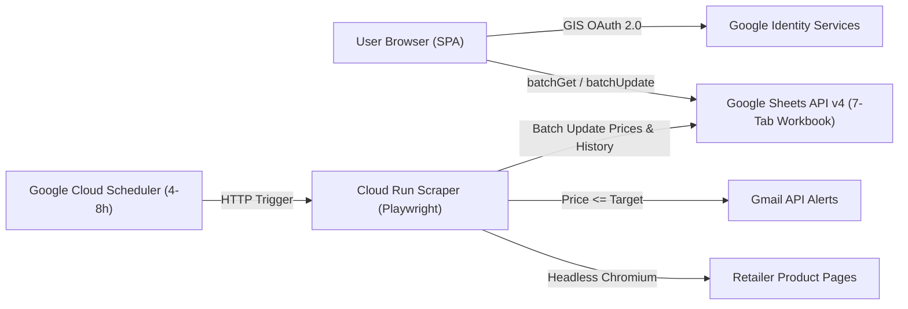
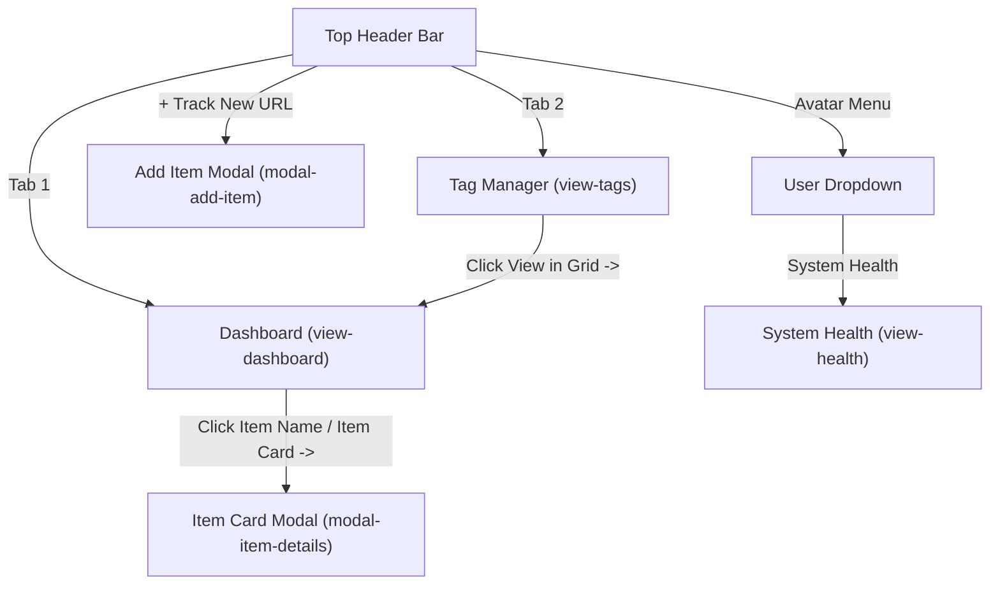

# Software Requirements Specification (SRS) — PricePulse

- **Document Version / App Target Baseline:** `0.4.0`
- **Status:** Active Implementation Baseline (`DS-BASELINE-360` Editorial Minimalism UI)
- **Primary Reference Prototype:** `ui_prototype.html` (v1.12) & `DS-BASELINE-360` (v1.0.0)
- **Data Model Reference:** `docs/GSHEETS_DATA_MODEL.md`
- **Architectural Decisions Reference:** `docs/PROJECT_DISCUSSION_AND_DECISIONS.md`

---

## 1. Purpose, Scope & Core Principles

### 1.1 Purpose
**PricePulse** is a personal, automated e-commerce price intelligence and deal-tracking application. It monitors arbitrary retailer product URLs, records historical price trajectories, alerts users when target prices are reached, and tracks realized savings when items are purchased.

### 1.2 Scope & Scale Target
- **Scale:** Optimized for **100–300 concurrent tracked URLs** (validated in prototype at 99 active positions + 12 archived bought items).
- **Infrastructure Budget:** Zero-cost personal deployment using **Google Sheets API v4** (database), **Google Cloud Run + Cloud Scheduler** (headless Playwright scraper), **Gmail API** (alerts), and a **Single-Page Application (SPA)** authenticated via **Google Identity Services (GIS) OAuth 2.0**.
- **Unified Tagging Principle:** The entire system uses a **1-level flat Tag model**. There are no separate "Categories", "Retailers", or "Taxonomy Types" anywhere in the data model, UI, filters, or grouping logic.

---

## 2. Application Architecture

### 2.1 Hexagonal Clean Architecture (`REQ-ARCH-01`)
Both the frontend SPA and backend scraper service MUST maintain strict separation across four layers:

1. **Domain Layer (`domain/`):** Pure entities, value objects, and business rules (`TrackedItem`, `BoughtItem`, `Tag`, `PriceSnapshot`, `TelemetryRun`, normalized `%` delta calculation, `saved_cost` calculation, `status` evaluation). Zero framework or I/O imports.
2. **Ports Layer (`ports/`):** Abstract interfaces defining external capabilities:
   - `ItemRepositoryPort` (read/write `Items`, `Bought_Items`, `Price_History`)
   - `TagRepositoryPort` (CRUD + rename/delete propagation on `Tags` and `Item_Tags`)
   - `ScraperPort` (fetch & extract price/title/image from arbitrary URL)
   - `NotificationPort` (dispatch target-price alerts)
   - `TelemetryPort` (record and query batch run logs)
3. **Adapters Layer (`adapters/`):** Concrete implementations:
   - **Google Sheets Adapter:** `spreadsheets.values.batchGet`, `batchUpdate`, `append`, and `DeleteDimensionRequest` over Google Sheets API v4.
   - **Playwright Waterfall Scraper Adapter:** Headless Chromium executing the 3-tier extraction heuristic (JSON-LD &rarr; OpenGraph/Meta &rarr; DOM/RegEx).
   - **Gmail API Adapter:** OAuth 2.0 consolidated digest sender.
   - **In-Memory / Local JSON Adapters (`REQ-ARCH-03`):** Deterministic local adapters implementing all repository, scraper, notification, and telemetry ports for offline development and Playwright E2E testing.
4. **Presentation Layer (`ui/` / `cli/`):** React 19 + TypeScript + Tailwind CSS SPA (plus FastAPI HTTP API & optional CLI runner for local batch diagnostics).

- **`REQ-ARCH-02` (Monorepo Layout):** The repository MUST be organized into `frontend/` (Vite + React 19 + TypeScript + Tailwind CSS SPA) and `backend/` (Python 3.12+ FastAPI + Playwright service, `src/pricepulse/`, `tests/`, `scripts/quality_check.py`).
- **`REQ-ARCH-03` (Offline Dev & E2E Parity):** Both `frontend/` and `backend/` MUST support deterministic In-Memory / Local JSON adapters via environment configuration so full workflows and Playwright E2E suites run offline without live Google credentials.

### 2.2 System Topology

---

## 3. Data Architecture (Google Sheets Backend)

Full column-level schemas, formulas, and ER diagrams are defined in [docs/GSHEETS_DATA_MODEL.md](docs/GSHEETS_DATA_MODEL.md).

### 3.1 Workbook Entities (`REQ-DATA-01`..`REQ-DATA-06`)
- **`REQ-DATA-01` (7-Tab Workbook):** The datastore MUST consist of `Items`, `Bought_Items`, `Tags`, `Item_Tags`, `Price_History`, `Telemetry_Logs`, and `Config`.
- **`REQ-DATA-02` (1-Level Flat Tags & Junction):** `Tags` stores `{tag_id, name, color, created_at}` without any `type` or hierarchy field. `Item_Tags` resolves the many-to-many relation (`item_id`, `tag_id`) so tag renames are O(1) cell updates and deletions leave no orphaned strings.
- **`REQ-DATA-03` (Preserved `item_id` Across Lifecycle):** Moving an item from `Items` to `Bought_Items` (and restoring it via *Resume Tracking*) MUST preserve the exact `item_id` so `Price_History` and `Item_Tags` remain continuously linked.
- **`REQ-DATA-04` (Batch API & Sheet Formulas):**
  - Dashboard initialization MUST use a single `spreadsheets.values.batchGet` across active tabs.
  - `Items.status` (`ACTIVE` | `DISCOUNT`), `Items.drop_pct`, and `Bought_Items.saved_cost` (`MAX(0, initial_price - purchased_price)`) MUST be deterministically computable via Sheet formulas and mirrored in domain logic.
- **`REQ-DATA-05` (Sheet Schema Auto-Bootstrapping):** When connecting a new Google Spreadsheet ID, the system MUST inspect existing sheets and auto-initialize any missing tabs, canonical header rows, and formulas via `spreadsheets.batchUpdate`.
- **`REQ-DATA-06` (Multi-Currency Aggregation):** Monetary aggregations (`Total Saved Costs` KPI, Tag Manager `realized_savings`) MUST group and display totals per currency symbol (e.g., `$120.00 + ₴1,500` when mixed) without external FX API dependencies.

---

## 4. Application Structure & Navigation Map

### 4.1 Global Header & Navigation (`REQ-NAV-01`..`REQ-NAV-04`)
- **`REQ-NAV-01` (Compact Top Header):** Displays on `#FFFFFF` canvas with `1px solid #E5E7EB` bottom border (non-sticky `relative` on mobile `< 768px` so it scrolls out of view to preserve vertical working space, and `sticky top-0` on `>= 768px`):
  1. Brand lockup: tilted `#09090B` price-tag outline + Cobalt Blue `#2563EB` ECG pulse vector icon mark (`BrandMark`) paired with `PricePulse` in `#09090B` (and matching vector `favicon.svg` + `logo.webp` app icon; no redundant subtitle or tag-status badge).
  2. Primary navigation tabs (`whitespace-nowrap`, underlined `2px solid #09090B` active indicator on desktop): **Dashboard** (`view-dashboard`) and **Tag Manager** (`view-tags`), with **System Health** (`view-health`) accessed via the User Avatar Dropdown.
  3. Global action buttons: single solid `#09090B` **+ Track New URL** primary CTA displayed in the top header on desktop/tablet (`>= 768px`) and hidden on mobile (`< 768px`) where `#mobile-bottom-nav` is shown (the **Run Check** action lives inside the User Avatar Dropdown rather than the top bar).
  4. **User Avatar Menu** (`user-menu-btn` / `user-dropdown-menu`) displaying the authenticated Google account avatar image (with uppercase 2-letter initials fallback such as `EG` for `Eugene Garkavtcev`, or `PP` when unset) and email local-part nickname before `@` (e.g. `meksico` for `meksico@gmail.com`, falling back to `gmail_alert_recipient` config or `Owner`).
- **`REQ-NAV-02` (User Avatar Dropdown & Mobile Bottom Nav):** Clicking the avatar opens a light `#FFFFFF` menu containing:
  1. Sync summary (`N Positions & Tags Synced` + unified `v<APP_VERSION>`)
  2. **System Health** (`Logs review` &rarr; `view-health`)
  3. **Run Check (`N` Items)** — Triggers an immediate batch price check across all active tracked items (`tabular-nums`).
  4. **Open Google Sheet** (external link to spreadsheet)
  5. **Sign out** (disconnect / switch account action)
  On mobile viewports (`< 768px`), the top header hides `+ Track New URL` and the hamburger menu, while the sticky 3-button **Bottom Navigation Bar** (`#mobile-bottom-nav`) provides one-tap access to `Dashboard`, `Tag Manager`, and `Track New URL` (`System Health` is accessed via `#user-dropdown-menu`), with every bottom button styled with a `1px solid` outline border and subtle gray fill (`#F9FAFB` / `#F3F4F6`). `#user-dropdown-menu` closes immediately on outside pointer click (`mousedown` outside container) and `Escape` (`RULE-OVERLAY-DISMISS`).
- **`REQ-NAV-03` (Single-View Switching):** Only one primary view (`view-dashboard`, `view-tags`, or `view-health`) is visible at a time; switching tabs closes any open dropdowns and resets focus appropriately. Unauthenticated Sign In (`#auth-gate`) hides all app navigation chrome (`DS-LOGIC-03`) on a pure `#FFFFFF` canvas displaying the official stacked `PricePulse` logo (`BrandHeroLogo` / `logo.webp` with vector fallback), `Sign in to your workspace`, a clean hairline divider, and a single `Continue with Google` OAuth button (`#F3F4F6` pill).
- **`REQ-NAV-04` (Modal / Bottom-Sheet Overlays):** `modal-add-item`, `modal-item-details`, and `modal-telemetry-json` open over the active view as centered `#FFFFFF` dialogs on desktop and bottom sheets with a `36×4px` grab handle on mobile, closing on outside backdrop click (`mousedown` outside dialog box), `Escape`, explicit Close (`×`) controls (`RULE-OVERLAY-DISMISS`), and interactive finger-tracking swipe-down dismissal across the top grab-handle and header region on mobile (`RULE-BOTTOM-SHEET-SWIPE`, locked while any async server action is in-flight in `modal-add-item` or `modal-item-details`). Inside `modal-add-item`, a top 2-tab switcher toggles between **Single URL** and **Bulk URL List** (`#modal-add-item__mode-tabs`).
- **`REQ-NAV-05` (Canonical URL Deep-Linking & History Parity):** Every view (`/dashboard`, `/tags`, `/health`), modal (`/items/:itemId`, `/items/new`, `/items/new?mode=bulk`, or `?modal=add&mode=bulk`), and grid/chart filter (`?tab=active|bought&tag=<tag_id>`) MUST be synchronized with `window.location` via a centralized `src/shared/routes.ts` registry and History API (`pushState`/`replaceState`/`popstate`), respecting Vite's `BASE_URL` prefix (e.g. `/price-pulse/` on GitHub Pages). Dashboard-scoped query params (`?tab=`, `?tag=`) MUST be scoped strictly to `/dashboard` and cleared when switching between top-level sections. Direct cold loads, browser refresh, and Back/Forward navigation MUST restore the exact state; FastAPI MUST fall back non-`/api/*` routes to `frontend/dist/index.html` when built and GitHub Pages MUST publish `404.html` as a copy of `index.html`; missing/unknown item IDs MUST fall back cleanly to `/dashboard` with a `role="status"` notice.
- **`REQ-NAV-06` (Unified Action Confirmation, Warning & Error Toaster):** All user-initiated and system-triggered operations (URL preview fetch, item creation/card update/tag update/purchase/resume/delete/delete-confirmation, tag CRUD, batch check start/success/`PARTIAL` warning/error, sign-in/sign-out/401 session expiry, JSON clipboard copy, and missing deep-link item fallback) MUST emit accessible notifications in `#toast-viewport` (`role="status"`, `aria-live="polite"`, auto-dismissing with manual `Dismiss notification` control, `RULE-TOAST`).

---

## 5. Functional Behavior & Controls Specification

### 5.1 Dashboard KPI Summary (`REQ-DASH-01`..`REQ-DASH-03`)
- **`REQ-DASH-01` (Active Monitoring Card):** Interactive `#FFFFFF` `<button>` card (`1px solid #E5E7EB`, zero drop shadow) displaying `12px` Medium `#09090B` label, `28px` Bold `#09090B` `tabular-nums` active item count (`state.items.length`), and `11px` `#71717A` subtitle `<tagCount> Tags • <itemCount> Tracked`. Clicking selects the `Active Positions` tab and smoothly scrolls to `#grid-panel`.
- **`REQ-DASH-02` (Total Saved Costs Card):** Interactive monochrome hairline `#FFFFFF` `<button>` card displaying sum of `saved_cost` across all `Bought_Items` in formatted `tabular-nums` currency (`#09090B`) and count of archived items. Clicking switches `#grid-panel` to the `Bought Items Sheet` tab (`?tab=bought`) and smoothly scrolls to `#grid-panel`.
- **`REQ-DASH-03` (Engine Health Card):** Interactive monochrome hairline `#FFFFFF` `<button>` card displaying current operational status (`tabular-nums`) and latest batch duration summary. Clicking navigates directly to `System Health` (`view-health` / `/health`).

### 5.2 Total Price Dynamic & Market Trajectory Chart (`REQ-CHART-01`..`REQ-CHART-06`)
- **`REQ-CHART-01` (Normalized % Y-Axis, Gridlines & Timestamp Timeline):** Plots canonical `%` delta recomputed against each item's `initial_price` (`0.0%` dashed baseline) with 5%-step `#F3F4F6` horizontal gridlines (`+5%` down to `-30%`+), distinct per-series stroke and point colors assigned deterministically from `SERIES_PALETTE` (with Cobalt Blue `#2563EB` primary area gradient, bounded `±2px` per-series vertical line separation, timestamp-faithful polylines at `(rawX, lineY)`, locally bounded per-cluster de-overlapped bullet markers within `±8px` of `rawX` in a dedicated top SVG layer, haloed endpoint dot, and hover/focus dimming of non-focused series), a top status bar (`0.0% Baseline`, `↓ Negative % = Price Drop`, `Visible: X of Y items`), timestamp-aligned X coordinates across `[minTs, maxTs]` (with a dashed lead-in indicator for single-snapshot items), and a deduplicated bottom X-axis timeline footer (no repeated `Yesterday` labels, ending with `Latest Check (Pooled)`), allowing items at vastly different price points to be compared on a single chart.
- **`REQ-CHART-02` (Series Visible Control Panel):** Positioned to the right of the SVG chart on desktop (`>= 1024px`) with a clean `1px solid #F3F4F6` divider and collapsed by default behind an adjacent `Series Filters (X/Y)` toggle bar directly above the panel on smaller/mobile viewports (`< 1024px`), containing in strict top-to-bottom order:
  1. Header + **Select All / Unselect All** toggle button.
  2. **Filter by Tag** (`chart-category-filter`) dropdown (`All Tags (N)` + all registered tags), placed **below Select All and above Search**.
  3. **Filter series...** `#F3F4F6` borderless text search input (matches item `name` or any assigned `tag`).
  4. Scrollable checkbox list of items with series-matched color dots from `SERIES_PALETTE` (`#D4D4D8` when unchecked), truncated title, current drop `%` (`tabular-nums`), and keyboard focus isolation (`onFocus`/`onBlur` highlights the focused series and dims others).
- **`REQ-CHART-03` (Presets):** Filled Pill Tabs **Top 5 Drops** and **All in View** (`#09090B` active vs `#F3F4F6` inactive).
- **`REQ-CHART-04` (Interactive Per-Bullet Tooltips):** Hovering or clicking any plotted bullet dynamically positions a floating tooltip near that specific bullet (without occluding it) displaying the item's series color dot, item name, assigned `Tags`, snapshot point index (`Point k/N`) and event type, exact price, recomputed `%` delta vs `initial_price` baseline, and formatted timestamp.
- **`REQ-CHART-05` (Bi-Directional Chart &harr; Grid Sync):** Selecting a tag in the Chart dropdown updates the Data Grid's active tag filter (`state.activeLabelFilter`), resets grid pagination to page 1, and re-renders the grid. Conversely, selecting a tag in the Data Grid's `Filter by Tag:` bar or clicking a tag chip updates the Chart dropdown and plotted series.

### 5.3 Data Grid & Bought Items Sheet (`REQ-GRID-01`..`REQ-GRID-10`)
- **`REQ-GRID-01` (View Switcher Tabs & Default Ordering):** Filled Pill Tabs (`#09090B` active vs `#F3F4F6` inactive) toggling between **Active Positions (`N`)** and **Bought Items Sheet (`M`)**. By default (`sortField = "added"`), `PositionsGrid` displays the **latest added items first** across Active Positions, Manual check, and Bought Items Sheet until the user explicitly sorts by a column header.
- **`REQ-GRID-02` (Grid Toolbar Controls):**
  - **Group By** dropdown: `Flat List (None)` or `Tag` (no Category or Retailer grouping).
  - **Search** `#F3F4F6` borderless input well: filters by item `name` or any assigned `tag` across both Active and Bought views. (New URL creation lives exclusively in the top header's `+ Track New URL` primary CTA and mobile bottom bar.)
- **`REQ-GRID-03` (Quick Tag Filter Bar):** Horizontal scrollable strip (`Filter by Tag:`) showing `Show All` (`#09090B` when active) plus one color-coded button per distinct tag present on active items (`TAG_BADGE_CLASSES[tag.color]` with `TAG_DOT_CLASSES[tag.color]` bullet when inactive, transitioning to its saturated tag color `TAG_ACTIVE_BADGE_CLASSES[tag.color]` with white text `text-white` and white bullet `bg-white` when selected).
- **`REQ-GRID-09` (Mobile Scroll-Triggered Collapsible Filtration Ribbon):** On mobile viewports (`< 768px`), once the user scrolls past the in-flow filtration header (`#grid-panel__toolbar` + `#grid-panel__tag-bar`), a narrow sticky ribbon (`#grid-panel__sticky-ribbon`, `fixed top-0`) pins to the top of the viewport showing the active section (`Active Positions`, `Manual check`, or `Bought Items Sheet`) and active tag (`Show All` or tag name) as compact link-style triggers. Clicking the ribbon expands `#grid-panel__sticky-panel` with full filtration controls (tabs, `Group By`, `Search`, and `Filter by Tag:`); scrolling again (`>= 24px` delta), clicking outside, pressing `Escape`, or tapping Collapse transforms it back into the narrow sticky ribbon.
- **`REQ-GRID-04` (Active Positions Table Columns):**
  1. `Product Name` (sortable; `44×44px` rounded thumbnail + clickable title button opening `modal-item-details`)
  2. `Tags` (semantic color-coded tag pills via `TAG_BADGE_CLASSES[tag.color]`)
  3. `Baseline` (`initial_price`, sortable, `tabular-nums`)
  4. `Current Price` (sortable, `tabular-nums`)
  5. `Target Alert` (`target_price`, sortable, `tabular-nums`)
  6. `Trend Dynamic` (inline Cobalt Blue `#2563EB` SVG sparkline)
  7. `Drop %` (sortable; `-X%` badge or `NORMAL`, `tabular-nums`)
  8. `Actions` (outlined `Item Card →` button on desktop `>= 768px`; on mobile `< 768px`, the entire item tile is a single clickable `<button>` with a left thumbnail constrained to `min-height: 140px` / `max-height: 160px` (`object-cover object-center`), top status badge + compact `10px` tag pills, 2-line title, and compact 2-column `Baseline` / `Current` price strip without an `Item Card` button).
- **`REQ-GRID-05` (Clickable Tag Chips in Grid):** Every tag chip rendered in the `Tags` column (in both Active Positions and Bought Items) MUST be an interactive `<button>` that filters the grid by that tag (and syncs the Chart); clicking the already-active tag chip clears the filter back to `ALL`.
- **`REQ-GRID-06` (Collapsible Group By Tag Mode):** When `Group By: Tag` is selected, items are partitioned under collapsible group header rows (`<TagName>`, item count, average drop `%`); pagination is hidden in grouped mode.
- **`REQ-GRID-07` (Pagination):** In `Flat List (None)` mode, paginate at **15 items per page** with `← Prev`, numbered page buttons, and `Next →` plus range indicator (`Showing X–Y of Z active positions`).
- **`REQ-GRID-08` (Bought Items Columns):** `Product Name` (clickable &rarr; Item Card in bought mode), `Tags` (clickable tag chips), `Baseline`, `Bought Price`, `Realized Savings` (`+$X.XX SAVED`), `Date Bought`, `Actions` (`View Card`).
- **`REQ-GRID-10` (Grid Multi-Select & Bulk Actions):** `PositionsGrid` supports multi-item selection via a leading checkbox column on desktop (`>= 768px`, with a `Select all visible` header checkbox supporting `indeterminate`) and sibling card checkboxes (`<input type="checkbox">` beside the clickable card `<button>`, plus a `Select all` toggle) on mobile (`< 768px`). Selecting one or more items reveals `#grid-panel__bulk-bar` with selection count, `Clear`, and scoped bulk actions backed by single-request batch endpoints:
  - **Active Positions (`active`) & Manual check (`manual`):** **Manage Tags** popover (`#grid-panel__bulk-tag-popover` with `RULE-OVERLAY-DISMISS` click-outside & `Escape` dismissal) offering **Add** (append existing or newly created tag), **Replace** (overwrite assigned tags with chosen set), and **Remove** (strip chosen tag from selected items) via `POST /api/items/bulk-tags`; **Re-check (`N`)** triggering pooled scraping via `POST /api/items/bulk-recheck`; and two-step **Delete (`N`)** (`bg-red-50 text-red-600` &rarr; **Confirm Delete (`N`)** + **Cancel**) via `POST /api/items/bulk-delete`.
  - **Bought Items Sheet (`bought`):** Supports two-step **Delete (`N`)** only.

### 5.4 Modals: Track New URL & Item Card (`REQ-MODAL-01`..`REQ-MODAL-06`)
- **`REQ-MODAL-01` (No Technical Selector Fields):** `modal-add-item` MUST NOT expose CSS/XPath selector inputs to end users.
- **`REQ-MODAL-02` (Add Item Flow — Single URL & Bulk URL List):** `modal-add-item` provides two modes via `#modal-add-item__mode-tabs` (`Single URL` | `Bulk URL List`, synced with `?mode=bulk`):
  1. **Single URL Mode:** User pastes URL into a `#F3F4F6` input well, clicks Cobalt Blue (`#2563EB`) **Fetch Preview** — which locks all modal controls behind a full-modal blocking overlay (`#modal-add-item__loading-overlay`, preventing form edits, submission, `Escape`, and outside-click dismissal until `/api/scrape/preview` responds) and auto-populates title, price, image, and suggested tags — assigns or removes tags using the unified `TagAdderControl` (removable colored tag chips + **Add Tag** `<select>` dropdown listing existing non-`Purchased` workspace tags and **`+ Add new one`**, which switches the `<select>` into a free-text `<input>` with **`+ Add Tag`** / **`Cancel`**), and clicks the single `#09090B` **Save & Start Tracking** CTA. Any unknown tags entered are auto-registered in `Tags`.
  2. **Bulk URL List Mode (`up to 20 URLs`):**
     - *Input & Shared Defaults:* User pastes multiple product URLs into a `#F3F4F6` `<textarea>` (`Product URLs (up to 20)`) with a live client-side counter (`Valid New URLs`, `Already Tracked (skipped)`, `Duplicates / Invalid`), a shared **Target Discount `%`** input (default `15%`), and shared `TagAdderControl`. Clicking **Fetch Previews (`N` URLs)** locks `#modal-add-item` behind `#modal-add-item__loading-overlay` and calls `POST /api/scrape/preview-batch` (reusing one shared Chromium instance with `Semaphore(4)`).
     - *Horizontal Swipeable Visual Validation Deck (`#modal-add-item__review-carousel`):* Displays fetched items one card at a time with a step counter (`(1/K)`, `(2/K)`, `tabular-nums`), `← Prev` / `Next →` controls, and horizontal touch/pointer swipe gestures (`translate3d(deltaX, 0, 0)`) so the user can visually validate thumbnails/URLs, inline-edit `Product Title`, `Currency`, `Baseline Price`, `Target Alert Price`, and `Tags`, or toggle `Included in Batch` / `Skipped`. Clicking **Save Validated Items (`K`)** persists all included items in a single batched Google Sheets operation (`POST /api/items/batch` &rarr; `add_items_batch`, executing at most 1 `values().append()` per tab with sequential `row_num` formulas).
     - *Final Recovery Window (`#modal-add-item__bulk-summary`):* If any URLs fail preview scraping (or on partial batch failure), the modal transitions to `#modal-add-item__bulk-summary`, automatically narrowing the `<textarea>` (`Remaining Failed URLs`) down to **only the failed URLs**, displaying a compact breakdown (`Saved & Tracking` vs `Failed` with exact error reason), and providing a **Configure Manually &rarr;** button per failed URL that switches `#modal-add-item` to the **Single URL** tab with that failed URL and shared tags pre-filled.
- **`REQ-MODAL-03` (Item Card Details & Price Chart):** `modal-item-details` displays product image, monochrome status/discount badge (`-X% DISCOUNT`, `ACTIVE`, or `BOUGHT`), clickable `Open Original Retailer Web Page ↗` link (rendered Unicode glyph, never raw `&nearr;`), an active-item **Re-check** button below the header `×` Close button (triggering `POST /api/items/{item_id}/recheck` to immediately re-scrape that single item, bypassing the 48h Gemini fallback cooldown, and displaying a success/error toast), Checkout-style 2-column asymmetric key-value rows (`TAGS`, `TITLE`, `PRICING` with `tabular-nums`), editable title, `Baseline Price`, `Current Tracked Price`, editable `Alert Target Price` (saved via single `#09090B` **Save Changes**, dismissed via muted **Close**), `Last checked` relative timestamp, and an interactive SVG `Price Dynamics` chart in Cobalt Blue (`#2563EB`) with `Value` readout, dashed `#71717A` `Target Threshold` reference line, and per-bullet hover tooltips (`Point k/N`, exact price, recomputed `%` delta vs baseline, timestamp).
- **`REQ-MODAL-04` (Inline Tag Management on Item Card):** Uses the same unified `TagAdderControl` as `modal-add-item`, displaying assigned tags as semantic color-coded removable chips (`TAG_BADGE_CLASSES[tag.color]` with `TAG_DOT_CLASSES[tag.color]` bullets and `×` remove buttons) paired with an **Add Tag** `<select>` dropdown of unassigned existing non-`Purchased` tags whose **`+ Add new one`** option switches the `<select>` into a free-text `<input>` + **`+ Add Tag`** / **`Cancel`** (`Enter` or click attaches and syncs all views, `Escape` returns to the dropdown).
- **`REQ-MODAL-05` (Buy & Archive Workflow):** Active Item Cards provide a quiet `#F3F4F6` settlement well (`Bought this item? Move to Bought Items Sheet`) with an editable purchase price (defaulting to `current_price`) and outlined **Confirm Buy** button. Confirming moves the item to `Bought_Items`, freezes polling, records `saved_cost`, attaches `Purchased`, and switches to the `Bought Items Sheet` view. Bought Item Cards offer **Resume Tracking** to move the item back to `Items`.
- **`REQ-MODAL-06` (Delete Position Location & Universal Blocking Overlays):** **Delete Position** renders with a permanent soft-red destructive accent (`bg-red-50 text-red-600`) in its resting state (two-step solid-red **Confirm Delete** on click) and is located exclusively inside the `modal-item-details` footer (never on dashboard rows/titles). All async server actions in `modal-item-details` (**Re-check**, **Save Changes**, **Add/Remove Tag**, **Confirm Buy**, **Resume Tracking**, **Confirm Delete**) and `modal-add-item` (**Fetch Preview**, **Save & Start Tracking**, **Fetch Previews**, **Save Validated Items**) activate their respective blocking loading overlays (`#modal-item-details__loading-overlay` / `#modal-add-item__loading-overlay`, `aria-busy="true"`), disabling action buttons and locking `Escape`, outside-click, and mobile swipe-down dismissal until the server response completes.

### 5.5 Tag Manager (`view-tags`) (`REQ-TAG-01`..`REQ-TAG-04`)
- **`REQ-TAG-01` (Single-Level Creation Form):** Single `#09090B` `+ Create New Tag` button reveals a minimal form containing **Tag Name** and **Color Theme** (`purple`, `amber`, `emerald`, `blue`, `rose`, `cyan`, `slate` rendered with `TAG_BADGE_CLASSES`), plus a Save button.
- **`REQ-TAG-02` (2-Column Tag Data Grid):** Displays tags in a clean `#FFFFFF` hairline table/list:
  - **Column 1 (`Tag Name`):** Color-tinted pill badge (`TAG_BADGE_CLASSES[tag.color]`) with `6px` `TAG_DOT_CLASSES[tag.color]` indicator dot.
  - **Column 2 (`Additional Info & Edit Options`):** Active item count, average drop `%`, realized savings from `Bought_Items` formatted with workspace currency (`tabular-nums`), inline **Color Theme** `<select>` styled with `TAG_BADGE_CLASSES[tag.color]`, outlined **View in Grid &rarr;** (switches to Dashboard filtered to that tag), **Rename**, and hover-red **Delete**.
- **`REQ-TAG-03` (Search & Summary):** Live `#F3F4F6` tag search input and total active tags counter.
- **`REQ-TAG-04` (Cascading Rename & Delete):** Renaming or deleting a tag updates `Tags`, `Item_Tags`, active `Items`, `Bought_Items`, Chart filter options, and the Dashboard quick-filter bar atomically.

### 5.6 System Health (`view-health`) & Automatic Configuration (`REQ-HEALTH-01`, `REQ-CFG-01`)
- **`REQ-HEALTH-01` (Telemetry Table & Inspection):** Displays an inline monospace `v<APP_VERSION>` version badge (sourced directly from the unified frontend `APP_VERSION` constant so it always matches the header user dropdown menu) beside the **System Health** heading above the telemetry ledger (`Run ID`, `Timestamp`, `Status`, `Checked`, `Breakdown`, `Duration`, and **JSON Log** popup modal (`#modal-telemetry-json`) with a **Copy JSON** clipboard action, `Close` button, and click-outside/`Escape` dismissal exposing the run payload and `RULE-DIAG` runtime diagnostic context with `app_version` normalized to `APP_VERSION`), where `SUCCESS` runs use neutral `#F3F4F6` pills and `PARTIAL`/`ERROR` anomalies display a Crimson Red (`#EF4444`) `6px` dot. Manual batch checks are triggered via **Run Check (`N` Items)** inside `#user-dropdown-menu`.
- **`REQ-CFG-01` (Code-Configured Sync & Auto-Bound Alert Routing):** The redundant `G-Sync & Configuration` UI page is removed. `SPREADSHEET_ID` is configured in deployment/code (`_serialize_state` injects env `SPREADSHEET_ID` when empty in `Config`), Cloud Scheduler polling cadence is fixed at daily `24h` (`poll_interval_hours = "24"`), and `gmail_alert_recipient` automatically binds to the logged-in Google account email (synchronized on UI sign-in and resolved during authenticated `/api/scrape/run-check`, falling back to `ALLOWED_OWNER_EMAIL` for headless cron runs).

### 5.7 Backend Extraction, Auth & Alerting (`REQ-SCRAPE-01`..`REQ-AUTH-02`)
- **`REQ-SCRAPE-01` (3-Tier Waterfall Extraction):** Scraper executes Tier 1 (`application/ld+json` `schema.org/Product`/`Offer` parsed with `strict=False` to tolerate unescaped control characters, including `ImageObject` dict `url` normalization), Tier 2 (OpenGraph/Meta + Schema.org `itemprop="price"`/`priceCurrency` tags), and Tier 3 (visible-text DOM prefix/suffix currency RegEx including `UAH`/`грн` and `PLN`/`zł` and comma-decimal / mixed-separator price parsing via `_parse_float` after stripping `<script>`, `<style>`, `<noscript>`, `<template>` + `html.unescape` title normalization) inside headless Playwright.
- **`REQ-SCRAPE-02` (Pooled Concurrency, HTTP Guard & Revolving Proxy Fallback):** Batch scraping MUST reuse a single shared Chromium browser instance (launched with container-safe `--disable-dev-shm-usage` and `--disable-blink-features=AutomationControlled` flags and `Accept-Language` headers) with `asyncio.Semaphore(4)`, a 20s per-URL timeout, an `HTTP >= 400` status guard (raising `ValueError` instead of extracting prices from WAF/error pages), 1 retry on transient failure, and optional `SCRAPER_PROXY_URL` revolving proxy pool (`parse_proxy_pool` supporting comma/newline-separated `host:port:user:pass` and URL formats; direct-first fetch with round-robin fallback across up to 10 proxies), recording `PARTIAL` status in `Telemetry_Logs` when individual URLs fail without aborting the batch.
- **`REQ-SCRAPE-03` (CAPTCHA / Anti-Bot Gate Handling, iOS Shortcut Prefill & Daily Manual-Check Report):** When a target URL responds with HTTP `403`/`429`/`503` and interactive anti-bot markers (`zhCAPTCHA`, `DDOS protection page`, `cf-chl-`, `g-recaptcha`, `hcaptcha`), `PlaywrightScraperAdapter` raises `CaptchaBlockedError` (`HTTP 422` on `/api/scrape/preview`) without attempting automated CAPTCHA bypassing. `AddItemModal` surfaces a clear explanation banner proposing manual entry + save, and supports deep-linked browser-session pre-fill via `/items/new?url=...&title=...&price=...&currency=...&image=...` (powered by the **Track in PricePulse** iOS Safari Shortcut documented in [docs/IOS_SHORTCUT_GUIDE.md](docs/IOS_SHORTCUT_GUIDE.md)), normalizing ISO currency codes (`UAH`→`₴`, `USD`→`$`, `EUR`→`€`, `GBP`→`£`), normalizing comma/space price strings, computing the default 15% target price, and displaying a pre-fill thumbnail preview. `ItemDetailsModal` + `PATCH /api/items/{item_id}` support manual `current_price` updates (recording a `MANUAL` snapshot in `Price_History`). During batch checks (`/api/cron/run-check`, `/api/scrape/run-check`), `GmailDigestNotifier.send_captcha_report` dispatches a **once-per-day** report (deduplicated via `last_captcha_report_date` in `Config`) listing each blocked item's retailer URL (`item.url`) and direct PricePulse modal link (`{FRONTEND_BASE_URL}/items/{item.item_id}`).
- **`REQ-SCRAPE-04` (Live Retry Attempt Feedback):** When `LocalApiAdapter` retries a transient `502`/`503`/`504` or network failure across up to 3 attempts during `previewUrl` or `previewUrlsBatch`, it MUST emit intermediate warning toasts (`Bad result. Attempt #2`, `Bad result. Attempt #3`) and update the `#modal-add-item__loading-overlay` status text (`Retrying (Attempt N/3)...`) prior to the final error toast so users never wait through multi-attempt timeouts without live status feedback.
- **`REQ-SCRAPE-05` (Gemini Google Search Grounding Fallback with Monthly Cap & Cooldown):** When `GEMINI_API_KEY` is configured and `PlaywrightScraperAdapter` fails with `CaptchaBlockedError` (`CAPTCHA_BLOCKED` or `HTTP 403`) on `/api/scrape/preview` or during `_execute_batch_check`, `GeminiSearchFallbackClient` (default `gemini-3.5-flash-lite` with `google_search` grounding tool, `temperature: 0.0`, exact product URL + extracted numeric SKU/article ID anchoring, and strict non-substitution instructions) MUST attempt a single-query lookup against Google's Search index. Usage MUST be tracked per calendar month (`YYYY-MM:count`) in `Config.gemini_grounding_usage` from `groundingMetadata.webSearchQueries` and hard-capped at `GEMINI_GROUNDING_MONTHLY_CAP` (default `4500`, staying below the 5,000/month free grounding allowance). Batch fallback checks MUST enforce a per-item `GEMINI_GROUNDING_COOLDOWN_HOURS` cooldown (default `48` hours based on `last_checked`), falling back cleanly to `"manual check"` / `422` when disabled, capped, or cooling down.
- **`REQ-GRID-03` (`Manual check` Section, `Last check` Date & Staleness Highlighting):** Items blocked by CAPTCHA / anti-bot protection or pre-filled via the iOS Safari Shortcut automatically receive the `"manual check"` tag (in `AddItemModal` on `CAPTCHA_BLOCKED`/`403` preview failure or Shortcut pre-fill, and in `_execute_batch_check` during batch runs). `PositionsGrid` provides a **`Manual check (N)`** tab (`?tab=manual`) alongside **Active Positions** (keeping `"manual check"` items visible in **Active Positions** as well) with the same data-grid structure plus a **`Last check`** date column (`YYYY-MM-DD`). Rows and mobile cards highlight **yellow** (`bg-amber-50`) with a left-side yellow warning icon when `1..5` days have elapsed since `last_checked` and **red** (`bg-red-50`) with a left-side red warning icon when `6+` days have elapsed; the **`Manual check (N)`** tab pill displays a matching yellow or red indicator dot reflecting the most outdated item.
- **`REQ-ALERT-01` (Consolidated Gmail Digest):** When `current_price <= target_price` and an item either transitions `ACTIVE` &rarr; `DISCOUNT` or reaches a new `lowest_price` while discounted, dispatch a single consolidated digest email per batch run to the configured recipient via Gmail API.
- **`REQ-AUTH-01` (SPA-to-Backend Auth & Same-Origin Routing):** Production SPA builds default to same-origin `/api/...` paths (`DEV` falls back to `127.0.0.1:8000`) or `VITE_API_BASE_URL` (for GitHub Pages → Cloud Run, with default FastAPI `CORS_ORIGINS` allowing `http://127.0.0.1:5173`, `http://localhost:5173`, and `https://meksico.github.io`). When `VITE_GOOGLE_CLIENT_ID` is configured, the SPA renders an accessible Google Identity Services Sign-In gate (`auth-gate`), persists the OAuth access token (with `expires_in` tracking) and user profile in `localStorage` (with `sessionStorage` and in-memory fallback plus cross-tab `storage` event synchronization so opening a new tab preserves the session), waits for the browser tab to return to `visible` after the mobile OAuth popup transition, retries transient network/gateway errors (`TypeError` / `Load failed` / `502`/`503`/`504`) in `LocalApiDataAdapter`, and surfaces `#workspace-sync-status` with **Retry Workspace Sync** / **Sign out** recovery controls (plus automatic `visibilitychange` / `online` re-sync) if initial sync fails. The SPA sends the Bearer token to FastAPI; the backend (`AUTH_MODE=google_oauth`) verifies the token via `tokeninfo`, enforces `GOOGLE_CLIENT_ID` (`aud`/`azp`) matching so any Google Console Test User can authenticate (with optional `ALLOWED_OWNER_EMAIL` allowlist), and supports `AUTH_MODE=local_dev` bypass on `127.0.0.1`.
- **`REQ-AUTH-02` (Unattended Cron Auth & Cloud Deployment):** Cloud Run (`europe-central2`, `1Gi` RAM, `Dockerfile` with `libatomic1` + Chromium) scheduled batch runs (`0 9 * * *` `Europe/Kyiv`) authenticate to Google Sheets API v4 and Gmail API using a Secret Manager OAuth 2.0 Refresh Token (without hardcoded cross-service scopes on `Credentials`) and optionally consume `SCRAPER_PROXY_URL` from Secret Manager (`pricepulse-scraper-proxy:latest`). `POST /api/cron/run-check` MUST enforce `X-Cron-Secret` (`hmac.compare_digest`) when `CRON_SECRET` is configured, paired with Cloud Scheduler OIDC IAM invocation.

---

## 6. Non-Functional, Accessibility & Quality Governance

- **`REQ-A11Y-01` (Semantic HTML & WAI-ARIA):** All clickable actions (including grid tag chips, item titles, group headers, and modal triggers) MUST use `<button>`, modals MUST use `<dialog>` or `role="dialog"`, icon-only buttons MUST have `aria-label`, and dynamic filter/toggle states MUST expose `aria-pressed` / `aria-expanded`.
- **`REQ-A11Y-02` (BEM Anchor Registry):** All structural landmark, panel, form, and modal IDs MUST follow `block__element` kebab-case without `--modifier` suffixes in `id`, registered in a single `src/shared/anchors.ts` source of truth.
- **`REQ-QA-01` (Automated Verification):** Frontend MUST enforce `eslint-plugin-jsx-a11y` in `strict` mode and Playwright E2E tests using A11y-tree queries (`getByRole`, `getByLabel`, `getByText`). Backend/Python modules MUST maintain 100% type annotations, PEP-8 (`<=100` chars), and 100% passing unit tests.
- **`REQ-DIAG-01` (Diagnostic Observability):** Backend/CLI and System Health views MUST expose runtime context (`sys.executable`, `sys.version`, `sys.platform`, dependency versions, workspace path), timestamped `INFO`/`WARN`/`ERROR` logs (including stdout batch error summaries for Cloud Run), and full stack traces on failure (including a global FastAPI unhandled-exception JSON handler).
- **`REQ-NFR-01` (Mobile-First Responsive Layout):** Zero horizontal page overflow across mobile (`320px+`) and desktop viewports. Data grids (`PositionsGrid`, `TagManagerView`, `SystemHealthView`) MUST render stacked touch-friendly cards on `< 768px` (`md:hidden`) and full tables on `>= 768px`; on `< 768px`, the top navigation bar collapses into an accessible hamburger toggle button (`header__mobile-nav`) paired with a sticky 5-icon bottom navigation bar (`mobile-bottom-nav`); modal forms render as mobile bottom sheets (`36×4px` grab handle with finger-tracking swipe-down dismissal across the top handle/header zone per `RULE-BOTTOM-SHEET-SWIPE`) and stack cleanly on narrow screens; long product names truncate gracefully with `title` tooltips. On mobile (`< 768px`), the Dashboard KPI summary tiles (`Active Monitoring`, `Total Saved Costs`, `Engine Health`) MUST appear below `PositionsGrid` (`order-3 md:order-1`) so primary content appears near the fold. All enabled clickable controls (`button`, `a[href]`, `select`, `role="tab"`, `role="menuitem"`, checkboxes) MUST expose `cursor: pointer`.

---

## 7. Revision History

| Version | Date | Author | Summary of Changes |
| :--- | :--- | :--- | :--- |
| `0.1.0` | 2026-11-13 | Antigravity | Initial SRS baseline synthesized from validated `ui_prototype.html` (v1.12), `PROJECT_DISCUSSION_AND_DECISIONS.md`, and `GSHEETS_DATA_MODEL.md`. |
| `0.2.0` | 2026-11-13 | Antigravity | Added `REQ-ARCH-02..03` (monorepo `frontend/` + `backend/`, offline dev/E2E adapters), `REQ-DATA-05..06` (auto-bootstrapping, multi-currency grouping), `REQ-SCRAPE-02` (pooled Semaphore(4) & retries), consolidated digest `REQ-ALERT-01`, and `REQ-AUTH-01..02`. |
| `0.2.1` | 2026-11-14 | Antigravity | Refined `REQ-NAV-05` (`src/shared/routes.ts` URL deep-linking with `BASE_URL` subpath support, FastAPI SPA fallback, GitHub Pages `404.html`), `REQ-CHART-01..02` (5%-step gridlines, timestamp-aligned X-axis, single-snapshot lead-in, focus isolation, mobile `Series Filters` toggle), `REQ-MODAL-03..06` (Price Dynamics + Target Threshold chart, `Confirm Buy`, `Save Changes`, `Delete Position`), `REQ-NFR-01` (mobile cards `< 768px`, collapsible hamburger nav `header__mobile-nav`, `320px+` bounding-box audit, mobile KPI tiles below `PositionsGrid`, global `cursor: pointer`), `REQ-SCRAPE-01..02` (`itemprop` microdata, suffix `UAH`/`грн`, `html.unescape`, container Chromium flags), `REQ-AUTH-01..02` (GIS Sign-In gate, `aud`/`azp` Console Test-User verification, `X-Cron-Secret`, Cloud Run `europe-central2` + Cloud Scheduler), `REQ-DIAG-01` (unhandled 500 JSON traceback + stdout errors), and `verify_live_setup.py`. |
| `0.2.2` | 2026-11-15 | Antigravity | Refined `REQ-SCRAPE-01..02` (`ImageObject` dict `url` extraction, `<script>`/`<style>`/`<noscript>`/`<template>` stripping prior to Tier 3 RegEx, `HTTP >= 400` status guard, and `SCRAPER_PROXY_URL` revolving proxy pool with direct-first fetch and 10-proxy round-robin fallback) and `REQ-AUTH-02` (daily `0 9 * * *` `Europe/Kyiv` Cloud Scheduler cadence + Secret Manager `pricepulse-scraper-proxy`). |
| `0.3.0` | 2026-11-15 | Antigravity | Full `DS-BASELINE-360` High-Contrast Editorial Minimalism UI redesign across all 7 screens: 90/8/2 light surface ratio (`#FFFFFF` / `#F3F4F6` / `#09090B`), Single Ink Anchor (`#09090B`) CTA discipline, Cobalt Blue (`#2563EB`) focus trajectory & micro-sparklines, Crimson Red (`#EF4444`) anomaly dots, unified monochrome tag badges, Checkout-style 2-column asymmetric key-value forms, deduplicated chart X-axis labels, fixed `↗` retailer link glyph, workspace-currency `tabular-nums` alignment, chromeless Auth Gate, mobile bottom sheets, and 5-icon `mobile-bottom-nav`. |
| `0.3.1` | 2026-11-15 | Antigravity | Made Dashboard KPI tiles interactive (`REQ-DASH-01..03`: `Active Monitoring` scrolls to `#grid-panel`, `Total Saved Costs` switches to `Bought Items Sheet` and scrolls to `#grid-panel`, `Engine Health` navigates to `/health`), simplified top header desktop navigation (`REQ-NAV-01`) to 2 tabs (**Dashboard**, **Tag Manager**; leaving **System Health** and **G-Sync & Configuration** in the `PP Owner` dropdown), and streamlined `#auth-gate` Sign-In screen (`REQ-NAV-03`) to remove email input / `Continue` form and `"or"` divider, keeping `PricePulse`, `Sign in to your workspace`, hairline divider, and `Continue with Google` CTA. |
| `0.3.2` | 2026-11-15 | Antigravity | Restored distinct per-series colors (`SERIES_PALETTE`) across the `TrajectoryChart` SVG lines, point markers, endpoint halo, and `Series Visible` legend dots with keyboard focus isolation (`REQ-CHART-01..02`). |
| `0.3.3` | 2026-11-15 | Antigravity | Restored semantic `Tag.color` pill and color-select styling (`TAG_BADGE_CLASSES`, `TAG_DOT_CLASSES`) across `PositionsGrid` (`Filter by Tag:` and `Tags` column), `TagManagerView` (`Tag Name` pill + `Color Theme` `<select>`), and modals (`REQ-GRID-03..04`, `REQ-TAG-01..02`), and removed duplicate `+ Add URL` button from `PositionsGrid` toolbar (`REQ-GRID-02`). |
| `0.3.4` | 2026-11-15 | Antigravity | Applied permanent resting soft-red destructive accent (`bg-red-50 text-red-600`) to **Delete Position** in the `ItemDetailsModal` footer (`REQ-MODAL-06`). |
| `0.3.5` | 2026-11-15 | Antigravity | Recomputed canonical `delta_pct` from `initial_price` in `GoogleSheetsRepository.load_state()`, de-overlapped coincident pooled-check bullets in a dedicated top SVG layer with dynamic per-bullet tooltips in `TrajectoryChart` (`REQ-CHART-01`, `REQ-CHART-04`), added per-bullet hover tooltips to `ItemDetailsModal` (`REQ-MODAL-03`), and fixed `Series Visible` focus-dimming reset. |
| `0.3.6` | 2026-11-15 | Antigravity | Moved `Run Check (N Items)` button from top header bar into `#user-dropdown-menu` below `G-Sync & Configuration` (`REQ-NAV-01..02`). |
| `0.3.7` | 2026-11-15 | Antigravity | Hydrated authenticated Google profile (`picture`, `name`, `email`) via OpenID UserInfo in the header user pill (`REQ-NAV-01`), falling back to two-letter uppercase initials (`EG` for `Eugene Garkavtcev`, `PP` when unset) and email handle nickname before `@` (`meksico` for `meksico@gmail.com`). |
| `0.3.8` | 2026-11-15 | Antigravity | Replaced black active tag pill background with saturated `TAG_ACTIVE_BADGE_CLASSES[tag.color]`, white text, and white bullet dot across `PositionsGrid` (`Filter by Tag:` & `Tags` chips) and `AddItemModal` (`REQ-GRID-03`). |
| `0.3.9` | 2026-11-15 | Antigravity | Moved `v<APP_VERSION>` inline beside the `System Health` heading, removed the 6-cell diagnostics box above the telemetry table, and included `runtime_diagnostics` inside the expandable `JSON Log` inspector (`REQ-HEALTH-01`). |
| `0.3.10` | 2026-11-15 | Antigravity | Excluded system `Purchased` tag from `AddItemModal` quick-select pills (`REQ-MODAL-02`) and restored semantic `TAG_BADGE_CLASSES` & `TAG_DOT_CLASSES` styling on `ItemDetailsModal` tag chips (`REQ-MODAL-04`). |
| `0.3.11` | 2026-11-15 | Antigravity | Unified `APP_VERSION` rendering across `#user-dropdown-menu` and `#view-health`, normalized `runtime_diagnostics.app_version` in the `JSON Log` inspector (`REQ-HEALTH-01`), and synchronized `README.md` version references to `0.3.11`. |
| `0.3.12` | 2026-11-15 | Antigravity | Removed redundant `Tag Manager` menuitem from `#user-dropdown-menu` (`REQ-NAV-02`) and removed duplicate `Run Batch Check Now` button from `#view-health` header (`REQ-HEALTH-01`). |
| `0.3.13` | 2026-11-15 | Antigravity | Added click-outside (`mousedown`) and `Escape` (`keydown`) dismissal across all modals and popups (`#modal-add-item`, `#modal-item-details`, `#user-dropdown-menu`, and `#header__mobile-nav`) per `RULE-OVERLAY-DISMISS` (`REQ-NAV-02`, `REQ-NAV-04`). |
| `0.3.14` | 2026-11-15 | Antigravity | Converted the inline Telemetry `JSON Log` inspector in `#view-health` into a popup modal (`#modal-telemetry-json`) with a **Copy JSON** clipboard button, `Close` button, and click-outside/`Escape` dismissal (`REQ-NAV-04`, `REQ-HEALTH-01`). |
| `0.3.15` | 2026-11-15 | Antigravity | Removed redundant `G-Sync & Configuration` page and navigation links (`REQ-NAV-01..05`), fixed default polling cadence to `24h`, exposed code/env `SPREADSHEET_ID` automatically, and bound Gmail digest alerts to the logged-in Google account email (`REQ-CFG-01`). |
| `0.3.16` | 2026-11-15 | Antigravity | Implemented global toast notification system (`#toast-viewport`) across all user actions, warnings, and errors (`REQ-NAV-06`, `RULE-TOAST`). |
| `0.3.17` | 2026-11-15 | Antigravity | Hid mobile top-bar `+ Track` and removed hamburger drawer alongside bottom bar, removed `System Health` bell button from `#mobile-bottom-nav`, and added outline borders with hover-style fills to bottom navigation buttons (`REQ-NAV-01..02`). |
| `0.3.18` | 2026-11-15 | Antigravity | Unified tag-adding controls across `AddItemModal` and `ItemDetailsModal` via shared `TagAdderControl` (`<select>` dropdown of existing tags + `+ Add new one` switching to a free-text `<input>`, `REQ-MODAL-02`, `REQ-MODAL-04`). |
| `0.3.19` | 2026-11-15 | Antigravity | Added full-modal blocking overlay (`#modal-add-item__loading-overlay`) in `AddItemModal` during `Fetch Preview`, disabling inputs/buttons and locking `Escape` and click-outside dismissal until the server responds (`REQ-MODAL-02`). |
| `0.3.20` | 2026-11-15 | Antigravity | Integrated the official PricePulse brand logo (`logo.webp` + vector `favicon.svg` + `BrandMark` / `BrandHeroLogo`) across the browser favicon/app icon, top header brand lockup, `#auth-gate` Sign-In canvas, and `README.md` (`REQ-NAV-01`, `REQ-NAV-03`). |
| `0.3.21` | 2026-11-15 | Antigravity | Persisted GIS OAuth token/profile across tabs via `localStorage` with `expires_in` tracking and `storage` event sync, waited for post-OAuth tab visibility and added transient `Load failed` / `502–504` retries in `LocalApiDataAdapter`, added `#workspace-sync-status` recovery controls and `visibilitychange`/`online` auto-resync, and included `https://meksico.github.io` in default `CORS_ORIGINS` (`REQ-AUTH-01`). |
| `0.3.22` | 2026-11-15 | Antigravity | Added interactive finger-tracking swipe-down dismissal across the top grab-handle and header region for all mobile bottom sheets (`#modal-item-details`, `#modal-add-item`, `#modal-telemetry-json`) via `useBottomSheetSwipeDismiss` (`REQ-NAV-04`, `REQ-NFR-01`, `RULE-BOTTOM-SHEET-SWIPE`). |
| `0.3.23` | 2026-11-15 | Antigravity | Added Bulk URL List tracking in `#modal-add-item` (`/items/new?mode=bulk`, `POST /api/scrape/preview-batch`, `POST /api/items/batch`, `GoogleSheetsRepository.add_items_batch`) with horizontal swipeable visual validation cards (`#modal-add-item__review-carousel`, `(1/K)` counter) and a Final Recovery Window (`#modal-add-item__bulk-summary`) that narrows the `<textarea>` to failed URLs with per-URL error details and **Configure Manually &rarr;** fallback (`REQ-NAV-04`, `REQ-NAV-05`, `REQ-MODAL-02`). |
| `0.3.24` | 2026-11-15 | Antigravity | Added blocking loading overlay (`#modal-item-details__loading-overlay`) during **Confirm Delete** in `ItemDetailsModal` (`aria-busy`, locked `Escape`/outside-click/swipe-down/footer buttons until server delete completes) (`REQ-NAV-04`, `REQ-MODAL-06`). |
| `0.3.25` | 2026-11-16 | Antigravity | Added `CaptchaBlockedError` (`HTTP 422`) detection for `zhCAPTCHA`/WAF gates, `/items/new` query-parameter pre-fill + **Copy Browser Bookmarklet** in `AddItemModal`, and editable **Current Tracked Price** (`MANUAL` snapshot via `PATCH /api/items/{item_id}`) in `ItemDetailsModal` (`REQ-SCRAPE-03`). |
| `0.3.26` | 2026-11-16 | Antigravity | Replaced the browser bookmarklet with clear manual-entry + daily-reminder guidance in `AddItemModal` and added once-daily `send_captcha_report` emails (deduplicated via `last_captcha_report_date`) containing both the retailer URL and PricePulse `/items/{item_id}` modal link (`REQ-SCRAPE-03`). |
| `0.3.27` | 2026-11-16 | Antigravity | Added live retry-attempt toast notifications (`Bad result. Attempt #2`, `Bad result. Attempt #3`, and final toast) plus loading overlay attempt counter during `previewUrl` and `previewUrlsBatch` retries (`REQ-SCRAPE-04`). |
| `0.3.28` | 2026-11-16 | Antigravity | Generalized blocking loading overlays across all remaining async modal server mutations (`Save & Start Tracking` in `AddItemModal`; `Save Changes`, `Add/Remove Tag`, `Confirm Buy`, `Resume Tracking`, and `Confirm Delete` via `runBlockingAction` in `ItemDetailsModal`) (`REQ-NAV-04`, `REQ-MODAL-06`). |
| `0.3.29` | 2026-11-16 | Antigravity | Added programmatic `"manual check"` tag assignment on CAPTCHA/403 detection (`AddItemModal` + `_execute_batch_check`) and a dedicated **`Manual check`** section (`?tab=manual`) in `PositionsGrid` with the **`Last check`** date column and `1–5` day yellow / `6+` day red row highlighting (`REQ-GRID-03`). |
| `0.3.30` | 2026-11-16 | Antigravity | Added left-side yellow/red warning triangle icons on `Manual check` rows/cards and a top-right staleness indicator dot on the **`Manual check (N)`** tab pill reflecting the most outdated item (`REQ-GRID-03`). |
| `0.3.31` | 2026-11-16 | Antigravity | Fixed manual check confirmation in `ItemDetailsModal`, `LocalJsonRepository`, and `GoogleSheetsRepository` so clicking **Save Changes** with an unchanged `current_price` still updates `last_checked` and records a `MANUAL` snapshot in `Price_History`, clearing stale row/tab indicators (`REQ-SCRAPE-03`, `REQ-GRID-03`). |
| `0.3.32` | 2026-11-16 | Antigravity | Auto-focused the Product URL input (or Bulk URL textarea) whenever `AddItemModal` opens so users can paste immediately without an extra click (`REQ-MODAL-02`). |
| `0.3.33` | 2026-11-16 | Antigravity | Disabled **Save & Start Tracking** until required Single URL fields are entered, enforced `16px` input/select/textarea font size `< 640px` to prevent iOS Safari focus zoom & horizontal scroll, and moved modal scroll containers inside non-scrolling `overflow-hidden` dialog frames so blocking loading overlays always cover the visible mobile viewport even when scrolled (`REQ-NAV-04`, `REQ-MODAL-02`, `REQ-NFR-01`). |
| `0.3.34` | 2026-11-16 | Antigravity | Un-fixed the global top `<header>` on mobile (`< 768px`, `md:sticky md:top-0`) to reclaim vertical working space and added a scroll-triggered collapsible sticky filtration ribbon (`#grid-panel__sticky-ribbon`) and expandable panel (`#grid-panel__sticky-panel`) to `PositionsGrid` (`REQ-NAV-01`, `REQ-GRID-09`). |
| `0.3.35` | 2026-11-16 | Antigravity | Redesigned mobile (`< 768px`) item tiles in `PositionsGrid` as fully clickable `<button>` cards with a full-height left photo, compact `10px` tag pills next to the status badge, a 2-column `Baseline` / `Current` price strip, and removed the redundant `Item Card` / `View Card` buttons (`REQ-GRID-04`). |
| `0.3.36` | 2026-11-17 | Antigravity | Fixed comma-decimal and mixed-separator price parsing (`50,48 грн`, `1.250,50 €`) in `_parse_float` / Tier 3 RegEx and enabled `json.loads(..., strict=False)` for Tier 1 JSON-LD blocks containing unescaped control characters (`REQ-SCRAPE-01`). |
| `0.3.37` | 2026-11-17 | Antigravity | Changed `PositionsGrid` default sort order (`sortField = "added"`) to display the latest added items first across Active Positions, Manual check, and Bought Items Sheet (`REQ-GRID-01`). |
| `0.3.38` | 2026-11-17 | Antigravity | Updated **Cancel** in `AddItemModal` (`handleResetAndClose`) to wipe all Single URL and Bulk URL List fields and state before closing (`REQ-MODAL-02`). |
| `0.3.39` | 2026-11-17 | Antigravity | Formalized the **Track in PricePulse** iOS Safari Shortcut CAPTCHA workaround in [docs/IOS_SHORTCUT_GUIDE.md](docs/IOS_SHORTCUT_GUIDE.md), added `normalizeCurrencySymbol` & `normalizePriceInput` in `domain/models.ts`, rendered pre-fill thumbnail preview in `AddItemModal`, and added E2E coverage for `/items/new` query-parameter pre-fill (`REQ-SCRAPE-03`). |
| `0.3.40` | 2026-11-17 | Antigravity | Added `GeminiSearchFallbackClient` (`gemini-3.5-flash-lite` with Google Search grounding) as an automated fallback for `CAPTCHA_BLOCKED` / `HTTP 403` URLs in `/api/scrape/preview` and `_execute_batch_check`, enforcing a `4,500/mo` hard cap in `Config.gemini_grounding_usage` and a `48h` per-item cooldown (`REQ-SCRAPE-05`). |
| `0.3.41` | 2026-11-17 | Antigravity | Anchored `GeminiSearchFallbackClient.extract_price` to the exact product URL, extracted SKU/article ID (`_extract_product_id`), `temperature: 0.0`, and strict non-substitution instructions (`REQ-SCRAPE-05`), added `PLN`/`zł` support to `playwright_scraper.py` (`REQ-SCRAPE-01`), and set `extraction_tier="gemini_search"` in `_execute_batch_check`. |
| `0.3.42` | 2026-11-17 | Antigravity | Added **Re-check** button in `ItemDetailsModal` header (`POST /api/items/{item_id}/recheck`) to trigger an immediate single-item price check with blocking loading overlay and toast feedback, bypassing the 48h Gemini cooldown (`REQ-MODAL-03`, `REQ-MODAL-06`). |
| `0.3.43` | 2026-11-17 | Antigravity | Fixed `TrajectoryChart` line/dot misalignment on large coincident datasets (`REQ-CHART-01`): bounded `lineOffset` to `±2px` so lines stay at true `%` deltas regardless of series count, anchored polylines to true `(rawX, lineY)`, and replaced chart-wide 1D horizontal bullet spreading with locally bounded per-cluster (`±8px`) de-overlapping so bullets never drift into diagonal staircases. |
| `0.4.0` | 2026-11-17 | Antigravity | Added grid multi-select and bulk actions (`REQ-GRID-10`) across desktop and mobile `PositionsGrid`: **Manage Tags** (`Add` / `Replace` / `Remove` via `POST /api/items/bulk-tags`), pooled **Re-check** (`POST /api/items/bulk-recheck`), and two-step **Delete** (`POST /api/items/bulk-delete`), with batched Google Sheets / Local JSON persistence and unified `APP_VERSION` bump to `0.4.0`. |
