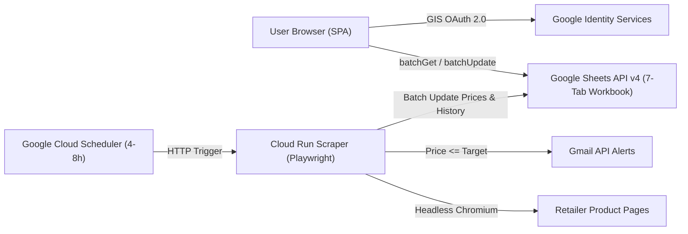
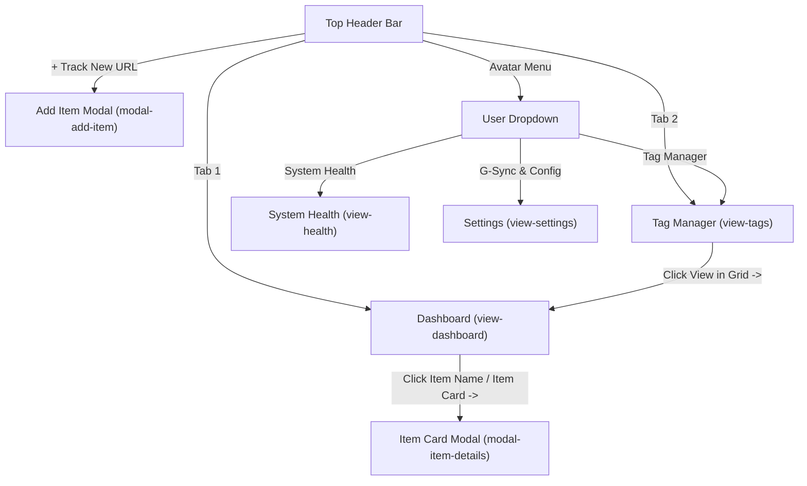

# Software Requirements Specification (SRS) — PricePulse

- **Document Version / App Target Baseline:** `0.2.0`
- **Status:** Draft for Architectural Review (Foundation for Implementation Phase)
- **Primary Reference Prototype:** `ui_prototype.html` (v1.12)
- **Data Model Reference:** `docs/GSHEETS_DATA_MODEL.md`
- **Architectural Decisions Reference:** `docs/PROJECT_DISCUSSION_AND_DECISIONS.md`

---

## 1. Purpose, Scope & Core Principles

### 1.1 Purpose
**PricePulse** is a personal, automated e-commerce price intelligence and deal-tracking application. It monitors arbitrary retailer product URLs, records historical price trajectories, alerts users when target prices are reached, and tracks realized savings when items are purchased.

### 1.2 Scope & Scale Target
- **Scale:** Optimized for **100–300 concurrent tracked URLs** (validated in prototype at 99 active positions + 12 archived bought items).
- **Infrastructure Budget:** Zero-cost personal deployment using **Google Sheets API v4** (database), **Google Cloud Run + Cloud Scheduler** (headless Playwright scraper), **Gmail API** (alerts), and a **Single-Page Application (SPA)** authenticated via **Google Identity Services (GIS) OAuth 2.0**.
- **Unified Tagging Principle:** The entire system uses a **1-level flat Tag model**. There are no separate "Categories", "Retailers", or "Taxonomy Types" anywhere in the data model, UI, filters, or grouping logic.

---

## 2. Application Architecture

### 2.1 Hexagonal Clean Architecture (`REQ-ARCH-01`)
Both the frontend SPA and backend scraper service MUST maintain strict separation across four layers:

1. **Domain Layer (`domain/`):** Pure entities, value objects, and business rules (`TrackedItem`, `BoughtItem`, `Tag`, `PriceSnapshot`, `TelemetryRun`, normalized `%` delta calculation, `saved_cost` calculation, `status` evaluation). Zero framework or I/O imports.
2. **Ports Layer (`ports/`):** Abstract interfaces defining external capabilities:
   - `ItemRepositoryPort` (read/write `Items`, `Bought_Items`, `Price_History`)
   - `TagRepositoryPort` (CRUD + rename/delete propagation on `Tags` and `Item_Tags`)
   - `ScraperPort` (fetch & extract price/title/image from arbitrary URL)
   - `NotificationPort` (dispatch target-price alerts)
   - `TelemetryPort` (record and query batch run logs)
3. **Adapters Layer (`adapters/`):** Concrete implementations:
   - **Google Sheets Adapter:** `spreadsheets.values.batchGet`, `batchUpdate`, `append`, and `DeleteDimensionRequest` over Google Sheets API v4.
   - **Playwright Waterfall Scraper Adapter:** Headless Chromium executing the 3-tier extraction heuristic (JSON-LD &rarr; OpenGraph/Meta &rarr; DOM/RegEx).
   - **Gmail API Adapter:** OAuth 2.0 consolidated digest sender.
   - **In-Memory / Local JSON Adapters (`REQ-ARCH-03`):** Deterministic local adapters implementing all repository, scraper, notification, and telemetry ports for offline development and Playwright E2E testing.
4. **Presentation Layer (`ui/` / `cli/`):** React 19 + TypeScript + Tailwind CSS SPA (plus FastAPI HTTP API & optional CLI runner for local batch diagnostics).

- **`REQ-ARCH-02` (Monorepo Layout):** The repository MUST be organized into `frontend/` (Vite + React 19 + TypeScript + Tailwind CSS SPA) and `backend/` (Python 3.12+ FastAPI + Playwright service, `src/pricepulse/`, `tests/`, `scripts/quality_check.py`).
- **`REQ-ARCH-03` (Offline Dev & E2E Parity):** Both `frontend/` and `backend/` MUST support deterministic In-Memory / Local JSON adapters via environment configuration so full workflows and Playwright E2E suites run offline without live Google credentials.

### 2.2 System Topology

---

## 3. Data Architecture (Google Sheets Backend)

Full column-level schemas, formulas, and ER diagrams are defined in [docs/GSHEETS_DATA_MODEL.md](docs/GSHEETS_DATA_MODEL.md).

### 3.1 Workbook Entities (`REQ-DATA-01`..`REQ-DATA-06`)
- **`REQ-DATA-01` (7-Tab Workbook):** The datastore MUST consist of `Items`, `Bought_Items`, `Tags`, `Item_Tags`, `Price_History`, `Telemetry_Logs`, and `Config`.
- **`REQ-DATA-02` (1-Level Flat Tags & Junction):** `Tags` stores `{tag_id, name, color, created_at}` without any `type` or hierarchy field. `Item_Tags` resolves the many-to-many relation (`item_id`, `tag_id`) so tag renames are O(1) cell updates and deletions leave no orphaned strings.
- **`REQ-DATA-03` (Preserved `item_id` Across Lifecycle):** Moving an item from `Items` to `Bought_Items` (and restoring it via *Resume Tracking*) MUST preserve the exact `item_id` so `Price_History` and `Item_Tags` remain continuously linked.
- **`REQ-DATA-04` (Batch API & Sheet Formulas):**
  - Dashboard initialization MUST use a single `spreadsheets.values.batchGet` across active tabs.
  - `Items.status` (`ACTIVE` | `DISCOUNT`), `Items.drop_pct`, and `Bought_Items.saved_cost` (`MAX(0, initial_price - purchased_price)`) MUST be deterministically computable via Sheet formulas and mirrored in domain logic.
- **`REQ-DATA-05` (Sheet Schema Auto-Bootstrapping):** When connecting a new Google Spreadsheet ID, the system MUST inspect existing sheets and auto-initialize any missing tabs, canonical header rows, and formulas via `spreadsheets.batchUpdate`.
- **`REQ-DATA-06` (Multi-Currency Aggregation):** Monetary aggregations (`Total Saved Costs` KPI, Tag Manager `realized_savings`) MUST group and display totals per currency symbol (e.g., `$120.00 + ₴1,500` when mixed) without external FX API dependencies.

---

## 4. Application Structure & Navigation Map

### 4.1 Global Header & Navigation (`REQ-NAV-01`..`REQ-NAV-04`)
- **`REQ-NAV-01` (Compact Top Header):** Displays:
  1. Brand lockup: `PricePulse` (no redundant subtitle or tag-status badge).
  2. Primary navigation tabs (`whitespace-nowrap`): **Dashboard** (`view-dashboard`) and **Tag Manager** (`view-tags`).
  3. Global action buttons: **Run Check (`N` Items)** and **+ Track New URL**.
  4. **User Avatar Menu** (`user-menu-btn` / `user-dropdown-menu`) showing user initials, name, and active sync status.
- **`REQ-NAV-02` (User Avatar Dropdown):** Clicking the avatar opens a menu containing:
  - Sync summary pill (`N Positions & Tags Synced`)
  - **System Health** (`Logs review` &rarr; `view-health`)
  - **Tag Manager** (&rarr; `view-tags`)
  - **G-Sync & Configuration** (`Sheet ID, Gmail alerts, schedule` &rarr; `view-settings`)
  - **Open Google Sheet** (external link to spreadsheet)
  - **Switch / Disconnect Account** (sign-out action)
- **`REQ-NAV-03` (Single-View Switching):** Only one primary view (`view-dashboard`, `view-tags`, `view-health`, or `view-settings`) is visible at a time; switching tabs closes any open dropdowns and resets focus appropriately.
- **`REQ-NAV-04` (Modal Overlays):** `modal-add-item` and `modal-item-details` open over the active view with backdrop dismissal and explicit Close (`×`) controls.

---

## 5. Functional Behavior & Controls Specification

### 5.1 Dashboard KPI Summary (`REQ-DASH-01`..`REQ-DASH-03`)
- **`REQ-DASH-01` (Active Monitoring Card):** Displays total active item count (`state.items.length`) and subtitle `● <tagCount> Tags • <itemCount> Tracked`. (No redundant "Active Deals" tile.)
- **`REQ-DASH-02` (Total Saved Costs Card):** Displays sum of `saved_cost` across all `Bought_Items` in formatted currency and count of archived items.
- **`REQ-DASH-03` (Engine Health Card):** Displays current operational status and latest batch duration summary.

### 5.2 Total Price Dynamic & Market Trajectory Chart (`REQ-CHART-01`..`REQ-CHART-06`)
- **`REQ-CHART-01` (Normalized % Y-Axis):** Plots `%` delta relative to each item's `initial_price` (`0%` baseline), allowing items at vastly different price points (e.g., `$25` vs `$2,000`) to be compared on a single chart to spot macro discount events.
- **`REQ-CHART-02` (Series Visible Control Panel):** Positioned to the right of the SVG chart and contains, in strict top-to-bottom order:
  1. Header + **Select All / Unselect All** toggle button.
  2. **Filter by Tag** (`chart-category-filter`) dropdown (`All Tags (N)` + all registered tags), placed **below Select All and above Search**.
  3. **Filter series...** text search input (matches item `name` or any assigned `tag`).
  4. Scrollable checkbox list of items with color dot, truncated title, and current drop `%` badge.
- **`REQ-CHART-03` (Presets):** Quick preset buttons **Top 5 Drops** and **All in View**.
- **`REQ-CHART-04` (Interactive Tooltips):** Hovering any plotted data point displays item name, assigned `Tags`, snapshot time, exact price, and `%` delta.
- **`REQ-CHART-05` (Bi-Directional Chart &harr; Grid Sync):** Selecting a tag in the Chart dropdown updates the Data Grid's active tag filter (`state.activeLabelFilter`), resets grid pagination to page 1, and re-renders the grid. Conversely, selecting a tag in the Data Grid's `Filter by Tag:` bar or clicking a tag chip updates the Chart dropdown and plotted series.

### 5.3 Data Grid & Bought Items Sheet (`REQ-GRID-01`..`REQ-GRID-08`)
- **`REQ-GRID-01` (View Switcher Tabs):** Toggle between **Active Positions (`N`)** and **Bought Items Sheet (`M`)**.
- **`REQ-GRID-02` (Grid Toolbar Controls):**
  - **Group By** dropdown: `Flat List (None)` or `Tag` (no Category or Retailer grouping).
  - **Search** input: filters by item `name` or any assigned `tag` across both Active and Bought views.
  - **+ Add URL** shortcut button.
- **`REQ-GRID-03` (Quick Tag Filter Bar):** Horizontal scrollable strip (`Filter by Tag:`) showing `Show All` plus one button per distinct tag present on active items.
- **`REQ-GRID-04` (Active Positions Table Columns):**
  1. `Product Name` (sortable; thumbnail + clickable title button opening `modal-item-details`)
  2. `Tags` (uniform color-coded tag chips from `Tags` registry)
  3. `Baseline` (`initial_price`, sortable)
  4. `Current Price` (sortable; highlighted emerald when discounted)
  5. `Target Alert` (`target_price`, sortable)
  6. `Trend Dynamic` (inline SVG sparkline)
  7. `Drop %` (sortable; `-X%` badge or `NORMAL`)
  8. `Actions` (`Item Card →` button)
- **`REQ-GRID-05` (Clickable Tag Chips in Grid):** Every tag chip rendered in the `Tags` column (in both Active Positions and Bought Items) MUST be an interactive `<button>` that filters the grid by that tag (and syncs the Chart); clicking the already-active tag chip clears the filter back to `ALL`.
- **`REQ-GRID-06` (Collapsible Group By Tag Mode):** When `Group By: Tag` is selected, items are partitioned under collapsible group header rows (`🏷️ <TagName>`, item count, average drop `%`); pagination is hidden in grouped mode.
- **`REQ-GRID-07` (Pagination):** In `Flat List (None)` mode, paginate at **15 items per page** with `← Prev`, numbered page buttons, and `Next →` plus range indicator (`Showing X–Y of Z active positions`).
- **`REQ-GRID-08` (Bought Items Columns):** `Product Name` (clickable &rarr; Item Card in bought mode), `Tags` (clickable tag chips), `Baseline`, `Bought Price`, `Realized Savings` (`+$X.XX SAVED`), `Date Bought`, `Actions` (`View Card`).

### 5.4 Modals: Track New URL & Item Card (`REQ-MODAL-01`..`REQ-MODAL-06`)
- **`REQ-MODAL-01` (No Technical Selector Fields):** `modal-add-item` MUST NOT expose CSS/XPath selector inputs to end users.
- **`REQ-MODAL-02` (Add Item Flow):** User pastes URL, clicks **Fetch Preview** (auto-populates title, price, image, suggested tags), optionally edits **Tags (comma-separated)**, and clicks **Save & Start Tracking**. Any unknown tags entered are auto-registered in `Tags`.
- **`REQ-MODAL-03` (Item Card Details & Price Chart):** `modal-item-details` displays product image, clickable store link, editable title, editable `target_price` (active items), baseline vs current/bought price, last-checked/purchased timestamp, and an SVG price-history chart with target-threshold reference line.
- **`REQ-MODAL-04` (Inline Tag Management on Item Card):** Displays assigned tags as removable chips (`×`) and an **Add Tag** input + button (`Enter` or click) that attaches the tag (auto-registering if new) and syncs all views.
- **`REQ-MODAL-05` (Buy & Archive Workflow):** Active Item Cards provide a **Buy** action with an editable purchase price (defaulting to `current_price`). Confirming moves the item to `Bought_Items`, freezes polling, records `saved_cost`, attaches `Purchased`, and switches to the `Bought Items Sheet` view. Bought Item Cards offer **Resume Tracking** to move the item back to `Items`.
- **`REQ-MODAL-06` (Delete Position Location):** **Delete** is located exclusively inside the `modal-item-details` footer (never on dashboard rows/titles) and removes the position after confirmation.

### 5.5 Tag Manager (`view-tags`) (`REQ-TAG-01`..`REQ-TAG-04`)
- **`REQ-TAG-01` (Single-Level Creation Form):** `+ Create New Tag` reveals a minimal form containing only **Tag Name** and **Color Theme** (`purple`, `amber`, `emerald`, `blue`, `rose`, `cyan`), plus a Save button.
- **`REQ-TAG-02` (2-Column Tag Data Grid):** Displays tags in a 2-column table (no tile cards, no taxonomy filter tabs):
  - **Column 1 (`Tag Name`):** Color-themed pill badge (`🏷️ <name>`).
  - **Column 2 (`Additional Info & Edit Options`):** Active item count, average drop `%`, realized savings from `Bought_Items`, inline **Color Theme** `<select>`, **View in Grid &rarr;** (switches to Dashboard filtered to that tag), **Rename**, and **Delete**.
- **`REQ-TAG-03` (Search & Summary):** Live tag search input and total active tags counter.
- **`REQ-TAG-04` (Cascading Rename & Delete):** Renaming or deleting a tag updates `Tags`, `Item_Tags`, active `Items`, `Bought_Items`, Chart filter options, and the Dashboard quick-filter bar atomically.

### 5.6 System Health (`view-health`) & Settings (`view-settings`) (`REQ-HEALTH-01`, `REQ-CFG-01`)
- **`REQ-HEALTH-01` (Telemetry Table & Manual Run):** Displays `Run ID`, `Timestamp`, `Status` (`SUCCESS`/`PARTIAL`/`ERROR`), `Checked`, `Breakdown`, `Duration`, and JSON log inspection. **Run Check (N Items)** triggers an immediate pooled batch check with spinning progress feedback and appends a new telemetry row.
- **`REQ-CFG-01` (G-Sync & Configuration):** Allows configuring Spreadsheet ID, Gmail alert recipient, polling interval, and saving to `Config`.

### 5.7 Backend Extraction, Auth & Alerting (`REQ-SCRAPE-01`..`REQ-AUTH-02`)
- **`REQ-SCRAPE-01` (3-Tier Waterfall Extraction):** Scraper executes Tier 1 (`application/ld+json` `schema.org/Product`/`Offer`), Tier 2 (OpenGraph/Meta price tags), and Tier 3 (DOM price heuristics + currency RegEx) inside headless Playwright.
- **`REQ-SCRAPE-02` (Pooled Concurrency & Resilience):** Batch scraping MUST reuse a single shared Chromium browser instance with `asyncio.Semaphore(4)`, a 20s per-URL timeout, 1 retry on transient failure, and record `PARTIAL` status in `Telemetry_Logs` when individual URLs fail without aborting the batch.
- **`REQ-ALERT-01` (Consolidated Gmail Digest):** When `current_price <= target_price` and an item either transitions `ACTIVE` &rarr; `DISCOUNT` or reaches a new `lowest_price` while discounted, dispatch a single consolidated digest email per batch run to the configured recipient via Gmail API.
- **`REQ-AUTH-01` (SPA-to-Backend Auth):** The SPA sends the user's Google GIS OAuth Bearer token to FastAPI endpoints (`Fetch Preview`, manual `Run Check`); the backend verifies the token and owner email (with explicit local dev mode bypass on `127.0.0.1`).
- **`REQ-AUTH-02` (Unattended Cron Auth):** Cloud Run scheduled batch runs authenticate to Google Sheets API v4 and Gmail API using a single OAuth 2.0 Refresh Token.

---

## 6. Non-Functional, Accessibility & Quality Governance

- **`REQ-A11Y-01` (Semantic HTML & WAI-ARIA):** All clickable actions (including grid tag chips, item titles, group headers, and modal triggers) MUST use `<button>`, modals MUST use `<dialog>` or `role="dialog"`, icon-only buttons MUST have `aria-label`, and dynamic filter/toggle states MUST expose `aria-pressed` / `aria-expanded`.
- **`REQ-A11Y-02` (BEM Anchor Registry):** All structural landmark, panel, form, and modal IDs MUST follow `block__element` kebab-case without `--modifier` suffixes in `id`, registered in a single `src/shared/anchors.ts` source of truth.
- **`REQ-QA-01` (Automated Verification):** Frontend MUST enforce `eslint-plugin-jsx-a11y` in `strict` mode and Playwright E2E tests using A11y-tree queries (`getByRole`, `getByLabel`, `getByText`). Backend/Python modules MUST maintain 100% type annotations, PEP-8 (`<=100` chars), and 100% passing unit tests.
- **`REQ-DIAG-01` (Diagnostic Observability):** Backend/CLI and System Health views MUST expose runtime context (`sys.executable`, `sys.version`, `sys.platform`, dependency versions, workspace path), timestamped `INFO`/`WARN`/`ERROR` logs, and full stack traces on failure.
- **`REQ-NFR-01` (Responsive Layout):** Zero horizontal page overflow; long product names truncate gracefully with `title` tooltips, and streaming/long lists scroll within bounded containers.

---

## 7. Revision History

| Version | Date | Author | Summary of Changes |
| :--- | :--- | :--- | :--- |
| `0.1.0` | 2026-11-13 | Antigravity | Initial SRS baseline synthesized from validated `ui_prototype.html` (v1.12), `PROJECT_DISCUSSION_AND_DECISIONS.md`, and `GSHEETS_DATA_MODEL.md`. |
| `0.2.0` | 2026-11-13 | Antigravity | Added `REQ-ARCH-02..03` (monorepo `frontend/` + `backend/`, offline dev/E2E adapters), `REQ-DATA-05..06` (auto-bootstrapping, multi-currency grouping), `REQ-SCRAPE-02` (pooled Semaphore(4) & retries), consolidated digest `REQ-ALERT-01`, and `REQ-AUTH-01..02`. |
