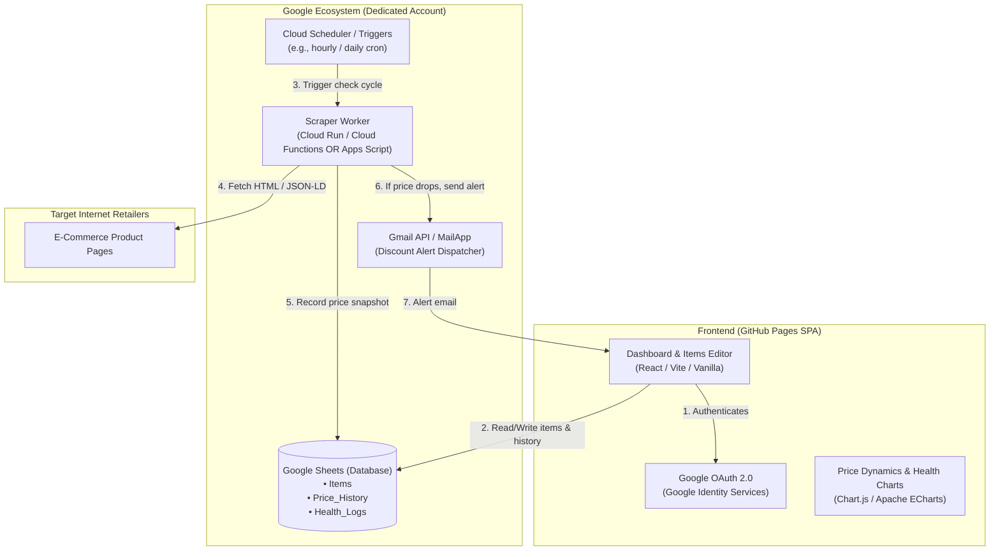
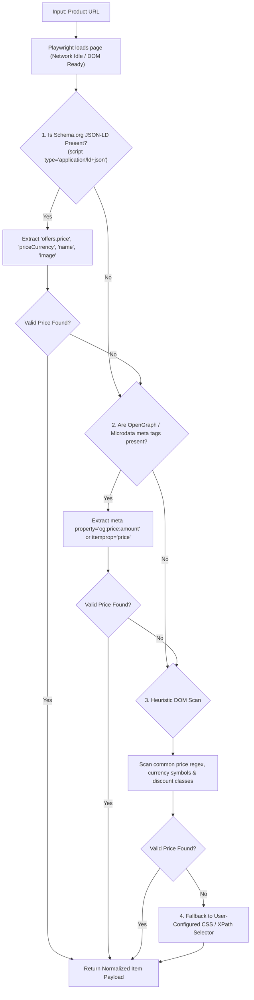
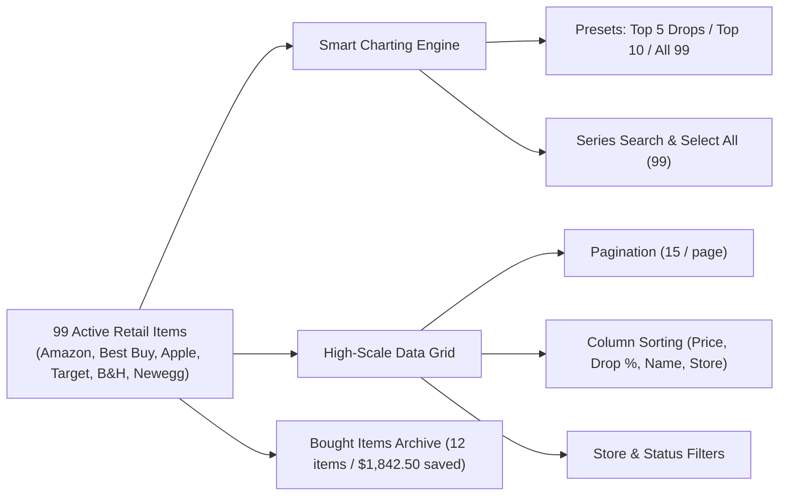

# PricePulse: Complete Design & Discovery Discussion Transcript

**Export Date:** 2026-11-09
**Project:** PricePulse (Cloud Run + Google Sheets + Playwright Price Tracker)
**Total Dialogue Turns:** 107

---

### 👤 **User** <small>(2026-11-03T09:33:58Z)</small>

Hi there! Let's brainstorm to create the app for price tracking. The idea is to regulary check internet pages in a programmatic way to review if the price is discounted. The BE part should be developed based on a specific and specially created G account with all G Cloud services to handle all possible queries. G Sheets as a DB, Sheets API as a BE. And all G Workspace capabilities for all possible cases. The UI should be a custom FE besed on Github pages. Auth - using G OAuth.

Scenario is next - using custom UI user can add/edit/remove URL. System will fetch information like an item name, item attributes, price. Create an item card. And based on schedule starts tracking the price dynamic. every time price is added to sheets. Once the price is lower than usual - system should inform user via email.

The app should have the items editor and a dashboard for all items and system health, including ability to visualise the price dynamic, and saved costs.

So let's brainstorm to collect all necessety data, and validate against tech capabilities and restricitons

<ADDITIONAL_METADATA>
The current local time is: 2026-11-03T11:33:58+02:00.
</ADDITIONAL_METADATA>
<USER_SETTINGS_CHANGE>
The user changed setting `Model Selection` from None to Gemini 3.8 Flash (Medium). No need to comment on this change if the user doesn't ask about it. If reporting what model you are, please use a human readable name instead of the exact string.
</USER_SETTINGS_CHANGE>

---

### 🤖 **Antigravity Assistant** <small>(2026-11-03T09:34:08Z)</small>

Created At: 2026-11-03T11:34:08+02:00
Completed At: 2026-11-03T11:34:08+02:00
Command exited with code 0.

Command output:
/
total 10
drwxr-xr-x  23 root  wheel   736 Oct 23 02:10 .
drwxr-xr-x  23 root  wheel   736 Oct 23 02:10 ..
lrwxr-xr-x   1 root  admin    36 Oct 23 02:10 .VolumeIcon.icns -> System/Volumes/Data/.VolumeIcon.icns
----------   1 root  admin     0 Oct 23 02:10 .file
drwxr-xr-x   2 root  wheel    64 Oct 23 02:10 .nofollow
drwxr-xr-x   2 root  wheel    64 Oct 23 02:10 .resolve
drwxr-xr-x   2 root  wheel    64 Oct 23 02:10 .vol
drwxrwxr-x  27 root  admin   864 Nov  3 08:14 Applications
drwxr-xr-x  67 root  wheel  2144 Oct 30 16:11 Library
drwxr-xr-x@ 12 root  wheel   384 Oct 23 02:10 System
drwxr-xr-x   5 root  admin   160 Oct 30 16:10 Users
drwxr-xr-x   4 root  wheel   128 Nov  2 17:26 Volumes
drwxr-xr-x@ 39 root  wheel  1248 Oct 23 02:10 bin
drwxr-xr-x   2 root  wheel    64 Feb  9  2023 cores
dr-xr-xr-x   4 root  wheel  4681 Nov  2 13:06 dev
lrwxr-xr-x@  1 root  wheel    11 Oct 23 02:10 etc -> private/etc
lrwxr-xr-x   1 root  wheel    25 Nov  2 13:06 home -> /System/Volumes/Data/home
drwxr-xr-x   3 root  wheel    96 Oct 22 09:58 opt
drwxr-xr-x   6 root  wheel   192 Oct 30 16:11 pkg
drwxr-xr-x   6 root  wheel   192 Nov  2 13:06 private
drwxr-xr-x@ 74 root  wheel  2368 Oct 23 02:10 sbin
lrwxr-xr-x@  1 root  wheel    11 Oct 23 02:10 tmp -> private/tmp
drwxr-xr-x@ 11 root  wheel   352 Oct 23 02:10 usr
lrwxr-xr-x@  1 root  wheel    11 Oct 23 02:10 var -> private/var

---

### 🤖 **Antigravity Assistant** <small>(2026-11-03T09:34:08Z)</small>

Here is a comprehensive technical breakdown and feasibility validation for your proposed price-tracking application.

---

### 1. High-Level Architecture Overview



---

### 2. Validation Against Capabilities & Restrictions

#### A. Web Scraping & Content Ingestion
| Challenge | Technical Reality | Recommended Strategy |
| :--- | :--- | :--- |
| **Client-Side Hydration (SPA)** | Many modern stores (Shopify, Next.js, React) do not render prices in raw HTML; prices are injected via JavaScript or internal APIs. | Fallback hierarchy: <br>1. Parse structured `application/ld+json` (`schema.org/Product` `offers.price`).<br>2. Look for OpenGraph / microdata meta tags.<br>3. Inspect public product API endpoints.<br>4. Headless browser (Playwright/Puppeteer in Cloud Run container) when raw HTML parsing fails. |
| **Bot Detection & IP Blocking** | Retailers (Amazon, Cloudflare, Datadome, PerimeterX) frequently block or CAPTCHA traffic originating from cloud IP ranges (GCP / AWS). | • Set realistic User-Agent, Accept-Language, and browser headers.<br>• Avoid aggressive concurrent requests to the same domain (rate-limit to 1 request per few seconds per domain).<br>• Respect `Retry-After` on HTTP 429. |
| **Markup Volatility** | CSS/XPath classes change frequently across site redesigns. | Instead of brittle CSS paths (`div.prod-box > span.val`), prioritize: <br>• Semantic attributes (`[itemprop="price"]`, `meta[property="product:price:amount"]`).<br>• Custom user-configured selectors per domain editable via the UI. |

---

#### B. Google Sheets as a Database
| Metric | Limit / Constraint | Design Mitigation |
| :--- | :--- | :--- |
| **Read/Write Quota** | 300 requests per minute per project (60 per user/min). | **Batch Operations:** Always use `spreadsheets.values.batchGet` and `spreadsheets.values.append` rather than cell-by-cell calls. |
| **Storage Capacity** | Up to 10,000,000 cells per workbook. | Sufficient for tens of thousands of price checks. To avoid slow reads as history grows, separate into sheets: `Items` (active configs) and `Price_History` (append-only log). |
| **Concurrency & Locking** | Google Sheets does not provide native row-level transactions. | Ensure only **one worker** runs the check pipeline at a time, or use Google Apps Script `LockService.getScriptLock()` if using Apps Script. |

---

#### C. Authentication & GitHub Pages (Static Hosting)
1. **OAuth 2.0 Flow on Static Host:**
   - GitHub Pages is a static public client; it **cannot** securely hold a `client_secret`.
   - **Solution:** Use Google Identity Services (GIS) with OAuth 2.0 PKCE / token client directly in the browser to acquire an access token for Google Sheets API.
2. **Google API Scopes & Verification:**
   - Required scopes:
     - `https://www.googleapis.com/auth/spreadsheets` (Read/write access to the database sheet).
     - `https://www.googleapis.com/auth/gmail.send` (If sending emails directly via API).
   - *Google Verification Barrier:* Sensitive/restricted scopes require formal verification if published publicly.
   - **Bypass / Clean Path:** In Google Cloud Console, keep the project in **"Testing"** mode and add your personal Google account(s) to the **Authorized Test Users** list (supports up to 100 users with zero verification required).

---

#### D. Backend Execution Engine: Two Implementation Paths

| Architecture Approach | Pros | Cons / Limits |
| :--- | :--- | :--- |
| **Option 1: Pure Google Workspace (Apps Script + Sheets + Gmail)** | • Zero cost, zero GCP infrastructure.<br>• Native `SpreadsheetApp` and `MailApp.sendEmail()`.<br>• Built-in time triggers (every hour, daily). | • Max execution time: 6 min/run (consumer accounts).<br>• `UrlFetchApp` cannot run dynamic JavaScript/Puppeteer.<br>• Moderate IP block vulnerability on major e-commerce platforms. |
| **Option 2: GCP Containerized (Cloud Scheduler + Cloud Run [Python/Node.js] + Sheets API)** | • Full headless browser support (Playwright/Puppeteer) for any dynamic SPA site.<br>• Robust logging and health telemetry.<br>• Complete control over retry logic and request headers. | • Requires configuring Cloud Run and Cloud Scheduler.<br>• Requires GCP Service Account for Sheets/Gmail access. |

---

### 3. Proposed Google Sheets Schema

#### Sheet 1: `Items` (Main Registry)
| Column | Type | Description |
| :--- | :--- | :--- |
| `item_id` | String (UUID) | Unique identifier |
| `url` | String | Target product URL |
| `name` | String | Extracted product name |
| `currency` | String | e.g., `USD`, `EUR`, `UAH` |
| `initial_price` | Number | Price when item was first added |
| `current_price` | Number | Most recently scraped price |
| `lowest_price` | Number | All-time lowest recorded price |
| `target_price` | Number | User-defined threshold for alert |
| `status` | String | `ACTIVE`, `PAUSED`, `ERROR`, `OUT_OF_STOCK` |
| `custom_selector` | String | Optional fallback CSS/XPath selector |
| `last_checked_at`| Timestamp | ISO 8601 string |

#### Sheet 2: `Price_History` (Time-Series)
| Column | Type | Description |
| :--- | :--- | :--- |
| `history_id` | String (UUID) | Unique entry ID |
| `item_id` | String | Foreign key to `Items.item_id` |
| `timestamp` | Timestamp | Record time |
| `price` | Number | Recorded price |
| `in_stock` | Boolean | Availability flag |

#### Sheet 3: `System_Health` (Audit & Telemetry)
| Column | Type | Description |
| :--- | :--- | :--- |
| `run_id` | String | Execution batch ID |
| `timestamp` | Timestamp | Execution time |
| `items_checked` | Number | Count of processed URLs |
| `success_count` | Number | Successfully parsed count |
| `error_count` | Number | Failed parses (403, 404, selector missing) |
| `duration_ms` | Number | Total run duration |
| `error_details` | String (JSON) | Captured error messages and affected URLs |

---

### 4. Key Questions & Alignment

Before writing code or specifications, let's align on a few strategic decisions:

1. **Target Websites & Rendering Complexity:**
   - Are you targeting specific stores (e.g., Amazon, eBay, local regional retailers), or should it handle arbitrary URLs?
   - Do target sites require JavaScript execution (Playwright/headless), or are they mostly static HTML with JSON-LD metadata?

2. **Backend Engine Preference:**
   - Would you prefer **Option 1 (100% Google Apps Script)** for simplicity and zero setup, or **Option 2 (Google Cloud Run + Playwright)** for reliability against JavaScript-heavy sites?

3. **Frontend Stack:**
   - For the GitHub Pages UI, do you prefer a lightweight single-file SPA, or a structured modern framework like **React + Vite + Tailwind CSS** with charting libraries (Chart.js / ECharts)?

---

### 👤 **User** <small>(2026-11-03T09:42:52Z)</small>

1. Target Websites & Rendering Complexity:
it should  handle arbitrary URLs

2. Backend Engine Preference:
(Google Cloud Run + Playwright) for reliability against JavaScript-heavy sites?

3. Frontend Stack:
structured modern framework like React + Vite + Tailwind CSS with charting libraries (Chart.js / ECharts)?

<ADDITIONAL_METADATA>
The current local time is: 2026-11-03T11:42:52+02:00.
</ADDITIONAL_METADATA>

---

### 🤖 **Antigravity Assistant** <small>(2026-11-03T09:42:52Z)</small>

Based on your choices, we now have a focused, enterprise-grade architecture:

1. **Extraction Engine:** Multi-stage heuristics capable of parsing **arbitrary URLs** (JSON-LD $\rightarrow$ OpenGraph/Microdata $\rightarrow$ DOM Heuristics $\rightarrow$ Custom Selector fallback).
2. **Backend Engine:** **Google Cloud Run** running headless Chromium via **Playwright**, orchestrated by **Cloud Scheduler**.
3. **Frontend Stack:** **React + Vite + Tailwind CSS** with **ECharts / Chart.js**, deployed to **GitHub Pages**.

Below is the comprehensive technical blueprint and implementation roadmap.

---

### 1. End-to-End System Architecture

```mermaid
flowchart TB
    subgraph Browser["Client: GitHub Pages (React + Vite + Tailwind)"]
        UI["React SPA Dashboard & Items Editor"]
        ECharts["Apache ECharts (Price Dynamic & Savings)"]
        GIS["Google Identity Services (OAuth 2.0 Client)"]
    end

    subgraph GCP["Google Cloud Platform (Dedicated Project)"]
        Scheduler["Cloud Scheduler<br/>(Cron trigger: e.g., every 6 hours)"]
        
        subgraph CloudRun["Cloud Run Service (Playwright + FastAPI / Express)"]
            API["API Endpoints:<br/>• POST /scrape-preview (CORS allowed)<br/>• POST /run-pipeline (Scheduler secured)"]
            Engine["Playwright Headless Browser<br/>(Stealth Mode + JSON-LD Parser)"]
            AlertService["Alert Evaluator & Gmail Dispatcher"]
        end

        SA["GCP Service Account<br/>(Has editor role on the Google Sheet)"]
    end

    subgraph Storage["Google Workspace Layer"]
        Sheet[("Google Sheets Database<br/>• Items<br/>• Price_History<br/>• System_Health")]
        Gmail["Gmail API / Notification Gateway"]
    end

    subgraph Web["Arbitrary External Retailers"]
        Store["E-Commerce Product Pages"]
    end

    UI -->|1. Authenticate with Google| GIS
    UI -->|2. Direct Read/Write via Sheets API| Sheet
    UI -->|3. On-demand URL preview (Bypasses CORS)| API
    Scheduler -->|4. Scheduled HTTP Trigger| API
    API --> Engine
    Engine -->|5. Render & Scrape| Store
    Engine -->|6. Append prices & update items via SA| Sheet
    Engine --> AlertService
    AlertService -->|7. Send discount emails| Gmail
```

---

### 2. The Arbitrary URL Parsing Pipeline

Because e-commerce HTML structures differ drastically, a 4-tier waterfall extraction engine guarantees high accuracy without manual selector configuration for most stores:



> **Why Cloud Run is essential for the Frontend:**
> A browser running on GitHub Pages cannot scrape arbitrary URLs directly due to browser **CORS restrictions**. The Cloud Run backend acts as the extraction proxy for both scheduled checks and real-time URL previews in the Items Editor.

---

### 3. Google Cloud Backend Design (Cloud Run + Playwright)

#### Tech Stack
- **Runtime:** Python (FastAPI + Playwright) or Node.js (TypeScript + Express + Playwright). *Python with Playwright and `google-api-python-client` is recommended for concise data manipulation.*
- **Container:** Official Playwright slim Docker image (`mcr.microsoft.com/playwright:v1.49.0-jammy`).
- **Authentication:** 
  - Internal GCP: Cloud Run authenticates to Google Sheets via a **Google Cloud Service Account** (granted `Editor` permission on the specific Google Sheet ID).
  - External endpoints: Protected by API token or Google OIDC.

#### Core API Endpoints
1. `POST /api/v1/preview`
   - **Input:** `{ "url": "https://example.com/item" }`
   - **Process:** Spawns a lightweight headless context, runs the waterfall extractor, and captures title, price, currency, thumbnail, and detected selector.
   - **Output:** `{ "name": "...", "price": 49.99, "currency": "USD", "image": "...", "confidence": "HIGH" }`
2. `POST /api/v1/run-pipeline`
   - **Triggered by:** Cloud Scheduler.
   - **Process:**
     1. Fetches all `ACTIVE` items from `Items` sheet.
     2. Sequentially / pooled visits URLs with polite throttling (1–3s delay per store domain).
     3. Appends rows to `Price_History`.
     4. Updates `Items` (`current_price`, `lowest_price`, `last_checked_at`).
     5. If `current_price < target_price` or `current_price < usual_price`: triggers email alert via Gmail.
     6. Records telemetry snapshot into `System_Health`.

---

### 4. Frontend Architecture (GitHub Pages SPA)

#### Tech Stack
- **Framework:** React 19 / Vite / TypeScript.
- **Styling:** Tailwind CSS + Lucide Icons + Shadcn/Radix UI patterns.
- **Visualizations:** Apache ECharts (`echarts-for-react`) or Chart.js:
  - **Price Dynamic Chart:** Smooth line graph showing price trajectory over time, marked with "Target Price" threshold line and "All-Time Low" point.
  - **Savings Metric:** Cumulative savings counter ($S = \sum (\text{Initial Price} - \text{Lowest / Bought Price})$).
  - **Health Gauge:** Success/failure ratio of scraping runs, response times, and domain reliability scores.
- **Client-Side Google Integration:**
  - Google Identity Services (GIS) Web SDK for OAuth 2.0 login.
  - Interacts directly with Google Sheets v4 API for reading dashboard data and CRUD operations on items.

---

### 5. Detailed Sheet Structure & Formulas

To minimize complex backend queries, we leverage Google Sheets built-in formulas:

```
[Items Sheet]
Columns:
A: item_id (UUID)
B: url (Text)
C: name (Text)
D: currency (USD, EUR, etc.)
E: initial_price (Number)
F: current_price (Number)
G: target_price (Number)
H: lowest_price (Formula: =MINIFS(Price_History!D:D, Price_History!B:B, A2))
I: status (ACTIVE | PAUSED | ERROR)
J: custom_selector (Nullable Text)
K: last_checked_at (ISO Timestamp)
```

---

### 6. Development Stages

1. **Stage 1: Multi-Stage Scraping Engine** (FastAPI + Playwright container tested against 5–10 diverse e-commerce URLs).
2. **Stage 2: Google Sheets & Workspace Integration** (Service account client to batch-read items, append history, and send test alerts via Gmail).
3. **Stage 3: Cloud Run Deployment & Cloud Scheduler Setup** (Deploy container, map environment variables, configure scheduled cron).
4. **Stage 4: React SPA Frontend** (Vite + Tailwind UI with Google OAuth, live URL preview tester, items editor, and dynamic charts).
5. **Stage 5: Verification & Automated Tests** (Quality check, type safety, end-to-end dry run).

Would you like to start by generating the formal Software Requirements Specification (`SRS.md`) or directly implement the scraper extraction prototype?

---

### 👤 **User** <small>(2026-11-03T09:45:25Z)</small>

Let's create a project folder in Documents, and continue to generate the UI prototypes first, and validate UX before SRS

<ADDITIONAL_METADATA>
The current local time is: 2026-11-03T11:45:25+02:00.
</ADDITIONAL_METADATA>

---

### 🤖 **Antigravity Assistant** <small>(2026-11-03T09:45:30Z)</small>

Created At: 2026-11-03T11:45:30+02:00
Completed At: 2026-11-03T11:45:30+02:00
Showing lines 1-100 of 123
1: ---
2: name: generative_ui
3: description: How to render rich interactive HTML widgets inline in the chat or as standalone artifacts. Use this skill when you want to show the user diagrams, data visualizations, interactive controls, educational walkthroughs, or any rich visual content beyond plain text and markdown.
4: ---
5: 
6: # Generative UI
7: 
8: You can render custom, rich, interactive user interfaces (inline widgets or
9: larger artifacts) directly in the chat. This is a great way to communicate
10: complex information to the user, generate rich visualizations, and even create
11: small interactive experiences for the user.
12: 
13: ## Workflow
14: 
15: 1.  **Create the HTML Artifact**: Use `write_to_file` to save a self-contained
16:     `.html` file (using Tailwind CSS and inline JavaScript) to the artifact
17:     directory. Set `UserFacing: true` in `ArtifactMetadata`.
18: 2.  **Embed Inline (optional)**: Include the `<agent-embed>` tag in your chat
19:     response, if you decide this html artifact should be rendered inline in the
20:     conversation:
21: 
22:     ```
23:     <agent-embed src="file:///<artifact_path>/widget.html"></agent-embed>
24:     ```
25: 
26: ## Constraints & Theming
27: 
28: *   **External Assets & Tailwind CSS**: All external CDNs are blocked by CSP,
29:     except for one allowlisted gstatic Tailwind dependency that you **CAN** and
30:     **SHOULD** use to style your artifacts. Include the following script tag in
31:     your `<head>` to enable Tailwind:
32: 
33:     ```html
34:     <script src="https://www.gstatic.com/antigravity/web/dev/tailwindcss.min.js"></script>
35:     ```
36: 
37: *   **Use Provided Theme Variables**: The iframe injects the app's semantic
38:     design-system tokens, so widgets automatically match the host theme and the
39:     user's custom colors. Surfaces (`--background`, `--content`, `--card`,
40:     `--sidebar`), borders (`--border`), text (`--foreground`,
41:     `--muted-foreground`, `--placeholder`), and accents
42:     (`--primary`/`--primary-foreground`, `--secondary`/`--secondary-foreground`,
43:     `--accent`) are all available. Typography is applied for you on the document
44:     body — you do not need to set a font, and never use sub-12px micro-text
45:     (`text-[10px]`, `text-[11px]`, or CSS `font-size` below `12px`; keep
46:     `text-xs` / `12px` as the minimum floor unless the user asks).
47: 
48: *   **Text & Surface Colors**: Use semantic variables (`bg-[var(--card)]`,
49:     `text-[var(--foreground)]`, `text-[var(--muted-foreground)]`)
50:     instead of hardcoded dark/light utility classes (e.g., `bg-slate-900`,
51:     `text-white`) to ensure high contrast across both light and dark themes.
52: 
53: *   **Do Not Declare Local Fallbacks on `:root`**: Never define local color
54:     fallbacks on `:root` in a `<style>` block; the host environment manages
55:     theme variables dynamically.
56: 
57: *   **HTML Boilerplate Template**: Recommended base template:
58: 
59:     ```html
60:     <!DOCTYPE html>
61:     <html>
62:     <head>
63:       <script src="https://www.gstatic.com/antigravity/web/dev/tailwindcss.min.js"></script>
64:     </head>
65:     <body class="bg-transparent text-[var(--foreground)] antialiased p-5">
66:       <div class="bg-[var(--card)] text-[var(--foreground)] border border-[var(--border)] rounded-xl p-5 shadow-sm">
67:         <h2 class="text-[var(--foreground)] font-semibold text-lg">Title</h2>
68:         <p class="text-[var(--muted-foreground)] text-sm">Description</p>
69:         <!-- Interactive content goes here -->
70:       </div>
71:     </body>
72:     </html>
73:     ```
74: 
75: *   **General styling**: Aim for a clean, premium aesthetic. For `<canvas>`,
76:     check `document.documentElement.classList.contains('light')` to adapt
77:     colors.
78: 
79: ## Deciding on Placement (Inline vs. Standalone)
80: 
81: **Default to artifact only** — reference the HTML artifact in your response and
82: let the user open it in the side pane. Consider inlining when the widget is
83: compact (comfortably under 500px tall) and directly illustrates the surrounding
84: explanation (e.g., a small educational widget, plot, or diagram). Larger, more
85: complex content (data dashboards, simulations, app prototypes) should stay
86: artifact-only. Always follow the user's explicit preference if stated.
87: 
88: ## Designing Inline Widgets (Cards & Transparency)
89: 
90: When embedding inline in chat (`<agent-embed>`), style widgets as native chat
91: components:
92: 
93: *   **Transparent Root Background**: Always set `<body class="bg-transparent
94:     ...">` so the widget blends seamlessly into the chat container.
95: *   **Card-Based Layouts**: Wrap inline content and controls in a card container
96:     (as shown in the Boilerplate Template above) to provide elevation and
97:     prevent loose text in light mode.
98: *   **Standalone Artifacts**: For full-page side-pane artifacts (like
99:     dashboards), use a solid background (e.g., `bg-[var(--background)]`).
100:

---

### 🤖 **Antigravity Assistant** <small>(2026-11-03T09:45:34Z)</small>

Created At: 2026-11-03T11:45:34+02:00
Completed At: 2026-11-03T11:45:34+02:00
Showing lines 100-123 of 123
100: 
101: ## Sizing Inline Embeds
102: 
103: For inline embeds, it is important to think **small and compact**.
104: 
105: Inline embeds only have a **500px** height viewport. Past that the widget
106: scrolls inside a small box and the user sees only a fragment of what you built,
107: so don't build inlined widgets that are too tall.
108: 
109: *   **Do not set a `height` attribute on `<agent-embed>`.** It is ignored.
110: *   **Think compact** Think carefully about designing something that is compact
111:     and fits nicely inline in the chat height budget.
112: *   **If the idea genuinely needs more room, make it a standalone artifact.** A
113:     scrolling inline widget is usually wrong — full-height in the side pane
114:     beats cropped in the chat.
115: 
116: After generating the artifact, consider whether it is sufficiently compact to be
117: useful inline and adjust if needed.
118: 
119: > [!IMPORTANT] Never size an inline widget relative to the viewport: no
120: > `h-screen`, `min-h-screen`, `100vh`, or `height: 100%` on a top-level
121: > container. The frame's viewport is derived from your content, so these feed
122: > themselves and the widget collapses to a sliver. Use padding for breathing
123: > room instead.

---

### 🤖 **Antigravity Assistant** <small>(2026-11-03T09:45:43Z)</small>

Created At: 2026-11-03T11:45:43+02:00
Completed At: 2026-11-03T11:45:45+02:00
Command exited with code 1.

There were sandbox errors that may or may not be related to the failure. If you think the failure is because of running in the sandbox, you can run the command again with `BypassSandbox` set to true to request explicit user permission.

Command output:
mkdir: /Users/eugenegarkavtcev/Documents: Operation not permitted

---

### 🤖 **Antigravity Assistant** <small>(2026-11-03T09:45:48Z)</small>

Created At: 2026-11-03T11:45:48+02:00
Completed At: 2026-11-03T11:46:01+02:00
Command exited with code 0.

Command output:
total 0
drwxr-xr-x@  2 eugenegarkavtcev  staff   64 Nov  3 11:46 .
drwx------+ 16 eugenegarkavtcev  staff  512 Nov  3 11:46 ..

---

### 🤖 **Antigravity Assistant** <small>(2026-11-03T09:48:18Z)</small>

Created At: 2026-11-03T11:48:18+02:00
Completed At: 2026-11-03T11:48:18+02:00
Created file.
Note: You requested user feedback on this artifact. Stop calling tools to end your turn so the user can review it.

---

### 🤖 **Antigravity Assistant** <small>(2026-11-03T09:48:37Z)</small>

Created At: 2026-11-03T11:48:37+02:00
Completed At: 2026-11-03T11:49:31+02:00
Command exited with code 0.

Command output:
total 112
drwxr-xr-x@  3 eugenegarkavtcev  staff     96 Nov  3 11:49 .
drwx------+ 16 eugenegarkavtcev  staff    512 Nov  3 11:46 ..
-rw-r--r--@  1 eugenegarkavtcev  staff  57301 Nov  3 11:49 ui_prototype.html

---

### 🤖 **Antigravity Assistant** <small>(2026-11-03T09:49:31Z)</small>

The project folder has been created at [`/Users/eugenegarkavtcev/Documents/price-tracker`](file:///Users/eugenegarkavtcev/Documents/price-tracker), and an interactive UI/UX prototype is ready for testing.

You can inspect and interact with the prototype directly in the side pane artifact or open the project file:
👉 **[Open Local Prototype: `ui_prototype.html`](file:///Users/eugenegarkavtcev/Documents/price-tracker/ui_prototype.html)**

---

### Key UX Scenarios Simulated in the Prototype

1. **Dashboard & Cost Savings**
   - KPI metrics: Tracked items count, active discounts, total saved costs ($P_{\text{initial}} - P_{\text{current}}$), and Cloud Run engine health.
   - Interactive price dynamic chart showing real-time trends against your alert threshold.
   - Active deals feed with direct store links.

2. **Item Addition with Extraction Preview**
   - Click **"Track New URL"** or **"Add Product URL"**.
   - Tests the Playwright multi-stage scraper simulation: auto-extracts item name, currency, price, thumbnail, and detected schema type (`JSON-LD` vs `Heuristics`).
   - Allows setting a target price alert and editing metadata or specifying a fallback CSS/XPath selector before saving.

3. **Management & Actions**
   - Filter items by status (`Discounted Only`, `Normal`, `Needs Attention`) and keyword search.
   - Click **"Run Check Now"** in the top bar to simulate an on-demand scraper run, which triggers simulated price updates, saves history snapshots, and logs telemetry.

4. **System Health & Google Workspace Integration**
   - **System Health Tab**: Execution logs, latency, and extraction method breakdown.
   - **G-Sync & Config Tab**: Google Sheet ID mapping, Gmail alert recipient, and scheduling frequency.

---

### UX Feedback & Validation Questions

Please review the prototype and share your feedback on:
1. **Item Card & Preview Layout**: Does the information in the URL preview modal (title, extracted price, alert target, selector fallback) meet your expectations for arbitrary sites?
2. **Chart Controls**: Is switching items via the dropdown intuitive, or would you prefer inline sparkline charts on each item card directly?
3. **Alert Policy**: Should the alert fire strictly when the price drops below the user-specified **Target Price**, or also automatically whenever there is **any price drop** relative to the previous check?

---

### 👤 **User** <small>(2026-11-03T09:50:10Z)</small>

Comments on artifact URI: file:///Users/eugenegarkavtcev/.gemini/antigravity/brain/9d001dd3-f4c4-4438-bb66-906e0b6feca6/price_tracker_ui_prototype.html

The user has approved this document.


<ADDITIONAL_METADATA>
The current local time is: 2026-11-03T11:50:10+02:00.
</ADDITIONAL_METADATA>

---

### 👤 **User** <small>(2026-11-03T09:50:57Z)</small>

Stop. I click approve wrongly.

<ADDITIONAL_METADATA>
The current local time is: 2026-11-03T11:50:57+02:00.
</ADDITIONAL_METADATA>

---

### 🤖 **Antigravity Assistant** <small>(2026-11-03T09:50:57Z)</small>

No problem at all! We won't proceed with any code or specs until you've had time to review.

Take your time exploring the prototype:
👉 **[Open Local Prototype: `ui_prototype.html`](file:///Users/eugenegarkavtcev/Documents/price-tracker/ui_prototype.html)**

Whenever you're ready, let me know what changes, additions, or adjustments you'd like to make to the UX, layout, or features.

---

### 👤 **User** <small>(2026-11-03T09:57:28Z)</small>

Let's add the dropdown menu by clicking on the user avatar in the top right corner, and move the navigation to section "G-Sync & Config" in this dropdown, so the header menu is not overweighted

<ADDITIONAL_METADATA>
The current local time is: 2026-11-03T11:57:28+02:00.
</ADDITIONAL_METADATA>

---

### 🤖 **Antigravity Assistant** <small>(2026-11-03T09:57:43Z)</small>

Created At: 2026-11-03T11:57:43+02:00
Completed At: 2026-11-03T11:57:43+02:00
Showing lines 30-90 of 1000
30:           <p class="text-xs text-[var(--muted-foreground,#94a3b8)]">Automated E-Commerce Intelligence</p>
31:         </div>
32:       </div>
33: 
34:       <!-- Navigation Tabs -->
35:       <nav class="hidden md:flex items-center gap-1 bg-[var(--background,#0b1120)] p-1 rounded-xl border border-[var(--border,#1e293b)] text-sm">
36:         <button onclick="switchTab('dashboard')" id="tab-btn-dashboard" class="px-3.5 py-1.5 rounded-lg font-medium transition-all duration-150 flex items-center gap-2 bg-emerald-500 text-white shadow-sm">
37:           <svg class="w-4 h-4" fill="none" stroke="currentColor" viewBox="0 0 24 24"><path stroke-linecap="round" stroke-linejoin="round" stroke-width="2" d="M9 19v-6a2 2 0 00-2-2H5a2 2 0 00-2 2v6a2 2 0 002 2h2a2 2 0 002-2zm0 0V9a2 2 0 012-2h2a2 2 0 012 2v10m-6 0a2 2 0 002 2h2a2 2 0 002-2m0 0V5a2 2 0 012-2h2a2 2 0 012 2v14a2 2 0 01-2 2h-2a2 2 0 01-2-2z"/></svg>
38:           Dashboard
39:         </button>
40:         <button onclick="switchTab('items')" id="tab-btn-items" class="px-3.5 py-1.5 rounded-lg font-medium transition-all duration-150 flex items-center gap-2 text-[var(--muted-foreground,#94a3b8)] hover:text-white hover:bg-[var(--card,#1e293b)]">
41:           <svg class="w-4 h-4" fill="none" stroke="currentColor" viewBox="0 0 24 24"><path stroke-linecap="round" stroke-linejoin="round" stroke-width="2" d="M19 11H5m14 0a2 2 0 012 2v6a2 2 0 01-2 2H5a2 2 0 01-2-2v-6a2 2 0 012-2m14 0V9a2 2 0 00-2-2M5 11V9a2 2 0 012-2m0 0V5a2 2 0 012-2h6a2 2 0 012 2v2M7 7h10"/></svg>
42:           Tracked Items
43:           <span id="badge-total-items" class="bg-slate-800 text-slate-300 text-xs px-1.5 py-0.2 rounded-full border border-slate-700">4</span>
44:         </button>
45:         <button onclick="switchTab('health')" id="tab-btn-health" class="px-3.5 py-1.5 rounded-lg font-medium transition-all duration-150 flex items-center gap-2 text-[var(--muted-foreground,#94a3b8)] hover:text-white hover:bg-[var(--card,#1e293b)]">
46:           <svg class="w-4 h-4" fill="none" stroke="currentColor" viewBox="0 0 24 24"><path stroke-linecap="round" stroke-linejoin="round" stroke-width="2" d="M9 12l2 2 4-4m5.618-4.016A11.955 11.955 0 0112 2.944a11.955 11.955 0 01-8.618 3.04A12.02 12.02 0 003 9c0 5.591 3.824 10.29 9 11.622 5.176-1.332 9-6.03 9-11.622 0-1.042-.133-2.052-.382-3.016z"/></svg>
47:           System Health
48:         </button>
49:         <button onclick="switchTab('settings')" id="tab-btn-settings" class="px-3.5 py-1.5 rounded-lg font-medium transition-all duration-150 flex items-center gap-2 text-[var(--muted-foreground,#94a3b8)] hover:text-white hover:bg-[var(--card,#1e293b)]">
50:           <svg class="w-4 h-4" fill="none" stroke="currentColor" viewBox="0 0 24 24"><path stroke-linecap="round" stroke-linejoin="round" stroke-width="2" d="M10.325 4.317c.426-1.756 2.924-1.756 3.35 0a1.724 1.724 0 002.573 1.066c1.543-.94 3.31.826 2.37 2.37a1.724 1.724 0 001.065 2.572c1.756.426 1.756 2.924 0 3.35a1.724 1.724 0 00-1.066 2.573c.94 1.543-.826 3.31-2.37 2.37a1.724 1.724 0 00-2.572 1.065c-.426 1.756-2.924 1.756-3.35 0a1.724 1.724 0 00-2.573-1.066c-1.543.94-3.31-.826-2.37-2.37a1.724 1.724 0 00-1.065-2.572c-1.756-.426-1.756-2.924 0-3.35a1.724 1.724 0 001.066-2.573c-.94-1.543.826-3.31 2.37-2.37.996.608 2.296.07 2.572-1.065z"/><path stroke-linecap="round" stroke-linejoin="round" stroke-width="2" d="M15 12a3 3 0 11-6 0 3 3 0 016 0z"/></svg>
51:           G-Sync & Config
52:         </button>
53:       </nav>
54:     </div>
55: 
56:     <!-- Header Actions (G-OAuth & Add Item Button) -->
57:     <div class="flex items-center gap-3">
58:       <!-- Quick Scraping Trigger -->
59:       <button onclick="triggerImmediateRun()" id="btn-trigger-run" class="hidden sm:flex items-center gap-1.5 px-3 py-1.5 text-xs font-semibold rounded-lg bg-[var(--card,#1e293b)] text-slate-200 border border-[var(--border,#334155)] hover:border-slate-500 hover:text-white transition">
60:         <svg class="w-3.5 h-3.5 text-emerald-400" id="icon-refresh" fill="none" stroke="currentColor" viewBox="0 0 24 24"><path stroke-linecap="round" stroke-linejoin="round" stroke-width="2" d="M4 4v5h.582m15.356 2A8.001 8.001 0 004.582 9m0 0H9m11 11v-5h-.581m0 0a8.003 8.003 0 01-15.357-2m15.357 2H15"/></svg>
61:         <span>Run Check Now</span>
62:       </button>
63: 
64:       <!-- Primary Add Button -->
65:       <button onclick="openAddItemModal()" class="flex items-center gap-2 px-3.5 py-1.5 text-xs sm:text-sm font-semibold rounded-lg bg-emerald-500 text-white hover:bg-emerald-600 shadow-md shadow-emerald-500/20 transition active:scale-95">
66:         <svg class="w-4 h-4" fill="none" stroke="currentColor" viewBox="0 0 24 24"><path stroke-linecap="round" stroke-linejoin="round" stroke-width="2.5" d="M12 4v16m8-8H4"/></svg>
67:         <span>Track New URL</span>
68:       </button>
69: 
70:       <!-- Google Connected Profile Pill -->
71:       <div class="flex items-center gap-2 pl-3 border-l border-[var(--border,#1e293b)]">
72:         <div class="relative">
73:           
74:           <span class="absolute bottom-0 right-0 w-2.5 h-2.5 rounded-full bg-emerald-400 border-2 border-[var(--card,#111827)]" title="Google Sheets API Connected"></span>
75:         </div>
76:         <div class="hidden lg:block text-left text-xs leading-tight">
77:           <p class="font-medium text-slate-200">G-Account Linked</p>
78:           <p class="text-[11px] text-emerald-400 font-mono">Sheets DB Active</p>
79:         </div>
80:       </div>
81:     </div>
82:   </header>
83: 
84:   <!-- MAIN SCROLLABLE CONTENT AREA -->
85:   <main class="flex-1 overflow-y-auto p-4 sm:p-6 lg:p-8 max-w-7xl w-full mx-auto space-y-6">
86: 
87:     <!-- ========================================== -->
88:     <!-- VIEW 1: DASHBOARD -->
89:     <!-- ========================================== -->
90:     <section id="view-dashboard" class="space-y-6">

---

### 🤖 **Antigravity Assistant** <small>(2026-11-03T09:57:49Z)</small>

Created At: 2026-11-03T11:57:49+02:00
Completed At: 2026-11-03T11:57:49+02:00
Showing lines 430-480 of 1000
430:             <div class="grid grid-cols-2 gap-2">
431:               <div>
432:                 <label class="block text-[10px] text-slate-400 uppercase font-semibold">Current Price</label>
433:                 <div class="flex items-center gap-1 bg-slate-900 border border-slate-700 rounded-lg px-2 py-1">
434:                   <span class="text-xs text-slate-400" id="preview-currency">$</span>
435:                   <input type="number" id="preview-price" value="999.00" step="0.01" class="w-full bg-transparent text-xs text-emerald-400 font-mono font-bold outline-none">
436:                 </div>
437:               </div>
438:               <div>
439:                 <label class="block text-[10px] text-slate-400 uppercase font-semibold">Alert Target Price</label>
440:                 <div class="flex items-center gap-1 bg-slate-900 border border-slate-700 rounded-lg px-2 py-1">
441:                   <span class="text-xs text-slate-400">$</span>
442:                   <input type="number" id="preview-target-price" value="920.00" step="0.01" class="w-full bg-transparent text-xs text-rose-400 font-mono font-bold outline-none">
443:                 </div>
444:               </div>
445:             </div>
446:           </div>
447:         </div>
448: 
449:         <!-- Advanced Selector Fallback Accordion -->
450:         <details class="text-xs group pt-1">
451:           <summary class="cursor-pointer text-slate-400 hover:text-slate-200 flex items-center justify-between font-medium">
452:             <span>Advanced: Fallback CSS / XPath Selector</span>
453:             <span class="text-[10px] text-emerald-400 group-open:rotate-180 transition-transform">▼</span>
454:           </summary>
455:           <div class="mt-2 pt-2 border-t border-slate-800/80">
456:             <input type="text" id="preview-custom-selector" placeholder="e.g., span.current-price-val or //div[@class='price']" class="w-full bg-slate-900 border border-slate-700 rounded-lg px-2.5 py-1.5 text-xs font-mono text-slate-300 placeholder-slate-600 outline-none">
457:             <p class="text-[10px] text-slate-500 mt-1">Leave empty to use automatic JSON-LD / heuristic discovery.</p>
458:           </div>
459:         </details>
460:       </div>
461: 
462:       <!-- Action Buttons -->
463:       <div class="flex items-center justify-end gap-3 pt-2">
464:         <button onclick="closeAddItemModal()" class="px-4 py-2 rounded-xl text-xs font-semibold text-slate-400 hover:text-white transition">Cancel</button>
465:         <button onclick="saveNewItem()" class="px-5 py-2 rounded-xl bg-emerald-500 text-white font-semibold text-xs hover:bg-emerald-600 shadow-lg shadow-emerald-500/25 transition flex items-center gap-1.5">
466:           <svg class="w-4 h-4" fill="none" stroke="currentColor" viewBox="0 0 24 24"><path stroke-linecap="round" stroke-linejoin="round" stroke-width="2.5" d="M5 13l4 4L19 7"/></svg>
467:           <span>Save & Start Tracking</span>
468:         </button>
469:       </div>
470:     </div>
471:   </div>
472: 
473:   <!-- TOAST NOTIFICATION CONTAINER -->
474:   <div id="toast-container" class="fixed bottom-5 right-5 z-50 flex flex-col gap-2 pointer-events-none"></div>
475: 
476:   <!-- JAVASCRIPT STATE & APPLICATION CONTROLLER -->
477:   <script>
478:     // In-memory state simulating Google Sheets DB
479:     const state = {
480:       items: [

---

### 🤖 **Antigravity Assistant** <small>(2026-11-03T09:57:53Z)</small>

Created At: 2026-11-03T11:57:53+02:00
Completed At: 2026-11-03T11:57:53+02:00
Showing lines 550-580 of 1000
550:           currency: '$',
551:           initialPrice: 699.99,
552:           currentPrice: 699.99,
553:           targetPrice: 650.00,
554:           lowestPrice: 699.99,
555:           status: 'ACTIVE',
556:           lastChecked: '14m ago',
557:           history: [
558:             { time: '6d ago', price: 699.99 },
559:             { time: '4d ago', price: 699.99 },
560:             { time: '2d ago', price: 699.99 },
561:             { time: '1d ago', price: 699.99 },
562:             { time: 'Today', price: 699.99 }
563:           ]
564:         }
565:       ],
566:       telemetry: [
567:         { runId: 'run-8821', time: 'Today 11:30', status: 'SUCCESS', count: 4, breakdown: '4/4 Parsed (2 JSON-LD, 2 Heuristic)', duration: '1,420 ms' },
568:         { runId: 'run-8820', time: 'Today 07:30', status: 'SUCCESS', count: 4, breakdown: '4/4 Parsed (2 JSON-LD, 2 Heuristic)', duration: '1,380 ms' },
569:         { runId: 'run-8819', time: 'Yesterday 23:30', status: 'SUCCESS', count: 4, breakdown: '4/4 Parsed (2 JSON-LD, 2 Heuristic)', duration: '1,510 ms' },
570:         { runId: 'run-8818', time: 'Yesterday 19:30', status: 'DEGRADED', count: 4, breakdown: '3/4 Parsed (1 Cloudflare Challenge retry)', duration: '2,940 ms' }
571:       ],
572:       selectedChartItem: 'item-1'
573:     };
574: 
575:     // TAB NAVIGATION CONTROLLER
576:     function switchTab(tabId) {
577:       ['dashboard', 'items', 'health', 'settings'].forEach(id => {
578:         const view = document.getElementById(`view-${id}`);
579:         const btn = document.getElementById(`tab-btn-${id}`);
580:         if (id === tabId) {

---

### 🤖 **Antigravity Assistant** <small>(2026-11-03T09:58:48Z)</small>

Created At: 2026-11-03T11:58:48+02:00
Completed At: 2026-11-03T11:58:49+02:00
Made 1 replacement in /Users/eugenegarkavtcev/.gemini/antigravity/brain/9d001dd3-f4c4-4438-bb66-906e0b6feca6/price_tracker_ui_prototype.html starting at line 34 (+54/-13 lines).
Note: You requested user feedback on this artifact. Stop calling tools to end your turn so the user can review it.

---

### 🤖 **Antigravity Assistant** <small>(2026-11-03T09:59:00Z)</small>

Created At: 2026-11-03T11:59:00+02:00
Completed At: 2026-11-03T11:59:00+02:00
Showing lines 590-650 of 1041
590:           image: 'https://images.unsplash.com/photo-1606813907291-d86efa9b94db?w=300',
591:           currency: '$',
592:           initialPrice: 699.99,
593:           currentPrice: 699.99,
594:           targetPrice: 650.00,
595:           lowestPrice: 699.99,
596:           status: 'ACTIVE',
597:           lastChecked: '14m ago',
598:           history: [
599:             { time: '6d ago', price: 699.99 },
600:             { time: '4d ago', price: 699.99 },
601:             { time: '2d ago', price: 699.99 },
602:             { time: '1d ago', price: 699.99 },
603:             { time: 'Today', price: 699.99 }
604:           ]
605:         }
606:       ],
607:       telemetry: [
608:         { runId: 'run-8821', time: 'Today 11:30', status: 'SUCCESS', count: 4, breakdown: '4/4 Parsed (2 JSON-LD, 2 Heuristic)', duration: '1,420 ms' },
609:         { runId: 'run-8820', time: 'Today 07:30', status: 'SUCCESS', count: 4, breakdown: '4/4 Parsed (2 JSON-LD, 2 Heuristic)', duration: '1,380 ms' },
610:         { runId: 'run-8819', time: 'Yesterday 23:30', status: 'SUCCESS', count: 4, breakdown: '4/4 Parsed (2 JSON-LD, 2 Heuristic)', duration: '1,510 ms' },
611:         { runId: 'run-8818', time: 'Yesterday 19:30', status: 'DEGRADED', count: 4, breakdown: '3/4 Parsed (1 Cloudflare Challenge retry)', duration: '2,940 ms' }
612:       ],
613:       selectedChartItem: 'item-1'
614:     };
615: 
616:     // TAB NAVIGATION CONTROLLER
617:     function switchTab(tabId) {
618:       ['dashboard', 'items', 'health', 'settings'].forEach(id => {
619:         const view = document.getElementById(`view-${id}`);
620:         const btn = document.getElementById(`tab-btn-${id}`);
621:         if (id === tabId) {
622:           view.classList.remove('hidden');
623:           btn.className = "px-3.5 py-1.5 rounded-lg font-medium transition-all duration-150 flex items-center gap-2 bg-emerald-500 text-white shadow-sm";
624:         } else {
625:           view.classList.add('hidden');
626:           btn.className = "px-3.5 py-1.5 rounded-lg font-medium transition-all duration-150 flex items-center gap-2 text-[var(--muted-foreground,#94a3b8)] hover:text-white hover:bg-[var(--card,#1e293b)]";
627:         }
628:       });
629:       if (tabId === 'dashboard') renderPriceChart();
630:     }
631: 
632:     // MODAL HANDLERS
633:     function openAddItemModal() {
634:       document.getElementById('modal-add-item').classList.remove('hidden');
635:     }
636: 
637:     function closeAddItemModal() {
638:       document.getElementById('modal-add-item').classList.add('hidden');
639:     }
640: 
641:     // SIMULATE SCRAPING EXTRACTION PREVIEW
642:     function simulateScrapePreview() {
643:       const urlInput = document.getElementById('input-url').value;
644:       if (!urlInput) {
645:         showToast('Please enter a product URL', 'error');
646:         return;
647:       }
648:       
649:       const loading = document.getElementById('scrape-loading');
650:       const card = document.getElementById('scrape-preview-card');

---

### 🤖 **Antigravity Assistant** <small>(2026-11-03T09:59:13Z)</small>

Created At: 2026-11-03T11:59:13+02:00
Completed At: 2026-11-03T11:59:13+02:00
Made 1 replacement in /Users/eugenegarkavtcev/.gemini/antigravity/brain/9d001dd3-f4c4-4438-bb66-906e0b6feca6/price_tracker_ui_prototype.html starting at line 616 (+44/-5 lines).
Note: You requested user feedback on this artifact. Stop calling tools to end your turn so the user can review it.

---

### 🤖 **Antigravity Assistant** <small>(2026-11-03T09:59:18Z)</small>

Created At: 2026-11-03T11:59:18+02:00
Completed At: 2026-11-03T11:59:18+02:00
Command exited with code 0.

Command output:
-rw-r--r--@ 1 eugenegarkavtcev  staff  61778 Nov  3 11:59 /Users/eugenegarkavtcev/Documents/price-tracker/ui_prototype.html

---

### 🤖 **Antigravity Assistant** <small>(2026-11-03T09:59:18Z)</small>

The UI prototype has been updated:

1. **Clean Navigation Bar**: The **"G-Sync & Config"** tab was removed from the main header, leaving only **Dashboard**, **Tracked Items**, and **System Health**.
2. **User Avatar Dropdown**:
   - Clicking on the user profile in the top-right corner opens a context menu.
   - Shows user details (`Eugene Garkavtcev`, `eugene.g@gmail.com`, and Google Sheets connection status).
   - Provides quick navigation to **"G-Sync & Configuration"** (sheet ID, alert thresholds, scraping schedule).
   - Includes a direct link to **"Open Google Sheet"** and an option to **"Switch / Disconnect Account"**.
   - Closes automatically on outside click or pressing `Escape`.

You can test the updated interaction directly:
👉 **[Open Updated Local Prototype: `ui_prototype.html`](file:///Users/eugenegarkavtcev/Documents/price-tracker/ui_prototype.html)**

Let me know if this layout feels balanced, or if there are any other UX elements you'd like to refine before moving to the SRS!

---

### 👤 **User** <small>(2026-11-03T10:22:55Z)</small>

1. Tile "Active Deals" is redundant - let's remove this
2. On the dashboard I;d like to see default view like all positions
3. Every item card should be clickable, click navigates window with details and edit.
3.1. Field "Advanced: Fallback CSS / XPath Selector" - to be removed, user is not well educated to use this
3.2. Card chould contain the chart graph 
3.3. Button "Delete" has to be moved out from item title to item window
3.4. New button "Buy" - which is stop item with tracking, and fix the latest tracked price or user enetered

<ADDITIONAL_METADATA>
The current local time is: 2026-11-03T12:22:55+02:00.
</ADDITIONAL_METADATA>

---

### 🤖 **Antigravity Assistant** <small>(2026-11-03T10:23:12Z)</small>

Created At: 2026-11-03T12:23:12+02:00
Completed At: 2026-11-03T12:23:12+02:00
Showing lines 85-250 of 1080
85:           <div class="px-4 py-3 border-b border-slate-800/80">
86:             <p class="font-bold text-white text-sm">Eugene Garkavtcev</p>
87:             <p class="text-slate-400 font-mono text-[11px] truncate">eugene.g@gmail.com</p>
88:             <div class="mt-2 flex items-center gap-1.5 px-2 py-1 rounded-lg bg-emerald-500/10 border border-emerald-500/20 text-emerald-400 text-[11px] font-medium">
89:               <span class="w-1.5 h-1.5 rounded-full bg-emerald-400"></span>
90:               Connected to Google Sheets DB
91:             </div>
92:           </div>
93: 
94:           <!-- Menu Items -->
95:           <div class="py-1">
96:             <button onclick="selectSettingsFromMenu()" class="w-full text-left px-4 py-2.5 text-slate-200 hover:text-white hover:bg-slate-800/70 flex items-center gap-2.5 transition">
97:               <svg class="w-4 h-4 text-emerald-400" fill="none" stroke="currentColor" viewBox="0 0 24 24"><path stroke-linecap="round" stroke-linejoin="round" stroke-width="2" d="M10.325 4.317c.426-1.756 2.924-1.756 3.35 0a1.724 1.724 0 002.573 1.066c1.543-.94 3.31.826 2.37 2.37a1.724 1.724 0 001.065 2.572c1.756.426 1.756 2.924 0 3.35a1.724 1.724 0 00-1.066 2.573c.94 1.543-.826 3.31-2.37 2.37a1.724 1.724 0 00-2.572 1.065c-.426 1.756-2.924 1.756-3.35 0a1.724 1.724 0 00-2.573-1.066c-1.543.94-3.31-.826-2.37-2.37a1.724 1.724 0 00-1.065-2.572c-1.756-.426-1.756-2.924 0-3.35a1.724 1.724 0 001.066-2.573c-.94-1.543.826-3.31 2.37-2.37.996.608 2.296.07 2.572-1.065z"/><path stroke-linecap="round" stroke-linejoin="round" stroke-width="2" d="M15 12a3 3 0 11-6 0 3 3 0 016 0z"/></svg>
98:               <div class="flex-1">
99:                 <span class="font-medium block text-slate-100">G-Sync & Config</span>
100:                 <span class="text-[10px] text-slate-400">Sheet ID, Gmail alerts, schedule</span>
101:               </div>
102:             </button>
103: 
104:             <a href="https://docs.google.com/spreadsheets/d/1BxiMVs0XRA5nFMdKvBdBZjgmUUqptlbs74OgvE2upms" target="_blank" class="w-full text-left px-4 py-2.5 text-slate-200 hover:text-white hover:bg-slate-800/70 flex items-center gap-2.5 transition">
105:               <svg class="w-4 h-4 text-emerald-400" fill="none" stroke="currentColor" viewBox="0 0 24 24"><path stroke-linecap="round" stroke-linejoin="round" stroke-width="2" d="M10 6H6a2 2 0 00-2 2v10a2 2 0 002 2h10a2 2 0 002-2v-4M14 4h6m0 0v6m0-6L10 14"/></svg>
106:               <div class="flex-1">
107:                 <span class="font-medium block text-slate-100">Open Google Sheet</span>
108:                 <span class="text-[10px] text-slate-400">Direct link to live database</span>
109:               </div>
110:             </a>
111:           </div>
112: 
113:           <!-- Sign out / Switch Account -->
114:           <div class="pt-1 border-t border-slate-800/80">
115:             <button onclick="handleSignOut()" class="w-full text-left px-4 py-2 text-rose-400 hover:text-rose-300 hover:bg-rose-500/10 flex items-center gap-2 transition">
116:               <svg class="w-3.5 h-3.5" fill="none" stroke="currentColor" viewBox="0 0 24 24"><path stroke-linecap="round" stroke-linejoin="round" stroke-width="2" d="M17 16l4-4m0 0l-4-4m4 4H7m6 4v1a3 3 0 01-3 3H6a3 3 0 01-3-3V7a3 3 0 013-3h4a3 3 0 013 3v1"/></svg>
117:               <span>Switch / Disconnect Account</span>
118:             </button>
119:           </div>
120:         </div>
121:       </div>
122:     </div>
123:   </header>
124: 
125:   <!-- MAIN SCROLLABLE CONTENT AREA -->
126:   <main class="flex-1 overflow-y-auto p-4 sm:p-6 lg:p-8 max-w-7xl w-full mx-auto space-y-6">
127: 
128:     <!-- ========================================== -->
129:     <!-- VIEW 1: DASHBOARD -->
130:     <!-- ========================================== -->
131:     <section id="view-dashboard" class="space-y-6">
132:       
133:       <!-- Top Metric Cards -->
134:       <div class="grid grid-cols-1 sm:grid-cols-2 lg:grid-cols-4 gap-4">
135:         <!-- Metric 1: Tracked Items -->
136:         <div class="bg-[var(--card,#111827)] border border-[var(--border,#1f2937)] rounded-2xl p-5 shadow-sm flex items-center justify-between">
137:           <div>
138:             <p class="text-xs font-medium text-[var(--muted-foreground,#94a3b8)] uppercase tracking-wider">Tracked Products</p>
139:             <h3 class="text-3xl font-extrabold mt-1 text-white tracking-tight" id="stat-tracked-count">4</h3>
140:             <p class="text-xs text-emerald-400 mt-1 flex items-center gap-1 font-medium">
141:               <span class="inline-block w-1.5 h-1.5 rounded-full bg-emerald-400"></span> 100% active monitoring
142:             </p>
143:           </div>
144:           <div class="w-12 h-12 rounded-xl bg-blue-500/10 text-blue-400 border border-blue-500/20 flex items-center justify-center">
145:             <svg class="w-6 h-6" fill="none" stroke="currentColor" viewBox="0 0 24 24"><path stroke-linecap="round" stroke-linejoin="round" stroke-width="2" d="M16 11V7a4 4 0 00-8 0v4M5 9h14l1 12H4L5 9z"/></svg>
146:           </div>
147:         </div>
148: 
149:         <!-- Metric 2: Price Drops -->
150:         <div class="bg-[var(--card,#111827)] border border-[var(--border,#1f2937)] rounded-2xl p-5 shadow-sm flex items-center justify-between">
151:           <div>
152:             <p class="text-xs font-medium text-[var(--muted-foreground,#94a3b8)] uppercase tracking-wider">Active Deals</p>
153:             <h3 class="text-3xl font-extrabold mt-1 text-emerald-400 tracking-tight" id="stat-deals-count">2</h3>
154:             <p class="text-xs text-emerald-300 mt-1 font-medium">Below usual historical price</p>
155:           </div>
156:           <div class="w-12 h-12 rounded-xl bg-emerald-500/10 text-emerald-400 border border-emerald-500/20 flex items-center justify-center">
157:             <svg class="w-6 h-6" fill="none" stroke="currentColor" viewBox="0 0 24 24"><path stroke-linecap="round" stroke-linejoin="round" stroke-width="2" d="M13 17h8m0 0V9m0 8l-8-8-4 4-6-6"/></svg>
158:           </div>
159:         </div>
160: 
161:         <!-- Metric 3: Total Saved Costs -->
162:         <div class="bg-[var(--card,#111827)] border border-[var(--border,#1f2937)] rounded-2xl p-5 shadow-sm flex items-center justify-between">
163:           <div>
164:             <p class="text-xs font-medium text-[var(--muted-foreground,#94a3b8)] uppercase tracking-wider">Total Potential Savings</p>
165:             <h3 class="text-3xl font-extrabold mt-1 text-white tracking-tight" id="stat-savings-amount">$285.00</h3>
166:             <p class="text-xs text-slate-400 mt-1 font-medium">Versus initial recorded baseline</p>
167:           </div>
168:           <div class="w-12 h-12 rounded-xl bg-purple-500/10 text-purple-400 border border-purple-500/20 flex items-center justify-center">
169:             <svg class="w-6 h-6" fill="none" stroke="currentColor" viewBox="0 0 24 24"><path stroke-linecap="round" stroke-linejoin="round" stroke-width="2" d="M12 8c-1.657 0-3 .895-3 2s1.343 2 3 2 3 .895 3 2-1.343 2-3 2m0-8c1.11 0 2.08.402 2.599 1M12 8V7m0 1v8m0 0v1m0-1c-1.11 0-2.08-.402-2.599-1M21 12a9 9 0 11-18 0 9 9 0 0118 0z"/></svg>
170:           </div>
171:         </div>
172: 
173:         <!-- Metric 4: Cloud Run Engine Status -->
174:         <div class="bg-[var(--card,#111827)] border border-[var(--border,#1f2937)] rounded-2xl p-5 shadow-sm flex items-center justify-between">
175:           <div>
176:             <p class="text-xs font-medium text-[var(--muted-foreground,#94a3b8)] uppercase tracking-wider">Engine Status</p>
177:             <h3 class="text-2xl font-bold mt-1 text-emerald-400 flex items-center gap-2">
178:               <span class="w-3 h-3 rounded-full bg-emerald-400 animate-pulse"></span> Healthy
179:             </h3>
180:             <p class="text-xs text-[var(--muted-foreground,#94a3b8)] mt-1">Last check: <span id="stat-last-run" class="text-slate-300 font-mono">14m ago</span></p>
181:           </div>
182:           <div class="w-12 h-12 rounded-xl bg-amber-500/10 text-amber-400 border border-amber-500/20 flex items-center justify-center">
183:             <svg class="w-6 h-6" fill="none" stroke="currentColor" viewBox="0 0 24 24"><path stroke-linecap="round" stroke-linejoin="round" stroke-width="2" d="M5 12h14M5 12a2 2 0 01-2-2V6a2 2 0 012-2h14a2 2 0 012 2v4a2 2 0 01-2 2M5 12a2 2 0 00-2 2v4a2 2 0 002 2h14a2 2 0 002-2v-4a2 2 0 00-2-2m-2-4h.01M17 16h.01"/></svg>
184:           </div>
185:         </div>
186:       </div>
187: 
188:       <!-- Price Dynamic Interactive Visualizer -->
189:       <div class="bg-[var(--card,#111827)] border border-[var(--border,#1f2937)] rounded-2xl p-6 shadow-sm space-y-5">
190:         <div class="flex flex-col sm:flex-row sm:items-center justify-between gap-4">
191:           <div>
192:             <h3 class="text-lg font-bold text-white flex items-center gap-2">
193:               <svg class="w-5 h-5 text-emerald-400" fill="none" stroke="currentColor" viewBox="0 0 24 24"><path stroke-linecap="round" stroke-linejoin="round" stroke-width="2" d="M7 12l3-3 3 3 4-4M8 21l4-4 4 4M3 4h18M4 4h16v12a1 1 0 01-1 1H5a1 1 0 01-1-1V4z"/></svg>
194:               Price Dynamics & Target Threshold
195:             </h3>
196:             <p class="text-xs text-[var(--muted-foreground,#94a3b8)]">Continuous time-series tracking synced with Google Sheets</p>
197:           </div>
198: 
199:           <!-- Product Selector for Chart -->
200:           <div class="flex items-center gap-3">
201:             <label class="text-xs text-slate-400 font-medium">Select Product:</label>
202:             <select id="chart-product-select" onchange="renderPriceChart()" class="bg-[var(--background,#0b1120)] text-slate-200 border border-[var(--border,#334155)] rounded-lg px-3 py-1.5 text-xs focus:ring-2 focus:ring-emerald-500 outline-none">
203:               <!-- Dynamically populated -->
204:             </select>
205:           </div>
206:         </div>
207: 
208:         <!-- Custom SVG / Canvas Price Dynamic Chart -->
209:         <div class="relative bg-[var(--background,#090d16)] border border-[var(--border,#1e293b)] rounded-xl p-4 overflow-hidden">
210:           <div class="flex items-center justify-between text-xs text-slate-400 border-b border-slate-800 pb-3 mb-2">
211:             <div class="flex items-center gap-4">
212:               <span class="flex items-center gap-1.5"><span class="w-3 h-0.5 bg-emerald-400 rounded"></span> Actual Price</span>
213:               <span class="flex items-center gap-1.5"><span class="w-3 h-0.5 bg-rose-400 border-t border-dashed"></span> Target Alert Threshold</span>
214:               <span class="flex items-center gap-1.5"><span class="w-2 h-2 rounded-full bg-blue-400"></span> Recorded Snapshot</span>
215:             </div>
216:             <div id="chart-summary-stat" class="font-mono text-emerald-400 font-semibold text-xs">
217:               Current: $749.00 (Dropped -12%)
218:             </div>
219:           </div>
220:           
221:           <div class="h-64 w-full relative">
222:             <svg id="price-svg-chart" class="w-full h-full" viewBox="0 0 700 240" preserveAspectRatio="none">
223:               <!-- SVG chart rendered via JavaScript -->
224:             </svg>
225:           </div>
226:           
227:           <div class="flex justify-between text-[11px] text-slate-500 font-mono pt-2 border-t border-slate-900 px-2" id="chart-timeline-labels">
228:             <span>7 Days Ago</span>
229:             <span>5 Days Ago</span>
230:             <span>3 Days Ago</span>
231:             <span>Yesterday</span>
232:             <span>Today (Latest)</span>
233:           </div>
234:         </div>
235:       </div>
236: 
237:       <!-- Active Deals & Recommended Action Section -->
238:       <div class="bg-[var(--card,#111827)] border border-[var(--border,#1f2937)] rounded-2xl p-6 shadow-sm">
239:         <div class="flex items-center justify-between mb-4">
240:           <div>
241:             <h3 class="text-base font-bold text-white flex items-center gap-2">
242:               <span class="w-2 h-2 rounded-full bg-emerald-400"></span>
243:               Significant Price Drops Ready to Buy
244:             </h3>
245:             <p class="text-xs text-[var(--muted-foreground,#94a3b8)]">Items that hit your target threshold or recent all-time lowest price</p>
246:           </div>
247:           <span class="text-xs bg-emerald-500/10 text-emerald-400 font-medium px-2.5 py-1 rounded-lg border border-emerald-500/20">
248:             Email alerts dispatched via Gmail
249:           </span>
250:         </div>

---

### 🤖 **Antigravity Assistant** <small>(2026-11-03T10:23:16Z)</small>

Created At: 2026-11-03T12:23:16+02:00
Completed At: 2026-11-03T12:23:16+02:00
Showing lines 245-450 of 1080
245:             <p class="text-xs text-[var(--muted-foreground,#94a3b8)]">Items that hit your target threshold or recent all-time lowest price</p>
246:           </div>
247:           <span class="text-xs bg-emerald-500/10 text-emerald-400 font-medium px-2.5 py-1 rounded-lg border border-emerald-500/20">
248:             Email alerts dispatched via Gmail
249:           </span>
250:         </div>
251: 
252:         <div class="grid grid-cols-1 md:grid-cols-2 gap-4" id="deals-grid">
253:           <!-- Populated by JS -->
254:         </div>
255:       </div>
256:     </section>
257: 
258:     <!-- ========================================== -->
259:     <!-- VIEW 2: TRACKED ITEMS (REGISTRY & EDITOR) -->
260:     <!-- ========================================== -->
261:     <section id="view-items" class="hidden space-y-6">
262:       
263:       <!-- Toolbar: Search, Filters, and New Item Trigger -->
264:       <div class="flex flex-col sm:flex-row items-stretch sm:items-center justify-between gap-4 bg-[var(--card,#111827)] border border-[var(--border,#1f2937)] p-4 rounded-2xl">
265:         <div class="flex items-center gap-3 flex-1">
266:           <div class="relative flex-1 max-w-md">
267:             <svg class="w-4 h-4 absolute left-3.5 top-1/2 -translate-y-1/2 text-slate-400" fill="none" stroke="currentColor" viewBox="0 0 24 24"><path stroke-linecap="round" stroke-linejoin="round" stroke-width="2" d="M21 21l-6-6m2-5a7 7 0 11-14 0 7 7 0 0114 0z"/></svg>
268:             <input type="text" id="items-search" oninput="filterItems()" placeholder="Search item title, domain, or store..." class="w-full bg-[var(--background,#0b1120)] border border-[var(--border,#334155)] rounded-xl pl-9 pr-4 py-2 text-xs sm:text-sm text-slate-200 placeholder-slate-500 focus:ring-2 focus:ring-emerald-500 outline-none">
269:           </div>
270:           <select id="items-filter-status" onchange="filterItems()" class="bg-[var(--background,#0b1120)] text-slate-300 border border-[var(--border,#334155)] rounded-xl px-3 py-2 text-xs sm:text-sm outline-none">
271:             <option value="ALL">All Statuses</option>
272:             <option value="DISCOUNT">Discounted Only</option>
273:             <option value="ACTIVE">Normal</option>
274:             <option value="ERROR">Needs Attention</option>
275:           </select>
276:         </div>
277: 
278:         <button onclick="openAddItemModal()" class="flex items-center justify-center gap-2 px-4 py-2 text-xs sm:text-sm font-semibold rounded-xl bg-emerald-500 text-white hover:bg-emerald-600 shadow-md shadow-emerald-500/20 transition">
279:           <svg class="w-4 h-4" fill="none" stroke="currentColor" viewBox="0 0 24 24"><path stroke-linecap="round" stroke-linejoin="round" stroke-width="2.5" d="M12 4v16m8-8H4"/></svg>
280:           Add Product URL
281:         </button>
282:       </div>
283: 
284:       <!-- Items Grid/Cards -->
285:       <div id="items-cards-container" class="grid grid-cols-1 md:grid-cols-2 lg:grid-cols-3 gap-5">
286:         <!-- Dynamically rendered item cards -->
287:       </div>
288:     </section>
289: 
290:     <!-- ========================================== -->
291:     <!-- VIEW 3: SYSTEM HEALTH & TELEMETRY -->
292:     <!-- ========================================== -->
293:     <section id="view-health" class="hidden space-y-6">
294:       
295:       <!-- Service Node Health Banner -->
296:       <div class="grid grid-cols-1 md:grid-cols-3 gap-4">
297:         <div class="bg-[var(--card,#111827)] border border-emerald-500/30 rounded-2xl p-5 shadow-sm">
298:           <div class="flex items-center justify-between mb-3">
299:             <span class="text-xs font-semibold uppercase tracking-wider text-slate-400">GCP Cloud Run Service</span>
300:             <span class="px-2 py-0.5 rounded text-[11px] font-bold bg-emerald-500/10 text-emerald-400">ONLINE</span>
301:           </div>
302:           <h4 class="text-xl font-bold text-white font-mono">playwright-scraper-v1</h4>
303:           <p class="text-xs text-slate-400 mt-2">Region: <code class="text-emerald-400 font-mono">europe-west1</code></p>
304:           <p class="text-xs text-slate-400">Average Execution Latency: <span class="text-slate-200 font-mono font-medium">1,420 ms</span></p>
305:         </div>
306: 
307:         <div class="bg-[var(--card,#111827)] border border-emerald-500/30 rounded-2xl p-5 shadow-sm">
308:           <div class="flex items-center justify-between mb-3">
309:             <span class="text-xs font-semibold uppercase tracking-wider text-slate-400">Google Sheets Storage</span>
310:             <span class="px-2 py-0.5 rounded text-[11px] font-bold bg-emerald-500/10 text-emerald-400">SYNCED</span>
311:           </div>
312:           <h4 class="text-xl font-bold text-white font-mono">PriceTracker_DB</h4>
313:           <p class="text-xs text-slate-400 mt-2">Quota: <span class="text-slate-200 font-mono">8 / 300 req/min (3%)</span></p>
314:           <p class="text-xs text-slate-400">Active Records: <span class="text-slate-200 font-mono font-medium">142 rows in history</span></p>
315:         </div>
316: 
317:         <div class="bg-[var(--card,#111827)] border border-emerald-500/30 rounded-2xl p-5 shadow-sm">
318:           <div class="flex items-center justify-between mb-3">
319:             <span class="text-xs font-semibold uppercase tracking-wider text-slate-400">Gmail Notification Gateway</span>
320:             <span class="px-2 py-0.5 rounded text-[11px] font-bold bg-emerald-500/10 text-emerald-400">READY</span>
321:           </div>
322:           <h4 class="text-xl font-bold text-white font-mono">Gmail API (OAuth2)</h4>
323:           <p class="text-xs text-slate-400 mt-2">Dispatched Today: <span class="text-slate-200 font-mono">2 alert emails</span></p>
324:           <p class="text-xs text-slate-400">Delivery Success: <span class="text-emerald-400 font-mono font-medium">100% (0 bounced)</span></p>
325:         </div>
326:       </div>
327: 
328:       <!-- Execution Telemetry Log Table -->
329:       <div class="bg-[var(--card,#111827)] border border-[var(--border,#1f2937)] rounded-2xl p-6 shadow-sm space-y-4">
330:         <div class="flex items-center justify-between">
331:           <div>
332:             <h3 class="text-base font-bold text-white">Cloud Scheduler Execution Logs</h3>
333:             <p class="text-xs text-[var(--muted-foreground,#94a3b8)]">Detailed history of automatic price extraction runs</p>
334:           </div>
335:           <span class="text-xs font-mono text-slate-400">Schedule: Every 4 hours (0 */4 * * *)</span>
336:         </div>
337: 
338:         <div class="overflow-x-auto">
339:           <table class="w-full text-left text-xs">
340:             <thead>
341:               <tr class="border-b border-slate-800 text-slate-400 uppercase tracking-wider font-semibold">
342:                 <th class="py-3 px-3">Run Timestamp</th>
343:                 <th class="py-3 px-3">Status</th>
344:                 <th class="py-3 px-3">Items Checked</th>
345:                 <th class="py-3 px-3">Extraction Breakdown</th>
346:                 <th class="py-3 px-3">Duration</th>
347:                 <th class="py-3 px-3">Actions</th>
348:               </tr>
349:             </thead>
350:             <tbody id="telemetry-table-body" class="divide-y divide-slate-800/60 font-mono">
351:               <!-- Dynamically populated -->
352:             </tbody>
353:           </table>
354:         </div>
355:       </div>
356:     </section>
357: 
358:     <!-- ========================================== -->
359:     <!-- VIEW 4: G-SYNC & CONFIGURATION -->
360:     <!-- ========================================== -->
361:     <section id="view-settings" class="hidden space-y-6">
362:       <div class="max-w-3xl bg-[var(--card,#111827)] border border-[var(--border,#1f2937)] rounded-2xl p-6 shadow-sm space-y-6">
363:         <div>
364:           <h3 class="text-lg font-bold text-white">Google Workspace & Cloud Run Settings</h3>
365:           <p class="text-xs text-[var(--muted-foreground,#94a3b8)]">Manage sheet bindings, alert policies, and scraping intervals</p>
366:         </div>
367: 
368:         <div class="space-y-4 text-xs">
369:           <!-- Setting 1: Sheet ID -->
370:           <div>
371:             <label class="block font-semibold text-slate-300 mb-1">Target Google Sheet ID</label>
372:             <input type="text" value="1BxiMVs0XRA5nFMdKvBdBZjgmUUqptlbs74OgvE2upms" class="w-full font-mono bg-[var(--background,#0b1120)] border border-[var(--border,#334155)] rounded-xl px-3 py-2 text-slate-200 outline-none focus:ring-2 focus:ring-emerald-500">
373:             <p class="text-[11px] text-slate-500 mt-1">Found in your Google Sheet URL between <code>/d/</code> and <code>/edit</code>.</p>
374:           </div>
375: 
376:           <!-- Setting 2: Alert Email Address -->
377:           <div>
378:             <label class="block font-semibold text-slate-300 mb-1">Notification Email Recipient</label>
379:             <input type="email" value="user@gmail.com" class="w-full font-mono bg-[var(--background,#0b1120)] border border-[var(--border,#334155)] rounded-xl px-3 py-2 text-slate-200 outline-none focus:ring-2 focus:ring-emerald-500">
380:             <p class="text-[11px] text-slate-500 mt-1">Alerts will be sent via Gmail API from your dedicated Google Account.</p>
381:           </div>
382: 
383:           <!-- Setting 3: Default Discount Threshold -->
384:           <div class="grid grid-cols-1 sm:grid-cols-2 gap-4">
385:             <div>
386:               <label class="block font-semibold text-slate-300 mb-1">Default Alert Drop Trigger (%)</label>
387:               <input type="number" value="5" min="1" max="90" class="w-full font-mono bg-[var(--background,#0b1120)] border border-[var(--border,#334155)] rounded-xl px-3 py-2 text-slate-200 outline-none focus:ring-2 focus:ring-emerald-500">
388:               <p class="text-[11px] text-slate-500 mt-1">Notify whenever an item drops by this percentage.</p>
389:             </div>
390:             <div>
391:               <label class="block font-semibold text-slate-300 mb-1">Scraper Check Interval</label>
392:               <select class="w-full bg-[var(--background,#0b1120)] border border-[var(--border,#334155)] rounded-xl px-3 py-2 text-slate-200 outline-none focus:ring-2 focus:ring-emerald-500">
393:                 <option value="2">Every 2 Hours (Intense)</option>
394:                 <option value="4" selected>Every 4 Hours (Recommended)</option>
395:                 <option value="12">Every 12 Hours (Conservative)</option>
396:                 <option value="24">Once a Day (Daily Digest)</option>
397:               </select>
398:             </div>
399:           </div>
400: 
401:           <!-- Save Button -->
402:           <div class="pt-4 border-t border-slate-800 flex justify-end">
403:             <button onclick="saveSettingsNotification()" class="px-5 py-2 rounded-xl bg-emerald-500 text-white font-semibold text-xs hover:bg-emerald-600 transition shadow-md shadow-emerald-500/20">
404:               Save Configuration
405:             </button>
406:           </div>
407:         </div>
408:       </div>
409:     </section>
410: 
411:   </main>
412: 
413:   <!-- ========================================== -->
414:   <!-- MODAL: ADD / EDIT PRODUCT URL WITH LIVE PREVIEW -->
415:   <!-- ========================================== -->
416:   <div id="modal-add-item" class="fixed inset-0 bg-black/70 backdrop-blur-sm z-50 flex items-center justify-center p-4 hidden">
417:     <div class="bg-[var(--card,#111827)] border border-[var(--border,#1f2937)] rounded-3xl max-w-xl w-full p-6 shadow-2xl space-y-5 animate-in fade-in zoom-in-95 duration-150">
418:       
419:       <!-- Modal Header -->
420:       <div class="flex items-center justify-between pb-3 border-b border-slate-800">
421:         <div class="flex items-center gap-2.5">
422:           <div class="w-8 h-8 rounded-lg bg-emerald-500/20 text-emerald-400 flex items-center justify-center">
423:             <svg class="w-4 h-4" fill="none" stroke="currentColor" viewBox="0 0 24 24"><path stroke-linecap="round" stroke-linejoin="round" stroke-width="2.5" d="M13.828 10.172a4 4 0 00-5.656 0l-4 4a4 4 0 105.656 5.656l1.102-1.101m-.758-4.899a4 4 0 005.656 0l4-4a4 4 0 00-5.656-5.656l-1.1 1.1"/></svg>
424:           </div>
425:           <div>
426:             <h3 class="text-base font-bold text-white">Track New Product URL</h3>
427:             <p class="text-xs text-slate-400">Playwright will simulate browser ingestion & detect price schema</p>
428:           </div>
429:         </div>
430:         <button onclick="closeAddItemModal()" class="text-slate-400 hover:text-white p-1 rounded-lg">
431:           <svg class="w-5 h-5" fill="none" stroke="currentColor" viewBox="0 0 24 24"><path stroke-linecap="round" stroke-linejoin="round" stroke-width="2" d="M6 18L18 6M6 6l12 12"/></svg>
432:         </button>
433:       </div>
434: 
435:       <!-- URL Input & Fetch Trigger -->
436:       <div class="space-y-2">
437:         <label class="block text-xs font-semibold text-slate-300">Product Web Page URL</label>
438:         <div class="flex gap-2">
439:           <input type="url" id="input-url" placeholder="https://www.store.com/product/..." value="https://www.apple.com/shop/buy-iphone/iphone-16-pro" class="flex-1 bg-[var(--background,#0b1120)] border border-[var(--border,#334155)] rounded-xl px-3.5 py-2 text-xs text-slate-200 outline-none focus:ring-2 focus:ring-emerald-500 font-mono">
440:           <button onclick="simulateScrapePreview()" id="btn-fetch-preview" class="px-4 py-2 bg-slate-800 text-emerald-400 hover:bg-slate-700 border border-slate-700 font-semibold text-xs rounded-xl flex items-center gap-1.5 transition">
441:             <svg class="w-3.5 h-3.5" fill="none" stroke="currentColor" viewBox="0 0 24 24"><path stroke-linecap="round" stroke-linejoin="round" stroke-width="2" d="M21 21l-6-6m2-5a7 7 0 11-14 0 7 7 0 0114 0z"/></svg>
442:             <span>Preview</span>
443:           </button>
444:         </div>
445:         <p class="text-[11px] text-slate-500">Supports arbitrary stores: Amazon, Apple, Rozetka, Allegro, Shopify, etc.</p>
446:       </div>
447: 
448:       <!-- Scrape Simulation Loading State -->
449:       <div id="scrape-loading" class="hidden p-6 bg-slate-900/60 rounded-2xl border border-slate-800 text-center space-y-3">
450:         <div class="w-8 h-8 border-2 border-emerald-400 border-t-transparent rounded-full animate-spin mx-auto"></div>

---

### 🤖 **Antigravity Assistant** <small>(2026-11-03T10:23:29Z)</small>

Created At: 2026-11-03T12:23:29+02:00
Completed At: 2026-11-03T12:23:29+02:00
Showing lines 630-850 of 1080
630:     }
631: 
632:     // USER PROFILE DROPDOWN MENU CONTROLLER
633:     function toggleUserDropdown(event) {
634:       if (event) event.stopPropagation();
635:       const menu = document.getElementById('user-dropdown-menu');
636:       menu.classList.toggle('hidden');
637:     }
638: 
639:     function selectSettingsFromMenu() {
640:       const menu = document.getElementById('user-dropdown-menu');
641:       if (menu) menu.classList.add('hidden');
642:       switchTab('settings');
643:       showToast('Opened G-Sync & Configuration', 'info');
644:     }
645: 
646:     function handleSignOut() {
647:       const menu = document.getElementById('user-dropdown-menu');
648:       if (menu) menu.classList.add('hidden');
649:       showToast('Google OAuth session reset. Redirecting...', 'info');
650:     }
651: 
652:     // Close dropdown on click outside or escape key
653:     window.addEventListener('click', (e) => {
654:       const menu = document.getElementById('user-dropdown-menu');
655:       const btn = document.getElementById('user-menu-btn');
656:       if (menu && !menu.classList.contains('hidden')) {
657:         if (!menu.contains(e.target) && (!btn || !btn.contains(e.target))) {
658:           menu.classList.add('hidden');
659:         }
660:       }
661:     });
662: 
663:     window.addEventListener('keydown', (e) => {
664:       if (e.key === 'Escape') {
665:         const menu = document.getElementById('user-dropdown-menu');
666:         if (menu) menu.classList.add('hidden');
667:         closeAddItemModal();
668:       }
669:     });
670: 
671:     // MODAL HANDLERS
672:     function openAddItemModal() {
673:       document.getElementById('modal-add-item').classList.remove('hidden');
674:     }
675: 
676:     function closeAddItemModal() {
677:       document.getElementById('modal-add-item').classList.add('hidden');
678:     }
679: 
680:     // SIMULATE SCRAPING EXTRACTION PREVIEW
681:     function simulateScrapePreview() {
682:       const urlInput = document.getElementById('input-url').value;
683:       if (!urlInput) {
684:         showToast('Please enter a product URL', 'error');
685:         return;
686:       }
687:       
688:       const loading = document.getElementById('scrape-loading');
689:       const card = document.getElementById('scrape-preview-card');
690:       const btn = document.getElementById('btn-fetch-preview');
691:       
692:       loading.classList.remove('hidden');
693:       card.classList.add('opacity-40');
694:       btn.disabled = true;
695: 
696:       // Simulated network/headless delay
697:       setTimeout(() => {
698:         loading.classList.add('hidden');
699:         card.classList.remove('opacity-40');
700:         btn.disabled = false;
701: 
702:         // Auto populate preview according to URL
703:         if (urlInput.includes('iphone') || urlInput.includes('apple')) {
704:           document.getElementById('preview-title').value = "Apple iPhone 16 Pro 128GB Black Titanium";
705:           document.getElementById('preview-price').value = "999.00";
706:           document.getElementById('preview-target-price').value = "920.00";
707:           document.getElementById('preview-img').src = "https://images.unsplash.com/photo-1695048133142-1a20484d2569?w=300";
708:           document.getElementById('preview-method-badge').innerText = "Detected: Schema.org JSON-LD (High Confidence)";
709:         } else {
710:           document.getElementById('preview-title').value = "Extracted E-Commerce Product";
711:           document.getElementById('preview-price').value = "89.50";
712:           document.getElementById('preview-target-price').value = "75.00";
713:           document.getElementById('preview-img').src = "https://images.unsplash.com/photo-1523275335684-37898b6baf30?w=300";
714:           document.getElementById('preview-method-badge').innerText = "Detected: DOM Heuristic Matcher";
715:         }
716:         showToast('Page parsed successfully by Playwright engine!', 'success');
717:       }, 900);
718:     }
719: 
720:     // SAVE NEW TRACKED ITEM
721:     function saveNewItem() {
722:       const title = document.getElementById('preview-title').value;
723:       const price = parseFloat(document.getElementById('preview-price').value);
724:       const target = parseFloat(document.getElementById('preview-target-price').value);
725:       const url = document.getElementById('input-url').value;
726:       const img = document.getElementById('preview-img').src;
727: 
728:       const newItem = {
729:         id: 'item-' + (state.items.length + 1),
730:         name: title,
731:         store: new URL(url).hostname.replace('www.', ''),
732:         url: url,
733:         image: img,
734:         currency: '$',
735:         initialPrice: price,
736:         currentPrice: price,
737:         targetPrice: target,
738:         lowestPrice: price,
739:         status: (price <= target) ? 'DISCOUNT' : 'ACTIVE',
740:         lastChecked: 'Just now',
741:         history: [
742:           { time: 'Initial', price: price }
743:         ]
744:       };
745: 
746:       state.items.unshift(newItem);
747:       closeAddItemModal();
748:       renderAll();
749:       showToast(`Added "${title.substring(0, 24)}..." to Sheets!`, 'success');
750:       switchTab('items');
751:     }
752: 
753:     // DELETE ITEM
754:     function deleteItem(itemId) {
755:       state.items = state.items.filter(item => item.id !== itemId);
756:       renderAll();
757:       showToast('Item removed from tracking and Google Sheets', 'info');
758:     }
759: 
760:     // MANUAL RUN TRIGGER
761:     function triggerImmediateRun() {
762:       const btn = document.getElementById('btn-trigger-run');
763:       const icon = document.getElementById('icon-refresh');
764:       icon.classList.add('animate-spin');
765:       btn.disabled = true;
766: 
767:       showToast('Triggering Cloud Run scraping pipeline...', 'info');
768: 
769:       setTimeout(() => {
770:         icon.classList.remove('animate-spin');
771:         btn.disabled = false;
772:         
773:         // Update a random item price to simulate a discount
774:         state.items[2].currentPrice = 1489.00;
775:         state.items[2].status = 'DISCOUNT';
776:         state.items[2].lastChecked = 'Just now';
777:         state.items[2].history.push({ time: 'Just now', price: 1489.00 });
778: 
779:         state.telemetry.unshift({
780:           runId: 'run-' + Math.floor(1000 + Math.random() * 9000),
781:           time: 'Just now',
782:           status: 'SUCCESS',
783:           count: state.items.length,
784:           breakdown: `${state.items.length}/${state.items.length} Parsed OK`,
785:           duration: '1,120 ms'
786:         });
787: 
788:         renderAll();
789:         showToast('Pipeline completed! 1 new price drop alert dispatched via Gmail.', 'success');
790:       }, 1200);
791:     }
792: 
793:     // RENDER ITEMS CARDS
794:     function renderItemsCards(filteredItems = state.items) {
795:       const container = document.getElementById('items-cards-container');
796:       container.innerHTML = '';
797: 
798:       if (filteredItems.length === 0) {
799:         container.innerHTML = `
800:           <div class="col-span-3 text-center py-12 text-slate-500">
801:             <p class="text-sm">No tracked items found matching criteria.</p>
802:           </div>
803:         `;
804:         return;
805:       }
806: 
807:       filteredItems.forEach(item => {
808:         const dropPercent = Math.round(((item.initialPrice - item.currentPrice) / item.initialPrice) * 100);
809:         const isDiscount = item.currentPrice < item.initialPrice;
810: 
811:         const card = document.createElement('div');
812:         card.className = "bg-[var(--card,#111827)] border border-[var(--border,#1f2937)] rounded-2xl p-5 shadow-sm hover:border-slate-600 transition flex flex-col justify-between group";
813:         card.innerHTML = `
814:           <div>
815:             <div class="flex items-start gap-3.5 mb-3">
816:               
817:               <div class="flex-1 min-w-0">
818:                 <div class="flex items-center justify-between gap-2">
819:                   <span class="text-[11px] font-mono text-emerald-400 font-medium px-2 py-0.5 rounded bg-emerald-500/10 border border-emerald-500/20">${item.store}</span>
820:                   ${isDiscount ? `<span class="text-[11px] font-bold px-2 py-0.5 rounded-full bg-emerald-500 text-white">-${dropPercent}% DROP</span>` : ''}
821:                 </div>
822:                 <h4 class="text-xs font-bold text-slate-100 mt-1 line-clamp-2 leading-tight group-hover:text-emerald-400 transition" title="${item.name}">${item.name}</h4>
823:               </div>
824:             </div>
825: 
826:             <!-- Price & Target Comparison Row -->
827:             <div class="bg-[var(--background,#090d16)] border border-slate-800/80 rounded-xl p-3 my-3 grid grid-cols-2 gap-2 text-xs">
828:               <div>
829:                 <p class="text-[10px] uppercase text-slate-500 font-semibold">Current Price</p>
830:                 <p class="text-base font-extrabold font-mono ${isDiscount ? 'text-emerald-400' : 'text-white'}">${item.currency}${item.currentPrice.toFixed(2)}</p>
831:                 <p class="text-[10px] text-slate-500 line-through">Start: ${item.currency}${item.initialPrice.toFixed(2)}</p>
832:               </div>
833:               <div class="border-l border-slate-800 pl-2">
834:                 <p class="text-[10px] uppercase text-slate-500 font-semibold">Target Threshold</p>
835:                 <p class="text-base font-extrabold font-mono text-rose-400">${item.currency}${item.targetPrice.toFixed(2)}</p>
836:                 <p class="text-[10px] text-slate-400">Lowest: ${item.currency}${item.lowestPrice.toFixed(2)}</p>
837:               </div>
838:             </div>
839:           </div>
840: 
841:           <!-- Card Actions Footer -->
842:           <div class="flex items-center justify-between pt-2 border-t border-slate-800/80 text-xs">
843:             <span class="text-[11px] text-slate-500">Checked ${item.lastChecked}</span>
844:             <div class="flex items-center gap-2">
845:               <button onclick="viewHistoryChart('${item.id}')" class="p-1.5 text-slate-400 hover:text-emerald-400 rounded-lg hover:bg-slate-800 transition" title="Inspect Price History">
846:                 <svg class="w-4 h-4" fill="none" stroke="currentColor" viewBox="0 0 24 24"><path stroke-linecap="round" stroke-linejoin="round" stroke-width="2" d="M7 12l3-3 3 3 4-4M8 21l4-4 4 4"/></svg>
847:               </button>
848:               <a href="${item.url}" target="_blank" class="p-1.5 text-slate-400 hover:text-white rounded-lg hover:bg-slate-800 transition" title="Open Product Page">
849:                 <svg class="w-4 h-4" fill="none" stroke="currentColor" viewBox="0 0 24 24"><path stroke-linecap="round" stroke-linejoin="round" stroke-width="2" d="M10 6H6a2 2 0 00-2 2v10a2 2 0 002 2h10a2 2 0 002-2v-4M14 4h6m0 0v6m0-6L10 14"/></svg>
850:               </a>

---

### 🤖 **Antigravity Assistant** <small>(2026-11-03T10:23:32Z)</small>

Created At: 2026-11-03T12:23:32+02:00
Completed At: 2026-11-03T12:23:32+02:00
Showing lines 850-1040 of 1080
850:               </a>
851:               <button onclick="deleteItem('${item.id}')" class="p-1.5 text-slate-400 hover:text-rose-400 rounded-lg hover:bg-slate-800 transition" title="Delete from Sheets">
852:                 <svg class="w-4 h-4" fill="none" stroke="currentColor" viewBox="0 0 24 24"><path stroke-linecap="round" stroke-linejoin="round" stroke-width="2" d="M19 7l-.867 12.142A2 2 0 0116.138 21H7.862a2 2 0 01-1.995-1.858L5 7m5 4v6m4-6v6m1-10V4a1 1 0 00-1-1h-4a1 1 0 00-1 1v3M4 7h16"/></svg>
853:               </button>
854:             </div>
855:           </div>
856:         `;
857:         container.appendChild(card);
858:       });
859:     }
860: 
861:     // FILTER ITEMS
862:     function filterItems() {
863:       const query = document.getElementById('items-search').value.toLowerCase();
864:       const statusFilter = document.getElementById('items-filter-status').value;
865: 
866:       const filtered = state.items.filter(item => {
867:         const matchesQuery = item.name.toLowerCase().includes(query) || item.store.toLowerCase().includes(query);
868:         const matchesStatus = (statusFilter === 'ALL') || (item.status === statusFilter);
869:         return matchesQuery && matchesStatus;
870:       });
871: 
872:       renderItemsCards(filtered);
873:     }
874: 
875:     // RENDER ACTIVE DEALS IN DASHBOARD
876:     function renderDeals() {
877:       const dealsGrid = document.getElementById('deals-grid');
878:       dealsGrid.innerHTML = '';
879:       const discounted = state.items.filter(item => item.currentPrice < item.initialPrice);
880: 
881:       if (discounted.length === 0) {
882:         dealsGrid.innerHTML = '<p class="text-xs text-slate-500 py-4 col-span-2">No items currently below baseline price.</p>';
883:         return;
884:       }
885: 
886:       discounted.forEach(deal => {
887:         const savings = (deal.initialPrice - deal.currentPrice).toFixed(2);
888:         const dropPercent = Math.round(((deal.initialPrice - deal.currentPrice) / deal.initialPrice) * 100);
889:         const dealCard = document.createElement('div');
890:         dealCard.className = "flex items-center justify-between p-3.5 rounded-xl bg-[var(--background,#090d16)] border border-emerald-500/30";
891:         dealCard.innerHTML = `
892:           <div class="flex items-center gap-3 min-w-0">
893:             
894:             <div class="min-w-0">
895:               <h5 class="text-xs font-bold text-white truncate max-w-[200px] sm:max-w-[260px]">${deal.name}</h5>
896:               <div class="flex items-center gap-2 mt-0.5">
897:                 <span class="text-sm font-extrabold text-emerald-400 font-mono">${deal.currency}${deal.currentPrice.toFixed(2)}</span>
898:                 <span class="text-xs text-slate-500 line-through font-mono">${deal.currency}${deal.initialPrice.toFixed(2)}</span>
899:                 <span class="text-[10px] font-bold px-1.5 py-0.2 rounded bg-emerald-500 text-black">-${dropPercent}%</span>
900:               </div>
901:             </div>
902:           </div>
903:           <div class="text-right flex-shrink-0">
904:             <span class="text-xs font-bold text-emerald-300 block">Save ${deal.currency}${savings}</span>
905:             <a href="${deal.url}" target="_blank" class="inline-flex items-center gap-1 text-[11px] font-semibold text-emerald-400 hover:text-emerald-300 mt-1">
906:               Store Page &rarr;
907:             </a>
908:           </div>
909:         `;
910:         dealsGrid.appendChild(dealCard);
911:       });
912:     }
913: 
914:     // RENDER INTERACTIVE SVG PRICE CHART
915:     function renderPriceChart() {
916:       const select = document.getElementById('chart-product-select');
917:       const selectedId = select.value || state.selectedChartItem;
918:       const item = state.items.find(i => i.id === selectedId) || state.items[0];
919: 
920:       if (!item) return;
921: 
922:       const svg = document.getElementById('price-svg-chart');
923:       const prices = item.history.map(h => h.price);
924:       const target = item.targetPrice;
925: 
926:       const allVals = [...prices, target];
927:       const minVal = Math.min(...allVals) * 0.95;
928:       const maxVal = Math.max(...allVals) * 1.05;
929: 
930:       const width = 700;
931:       const height = 240;
932:       const padY = 30;
933:       const padX = 40;
934: 
935:       const scaleY = val => height - padY - ((val - minVal) / (maxVal - minVal)) * (height - 2 * padY);
936:       const scaleX = idx => padX + (idx / (prices.length - 1)) * (width - 2 * padX);
937: 
938:       // Path data for price history
939:       let pathData = '';
940:       let pointsData = '';
941:       prices.forEach((price, i) => {
942:         const x = scaleX(i);
943:         const y = scaleY(price);
944:         pathData += (i === 0 ? `M ${x} ${y}` : ` L ${x} ${y}`);
945:         pointsData += `<circle cx="${x}" cy="${y}" r="5" fill="#34d399" stroke="#064e3b" stroke-width="2" class="hover:r-7 transition-all cursor-pointer"><title>${item.history[i].time}: $${price}</title></circle>`;
946:       });
947: 
948:       // Target horizontal threshold line
949:       const targetY = scaleY(target);
950:       const targetLine = `
951:         <line x1="${padX}" y1="${targetY}" x2="${width - padX}" y2="${targetY}" stroke="#f43f5e" stroke-width="1.5" stroke-dasharray="4 4" />
952:         <text x="${width - padX - 110}" y="${targetY - 6}" fill="#f43f5e" font-size="11" font-family="monospace">Target: $${target.toFixed(2)}</text>
953:       `;
954: 
955:       svg.innerHTML = `
956:         <!-- Horizontal Gridlines -->
957:         <line x1="${padX}" y1="${padY}" x2="${width - padX}" y2="${padY}" stroke="#1e293b" stroke-width="1" />
958:         <line x1="${padX}" y1="${height / 2}" x2="${width - padX}" y2="${height / 2}" stroke="#1e293b" stroke-width="1" />
959:         <line x1="${padX}" y1="${height - padY}" x2="${width - padX}" y2="${height - padY}" stroke="#1e293b" stroke-width="1" />
960:         
961:         <!-- Target Alert Line -->
962:         ${targetLine}
963: 
964:         <!-- Price Dynamics Line -->
965:         <path d="${pathData}" fill="none" stroke="#10b981" stroke-width="3.5" stroke-linecap="round" stroke-linejoin="round" />
966:         
967:         <!-- Snapshot Data Points -->
968:         ${pointsData}
969:       `;
970: 
971:       // Update stat caption
972:       const diff = item.currentPrice - item.initialPrice;
973:       const pct = Math.round((diff / item.initialPrice) * 100);
974:       document.getElementById('chart-summary-stat').innerHTML = `
975:         Selected: <span class="text-white">${item.name.substring(0, 30)}...</span> | 
976:         Current: <span class="${diff < 0 ? 'text-emerald-400' : 'text-slate-200'} font-bold">$${item.currentPrice.toFixed(2)} (${pct > 0 ? '+' : ''}${pct}%)</span>
977:       `;
978:     }
979: 
980:     function viewHistoryChart(itemId) {
981:       document.getElementById('chart-product-select').value = itemId;
982:       state.selectedChartItem = itemId;
983:       switchTab('dashboard');
984:       renderPriceChart();
985:     }
986: 
987:     // TELEMETRY TABLE
988:     function renderTelemetry() {
989:       const tbody = document.getElementById('telemetry-table-body');
990:       tbody.innerHTML = '';
991:       state.telemetry.forEach(t => {
992:         const tr = document.createElement('tr');
993:         tr.className = "hover:bg-slate-800/40 transition";
994:         tr.innerHTML = `
995:           <td class="py-3 px-3 text-slate-300 font-medium">${t.time}</td>
996:           <td class="py-3 px-3">
997:             <span class="px-2 py-0.5 rounded text-[10px] font-bold ${t.status === 'SUCCESS' ? 'bg-emerald-500/10 text-emerald-400' : 'bg-amber-500/10 text-amber-400'}">
998:               ${t.status}
999:             </span>
1000:           </td>
1001:           <td class="py-3 px-3 text-slate-200">${t.count} items</td>
1002:           <td class="py-3 px-3 text-slate-400">${t.breakdown}</td>
1003:           <td class="py-3 px-3 text-slate-300">${t.duration}</td>
1004:           <td class="py-3 px-3">
1005:             <button onclick="showToast('Raw JSON Log downloaded for ${t.runId}', 'info')" class="text-emerald-400 hover:underline text-[11px]">Inspect JSON</button>
1006:           </td>
1007:         `;
1008:         tbody.appendChild(tr);
1009:       });
1010:     }
1011: 
1012:     // UPDATE TOP STATS
1013:     function updateMetrics() {
1014:       document.getElementById('stat-tracked-count').innerText = state.items.length;
1015:       document.getElementById('badge-total-items').innerText = state.items.length;
1016:       
1017:       const deals = state.items.filter(i => i.currentPrice < i.initialPrice);
1018:       document.getElementById('stat-deals-count').innerText = deals.length;
1019: 
1020:       let totalSavings = 0;
1021:       deals.forEach(d => {
1022:         totalSavings += (d.initialPrice - d.currentPrice);
1023:       });
1024:       document.getElementById('stat-savings-amount').innerText = '$' + totalSavings.toFixed(2);
1025: 
1026:       // Populate Chart Select Dropdown
1027:       const select = document.getElementById('chart-product-select');
1028:       select.innerHTML = '';
1029:       state.items.forEach(item => {
1030:         const opt = document.createElement('option');
1031:         opt.value = item.id;
1032:         opt.innerText = item.name.length > 40 ? item.name.substring(0, 40) + '...' : item.name;
1033:         if (item.id === state.selectedChartItem) opt.selected = true;
1034:         select.appendChild(opt);
1035:       });
1036:     }
1037: 
1038:     function saveSettingsNotification() {
1039:       showToast('Google Workspace bindings saved successfully!', 'success');
1040:     }

---

### 🤖 **Antigravity Assistant** <small>(2026-11-03T10:25:54Z)</small>

Created At: 2026-11-03T12:25:54+02:00
Completed At: 2026-11-03T12:25:54+02:00
Created file.
Note: You requested user feedback on this artifact. Stop calling tools to end your turn so the user can review it.

---

### 🤖 **Antigravity Assistant** <small>(2026-11-03T10:25:59Z)</small>

Created At: 2026-11-03T12:25:59+02:00
Completed At: 2026-11-03T12:26:00+02:00
Command exited with code 0.

Command output:
-rw-r--r--@ 1 eugenegarkavtcev  staff  69532 Nov  3 12:26 /Users/eugenegarkavtcev/Documents/price-tracker/ui_prototype.html

---

### 🤖 **Antigravity Assistant** <small>(2026-11-03T10:26:00Z)</small>

The UI prototype has been updated with all requested refinements:

1. **Removed "Active Deals"**: The redundant metric tile and dedicated bottom feed were eliminated. The dashboard header now features three balanced KPI tiles: **Tracked Positions**, **Total Saved Costs** (split into realized vs. potential savings), and **Engine Health**.
2. **Dashboard Default View = All Positions**: All tracked product cards are now the default primary view directly on the dashboard, complete with quick search and status filters (`All`, `Active Discounts`, `Tracking Normally`, `Purchased`).
3. **Clickable Cards with Embedded Sparklines**:
   - Each position card now embeds an **inline price trend chart** displaying recent price trajectories and trend status.
   - The card title no longer contains action clutter like the delete button.
   - Clicking anywhere on the card opens the **Item Details & Edit Window**.
4. **Cleaned Ingestion (No CSS/XPath Selectors)**: Removed the advanced CSS/XPath selector field from both the "Track New URL" preview and the edit window.
5. **Item Details Window with "Delete" & "Buy"**:
   - **Delete Button**: Moved cleanly into the bottom-left corner of the modal window.
   - **Interactive Price Chart**: Displays full price history, target threshold lines, and timestamps.
   - **New "Buy" Flow**: Allows setting/confirming the actual price paid (defaulting to the latest tracked price). Marking an item as **Bought** freezes background scraping, locks in the realized cost savings for that position, and updates dashboard metrics with a `PURCHASED` badge.

---

### Test the Updated Prototype
👉 **[Open Updated Local Prototype: `ui_prototype.html`](file:///Users/eugenegarkavtcev/Documents/price-tracker/ui_prototype.html)**

Try clicking any product card (like *Sony WH-1000XM5* or *MacBook Air*), review the chart and edit fields, test the **"Confirm Buy"** button, and see how the dashboard KPIs update immediately.

Let me know how this feels or if you're ready to proceed to the formal **Software Requirements Specification (`SRS.md`)**!

---

### 👤 **User** <small>(2026-11-03T10:30:21Z)</small>

1. You lost the total dynamic on the dashboard
2. When we bought the item - it should be moved in a specific sheet like bought items, which may help to calc the saved costs
3. In the dashboard instead of tiles let's have the data grid representartion with clickable name which calls an item card

<ADDITIONAL_METADATA>
The current local time is: 2026-11-03T12:30:21+02:00.
</ADDITIONAL_METADATA>

---

### 🤖 **Antigravity Assistant** <small>(2026-11-03T10:30:36Z)</small>

Created At: 2026-11-03T12:30:36+02:00
Completed At: 2026-11-03T12:30:36+02:00
Showing lines 120-180 of 1238
120: 
121:   <!-- MAIN SCROLLABLE CONTENT AREA -->
122:   <main class="flex-1 overflow-y-auto p-4 sm:p-6 lg:p-8 max-w-7xl w-full mx-auto space-y-6">
123: 
124:     <!-- ========================================== -->
125:     <!-- VIEW 1: DASHBOARD & ALL POSITIONS (DEFAULT) -->
126:     <!-- ========================================== -->
127:     <section id="view-dashboard" class="space-y-6">
128:       
129:       <!-- Top Metric Cards (3 Balanced Columns: Redundant Deals tile removed) -->
130:       <div class="grid grid-cols-1 sm:grid-cols-2 lg:grid-cols-3 gap-4">
131:         <!-- Metric 1: Tracked Items -->
132:         <div class="bg-[var(--card,#111827)] border border-[var(--border,#1f2937)] rounded-2xl p-5 shadow-sm flex items-center justify-between">
133:           <div>
134:             <p class="text-xs font-medium text-[var(--muted-foreground,#94a3b8)] uppercase tracking-wider">Tracked Positions</p>
135:             <h3 class="text-3xl font-extrabold mt-1 text-white tracking-tight" id="stat-tracked-count">4</h3>
136:             <p class="text-xs text-emerald-400 mt-1 flex items-center gap-1 font-medium">
137:               <span class="inline-block w-1.5 h-1.5 rounded-full bg-emerald-400"></span> <span id="stat-active-monitoring-sub">3 active, 1 purchased</span>
138:             </p>
139:           </div>
140:           <div class="w-12 h-12 rounded-xl bg-blue-500/10 text-blue-400 border border-blue-500/20 flex items-center justify-center">
141:             <svg class="w-6 h-6" fill="none" stroke="currentColor" viewBox="0 0 24 24"><path stroke-linecap="round" stroke-linejoin="round" stroke-width="2" d="M16 11V7a4 4 0 00-8 0v4M5 9h14l1 12H4L5 9z"/></svg>
142:           </div>
143:         </div>
144: 
145:         <!-- Metric 2: Total Realized & Potential Savings -->
146:         <div class="bg-[var(--card,#111827)] border border-[var(--border,#1f2937)] rounded-2xl p-5 shadow-sm flex items-center justify-between">
147:           <div>
148:             <p class="text-xs font-medium text-[var(--muted-foreground,#94a3b8)] uppercase tracking-wider">Total Saved Costs</p>
149:             <h3 class="text-3xl font-extrabold mt-1 text-white tracking-tight" id="stat-savings-amount">$271.99</h3>
150:             <p class="text-xs text-emerald-400 mt-1 font-medium" id="stat-savings-sub">
151:               $71.99 realized &bull; $200.00 potential
152:             </p>
153:           </div>
154:           <div class="w-12 h-12 rounded-xl bg-purple-500/10 text-purple-400 border border-purple-500/20 flex items-center justify-center">
155:             <svg class="w-6 h-6" fill="none" stroke="currentColor" viewBox="0 0 24 24"><path stroke-linecap="round" stroke-linejoin="round" stroke-width="2" d="M12 8c-1.657 0-3 .895-3 2s1.343 2 3 2 3 .895 3 2-1.343 2-3 2m0-8c1.11 0 2.08.402 2.599 1M12 8V7m0 1v8m0 0v1m0-1c-1.11 0-2.08-.402-2.599-1M21 12a9 9 0 11-18 0 9 9 0 0118 0z"/></svg>
156:           </div>
157:         </div>
158: 
159:         <!-- Metric 3: Cloud Run Engine Status -->
160:         <div class="bg-[var(--card,#111827)] border border-[var(--border,#1f2937)] rounded-2xl p-5 shadow-sm flex items-center justify-between sm:col-span-2 lg:col-span-1">
161:           <div>
162:             <p class="text-xs font-medium text-[var(--muted-foreground,#94a3b8)] uppercase tracking-wider">Engine Health</p>
163:             <h3 class="text-2xl font-bold mt-1 text-emerald-400 flex items-center gap-2">
164:               <span class="w-3 h-3 rounded-full bg-emerald-400 animate-pulse"></span> Operational
165:             </h3>
166:             <p class="text-xs text-[var(--muted-foreground,#94a3b8)] mt-1">Last check: <span id="stat-last-run" class="text-slate-300 font-mono">14m ago</span> (Cloud Run)</p>
167:           </div>
168:           <div class="w-12 h-12 rounded-xl bg-amber-500/10 text-amber-400 border border-amber-500/20 flex items-center justify-center">
169:             <svg class="w-6 h-6" fill="none" stroke="currentColor" viewBox="0 0 24 24"><path stroke-linecap="round" stroke-linejoin="round" stroke-width="2" d="M5 12h14M5 12a2 2 0 01-2-2V6a2 2 0 012-2h14a2 2 0 012 2v4a2 2 0 01-2 2M5 12a2 2 0 00-2 2v4a2 2 0 002 2h14a2 2 0 002-2v-4a2 2 0 00-2-2m-2-4h.01M17 16h.01"/></svg>
170:           </div>
171:         </div>
172:       </div>
173: 
174:       <!-- ALL POSITIONS (DEFAULT PRIMARY VIEW) -->
175:       <div class="space-y-4">
176:         
177:         <!-- Positions Toolbar: Search, Filters, and New Item Trigger -->
178:         <div class="flex flex-col sm:flex-row items-stretch sm:items-center justify-between gap-4 bg-[var(--card,#111827)] border border-[var(--border,#1f2937)] p-4 rounded-2xl">
179:           <div class="flex items-center gap-3 flex-1">
180:             <div class="relative flex-1 max-w-md">

---

### 🤖 **Antigravity Assistant** <small>(2026-11-03T10:33:16Z)</small>

Created At: 2026-11-03T12:33:16+02:00
Completed At: 2026-11-03T12:33:16+02:00
Created file.
Note: You requested user feedback on this artifact. Stop calling tools to end your turn so the user can review it.

---

### 🤖 **Antigravity Assistant** <small>(2026-11-03T10:33:28Z)</small>

Created At: 2026-11-03T12:33:28+02:00
Completed At: 2026-11-03T12:33:28+02:00
Command exited with code 0.

Command output:
-rw-r--r--@ 1 eugenegarkavtcev  staff  80328 Nov  3 12:33 /Users/eugenegarkavtcev/Documents/price-tracker/ui_prototype.html

---

### 🤖 **Antigravity Assistant** <small>(2026-11-03T10:33:28Z)</small>

The UI prototype has been updated with all 3 requested architectural improvements:

### 1. Restored Total Price Dynamic on the Dashboard
- A full-width, interactive **Total Price Dynamic & Market Trajectory** chart is back on the dashboard.
- Features a position selector dropdown, dynamic price curve, target alert line, check snapshots, and relative time axis.

### 2. Dedicated "Bought Items" Sheet & Verified Saved Costs
- In Google Sheets, purchased items are now moved out of the active tracking table into a dedicated **`Bought_Items`** sheet.
- **Saved Costs Calculation**: The KPI card now calculates realized savings strictly from the `Bought_Items` sheet ($\sum (\text{Initial Price} - \text{Purchase Price})$).
- Includes sub-tabs above the table to switch between:
  - **Active Positions** (monitored by Cloud Run)
  - **Bought Items Sheet** (archive with initial price, purchase price, exact dollar savings, and purchase date, with an option to move back to active tracking if needed).

### 3. Data Grid Table Representation
- Replaced the tile cards with a responsive **Data Grid table**:
  - **Clickable Product Name**: Clicking on any product title immediately opens its comprehensive **Item Card** (with the enlarged interactive chart, settings, and the "Buy" action).
  - Columns: Product Name, Store badge, Baseline Price, Current Price with % drop badge, Target Alert, inline Sparkline trend curve, Status, and Action.

---

### Test the Updated Data Grid Prototype
👉 **[Open Updated Local Prototype: `ui_prototype.html`](file:///Users/eugenegarkavtcev/Documents/price-tracker/ui_prototype.html)**

Try clicking a product name in the grid (e.g., *Sony WH-1000XM5*), clicking **"Confirm Buy"**, and see how it cleanly moves from the **Active Positions** grid to the **Bought Items Sheet** tab while locking in the verified savings.

Let me know what you think of this layout!

---

### 👤 **User** <small>(2026-11-03T10:40:35Z)</small>

Block Total Price Dynamic & Market Trajectory should contain all items on the screen. The Y axis by %, not by absolute value. The main idea for this widget is to observe all items impactful event. The right side of the graph - the list of the checkboxes with items list. At the top shoudl be the select/unselect all 


<ADDITIONAL_METADATA>
The current local time is: 2026-11-03T12:40:35+02:00.
</ADDITIONAL_METADATA>

---

### 🤖 **Antigravity Assistant** <small>(2026-11-03T10:40:45Z)</small>

Created At: 2026-11-03T12:40:45+02:00
Completed At: 2026-11-03T12:40:45+02:00
Showing lines 150-250 of 1439
150:           </div>
151:           <div class="w-12 h-12 rounded-xl bg-emerald-500/10 text-emerald-400 border border-emerald-500/20 flex items-center justify-center">
152:             <svg class="w-6 h-6" fill="none" stroke="currentColor" viewBox="0 0 24 24"><path stroke-linecap="round" stroke-linejoin="round" stroke-width="2" d="M12 8c-1.657 0-3 .895-3 2s1.343 2 3 2 3 .895 3 2-1.343 2-3 2m0-8c1.11 0 2.08.402 2.599 1M12 8V7m0 1v8m0 0v1m0-1c-1.11 0-2.08-.402-2.599-1M21 12a9 9 0 11-18 0 9 9 0 0118 0z"/></svg>
153:           </div>
154:         </div>
155: 
156:         <!-- Metric 3: Cloud Run Engine Status -->
157:         <div class="bg-[var(--card,#111827)] border border-[var(--border,#1f2937)] rounded-2xl p-5 shadow-sm flex items-center justify-between sm:col-span-2 lg:col-span-1">
158:           <div>
159:             <p class="text-xs font-medium text-[var(--muted-foreground,#94a3b8)] uppercase tracking-wider">Engine Health</p>
160:             <h3 class="text-2xl font-bold mt-1 text-emerald-400 flex items-center gap-2">
161:               <span class="w-3 h-3 rounded-full bg-emerald-400 animate-pulse"></span> Operational
162:             </h3>
163:             <p class="text-xs text-[var(--muted-foreground,#94a3b8)] mt-1">Last check: <span id="stat-last-run" class="text-slate-300 font-mono">14m ago</span> (Playwright)</p>
164:           </div>
165:           <div class="w-12 h-12 rounded-xl bg-amber-500/10 text-amber-400 border border-amber-500/20 flex items-center justify-center">
166:             <svg class="w-6 h-6" fill="none" stroke="currentColor" viewBox="0 0 24 24"><path stroke-linecap="round" stroke-linejoin="round" stroke-width="2" d="M5 12h14M5 12a2 2 0 01-2-2V6a2 2 0 012-2h14a2 2 0 012 2v4a2 2 0 01-2 2M5 12a2 2 0 00-2 2v4a2 2 0 002 2h14a2 2 0 002-2v-4a2 2 0 00-2-2m-2-4h.01M17 16h.01"/></svg>
167:           </div>
168:         </div>
169:       </div>
170: 
171:       <!-- ========================================== -->
172:       <!-- TOTAL PRICE DYNAMIC CHART (RESTORED ON DASHBOARD) -->
173:       <!-- ========================================== -->
174:       <div class="bg-[var(--card,#111827)] border border-[var(--border,#1f2937)] rounded-2xl p-6 shadow-sm space-y-4">
175:         <div class="flex flex-col sm:flex-row sm:items-center justify-between gap-4">
176:           <div>
177:             <h3 class="text-base font-bold text-white flex items-center gap-2">
178:               <svg class="w-5 h-5 text-emerald-400" fill="none" stroke="currentColor" viewBox="0 0 24 24"><path stroke-linecap="round" stroke-linejoin="round" stroke-width="2" d="M7 12l3-3 3 3 4-4M8 21l4-4 4 4M3 4h18M4 4h16v12a1 1 0 01-1 1H5a1 1 0 01-1-1V4z"/></svg>
179:               Total Price Dynamic & Market Trajectory
180:             </h3>
181:             <p class="text-xs text-[var(--muted-foreground,#94a3b8)]">Time-series price history recorded across automated scraper cycles</p>
182:           </div>
183: 
184:           <!-- Product Selector for Dynamic Chart -->
185:           <div class="flex items-center gap-2.5">
186:             <label class="text-xs text-slate-400 font-medium">Select Position:</label>
187:             <select id="dashboard-chart-select" onchange="renderDashboardDynamicChart()" class="bg-[var(--background,#0b1120)] text-slate-200 border border-[var(--border,#334155)] rounded-xl px-3 py-1.5 text-xs focus:ring-2 focus:ring-emerald-500 outline-none">
188:               <!-- Dynamically populated -->
189:             </select>
190:           </div>
191:         </div>
192: 
193:         <!-- Custom SVG Dynamic Chart Canvas -->
194:         <div class="bg-[var(--background,#090d16)] border border-[var(--border,#1e293b)] rounded-xl p-4 overflow-hidden">
195:           <div class="flex items-center justify-between text-xs text-slate-400 border-b border-slate-800 pb-3 mb-2">
196:             <div class="flex items-center gap-4">
197:               <span class="flex items-center gap-1.5"><span class="w-3 h-0.5 bg-emerald-400 rounded"></span> Recorded Price</span>
198:               <span class="flex items-center gap-1.5"><span class="w-3 h-0.5 bg-rose-400 border-t border-dashed"></span> Target Alert Threshold</span>
199:               <span class="flex items-center gap-1.5"><span class="w-2 h-2 rounded-full bg-emerald-400"></span> Check Snapshot</span>
200:             </div>
201:             <div id="dashboard-chart-stat" class="font-mono text-emerald-400 font-semibold text-xs">
202:               Current: $328.00 (-18% Drop)
203:             </div>
204:           </div>
205:           
206:           <div class="h-56 w-full relative">
207:             <svg id="dashboard-svg-chart" class="w-full h-full" viewBox="0 0 700 210" preserveAspectRatio="none">
208:               <!-- Rendered via JavaScript -->
209:             </svg>
210:           </div>
211:           
212:           <div class="flex justify-between text-[11px] text-slate-500 font-mono pt-2 border-t border-slate-900 px-2" id="dashboard-timeline-labels">
213:             <span>6 Days Ago</span>
214:             <span>4 Days Ago</span>
215:             <span>2 Days Ago</span>
216:             <span>Yesterday</span>
217:             <span>Latest Check</span>
218:           </div>
219:         </div>
220:       </div>
221: 
222:       <!-- ========================================== -->
223:       <!-- DATA GRID REPRESENTATION (ACTIVE VS BOUGHT SHEETS) -->
224:       <!-- ========================================== -->
225:       <div class="bg-[var(--card,#111827)] border border-[var(--border,#1f2937)] rounded-2xl p-6 shadow-sm space-y-4">
226:         
227:         <!-- Table View Selector: Active Tracking vs Bought Items Archive -->
228:         <div class="flex flex-col sm:flex-row items-stretch sm:items-center justify-between gap-4 border-b border-slate-800/80 pb-4">
229:           <div class="flex items-center gap-2">
230:             <button onclick="switchGridView('active')" id="btn-grid-active" class="px-4 py-2 rounded-xl text-xs font-bold transition flex items-center gap-2 bg-emerald-500/10 text-emerald-400 border border-emerald-500/30">
231:               <span class="w-2 h-2 rounded-full bg-emerald-400"></span>
232:               Active Positions (<span id="count-tab-active">3</span>)
233:             </button>
234:             <button onclick="switchGridView('bought')" id="btn-grid-bought" class="px-4 py-2 rounded-xl text-xs font-bold transition flex items-center gap-2 text-slate-400 hover:text-white hover:bg-slate-800/60 border border-transparent">
235:               <svg class="w-3.5 h-3.5 text-purple-400" fill="none" stroke="currentColor" viewBox="0 0 24 24"><path stroke-linecap="round" stroke-linejoin="round" stroke-width="2" d="M5 13l4 4L19 7"/></svg>
236:               Bought Items Sheet (<span id="count-tab-bought">1</span>)
237:             </button>
238:           </div>
239: 
240:           <!-- Quick Search & Add Action -->
241:           <div class="flex items-center gap-3">
242:             <div class="relative flex-1 sm:w-64">
243:               <svg class="w-3.5 h-3.5 absolute left-3 top-1/2 -translate-y-1/2 text-slate-400" fill="none" stroke="currentColor" viewBox="0 0 24 24"><path stroke-linecap="round" stroke-linejoin="round" stroke-width="2" d="M21 21l-6-6m2-5a7 7 0 11-14 0 7 7 0 0114 0z"/></svg>
244:               <input type="text" id="grid-search-input" oninput="filterGridData()" placeholder="Filter by product or store..." class="w-full bg-[var(--background,#0b1120)] border border-[var(--border,#334155)] rounded-xl pl-8 pr-3 py-1.5 text-xs text-slate-200 placeholder-slate-500 focus:ring-2 focus:ring-emerald-500 outline-none">
245:             </div>
246:             <button onclick="openAddItemModal()" class="flex items-center gap-1.5 px-3.5 py-1.5 text-xs font-semibold rounded-xl bg-emerald-500 text-white hover:bg-emerald-600 transition shadow-sm">
247:               <svg class="w-3.5 h-3.5" fill="none" stroke="currentColor" viewBox="0 0 24 24"><path stroke-linecap="round" stroke-linejoin="round" stroke-width="2" d="M12 4v16m8-8H4"/></svg>
248:               <span>Add URL</span>
249:             </button>
250:           </div>

---

### 🤖 **Antigravity Assistant** <small>(2026-11-03T10:41:00Z)</small>

Created At: 2026-11-03T12:41:00+02:00
Completed At: 2026-11-03T12:41:00+02:00
Showing lines 670-740 of 1439
670:           history: [
671:             { time: '6d ago', price: 399.99 },
672:             { time: '4d ago', price: 399.99 },
673:             { time: '2d ago', price: 379.00 },
674:             { time: '1d ago', price: 348.00 },
675:             { time: 'Today', price: 328.00 }
676:           ]
677:         },
678:         {
679:           id: 'item-2',
680:           name: 'Apple MacBook Air M3 15-inch 16GB/512GB Space Gray',
681:           store: 'Apple Store',
682:           url: 'https://apple.com/shop/buy-mac/macbook-air',
683:           image: 'https://images.unsplash.com/photo-1517336714731-489689fd1ca8?w=300',
684:           currency: '$',
685:           initialPrice: 1499.00,
686:           currentPrice: 1299.00,
687:           targetPrice: 1350.00,
688:           lowestPrice: 1299.00,
689:           status: 'DISCOUNT',
690:           lastChecked: '14m ago',
691:           history: [
692:             { time: '6d ago', price: 1499.00 },
693:             { time: '4d ago', price: 1499.00 },
694:             { time: '2d ago', price: 1420.00 },
695:             { time: '1d ago', price: 1349.00 },
696:             { time: 'Today', price: 1299.00 }
697:           ]
698:         },
699:         {
700:           id: 'item-3',
701:           name: 'LG C3 65-inch OLED 4K Smart TV with Dolby Vision',
702:           store: 'Best Buy',
703:           url: 'https://bestbuy.com/site/lg-c3',
704:           image: 'https://images.unsplash.com/photo-1593359677879-a4bb92f829d1?w=300',
705:           currency: '$',
706:           initialPrice: 1699.99,
707:           currentPrice: 1699.99,
708:           targetPrice: 1499.00,
709:           lowestPrice: 1599.00,
710:           status: 'ACTIVE',
711:           lastChecked: '14m ago',
712:           history: [
713:             { time: '6d ago', price: 1699.99 },
714:             { time: '4d ago', price: 1699.99 },
715:             { time: '2d ago', price: 1649.00 },
716:             { time: '1d ago', price: 1699.99 },
717:             { time: 'Today', price: 1699.99 }
718:           ]
719:         }
720:       ],
721: 
722:       // Sheet 2: Bought Items (Dedicated sheet for verified realized savings)
723:       boughtItems: [
724:         {
725:           id: 'item-bought-1',
726:           name: 'PlayStation 5 Pro Digital Console 2TB SSD',
727:           store: 'Target',
728:           url: 'https://target.com/p/ps5-pro',
729:           image: 'https://images.unsplash.com/photo-1606813907291-d86efa9b94db?w=300',
730:           currency: '$',
731:           initialPrice: 699.99,
732:           purchasedPrice: 628.00,
733:           savedCost: 71.99,
734:           purchasedDate: 'Nov 01, 2026',
735:           history: [
736:             { time: '6d ago', price: 699.99 },
737:             { time: '4d ago', price: 689.00 },
738:             { time: '2d ago', price: 649.00 },
739:             { time: 'Bought', price: 628.00 }
740:           ]

---

### 🤖 **Antigravity Assistant** <small>(2026-11-03T10:41:04Z)</small>

Created At: 2026-11-03T12:41:04+02:00
Completed At: 2026-11-03T12:41:04+02:00
Showing lines 1040-1120 of 1439
1040:         lowestPrice: bItem.purchasedPrice,
1041:         status: 'ACTIVE',
1042:         lastChecked: 'Just now',
1043:         history: bItem.history
1044:       };
1045: 
1046:       state.boughtItems.splice(index, 1);
1047:       state.items.unshift(activeItem);
1048:       state.dashboardChartSelectedId = activeItem.id;
1049: 
1050:       closeItemDetailsModal();
1051:       renderAll();
1052:       showToast('Position moved back to Active Tracking sheet!', 'info');
1053:       switchGridView('active');
1054:     }
1055: 
1056:     // DELETE ITEM PERMANENTLY
1057:     function deleteCurrentItem() {
1058:       if (state.activeModalIsBought) {
1059:         state.boughtItems = state.boughtItems.filter(i => i.id !== state.activeModalItemId);
1060:       } else {
1061:         state.items = state.items.filter(i => i.id !== state.activeModalItemId);
1062:         if (state.items.length > 0) {
1063:           state.dashboardChartSelectedId = state.items[0].id;
1064:         }
1065:       }
1066:       closeItemDetailsModal();
1067:       renderAll();
1068:       showToast('Position removed from Google Sheets database', 'info');
1069:     }
1070: 
1071:     // SPARKLINE GENERATOR FOR DATA GRID CELLS
1072:     function generateTableSparkline(history, isDiscount) {
1073:       const prices = history.map(h => h.price);
1074:       if (prices.length < 2) {
1075:         return `<span class="text-[11px] text-slate-500 font-mono">$${prices[0]}</span>`;
1076:       }
1077:       const minVal = Math.min(...prices) * 0.97;
1078:       const maxVal = Math.max(...prices) * 1.03;
1079:       const w = 120;
1080:       const h = 26;
1081:       const pad = 3;
1082: 
1083:       const scaleY = p => h - pad - ((p - minVal) / (maxVal - minVal || 1)) * (h - 2 * pad);
1084:       const scaleX = i => pad + (i / (prices.length - 1)) * (w - 2 * pad);
1085: 
1086:       let d = '';
1087:       prices.forEach((p, i) => {
1088:         const x = scaleX(i);
1089:         const y = scaleY(p);
1090:         d += (i === 0 ? `M ${x} ${y}` : ` L ${x} ${y}`);
1091:       });
1092: 
1093:       const color = isDiscount ? '#34d399' : '#60a5fa';
1094: 
1095:       return `
1096:         <svg class="w-28 h-6" viewBox="0 0 ${w} ${h}">
1097:           <path d="${d}" fill="none" stroke="${color}" stroke-width="2" stroke-linecap="round" stroke-linejoin="round"/>
1098:           <circle cx="${scaleX(prices.length - 1)}" cy="${scaleY(prices[prices.length - 1])}" r="3" fill="${color}"/>
1099:         </svg>
1100:       `;
1101:     }
1102: 
1103:     // RENDER DATA GRIDS
1104:     function renderGrids(filteredActive = state.items, filteredBought = state.boughtItems) {
1105:       // 1. Render Active Positions
1106:       const activeTbody = document.getElementById('active-grid-tbody');
1107:       activeTbody.innerHTML = '';
1108: 
1109:       if (filteredActive.length === 0) {
1110:         activeTbody.innerHTML = `<tr><td colspan="8" class="py-8 text-center text-slate-500">No active positions matching criteria.</td></tr>`;
1111:       } else {
1112:         filteredActive.forEach(item => {
1113:           const dropPct = Math.round(((item.initialPrice - item.currentPrice) / item.initialPrice) * 100);
1114:           const isDiscount = item.currentPrice < item.initialPrice;
1115: 
1116:           const tr = document.createElement('tr');
1117:           tr.className = "hover:bg-slate-800/40 transition group";
1118:           tr.innerHTML = `
1119:             <td class="py-3 px-3">
1120:               <div class="flex items-center gap-2.5">

---

### 🤖 **Antigravity Assistant** <small>(2026-11-03T10:41:07Z)</small>

Created At: 2026-11-03T12:41:07+02:00
Completed At: 2026-11-03T12:41:07+02:00
Showing lines 1180-1280 of 1439
1180:               </span>
1181:             </td>
1182:             <td class="py-3 px-3 text-slate-400 text-xs">${b.purchasedDate}</td>
1183:             <td class="py-3 px-3 text-right">
1184:               <button onclick="openItemDetailsModal('${b.id}', true)" class="px-2.5 py-1 rounded-lg bg-purple-500/10 hover:bg-purple-500/20 text-purple-300 font-medium text-[11px] transition">
1185:                 View Card
1186:               </button>
1187:             </td>
1188:           `;
1189:           boughtTbody.appendChild(tr);
1190:         });
1191:       }
1192:     }
1193: 
1194:     function filterGridData() {
1195:       const q = document.getElementById('grid-search-input').value.toLowerCase();
1196:       const filteredActive = state.items.filter(i => i.name.toLowerCase().includes(q) || i.store.toLowerCase().includes(q));
1197:       const filteredBought = state.boughtItems.filter(b => b.name.toLowerCase().includes(q) || b.store.toLowerCase().includes(q));
1198:       renderGrids(filteredActive, filteredBought);
1199:     }
1200: 
1201:     // ==========================================
1202:     // TOTAL PRICE DYNAMIC CHART ON DASHBOARD
1203:     // ==========================================
1204:     function renderDashboardDynamicChart() {
1205:       const select = document.getElementById('dashboard-chart-select');
1206:       const selectedId = select.value || state.dashboardChartSelectedId;
1207:       const item = state.items.find(i => i.id === selectedId) || state.items[0];
1208: 
1209:       if (!item) return;
1210: 
1211:       state.dashboardChartSelectedId = item.id;
1212: 
1213:       const svg = document.getElementById('dashboard-svg-chart');
1214:       const prices = item.history.map(h => h.price);
1215:       const target = item.targetPrice;
1216: 
1217:       const allVals = [...prices, target];
1218:       const minVal = Math.min(...allVals) * 0.95;
1219:       const maxVal = Math.max(...allVals) * 1.05;
1220: 
1221:       const width = 700;
1222:       const height = 210;
1223:       const padY = 25;
1224:       const padX = 40;
1225: 
1226:       const scaleY = val => height - padY - ((val - minVal) / (maxVal - minVal || 1)) * (height - 2 * padY);
1227:       const scaleX = idx => padX + (idx / Math.max(1, prices.length - 1)) * (width - 2 * padX);
1228: 
1229:       let pathData = '';
1230:       let pointsData = '';
1231:       prices.forEach((price, i) => {
1232:         const x = scaleX(i);
1233:         const y = scaleY(price);
1234:         pathData += (i === 0 ? `M ${x} ${y}` : ` L ${x} ${y}`);
1235:         pointsData += `<circle cx="${x}" cy="${y}" r="4.5" fill="#34d399" stroke="#064e3b" stroke-width="2"><title>${item.history[i].time}: $${price}</title></circle>`;
1236:       });
1237: 
1238:       const targetY = scaleY(target);
1239:       const targetLine = `
1240:         <line x1="${padX}" y1="${targetY}" x2="${width - padX}" y2="${targetY}" stroke="#f43f5e" stroke-width="1.5" stroke-dasharray="4 4" />
1241:         <text x="${width - padX - 100}" y="${targetY - 5}" fill="#f43f5e" font-size="10" font-family="monospace">Target: $${target.toFixed(2)}</text>
1242:       `;
1243: 
1244:       svg.innerHTML = `
1245:         <line x1="${padX}" y1="${padY}" x2="${width - padX}" y2="${padY}" stroke="#1e293b" stroke-width="1" />
1246:         <line x1="${padX}" y1="${height / 2}" x2="${width - padX}" y2="${height / 2}" stroke="#1e293b" stroke-width="1" />
1247:         <line x1="${padX}" y1="${height - padY}" x2="${width - padX}" y2="${height - padY}" stroke="#1e293b" stroke-width="1" />
1248:         ${targetLine}
1249:         <path d="${pathData}" fill="none" stroke="#10b981" stroke-width="3" stroke-linecap="round" stroke-linejoin="round" />
1250:         ${pointsData}
1251:       `;
1252: 
1253:       const diff = item.currentPrice - item.initialPrice;
1254:       const pct = Math.round((diff / item.initialPrice) * 100);
1255:       document.getElementById('dashboard-chart-stat').innerText = `Current: $${item.currentPrice.toFixed(2)} (${pct > 0 ? '+' : ''}${pct}% drop)`;
1256: 
1257:       if (item.history.length > 0) {
1258:         document.getElementById('dashboard-timeline-labels').innerHTML = `
1259:           <span>${item.history[0].time}</span>
1260:           <span>${item.history[Math.floor(item.history.length / 2)].time}</span>
1261:           <span>${item.history[item.history.length - 1].time} (Latest)</span>
1262:         `;
1263:       }
1264:     }
1265: 
1266:     // RENDER CHART INSIDE MODAL
1267:     function renderDetailChart(item) {
1268:       const svg = document.getElementById('detail-svg-chart');
1269:       const prices = item.history.map(h => h.price);
1270:       const target = item.targetPrice || item.purchasedPrice;
1271: 
1272:       const allVals = [...prices, target];
1273:       const minVal = Math.min(...allVals) * 0.95;
1274:       const maxVal = Math.max(...allVals) * 1.05;
1275: 
1276:       const width = 600;
1277:       const height = 170;
1278:       const padY = 25;
1279:       const padX = 35;
1280:

---

### 🤖 **Antigravity Assistant** <small>(2026-11-03T10:43:47Z)</small>

Created At: 2026-11-03T12:43:47+02:00
Completed At: 2026-11-03T12:43:47+02:00
Created file.
Note: You requested user feedback on this artifact. Stop calling tools to end your turn so the user can review it.

---

### 🤖 **Antigravity Assistant** <small>(2026-11-03T10:43:51Z)</small>

Created At: 2026-11-03T12:43:51+02:00
Completed At: 2026-11-03T12:43:51+02:00
Command exited with code 0.

Command output:
-rw-r--r--@ 1 eugenegarkavtcev  staff  84177 Nov  3 12:43 /Users/eugenegarkavtcev/Documents/price-tracker/ui_prototype.html

---

### 🤖 **Antigravity Assistant** <small>(2026-11-03T10:43:51Z)</small>

The **Total Price Dynamic & Market Trajectory** widget has been transformed into a normalized multi-series market event visualizer:

### Key Enhancements

1. **Normalized Percentage (%) Y-Axis**:
   - The Y-axis now plots **relative percentage change ($\% \Delta$)** instead of absolute dollar amounts, with a clear **`0.0% Baseline`** dashed reference line.
   - Percentage levels are marked along the axis (`+5%`, `0%`, `-5%`, `-10%`, `-15%`, `-20%`, `-25%`).
   - Every product's price trajectory is normalized to its initial recorded price, enabling you to spot correlated market drops (like seasonal sales or Black Friday promo events) where multiple items drop simultaneously regardless of their original price tag.

2. **Multi-Series Simultaneous Plotting**:
   - Displays all active items at once, each rendered in a distinct, high-contrast color (Emerald, Sky Blue, Purple, Amber, etc.).
   - Hovering over any data point reveals a tooltip with the product name, date snapshot, price in dollars, and exact percentage drop.

3. **Right-Side Series Control Panel**:
   - **Master Toggle**: A **"Select All / Unselect All"** button at the top to quickly isolate individual lines or show the entire market picture.
   - **Interactive Checklist**: Each item displays its series color swatch, truncated title, and live `%` drop badge (e.g. `-18%`, `-13%`, `0%`).
   - Toggling checkboxes dynamically adds or removes that item's curve from the chart.

---

### Test the Market Event Visualizer
👉 **[Open Updated Local Prototype: `ui_prototype.html`](file:///Users/eugenegarkavtcev/Documents/price-tracker/ui_prototype.html)**

Try unselecting/selecting items in the right-side series panel to see the lines toggle on the normalized percentage chart, and click on any product name in the table below to open its Item Card!

---

### 👤 **User** <small>(2026-11-03T10:46:50Z)</small>

Show me the case with 99 items so I can understand how the UX works in a true to life conditions

<ADDITIONAL_METADATA>
The current local time is: 2026-11-03T12:46:50+02:00.
</ADDITIONAL_METADATA>

---

### 🤖 **Antigravity Assistant** <small>(2026-11-03T10:49:44Z)</small>

Created At: 2026-11-03T12:49:44+02:00
Completed At: 2026-11-03T12:49:44+02:00
Created file.
Note: You requested user feedback on this artifact. Stop calling tools to end your turn so the user can review it.

---

### 🤖 **Antigravity Assistant** <small>(2026-11-03T10:49:52Z)</small>

Created At: 2026-11-03T12:49:52+02:00
Completed At: 2026-11-03T12:49:52+02:00
Command exited with code 0.

Command output:
-rw-r--r--@ 1 eugenegarkavtcev  staff  93901 Nov  3 12:49 /Users/eugenegarkavtcev/Documents/price-tracker/ui_prototype.html

---

### 🤖 **Antigravity Assistant** <small>(2026-11-03T10:49:52Z)</small>

The prototype has been upgraded to a **99-item stress test** with realistic mock data and real-world scalability UX patterns:

### What’s New at 99-Item Scale



#### 1. Preventing "Spaghetti Charts" at 99 Items
- **Smart Default**: Instead of plotting 99 overlapping lines at once (which creates visual noise), the chart defaults to the **Top 5 Drops** (the most impactful events).
- **One-Click Presets**: Added buttons for **"Top 5 Drops"**, **"Top 10 Drops"**, and **"All 99 Series"**.
- **Searchable Series Panel**: The right-side series controller now includes an instant search bar (`Filter series by name...`) to find specific products out of 99, along with the master **"Select All (99) / Unselect All"** toggle.

#### 2. Scalable Data Grid
- **Pagination**: 15 items per page (`Showing 1–15 of 99 active positions`) with clean page navigation (`← Prev`, `1 2 3 ... 7`, `Next →`).
- **Interactive Column Sorting**: Click any column header (**Product Name**, **Store**, **Baseline**, **Current Price**, **Target Alert**, or **Drop %**) to sort ascending or descending.
- **Retailer Filter Dropdown**: Easily filter by store (e.g. *Amazon*, *Best Buy*, *Apple Store*, *Target*, *B&H Photo*, *Newegg*).
- **Status Filter**: Instantly isolate only discounted items.

#### 3. Realized Savings from Bought Items
- Includes **12 verified purchased positions** in the dedicated `Bought_Items` sheet tab, reflecting **\$1,842.50 in cumulative saved costs**.

---

### Test the 99-Item Prototype
👉 **[Open Updated Local Prototype: `ui_prototype.html`](file:///Users/eugenegarkavtcev/Documents/price-tracker/ui_prototype.html)**

Try:
1. Sorting the table by **Drop %** or **Current Price**.
2. Filtering by store (e.g., *Amazon* or *Best Buy*).
3. Switching between **"Top 5 Drops"** and **"All 99 Series"** on the percentage chart.
4. Clicking a product name to open its Item Card and test marking it as **Bought**.

Does this workflow and scale match your vision for true-to-life conditions?

---

### 👤 **User** <small>(2026-11-03T10:56:01Z)</small>

Ok. Looks like a categorisation is needed to be able to work with. Let's add to the item additional labels, which are by default: retailer name, category name. User also could add his own labels. And this must by somehow manageble in the app.

Let's add this type of aggregation in the tabluar view, and in the dashboard view as well.

<ADDITIONAL_METADATA>
The current local time is: 2026-11-03T12:56:01+02:00.
</ADDITIONAL_METADATA>

---

### 🤖 **Antigravity Assistant** <small>(2026-11-03T10:59:53Z)</small>

Created At: 2026-11-03T12:59:53+02:00
Completed At: 2026-11-03T12:59:53+02:00
Created file.
Note: You requested user feedback on this artifact. Stop calling tools to end your turn so the user can review it.

---

### 🤖 **Antigravity Assistant** <small>(2026-11-03T11:00:18Z)</small>

Created At: 2026-11-03T13:00:18+02:00
Completed At: 2026-11-03T13:00:20+02:00
Command exited with code 1.

There were sandbox errors that may or may not be related to the failure. If you think the failure is because of running in the sandbox, you can run the command again with `BypassSandbox` set to true to request explicit user permission.

Command output:
ls: /Users/eugenegarkavtcev/Documents/price-tracker: Operation not permitted

---

### 🤖 **Antigravity Assistant** <small>(2026-11-03T11:00:24Z)</small>

Created At: 2026-11-03T13:00:24+02:00
Completed At: 2026-11-03T13:00:24+02:00
Showing lines 1-100 of 1998
1: <!DOCTYPE html>
2: <html lang="en" class="h-full">
3: <head>
4:   <meta charset="UTF-8">
5:   <meta name="viewport" content="width=device-width, initial-scale=1.0">
6:   <title>PricePulse - Categorization & Label Aggregations</title>
7:   <script src="https://www.gstatic.com/antigravity/web/dev/tailwindcss.min.js"></script>
8:   <style>
9:     /* Custom scrollbar and subtle transitions */
10:     ::-webkit-scrollbar { width: 6px; height: 6px; }
11:     ::-webkit-scrollbar-track { background: var(--background, #0f172a); }
12:     ::-webkit-scrollbar-thumb { background: var(--border, #334155); border-radius: 3px; }
13:     ::-webkit-scrollbar-thumb:hover { background: var(--muted-foreground, #64748b); }
14:   </style>
15: </head>
16: <body class="bg-[var(--background,#090d16)] text-[var(--foreground,#f1f5f9)] h-full flex flex-col font-sans antialiased">
17: 
18:   <!-- TOP NAVIGATION BAR -->
19:   <header class="bg-[var(--card,#111827)] border-b border-[var(--border,#1f2937)] sticky top-0 z-40 px-6 py-3.5 flex items-center justify-between shadow-sm">
20:     <div class="flex items-center gap-6">
21:       <div class="flex items-center gap-2.5">
22:         <div class="w-9 h-9 rounded-xl bg-gradient-to-tr from-emerald-500 to-teal-400 flex items-center justify-center text-white shadow-lg shadow-emerald-500/20">
23:           <svg class="w-5 h-5" fill="none" stroke="currentColor" viewBox="0 0 24 24"><path stroke-linecap="round" stroke-linejoin="round" stroke-width="2.2" d="M13 7h8m0 0v8m0-8l-8 8-4-4-6 6"/></svg>
24:         </div>
25:         <div>
26:           <div class="flex items-center gap-2">
27:             <span class="font-bold text-lg tracking-tight bg-gradient-to-r from-white via-slate-200 to-slate-400 bg-clip-text text-transparent">PricePulse</span>
28:             <span class="text-[11px] font-bold px-2 py-0.5 rounded-full bg-emerald-500/10 text-emerald-400 border border-emerald-500/20 font-mono">Categorized & Tagged</span>
29:           </div>
30:           <p class="text-xs text-[var(--muted-foreground,#94a3b8)]">Automated E-Commerce Price Intelligence</p>
31:         </div>
32:       </div>
33: 
34:       <!-- Navigation Tabs -->
35:       <nav class="hidden md:flex items-center gap-1 bg-[var(--background,#0b1120)] p-1 rounded-xl border border-[var(--border,#1e293b)] text-sm">
36:         <button onclick="switchTab('dashboard')" id="tab-btn-dashboard" class="px-4 py-1.5 rounded-lg font-medium transition-all duration-150 flex items-center gap-2 bg-emerald-500 text-white shadow-sm">
37:           <svg class="w-4 h-4" fill="none" stroke="currentColor" viewBox="0 0 24 24"><path stroke-linecap="round" stroke-linejoin="round" stroke-width="2" d="M3 10h18M3 14h18m-9-4v8m-7 0h14a2 2 0 002-2V8a2 2 0 00-2-2H5a2 2 0 00-2 2v8a2 2 0 002 2z"/></svg>
38:           Dashboard & Data Grid
39:         </button>
40:         <button onclick="switchTab('health')" id="tab-btn-health" class="px-4 py-1.5 rounded-lg font-medium transition-all duration-150 flex items-center gap-2 text-[var(--muted-foreground,#94a3b8)] hover:text-white hover:bg-[var(--card,#1e293b)]">
41:           <svg class="w-4 h-4" fill="none" stroke="currentColor" viewBox="0 0 24 24"><path stroke-linecap="round" stroke-linejoin="round" stroke-width="2" d="M9 12l2 2 4-4m5.618-4.016A11.955 11.955 0 0112 2.944a11.955 11.955 0 01-8.618 3.04A12.02 12.02 0 003 9c0 5.591 3.824 10.29 9 11.622 5.176-1.332 9-6.03 9-11.622 0-1.042-.133-2.052-.382-3.016z"/></svg>
42:           System Health
43:         </button>
44:       </nav>
45:     </div>
46: 
47:     <!-- Header Actions (Quick Run, Add URL, Profile Dropdown) -->
48:     <div class="flex items-center gap-3">
49:       <!-- Quick Scraping Trigger -->
50:       <button onclick="triggerImmediateRun()" id="btn-trigger-run" class="hidden sm:flex items-center gap-1.5 px-3 py-1.5 text-xs font-semibold rounded-lg bg-[var(--card,#1e293b)] text-slate-200 border border-[var(--border,#334155)] hover:border-slate-500 hover:text-white transition">
51:         <svg class="w-3.5 h-3.5 text-emerald-400" id="icon-refresh" fill="none" stroke="currentColor" viewBox="0 0 24 24"><path stroke-linecap="round" stroke-linejoin="round" stroke-width="2" d="M4 4v5h.582m15.356 2A8.001 8.001 0 004.582 9m0 0H9m11 11v-5h-.581m0 0a8.003 8.003 0 01-15.357-2m15.357 2H15"/></svg>
52:         <span>Run Check (99 Items)</span>
53:       </button>
54: 
55:       <!-- Primary Add Button -->
56:       <button onclick="openAddItemModal()" class="flex items-center gap-2 px-3.5 py-1.5 text-xs sm:text-sm font-semibold rounded-lg bg-emerald-500 text-white hover:bg-emerald-600 shadow-md shadow-emerald-500/20 transition active:scale-95">
57:         <svg class="w-4 h-4" fill="none" stroke="currentColor" viewBox="0 0 24 24"><path stroke-linecap="round" stroke-linejoin="round" stroke-width="2.5" d="M12 4v16m8-8H4"/></svg>
58:         <span>Track New URL</span>
59:       </button>
60: 
61:       <!-- Google Connected Profile Pill with Dropdown Trigger -->
62:       <div class="relative pl-3 border-l border-[var(--border,#1e293b)]">
63:         <button id="user-menu-btn" onclick="toggleUserDropdown(event)" class="flex items-center gap-2.5 p-1 rounded-xl hover:bg-slate-800/60 transition group focus:outline-none">
64:           <div class="relative">
65:             
66:             <span class="absolute bottom-0 right-0 w-2.5 h-2.5 rounded-full bg-emerald-400 border-2 border-[var(--card,#111827)]" title="Google Sheets API Connected"></span>
67:           </div>
68:           <div class="hidden lg:block text-left text-xs leading-tight pr-1">
69:             <p class="font-medium text-slate-200 flex items-center gap-1">
70:               Eugene G.
71:               <svg class="w-3 h-3 text-slate-400 group-hover:text-slate-200 transition" fill="none" stroke="currentColor" viewBox="0 0 24 24"><path stroke-linecap="round" stroke-linejoin="round" stroke-width="2" d="M19 9l-7 7-7-7"/></svg>
72:             </p>
73:             <p class="text-[11px] text-emerald-400 font-mono">Labels Active</p>
74:           </div>
75:         </button>
76: 
77:         <!-- Dropdown Menu -->
78:         <div id="user-dropdown-menu" class="hidden absolute right-0 mt-2 w-64 bg-[var(--card,#111827)] border border-[var(--border,#1f2937)] rounded-2xl shadow-2xl py-2 z-50 text-xs animate-in fade-in zoom-in-95 duration-100">
79:           <div class="px-4 py-3 border-b border-slate-800/80">
80:             <p class="font-bold text-white text-sm">Eugene Garkavtcev</p>
81:             <p class="text-slate-400 font-mono text-[11px] truncate">eugene.g@gmail.com</p>
82:             <div class="mt-2 flex items-center gap-1.5 px-2 py-1 rounded-lg bg-emerald-500/10 border border-emerald-500/20 text-emerald-400 text-[11px] font-medium">
83:               <span class="w-1.5 h-1.5 rounded-full bg-emerald-400"></span>
84:               99 Positions & Labels Synced
85:             </div>
86:           </div>
87: 
88:           <div class="py-1">
89:             <button onclick="selectSettingsFromMenu()" class="w-full text-left px-4 py-2.5 text-slate-200 hover:text-white hover:bg-slate-800/70 flex items-center gap-2.5 transition">
90:               <svg class="w-4 h-4 text-emerald-400" fill="none" stroke="currentColor" viewBox="0 0 24 24"><path stroke-linecap="round" stroke-linejoin="round" stroke-width="2" d="M10.325 4.317c.426-1.756 2.924-1.756 3.35 0a1.724 1.724 0 002.573 1.066c1.543-.94 3.31.826 2.37 2.37a1.724 1.724 0 001.065 2.572c1.756.426 1.756 2.924 0 3.35a1.724 1.724 0 00-1.066 2.573c.94 1.543-.826 3.31-2.37 2.37a1.724 1.724 0 00-2.572 1.065c-.426 1.756-2.924 1.756-3.35 0a1.724 1.724 0 00-2.573-1.066c-1.543.94-3.31-.826-2.37-2.37a1.724 1.724 0 00-1.065-2.572c-1.756-.426-1.756-2.924 0-3.35a1.724 1.724 0 001.066-2.573c-.94-1.543.826-3.31 2.37-2.37.996.608 2.296.07 2.572-1.065z"/><path stroke-linecap="round" stroke-linejoin="round" stroke-width="2" d="M15 12a3 3 0 11-6 0 3 3 0 016 0z"/></svg>
91:               <div class="flex-1">
92:                 <span class="font-medium block text-slate-100">G-Sync & Configuration</span>
93:                 <span class="text-[10px] text-slate-400">Sheet ID, Gmail alerts, schedule</span>
94:               </div>
95:             </button>
96: 
97:             <a href="https://docs.google.com/spreadsheets/d/1BxiMVs0XRA5nFMdKvBdBZjgmUUqptlbs74OgvE2upms" target="_blank" class="w-full text-left px-4 py-2.5 text-slate-200 hover:text-white hover:bg-slate-800/70 flex items-center gap-2.5 transition">
98:               <svg class="w-4 h-4 text-emerald-400" fill="none" stroke="currentColor" viewBox="0 0 24 24"><path stroke-linecap="round" stroke-linejoin="round" stroke-width="2" d="M10 6H6a2 2 0 00-2 2v10a2 2 0 002 2h10a2 2 0 002-2v-4M14 4h6m0 0v6m0-6L10 14"/></svg>
99:               <div class="flex-1">
100:                 <span class="font-medium block text-slate-100">Open Google Sheet</span>

---

### 🤖 **Antigravity Assistant** <small>(2026-11-03T11:00:27Z)</small>

Created At: 2026-11-03T13:00:27+02:00
Completed At: 2026-11-03T13:00:27+02:00
Showing lines 101-300 of 1998
101:                 <span class="text-[10px] text-slate-400">View Items & Bought_Items tabs</span>
102:               </div>
103:             </a>
104:           </div>
105: 
106:           <div class="pt-1 border-t border-slate-800/80">
107:             <button onclick="handleSignOut()" class="w-full text-left px-4 py-2 text-rose-400 hover:text-rose-300 hover:bg-rose-500/10 flex items-center gap-2 transition">
108:               <svg class="w-3.5 h-3.5" fill="none" stroke="currentColor" viewBox="0 0 24 24"><path stroke-linecap="round" stroke-linejoin="round" stroke-width="2" d="M17 16l4-4m0 0l-4-4m4 4H7m6 4v1a3 3 0 01-3 3H6a3 3 0 01-3-3V7a3 3 0 013-3h4a3 3 0 013 3v1"/></svg>
109:               <span>Switch / Disconnect Account</span>
110:             </button>
111:           </div>
112:         </div>
113:       </div>
114:     </div>
115:   </header>
116: 
117:   <!-- MAIN SCROLLABLE CONTENT AREA -->
118:   <main class="flex-1 overflow-y-auto p-4 sm:p-6 lg:p-8 max-w-7xl w-full mx-auto space-y-6">
119: 
120:     <!-- ========================================== -->
121:     <!-- VIEW 1: DASHBOARD & POSITIONS DATA GRID (DEFAULT) -->
122:     <!-- ========================================== -->
123:     <section id="view-dashboard" class="space-y-6">
124:       
125:       <!-- Top Metric Cards -->
126:       <div class="grid grid-cols-1 sm:grid-cols-2 lg:grid-cols-3 gap-4">
127:         <!-- Metric 1: Active Tracking Positions -->
128:         <div class="bg-[var(--card,#111827)] border border-[var(--border,#1f2937)] rounded-2xl p-5 shadow-sm flex items-center justify-between">
129:           <div>
130:             <p class="text-xs font-medium text-[var(--muted-foreground,#94a3b8)] uppercase tracking-wider">Active Monitoring</p>
131:             <h3 class="text-3xl font-extrabold mt-1 text-white tracking-tight" id="stat-active-count">99</h3>
132:             <p class="text-xs text-emerald-400 mt-1 flex items-center gap-1 font-medium">
133:               <span class="inline-block w-1.5 h-1.5 rounded-full bg-emerald-400"></span>
134:               <span id="stat-active-sub">6 Categories &bull; 99 Tracked</span>
135:             </p>
136:           </div>
137:           <div class="w-12 h-12 rounded-xl bg-blue-500/10 text-blue-400 border border-blue-500/20 flex items-center justify-center">
138:             <svg class="w-6 h-6" fill="none" stroke="currentColor" viewBox="0 0 24 24"><path stroke-linecap="round" stroke-linejoin="round" stroke-width="2" d="M9 19v-6a2 2 0 00-2-2H5a2 2 0 00-2 2v6a2 2 0 002 2h2a2 2 0 002-2zm0 0V9a2 2 0 012-2h2a2 2 0 012 2v10m-6 0a2 2 0 002 2h2a2 2 0 002-2m0 0V5a2 2 0 012-2h2a2 2 0 012 2v14a2 2 0 01-2 2h-2a2 2 0 01-2-2z"/></svg>
139:           </div>
140:         </div>
141: 
142:         <!-- Metric 2: Realized Saved Costs -->
143:         <div class="bg-[var(--card,#111827)] border border-[var(--border,#1f2937)] rounded-2xl p-5 shadow-sm flex items-center justify-between">
144:           <div>
145:             <p class="text-xs font-medium text-[var(--muted-foreground,#94a3b8)] uppercase tracking-wider">Total Saved Costs</p>
146:             <h3 class="text-3xl font-extrabold mt-1 text-emerald-400 tracking-tight" id="stat-realized-savings">$1,842.50</h3>
147:             <p class="text-xs text-slate-400 mt-1 font-medium" id="stat-savings-sub">
148:               Verified across 12 items in <code class="text-slate-300 font-mono">Bought_Items</code>
149:             </p>
150:           </div>
151:           <div class="w-12 h-12 rounded-xl bg-emerald-500/10 text-emerald-400 border border-emerald-500/20 flex items-center justify-center">
152:             <svg class="w-6 h-6" fill="none" stroke="currentColor" viewBox="0 0 24 24"><path stroke-linecap="round" stroke-linejoin="round" stroke-width="2" d="M12 8c-1.657 0-3 .895-3 2s1.343 2 3 2 3 .895 3 2-1.343 2-3 2m0-8c1.11 0 2.08.402 2.599 1M12 8V7m0 1v8m0 0v1m0-1c-1.11 0-2.08-.402-2.599-1M21 12a9 9 0 11-18 0 9 9 0 0118 0z"/></svg>
153:           </div>
154:         </div>
155: 
156:         <!-- Metric 3: Cloud Run Engine Status -->
157:         <div class="bg-[var(--card,#111827)] border border-[var(--border,#1f2937)] rounded-2xl p-5 shadow-sm flex items-center justify-between sm:col-span-2 lg:col-span-1">
158:           <div>
159:             <p class="text-xs font-medium text-[var(--muted-foreground,#94a3b8)] uppercase tracking-wider">Engine Health</p>
160:             <h3 class="text-2xl font-bold mt-1 text-emerald-400 flex items-center gap-2">
161:               <span class="w-3 h-3 rounded-full bg-emerald-400 animate-pulse"></span> Operational
162:             </h3>
163:             <p class="text-xs text-[var(--muted-foreground,#94a3b8)] mt-1">Batch duration: <span class="text-slate-200 font-mono">18.4s</span> (99 checks pooled)</p>
164:           </div>
165:           <div class="w-12 h-12 rounded-xl bg-amber-500/10 text-amber-400 border border-amber-500/20 flex items-center justify-center">
166:             <svg class="w-6 h-6" fill="none" stroke="currentColor" viewBox="0 0 24 24"><path stroke-linecap="round" stroke-linejoin="round" stroke-width="2" d="M5 12h14M5 12a2 2 0 01-2-2V6a2 2 0 012-2h14a2 2 0 012 2v4a2 2 0 01-2 2M5 12a2 2 0 00-2 2v4a2 2 0 002 2h14a2 2 0 002-2v-4a2 2 0 00-2-2m-2-4h.01M17 16h.01"/></svg>
167:           </div>
168:         </div>
169:       </div>
170: 
171:       <!-- ======================================================= -->
172:       <!-- DASHBOARD CATEGORY & LABEL AGGREGATION BAR -->
173:       <!-- ======================================================= -->
174:       <div class="bg-[var(--card,#111827)] border border-[var(--border,#1f2937)] rounded-2xl p-4 shadow-sm space-y-3">
175:         <div class="flex items-center justify-between">
176:           <div class="flex items-center gap-2">
177:             <svg class="w-4 h-4 text-emerald-400" fill="none" stroke="currentColor" viewBox="0 0 24 24"><path stroke-linecap="round" stroke-linejoin="round" stroke-width="2" d="M7 7h.01M7 3h5c.512 0 1.024.195 1.414.586l7 7a2 2 0 010 2.828l-7 7a2 2 0 01-2.828 0l-7-7A1.994 1.994 0 013 12V7a4 4 0 014-4z"/></svg>
178:             <span class="text-xs font-bold text-white uppercase tracking-wider">Category & Label Aggregation</span>
179:           </div>
180:           <span class="text-[11px] text-slate-400">Click any label to filter dashboard and table views</span>
181:         </div>
182: 
183:         <!-- Horizontal Scrollable Aggregation Chips with Counts & Avg Drop -->
184:         <div class="flex items-center gap-2 overflow-x-auto pb-1" id="dashboard-category-chips">
185:           <!-- Dynamically populated category/label aggregation chips -->
186:         </div>
187:       </div>
188: 
189:       <!-- ======================================================= -->
190:       <!-- TOTAL PRICE DYNAMIC & MARKET TRAJECTORY (%) (NORMALIZED) -->
191:       <!-- ======================================================= -->
192:       <div class="bg-[var(--card,#111827)] border border-[var(--border,#1f2937)] rounded-2xl p-6 shadow-sm space-y-4">
193:         
194:         <div class="flex flex-col sm:flex-row sm:items-center justify-between gap-4">
195:           <div>
196:             <h3 class="text-base font-bold text-white flex items-center gap-2">
197:               <svg class="w-5 h-5 text-emerald-400" fill="none" stroke="currentColor" viewBox="0 0 24 24"><path stroke-linecap="round" stroke-linejoin="round" stroke-width="2" d="M7 12l3-3 3 3 4-4M8 21l4-4 4 4M3 4h18M4 4h16v12a1 1 0 01-1 1H5a1 1 0 01-1-1V4z"/></svg>
198:               Total Price Dynamic & Market Trajectory (%)
199:             </h3>
200:             <p class="text-xs text-[var(--muted-foreground,#94a3b8)]">Normalized % price delta from baseline (0%) across categorized series to observe macro discount events</p>
201:           </div>
202: 
203:           <!-- Category/Label Filter for the Chart -->
204:           <div class="flex items-center gap-2 flex-wrap">
205:             <span class="text-xs text-slate-400 font-medium">Chart Group:</span>
206:             <select id="chart-category-filter" onchange="filterChartByCategory(this.value)" class="bg-[var(--background,#0b1120)] border border-[var(--border,#334155)] rounded-xl px-2.5 py-1 text-xs text-slate-200 outline-none">
207:               <option value="ALL">All Categories (99)</option>
208:               <option value="Audio">Audio</option>
209:               <option value="Laptops">Laptops & PCs</option>
210:               <option value="Smartphones">Smartphones</option>
211:               <option value="TVs & Displays">TVs & Displays</option>
212:               <option value="Gaming">Gaming</option>
213:               <option value="Cameras & Drones">Cameras & Drones</option>
214:               <option value="Black Friday">Tag: Black Friday</option>
215:               <option value="Gift Idea">Tag: Gift Idea</option>
216:             </select>
217: 
218:             <button onclick="setChartPreset('top5')" class="px-2.5 py-1 rounded-lg text-xs font-semibold bg-emerald-500/10 text-emerald-400 border border-emerald-500/30 hover:bg-emerald-500/20 transition">
219:               Top 5 Drops
220:             </button>
221:             <button onclick="setChartPreset('all')" class="px-2.5 py-1 rounded-lg text-xs font-semibold bg-slate-800 text-slate-300 border border-slate-700 hover:text-white hover:bg-slate-700 transition">
222:               All in View
223:             </button>
224:           </div>
225:         </div>
226: 
227:         <!-- Two Column Layout: Left SVG Multi-Series Chart, Right Checkboxes Series Selector -->
228:         <div class="grid grid-cols-1 lg:grid-cols-4 gap-4">
229:           
230:           <!-- Left: SVG Normalized % Multi-Series Chart (3 Cols on desktop) -->
231:           <div class="lg:col-span-3 bg-[var(--background,#090d16)] border border-[var(--border,#1e293b)] rounded-2xl p-4 flex flex-col justify-between">
232:             <div class="flex items-center justify-between text-xs text-slate-400 border-b border-slate-800/80 pb-2.5 mb-2">
233:               <div class="flex items-center gap-4">
234:                 <span class="flex items-center gap-1.5 font-mono text-[11px] text-slate-300">
235:                   <span class="w-3 h-0.5 bg-slate-500 border-t border-dashed"></span> 0.0% Baseline
236:                 </span>
237:                 <span class="flex items-center gap-1.5 font-mono text-[11px] text-emerald-400">
238:                   &darr; Negative % = Price Drop
239:                 </span>
240:               </div>
241:               <div id="chart-visible-count-stat" class="font-mono text-xs text-slate-400">
242:                 Visible: 5 of 99 items
243:               </div>
244:             </div>
245: 
246:             <!-- SVG Multi-Line Chart Canvas -->
247:             <div class="h-64 w-full relative">
248:               <svg id="dashboard-svg-chart" class="w-full h-full" viewBox="0 0 700 230" preserveAspectRatio="none">
249:                 <!-- Rendered dynamically via JavaScript -->
250:               </svg>
251:             </div>
252: 
253:             <div class="flex justify-between text-[11px] text-slate-500 font-mono pt-2 border-t border-slate-900 px-2" id="dashboard-timeline-labels">
254:               <span>6 Days Ago</span>
255:               <span>4 Days Ago</span>
256:               <span>2 Days Ago</span>
257:               <span>Yesterday</span>
258:               <span>Latest Check (Pooled)</span>
259:             </div>
260:           </div>
261: 
262:           <!-- Right: Checkboxes with Filter & Select/Unselect All (1 Col on desktop) -->
263:           <div class="lg:col-span-1 bg-[var(--background,#090d16)] border border-[var(--border,#1e293b)] rounded-2xl p-4 flex flex-col justify-between space-y-3">
264:             <div>
265:               <div class="flex items-center justify-between pb-2 border-b border-slate-800">
266:                 <span class="text-xs font-bold text-white uppercase tracking-wider">Series Visible</span>
267:                 <button onclick="toggleSelectAllSeries()" id="btn-toggle-all-series" class="text-[11px] font-semibold text-emerald-400 hover:text-emerald-300 transition">
268:                   Select All
269:                 </button>
270:               </div>
271: 
272:               <div class="my-2">
273:                 <input type="text" id="series-search-input" oninput="filterSeriesList()" placeholder="Filter series..." class="w-full bg-[var(--card,#111827)] border border-slate-700/80 rounded-lg px-2.5 py-1 text-xs text-slate-200 placeholder-slate-500 outline-none focus:ring-1 focus:ring-emerald-500">
274:               </div>
275: 
276:               <div id="chart-series-checkboxes" class="space-y-1.5 py-1 max-h-52 overflow-y-auto pr-1">
277:                 <!-- Injected via JavaScript -->
278:               </div>
279:             </div>
280: 
281:             <div class="pt-2 border-t border-slate-900 text-[10px] text-slate-500 leading-tight">
282:               Tip: Hover over points to see exact dollar prices, labels, and percentage drops.
283:             </div>
284:           </div>
285:         </div>
286:       </div>
287: 
288:       <!-- ========================================== -->
289:       <!-- DATA GRID REPRESENTATION (WITH CATEGORIZATION & AGGREGATIONS) -->
290:       <!-- ========================================== -->
291:       <div class="bg-[var(--card,#111827)] border border-[var(--border,#1f2937)] rounded-2xl p-6 shadow-sm space-y-4">
292:         
293:         <!-- Table View Selector: Active Tracking vs Bought Items Archive -->
294:         <div class="flex flex-col sm:flex-row items-stretch sm:items-center justify-between gap-4 border-b border-slate-800/80 pb-4">
295:           <div class="flex items-center gap-2">
296:             <button onclick="switchGridView('active')" id="btn-grid-active" class="px-4 py-2 rounded-xl text-xs font-bold transition flex items-center gap-2 bg-emerald-500/10 text-emerald-400 border border-emerald-500/30">
297:               <span class="w-2 h-2 rounded-full bg-emerald-400"></span>
298:               Active Positions (<span id="count-tab-active">99</span>)
299:             </button>
300:             <button onclick="switchGridView('bought')" id="btn-grid-bought" class="px-4 py-2 rounded-xl text-xs font-bold transition flex items-center gap-2 text-slate-400 hover:text-white hover:bg-slate-800/60 border border-transparent">

---

### 🤖 **Antigravity Assistant** <small>(2026-11-03T11:00:32Z)</small>

Created At: 2026-11-03T13:00:32+02:00
Completed At: 2026-11-03T13:00:33+02:00
Command exited with code 1.

There were sandbox errors that may or may not be related to the failure. If you think the failure is because of running in the sandbox, you can run the command again with `BypassSandbox` set to true to request explicit user permission.

Command output:
ls: /Users/eugenegarkavtcev/Documents/price-tracker: Operation not permitted

---

### 🤖 **Antigravity Assistant** <small>(2026-11-03T11:00:45Z)</small>

Created At: 2026-11-03T13:00:45+02:00
Completed At: 2026-11-03T13:00:46+02:00
Command exited with code 0.

Command output:
total 184
drwxr-xr-x@  3 eugenegarkavtcev  staff     96 Nov  3 11:49 .
drwx------+ 16 eugenegarkavtcev  staff    512 Nov  3 11:46 ..
-rw-r--r--@  1 eugenegarkavtcev  staff  93901 Nov  3 12:49 ui_prototype.html

---

### 🤖 **Antigravity Assistant** <small>(2026-11-03T11:00:49Z)</small>

Created At: 2026-11-03T13:00:49+02:00
Completed At: 2026-11-03T13:01:20+02:00
Command exited with code 0.

Command output:
Files differ

---

### 🤖 **Antigravity Assistant** <small>(2026-11-03T11:01:23Z)</small>

Created At: 2026-11-03T13:01:23+02:00
Completed At: 2026-11-03T13:02:32+02:00
Command exited with code 0.

Command output:
   93901 /Users/eugenegarkavtcev/Documents/price-tracker/ui_prototype.html
  109747 /Users/eugenegarkavtcev/.gemini/antigravity/brain/9d001dd3-f4c4-4438-bb66-906e0b6feca6/price_tracker_ui_prototype.html
  203648 total

---

### 🤖 **Antigravity Assistant** <small>(2026-11-03T11:02:36Z)</small>

Created At: 2026-11-03T13:02:36+02:00
Completed At: 2026-11-03T13:02:36+02:00
Command exited with code 0.

No output from the command.

---

### 🤖 **Antigravity Assistant** <small>(2026-11-03T11:02:40Z)</small>

Created At: 2026-11-03T13:02:40+02:00
Completed At: 2026-11-03T13:02:44+02:00
Command exited with code 0.

Command output:
Files match

---

### 🤖 **Antigravity Assistant** <small>(2026-11-03T11:02:44Z)</small>

The prototype has been updated with the requested categorization, label management, and aggregation systems across both the dashboard and tabular data grid views.

Both copies of the prototype are synchronized:
- **Local Browser Workspace File:** [ui_prototype.html](file:///Users/eugenegarkavtcev/Documents/price-tracker/ui_prototype.html)
- **Artifact:** [price_tracker_ui_prototype.html](file:///Users/eugenegarkavtcev/.gemini/antigravity/brain/9d001dd3-f4c4-4438-bb66-906e0b6feca6/price_tracker_ui_prototype.html)

---

### What's New in the Prototype

1. **Category & Label Taxonomy**:
   - **Default System Labels:** Automatically assigned per item: **Retailer** (e.g., *Amazon*, *Best Buy*, *B&H Photo*, *Micro Center*, *Target*, *Newegg*) and **Category** (e.g., *Audio*, *Laptops*, *Smartphones*, *TVs & Displays*, *Gaming*, *Cameras & Drones*).
   - **Custom User Labels:** Freely add or remove arbitrary tags (e.g., `"Black Friday"`, `"Gift Idea"`, `"Home Office"`, `"Holiday Deal"`).
   - **Label Management in Item Modal:** Click any item to open its card—labels render with remove badges (`×`), alongside an inline form to add new tags.

2. **Dashboard-Level Aggregations**:
   - **Horizontal Aggregation Strip:** Displays live aggregate chips showing the item count and average discount percentage per category/tag (`All (99)`, `Audio (16) -18.4%`, `Laptops (17) -15.1%`, `Black Friday (14) -21.8%`, etc.). Clicking any chip filters the dashboard and table.
   - **Trajectory Chart Grouping:** The normalized % trajectory widget includes a **Chart Group** dropdown selector to focus on specific categories or custom tags, a search filter for individual series, and quick presets (*"Top 5 Drops"*, *"All in View"*).

3. **Tabular View Aggregations & Grouping**:
   - **Dedicated Labels Column:** Distinct visual tags for categories (emerald), retailers (blue), and custom tags (purple/amber).
   - **Group By Modes:** Switch between:
     - `Flat List`: Standard table with pagination (15 items/page) and column sorting.
     - `Group by Category`: Collapsible category sections displaying total items and average drop % for that group.
     - `Group by Retailer`: Collapsible store sections displaying store-specific metrics.
   - **Multi-Field Search & Filter:** Filter by store, status, category pills, or search by product name and custom tags.

4. **Realistic 99-Item Stress Test**:
   - Evaluated under realistic scale with 99 products, multi-series normalized `%` charts, paginated grid, and the `Bought_Items` sheet workflow.

---

### Next Step

Open [ui_prototype.html](file:///Users/eugenegarkavtcev/Documents/price-tracker/ui_prototype.html) in your browser to verify the interactions. Once you are satisfied with the UX and layout, we will proceed to authoring the formal Software Requirements Specification (`SRS.md`) in accordance with **`RULE-SRS`**.

---

### 👤 **User** <small>(2026-11-03T11:10:34Z)</small>

1. Top block "Category & Label Aggregation" should be eliminated
2. In the dashboard chart let's move the chart group within block series visible. Below the Select all, above the search. 
3. Sync between chart and table data - is a perfect idea - I love it.
4. We need an additional page to manage tags

<ADDITIONAL_METADATA>
The current local time is: 2026-11-03T13:10:34+02:00.

The user has uploaded 1 image(s):
- /Users/eugenegarkavtcev/.gemini/antigravity/brain/9d001dd3-f4c4-4438-bb66-906e0b6feca6/.user_uploaded/media_1793703989545_78e2b841.png
You can embed this image in an artifact if you need the USER to review it.
</ADDITIONAL_METADATA>

---

### 🤖 **Antigravity Assistant** <small>(2026-11-03T11:10:41Z)</small>

Created At: 2026-11-03T13:10:41+02:00
Completed At: 2026-11-03T13:10:41+02:00
Showing lines 170-285 of 1998
170: 
171:       <!-- ======================================================= -->
172:       <!-- DASHBOARD CATEGORY & LABEL AGGREGATION BAR -->
173:       <!-- ======================================================= -->
174:       <div class="bg-[var(--card,#111827)] border border-[var(--border,#1f2937)] rounded-2xl p-4 shadow-sm space-y-3">
175:         <div class="flex items-center justify-between">
176:           <div class="flex items-center gap-2">
177:             <svg class="w-4 h-4 text-emerald-400" fill="none" stroke="currentColor" viewBox="0 0 24 24"><path stroke-linecap="round" stroke-linejoin="round" stroke-width="2" d="M7 7h.01M7 3h5c.512 0 1.024.195 1.414.586l7 7a2 2 0 010 2.828l-7 7a2 2 0 01-2.828 0l-7-7A1.994 1.994 0 013 12V7a4 4 0 014-4z"/></svg>
178:             <span class="text-xs font-bold text-white uppercase tracking-wider">Category & Label Aggregation</span>
179:           </div>
180:           <span class="text-[11px] text-slate-400">Click any label to filter dashboard and table views</span>
181:         </div>
182: 
183:         <!-- Horizontal Scrollable Aggregation Chips with Counts & Avg Drop -->
184:         <div class="flex items-center gap-2 overflow-x-auto pb-1" id="dashboard-category-chips">
185:           <!-- Dynamically populated category/label aggregation chips -->
186:         </div>
187:       </div>
188: 
189:       <!-- ======================================================= -->
190:       <!-- TOTAL PRICE DYNAMIC & MARKET TRAJECTORY (%) (NORMALIZED) -->
191:       <!-- ======================================================= -->
192:       <div class="bg-[var(--card,#111827)] border border-[var(--border,#1f2937)] rounded-2xl p-6 shadow-sm space-y-4">
193:         
194:         <div class="flex flex-col sm:flex-row sm:items-center justify-between gap-4">
195:           <div>
196:             <h3 class="text-base font-bold text-white flex items-center gap-2">
197:               <svg class="w-5 h-5 text-emerald-400" fill="none" stroke="currentColor" viewBox="0 0 24 24"><path stroke-linecap="round" stroke-linejoin="round" stroke-width="2" d="M7 12l3-3 3 3 4-4M8 21l4-4 4 4M3 4h18M4 4h16v12a1 1 0 01-1 1H5a1 1 0 01-1-1V4z"/></svg>
198:               Total Price Dynamic & Market Trajectory (%)
199:             </h3>
200:             <p class="text-xs text-[var(--muted-foreground,#94a3b8)]">Normalized % price delta from baseline (0%) across categorized series to observe macro discount events</p>
201:           </div>
202: 
203:           <!-- Category/Label Filter for the Chart -->
204:           <div class="flex items-center gap-2 flex-wrap">
205:             <span class="text-xs text-slate-400 font-medium">Chart Group:</span>
206:             <select id="chart-category-filter" onchange="filterChartByCategory(this.value)" class="bg-[var(--background,#0b1120)] border border-[var(--border,#334155)] rounded-xl px-2.5 py-1 text-xs text-slate-200 outline-none">
207:               <option value="ALL">All Categories (99)</option>
208:               <option value="Audio">Audio</option>
209:               <option value="Laptops">Laptops & PCs</option>
210:               <option value="Smartphones">Smartphones</option>
211:               <option value="TVs & Displays">TVs & Displays</option>
212:               <option value="Gaming">Gaming</option>
213:               <option value="Cameras & Drones">Cameras & Drones</option>
214:               <option value="Black Friday">Tag: Black Friday</option>
215:               <option value="Gift Idea">Tag: Gift Idea</option>
216:             </select>
217: 
218:             <button onclick="setChartPreset('top5')" class="px-2.5 py-1 rounded-lg text-xs font-semibold bg-emerald-500/10 text-emerald-400 border border-emerald-500/30 hover:bg-emerald-500/20 transition">
219:               Top 5 Drops
220:             </button>
221:             <button onclick="setChartPreset('all')" class="px-2.5 py-1 rounded-lg text-xs font-semibold bg-slate-800 text-slate-300 border border-slate-700 hover:text-white hover:bg-slate-700 transition">
222:               All in View
223:             </button>
224:           </div>
225:         </div>
226: 
227:         <!-- Two Column Layout: Left SVG Multi-Series Chart, Right Checkboxes Series Selector -->
228:         <div class="grid grid-cols-1 lg:grid-cols-4 gap-4">
229:           
230:           <!-- Left: SVG Normalized % Multi-Series Chart (3 Cols on desktop) -->
231:           <div class="lg:col-span-3 bg-[var(--background,#090d16)] border border-[var(--border,#1e293b)] rounded-2xl p-4 flex flex-col justify-between">
232:             <div class="flex items-center justify-between text-xs text-slate-400 border-b border-slate-800/80 pb-2.5 mb-2">
233:               <div class="flex items-center gap-4">
234:                 <span class="flex items-center gap-1.5 font-mono text-[11px] text-slate-300">
235:                   <span class="w-3 h-0.5 bg-slate-500 border-t border-dashed"></span> 0.0% Baseline
236:                 </span>
237:                 <span class="flex items-center gap-1.5 font-mono text-[11px] text-emerald-400">
238:                   &darr; Negative % = Price Drop
239:                 </span>
240:               </div>
241:               <div id="chart-visible-count-stat" class="font-mono text-xs text-slate-400">
242:                 Visible: 5 of 99 items
243:               </div>
244:             </div>
245: 
246:             <!-- SVG Multi-Line Chart Canvas -->
247:             <div class="h-64 w-full relative">
248:               <svg id="dashboard-svg-chart" class="w-full h-full" viewBox="0 0 700 230" preserveAspectRatio="none">
249:                 <!-- Rendered dynamically via JavaScript -->
250:               </svg>
251:             </div>
252: 
253:             <div class="flex justify-between text-[11px] text-slate-500 font-mono pt-2 border-t border-slate-900 px-2" id="dashboard-timeline-labels">
254:               <span>6 Days Ago</span>
255:               <span>4 Days Ago</span>
256:               <span>2 Days Ago</span>
257:               <span>Yesterday</span>
258:               <span>Latest Check (Pooled)</span>
259:             </div>
260:           </div>
261: 
262:           <!-- Right: Checkboxes with Filter & Select/Unselect All (1 Col on desktop) -->
263:           <div class="lg:col-span-1 bg-[var(--background,#090d16)] border border-[var(--border,#1e293b)] rounded-2xl p-4 flex flex-col justify-between space-y-3">
264:             <div>
265:               <div class="flex items-center justify-between pb-2 border-b border-slate-800">
266:                 <span class="text-xs font-bold text-white uppercase tracking-wider">Series Visible</span>
267:                 <button onclick="toggleSelectAllSeries()" id="btn-toggle-all-series" class="text-[11px] font-semibold text-emerald-400 hover:text-emerald-300 transition">
268:                   Select All
269:                 </button>
270:               </div>
271: 
272:               <div class="my-2">
273:                 <input type="text" id="series-search-input" oninput="filterSeriesList()" placeholder="Filter series..." class="w-full bg-[var(--card,#111827)] border border-slate-700/80 rounded-lg px-2.5 py-1 text-xs text-slate-200 placeholder-slate-500 outline-none focus:ring-1 focus:ring-emerald-500">
274:               </div>
275: 
276:               <div id="chart-series-checkboxes" class="space-y-1.5 py-1 max-h-52 overflow-y-auto pr-1">
277:                 <!-- Injected via JavaScript -->
278:               </div>
279:             </div>
280: 
281:             <div class="pt-2 border-t border-slate-900 text-[10px] text-slate-500 leading-tight">
282:               Tip: Hover over points to see exact dollar prices, labels, and percentage drops.
283:             </div>
284:           </div>
285:         </div>

---

### 🤖 **Antigravity Assistant** <small>(2026-11-03T11:10:53Z)</small>

Created At: 2026-11-03T13:10:53+02:00
Completed At: 2026-11-03T13:10:53+02:00
Showing lines 30-60 of 1998
30:           <p class="text-xs text-[var(--muted-foreground,#94a3b8)]">Automated E-Commerce Price Intelligence</p>
31:         </div>
32:       </div>
33: 
34:       <!-- Navigation Tabs -->
35:       <nav class="hidden md:flex items-center gap-1 bg-[var(--background,#0b1120)] p-1 rounded-xl border border-[var(--border,#1e293b)] text-sm">
36:         <button onclick="switchTab('dashboard')" id="tab-btn-dashboard" class="px-4 py-1.5 rounded-lg font-medium transition-all duration-150 flex items-center gap-2 bg-emerald-500 text-white shadow-sm">
37:           <svg class="w-4 h-4" fill="none" stroke="currentColor" viewBox="0 0 24 24"><path stroke-linecap="round" stroke-linejoin="round" stroke-width="2" d="M3 10h18M3 14h18m-9-4v8m-7 0h14a2 2 0 002-2V8a2 2 0 00-2-2H5a2 2 0 00-2 2v8a2 2 0 002 2z"/></svg>
38:           Dashboard & Data Grid
39:         </button>
40:         <button onclick="switchTab('health')" id="tab-btn-health" class="px-4 py-1.5 rounded-lg font-medium transition-all duration-150 flex items-center gap-2 text-[var(--muted-foreground,#94a3b8)] hover:text-white hover:bg-[var(--card,#1e293b)]">
41:           <svg class="w-4 h-4" fill="none" stroke="currentColor" viewBox="0 0 24 24"><path stroke-linecap="round" stroke-linejoin="round" stroke-width="2" d="M9 12l2 2 4-4m5.618-4.016A11.955 11.955 0 0112 2.944a11.955 11.955 0 01-8.618 3.04A12.02 12.02 0 003 9c0 5.591 3.824 10.29 9 11.622 5.176-1.332 9-6.03 9-11.622 0-1.042-.133-2.052-.382-3.016z"/></svg>
42:           System Health
43:         </button>
44:       </nav>
45:     </div>
46: 
47:     <!-- Header Actions (Quick Run, Add URL, Profile Dropdown) -->
48:     <div class="flex items-center gap-3">
49:       <!-- Quick Scraping Trigger -->
50:       <button onclick="triggerImmediateRun()" id="btn-trigger-run" class="hidden sm:flex items-center gap-1.5 px-3 py-1.5 text-xs font-semibold rounded-lg bg-[var(--card,#1e293b)] text-slate-200 border border-[var(--border,#334155)] hover:border-slate-500 hover:text-white transition">
51:         <svg class="w-3.5 h-3.5 text-emerald-400" id="icon-refresh" fill="none" stroke="currentColor" viewBox="0 0 24 24"><path stroke-linecap="round" stroke-linejoin="round" stroke-width="2" d="M4 4v5h.582m15.356 2A8.001 8.001 0 004.582 9m0 0H9m11 11v-5h-.581m0 0a8.003 8.003 0 01-15.357-2m15.357 2H15"/></svg>
52:         <span>Run Check (99 Items)</span>
53:       </button>
54: 
55:       <!-- Primary Add Button -->
56:       <button onclick="openAddItemModal()" class="flex items-center gap-2 px-3.5 py-1.5 text-xs sm:text-sm font-semibold rounded-lg bg-emerald-500 text-white hover:bg-emerald-600 shadow-md shadow-emerald-500/20 transition active:scale-95">
57:         <svg class="w-4 h-4" fill="none" stroke="currentColor" viewBox="0 0 24 24"><path stroke-linecap="round" stroke-linejoin="round" stroke-width="2.5" d="M12 4v16m8-8H4"/></svg>
58:         <span>Track New URL</span>
59:       </button>
60:

---

### 🤖 **Antigravity Assistant** <small>(2026-11-03T11:10:56Z)</small>

Created At: 2026-11-03T13:10:56+02:00
Completed At: 2026-11-03T13:10:56+02:00
Showing lines 650-750 of 1998
650:             <!-- Rendered by JS -->
651:           </svg>
652:         </div>
653:       </div>
654: 
655:       <!-- MANAGEABLE LABELS & CATEGORIZATION SECTION -->
656:       <div class="bg-slate-900/60 border border-slate-800 rounded-2xl p-4 space-y-3">
657:         <div class="flex items-center justify-between">
658:           <span class="text-xs font-bold text-slate-200 uppercase tracking-wider flex items-center gap-1.5">
659:             <svg class="w-3.5 h-3.5 text-emerald-400" fill="none" stroke="currentColor" viewBox="0 0 24 24"><path stroke-linecap="round" stroke-linejoin="round" stroke-width="2" d="M7 7h.01M7 3h5c.512 0 1.024.195 1.414.586l7 7a2 2 0 010 2.828l-7 7a2 2 0 01-2.828 0l-7-7A1.994 1.994 0 013 12V7a4 4 0 014-4z"/></svg>
660:             Assigned Labels & Categories
661:           </span>
662:           <span class="text-[10px] text-slate-400">Default labels: Retailer &bull; Category &bull; User tags</span>
663:         </div>
664: 
665:         <!-- Rendered Chips (Store badge, Category badge, Custom tag badges with remove x) -->
666:         <div class="flex items-center gap-1.5 flex-wrap" id="detail-labels-chips">
667:           <!-- Dynamically injected -->
668:         </div>
669: 
670:         <!-- Add Custom Label Input Form -->
671:         <div class="flex items-center gap-2 pt-1 border-t border-slate-800">
672:           <input type="text" id="input-new-custom-tag" placeholder="Type new label name (e.g. Gift Idea, Bedroom, Prime Day)..." class="flex-1 bg-slate-950 border border-slate-700 rounded-xl px-3 py-1.5 text-xs text-slate-200 outline-none focus:ring-1 focus:ring-emerald-500">
673:           <button onclick="addCustomTagToItem()" class="px-3 py-1.5 bg-emerald-500 hover:bg-emerald-600 text-white font-semibold text-xs rounded-xl transition flex items-center gap-1">
674:             <svg class="w-3 h-3" fill="none" stroke="currentColor" viewBox="0 0 24 24"><path stroke-linecap="round" stroke-linejoin="round" stroke-width="2.5" d="M12 4v16m8-8H4"/></svg>
675:             <span>Add Label</span>
676:           </button>
677:         </div>
678:       </div>
679: 
680:       <!-- Editable Details -->
681:       <div class="space-y-3 text-xs">
682:         <div>
683:           <label class="block font-semibold text-slate-300 mb-1">Product Title</label>
684:           <input type="text" id="detail-input-title" class="w-full bg-[var(--background,#0b1120)] border border-[var(--border,#334155)] rounded-xl px-3 py-2 text-slate-200 outline-none focus:ring-2 focus:ring-emerald-500">
685:         </div>
686: 
687:         <div class="grid grid-cols-1 sm:grid-cols-3 gap-3">
688:           <div>
689:             <label class="block font-semibold text-slate-400 mb-1">Baseline Price</label>
690:             <div class="bg-slate-900/60 border border-slate-800 rounded-xl px-3 py-2 text-slate-300 font-mono font-bold" id="detail-val-initial">
691:               $0.00
692:             </div>
693:           </div>
694:           <div>
695:             <label class="block font-semibold text-slate-400 mb-1">Current Tracked Price</label>
696:             <div class="bg-slate-900/60 border border-slate-800 rounded-xl px-3 py-2 text-emerald-400 font-mono font-bold" id="detail-val-current">
697:               $0.00
698:             </div>
699:           </div>
700:           <div>
701:             <label class="block font-semibold text-slate-300 mb-1">Alert Target Price</label>
702:             <div class="flex items-center gap-1 bg-[var(--background,#0b1120)] border border-[var(--border,#334155)] rounded-xl px-2.5 py-1.5 focus-within:ring-2 focus-within:ring-emerald-500">
703:               <span class="text-slate-400">$</span>
704:               <input type="number" id="detail-input-target" step="0.01" class="w-full bg-transparent text-rose-400 font-mono font-bold outline-none">
705:             </div>
706:           </div>
707:         </div>
708: 
709:         <div class="flex items-center justify-between pt-1">
710:           <a id="detail-store-link" href="#" target="_blank" class="text-emerald-400 hover:text-emerald-300 flex items-center gap-1.5 text-xs font-semibold">
711:             <span>Open Original Retailer Web Page</span>
712:             <svg class="w-3.5 h-3.5" fill="none" stroke="currentColor" viewBox="0 0 24 24"><path stroke-linecap="round" stroke-linejoin="round" stroke-width="2" d="M10 6H6a2 2 0 00-2 2v10a2 2 0 002 2h10a2 2 0 002-2v-4M14 4h6m0 0v6m0-6L10 14"/></svg>
713:           </a>
714:           <span class="text-[11px] text-slate-500" id="detail-last-checked-label">Last checked 14m ago</span>
715:         </div>
716:       </div>
717: 
718:       <!-- "Buy" Container: Moves Item to Dedicated Bought Items Sheet -->
719:       <div id="detail-buy-box" class="p-4 rounded-2xl bg-emerald-950/30 border border-emerald-500/30 flex flex-col sm:flex-row items-center justify-between gap-3">
720:         <div>
721:           <h4 class="text-xs font-bold text-emerald-300 flex items-center gap-1.5">
722:             <svg class="w-4 h-4 text-emerald-400" fill="none" stroke="currentColor" viewBox="0 0 24 24"><path stroke-linecap="round" stroke-linejoin="round" stroke-width="2" d="M16 11V7a4 4 0 00-8 0v4M5 9h14l1 12H4L5 9z"/></svg>
723:             Bought this item? Move to Bought Items Sheet
724:           </h4>
725:           <p class="text-[11px] text-slate-400 mt-0.5">Stops active scraper tracking and writes record to the dedicated <code class="text-emerald-400 font-mono">Bought_Items</code> sheet.</p>
726:         </div>
727:         <div class="flex items-center gap-2 w-full sm:w-auto">
728:           <div class="flex items-center gap-1 bg-slate-900 border border-emerald-500/40 rounded-xl px-2.5 py-1.5">
729:             <span class="text-xs text-slate-400">$</span>
730:             <input type="number" id="input-buy-price" step="0.01" class="w-20 bg-transparent text-xs font-mono font-bold text-white outline-none" title="Purchase Price">
731:           </div>
732:           <button onclick="executeBuyItem()" class="flex-1 sm:flex-none px-4 py-2 rounded-xl bg-gradient-to-r from-emerald-500 to-teal-500 hover:from-emerald-600 hover:to-teal-600 text-white font-bold text-xs shadow-lg shadow-emerald-500/20 transition flex items-center justify-center gap-1.5">
733:             <span>Confirm Buy</span>
734:           </button>
735:         </div>
736:       </div>
737: 
738:       <!-- Purchased Archive State Container -->
739:       <div id="detail-already-bought-box" class="hidden p-4 rounded-2xl bg-purple-950/30 border border-purple-500/30 flex items-center justify-between">
740:         <div class="flex items-center gap-2.5">
741:           <div class="w-7 h-7 rounded-lg bg-purple-500/20 text-purple-400 flex items-center justify-center">
742:             <svg class="w-4 h-4" fill="none" stroke="currentColor" viewBox="0 0 24 24"><path stroke-linecap="round" stroke-linejoin="round" stroke-width="2" d="M5 13l4 4L19 7"/></svg>
743:           </div>
744:           <div>
745:             <p class="text-xs font-bold text-purple-200" id="detail-bought-text">Archived in Bought_Items Sheet</p>
746:             <p class="text-[11px] text-slate-400">Scraper monitoring is stopped. Verified realized savings calculated.</p>
747:           </div>
748:         </div>
749:         <button onclick="resumeTrackingItem()" class="text-xs text-purple-300 hover:text-white underline font-medium">
750:           Move back to Active Tracking

---

### 🤖 **Antigravity Assistant** <small>(2026-11-03T11:11:01Z)</small>

Created At: 2026-11-03T13:11:01+02:00
Completed At: 2026-11-03T13:11:01+02:00
Showing lines 800-950 of 1998
800:         { category: 'TVs & Displays', brand: 'Dell', name: 'UltraSharp 32-inch 4K USB-C Hub Monitor', base: 849.99, maxDrop: 0.18, img: 'https://images.unsplash.com/photo-1527443224154-c4a3942d3acf?w=300' },
801:         { category: 'Audio', brand: 'Bose', name: 'QuietComfort Ultra Spatial Audio Earbuds', base: 299.00, maxDrop: 0.20, img: 'https://images.unsplash.com/photo-1590658268037-6bf12165a8df?w=300' },
802:         { category: 'Gaming', brand: 'Nintendo', name: 'Switch OLED Model Mario Red Edition', base: 349.99, maxDrop: 0.12, img: 'https://images.unsplash.com/photo-1578303512597-81e6cc155b3e?w=300' },
803:         { category: 'Smartphones', brand: 'Samsung', name: 'Galaxy S24 Ultra 512GB Titanium Gray', base: 1379.99, maxDrop: 0.20, img: 'https://images.unsplash.com/photo-1610945415295-d9bbf067e59c?w=300' },
804:         { category: 'Laptops', brand: 'Logitech', name: 'MX Master 3S Wireless Performance Mouse', base: 99.99, maxDrop: 0.25, img: 'https://images.unsplash.com/photo-1615663245857-ac93bb7c39e7?w=300' },
805:         { category: 'Gaming', brand: 'Sony', name: 'PlayStation VR2 Horizon Call of the Mountain', base: 599.99, maxDrop: 0.17, img: 'https://images.unsplash.com/photo-1622979135225-d2ba269bc1df?w=300' },
806:         { category: 'Cameras & Drones', brand: 'DJI', name: 'Mini 4 Pro Fly More Combo Drone', base: 1099.00, maxDrop: 0.10, img: 'https://images.unsplash.com/photo-1527977966376-1c8408f9f108?w=300' },
807:         { category: 'Smart Home', brand: 'Dyson', name: 'V15 Detect Absolute Cordless Vacuum', base: 749.99, maxDrop: 0.24, img: 'https://images.unsplash.com/photo-1558317374-067fb5f30001?w=300' }
808:       ];
809: 
810:       const customTagPool = ['Black Friday', 'Gift Idea', 'Office Setup', 'High Priority', 'Holiday Deal', 'Wishlist'];
811: 
812:       const list = [];
813:       for (let i = 1; i <= 99; i++) {
814:         const cat = rawCategories[(i - 1) % rawCategories.length];
815:         const store = stores[(i * 3) % stores.length];
816:         const hasDiscount = (i % 3 !== 0);
817:         const dropPct = hasDiscount ? (0.04 + ((i * 7) % 24) / 100) : 0;
818:         const currentPrice = +(cat.base * (1 - dropPct)).toFixed(2);
819:         const targetPrice = +(cat.base * (1 - cat.maxDrop)).toFixed(2);
820: 
821:         // Assign Custom Tags to some items
822:         const customTags = [];
823:         if (i % 2 === 0) customTags.push(customTagPool[i % customTagPool.length]);
824:         if (i % 5 === 0) customTags.push('Black Friday');
825: 
826:         list.push({
827:           id: `item-${i}`,
828:           index: i,
829:           name: `${cat.brand} ${cat.name} ${i > 12 ? 'Gen-' + (i % 4 + 1) : ''}`.trim(),
830:           store: store,
831:           category: cat.category,
832:           customTags: customTags,
833:           url: `https://www.${store.toLowerCase().replace(/[^a-z]/g, '')}.com/dp/item-${i}`,
834:           image: cat.img,
835:           currency: '$',
836:           initialPrice: cat.base,
837:           currentPrice: currentPrice,
838:           targetPrice: targetPrice,
839:           lowestPrice: currentPrice,
840:           status: (currentPrice <= targetPrice || dropPct > 0.05) ? 'DISCOUNT' : 'ACTIVE',
841:           dropPct: Math.round(dropPct * 100),
842:           lastChecked: `${(i % 55) + 5}m ago`,
843:           history: [
844:             { time: '6d ago', price: cat.base },
845:             { time: '4d ago', price: +(cat.base * (1 - dropPct * 0.3)).toFixed(2) },
846:             { time: '2d ago', price: +(cat.base * (1 - dropPct * 0.6)).toFixed(2) },
847:             { time: '1d ago', price: +(cat.base * (1 - dropPct * 0.85)).toFixed(2) },
848:             { time: 'Today', price: currentPrice }
849:           ]
850:         });
851:       }
852:       return list;
853:     }
854: 
855:     function generate12BoughtItems() {
856:       const items = [
857:         { name: 'PlayStation 5 Pro Digital Console 2TB SSD', store: 'Target', cat: 'Gaming', base: 699.99, bought: 628.00, date: 'Nov 01, 2026' },
858:         { name: 'Apple iPad Air M2 11-inch 128GB Starlight', store: 'Best Buy', cat: 'Laptops', base: 599.00, bought: 499.00, date: 'Oct 28, 2026' },
859:         { name: 'Sony A7 IV Full-Frame Mirrorless Camera', store: 'B&H Photo', cat: 'Cameras & Drones', base: 2498.00, bought: 2198.00, date: 'Oct 24, 2026' },
860:         { name: 'Samsung 49-inch Odyssey G9 Curved Gaming Monitor', store: 'Amazon', cat: 'TVs & Displays', base: 1299.99, bought: 999.99, date: 'Oct 20, 2026' },
861:         { name: 'Sonos Arc Premium Smart Soundbar Dolby Atmos', store: 'Best Buy', cat: 'Audio', base: 899.00, bought: 719.00, date: 'Oct 15, 2026' },
862:         { name: 'GoPro HERO12 Black Action Camera Bundle', store: 'Amazon', cat: 'Cameras & Drones', base: 449.99, bought: 349.99, date: 'Oct 12, 2026' },
863:         { name: 'Kindle Scribe 64GB with Premium Pen', store: 'Amazon', cat: 'Laptops', base: 419.99, bought: 319.99, date: 'Oct 09, 2026' },
864:         { name: 'Brevillle Barista Touch Espresso Machine', store: 'Target', cat: 'Smart Home', base: 999.95, bought: 799.95, date: 'Oct 05, 2026' },
865:         { name: 'Garmin Epix Pro Gen 2 Sapphire 51mm', store: 'Newegg', cat: 'Gaming', base: 999.99, bought: 849.99, date: 'Oct 01, 2026' },
866:         { name: 'Keychron Q1 Pro Wireless Custom Mechanical Keyboard', store: 'Newegg', cat: 'Laptops', base: 199.00, bought: 159.00, date: 'Sep 26, 2026' },
867:         { name: 'Anker Prime 27,650mAh Power Bank 250W', store: 'Amazon', cat: 'Smartphones', base: 179.99, bought: 129.99, date: 'Sep 22, 2026' },
868:         { name: 'Philips Hue White & Color Ambiance Starter Kit', store: 'Best Buy', cat: 'Smart Home', base: 199.99, bought: 149.99, date: 'Sep 18, 2026' }
869:       ];
870: 
871:       return items.map((it, idx) => ({
872:         id: `item-bought-${idx + 1}`,
873:         name: it.name,
874:         store: it.store,
875:         category: it.cat,
876:         customTags: ['Purchased'],
877:         url: 'https://example.com/store/item',
878:         image: 'https://images.unsplash.com/photo-1526170375885-4d8ecf77b99f?w=300',
879:         currency: '$',
880:         initialPrice: it.base,
881:         purchasedPrice: it.bought,
882:         savedCost: +(it.base - it.bought).toFixed(2),
883:         purchasedDate: it.date,
884:         history: [
885:           { time: '6d ago', price: it.base },
886:           { time: '4d ago', price: it.base },
887:           { time: '2d ago', price: +(it.base * 0.9).toFixed(2) },
888:           { time: 'Bought', price: it.bought }
889:         ]
890:       }));
891:     }
892: 
893:     const allGeneratedItems = generate99MockItems();
894:     const allGeneratedBought = generate12BoughtItems();
895:     const top5DropIds = [...allGeneratedItems].sort((a,b) => b.dropPct - a.dropPct).slice(0, 5).map(i => i.id);
896: 
897:     const state = {
898:       items: allGeneratedItems,
899:       boughtItems: allGeneratedBought,
900:       activeModalItemId: null,
901:       activeModalIsBought: false,
902:       currentGridView: 'active',
903:       
904:       // Selected series on percentage chart
905:       selectedSeriesIds: top5DropIds,
906:       seriesSearchQuery: '',
907:       
908:       // Active Filters & Aggregations
909:       activeLabelFilter: 'ALL', // 'ALL' or specific category/tag
910:       groupByMode: 'none', // 'none', 'category', 'retailer'
911:       collapsedGroups: {},
912: 
913:       // Pagination & Sorting
914:       currentPage: 1,
915:       itemsPerPage: 15,
916:       sortField: 'dropPct',
917:       sortOrder: 'desc',
918:       filterStore: 'ALL',
919:       filterSearch: '',
920: 
921:       telemetry: [
922:         { runId: 'run-8821', time: 'Today 11:30', status: 'SUCCESS', count: 99, breakdown: '99/99 Parsed (Categorized & Tagged)', duration: '18,420 ms' },
923:         { runId: 'run-8820', time: 'Today 07:30', status: 'SUCCESS', count: 99, breakdown: '99/99 Parsed (Categorized & Tagged)', duration: '17,890 ms' },
924:         { runId: 'run-8819', time: 'Yesterday 23:30', status: 'SUCCESS', count: 99, breakdown: '99/99 Parsed (Categorized & Tagged)', duration: '18,110 ms' },
925:         { runId: 'run-8818', time: 'Yesterday 19:30', status: 'DEGRADED', count: 99, breakdown: '98/99 Parsed (1 Challenge retry)', duration: '22,450 ms' }
926:       ]
927:     };
928: 
929:     // TAB NAVIGATION CONTROLLER
930:     function switchTab(tabId) {
931:       ['dashboard', 'health', 'settings'].forEach(id => {
932:         const view = document.getElementById(`view-${id}`);
933:         const btn = document.getElementById(`tab-btn-${id}`);
934:         if (id === tabId) {
935:           if (view) view.classList.remove('hidden');
936:           if (btn) btn.className = "px-4 py-1.5 rounded-lg font-medium transition-all duration-150 flex items-center gap-2 bg-emerald-500 text-white shadow-sm";
937:         } else {
938:           if (view) view.classList.add('hidden');
939:           if (btn) btn.className = "px-4 py-1.5 rounded-lg font-medium transition-all duration-150 flex items-center gap-2 text-[var(--muted-foreground,#94a3b8)] hover:text-white hover:bg-[var(--card,#1e293b)]";
940:         }
941:       });
942:       if (tabId === 'dashboard') {
943:         renderNormalizedPercentageChart();
944:       }
945:     }
946: 
947:     function switchGridView(viewName) {
948:       state.currentGridView = viewName;
949:       state.currentPage = 1;
950:       const btnActive = document.getElementById('btn-grid-active');

---

### 🤖 **Antigravity Assistant** <small>(2026-11-03T11:11:07Z)</small>

Created At: 2026-11-03T13:11:07+02:00
Completed At: 2026-11-03T13:11:07+02:00
Showing lines 500-600 of 1998
500: 
501:           <div>
502:             <label class="block font-semibold text-slate-300 mb-1">Notification Email Recipient</label>
503:             <input type="email" value="user@gmail.com" class="w-full font-mono bg-[var(--background,#0b1120)] border border-[var(--border,#334155)] rounded-xl px-3 py-2 text-slate-200 outline-none focus:ring-2 focus:ring-emerald-500">
504:           </div>
505: 
506:           <div class="grid grid-cols-1 sm:grid-cols-2 gap-4">
507:             <div>
508:               <label class="block font-semibold text-slate-300 mb-1">Alert Notification Mode</label>
509:               <select class="w-full bg-[var(--background,#0b1120)] border border-[var(--border,#334155)] rounded-xl px-3 py-2 text-slate-200 outline-none focus:ring-2 focus:ring-emerald-500">
510:                 <option value="consolidated" selected>Consolidated Batch Digest (Grouped by Category)</option>
511:                 <option value="instant">Instant per Drop</option>
512:               </select>
513:             </div>
514:             <div>
515:               <label class="block font-semibold text-slate-300 mb-1">Scraper Check Interval</label>
516:               <select class="w-full bg-[var(--background,#0b1120)] border border-[var(--border,#334155)] rounded-xl px-3 py-2 text-slate-200 outline-none focus:ring-2 focus:ring-emerald-500">
517:                 <option value="4" selected>Every 4 Hours</option>
518:                 <option value="8">Every 8 Hours</option>
519:                 <option value="12">Every 12 Hours</option>
520:                 <option value="24">Daily Digest</option>
521:               </select>
522:             </div>
523:           </div>
524: 
525:           <div class="pt-4 border-t border-slate-800 flex justify-end">
526:             <button onclick="saveSettingsNotification()" class="px-5 py-2 rounded-xl bg-emerald-500 text-white font-semibold text-xs hover:bg-emerald-600 transition shadow-md shadow-emerald-500/20">
527:               Save Configuration
528:             </button>
529:           </div>
530:         </div>
531:       </div>
532:     </section>
533: 
534:   </main>
535: 
536:   <!-- ========================================== -->
537:   <!-- MODAL 1: ADD PRODUCT URL -->
538:   <!-- ========================================== -->
539:   <div id="modal-add-item" class="fixed inset-0 bg-black/75 backdrop-blur-sm z-50 flex items-center justify-center p-4 hidden">
540:     <div class="bg-[var(--card,#111827)] border border-[var(--border,#1f2937)] rounded-3xl max-w-xl w-full p-6 shadow-2xl space-y-5 animate-in fade-in zoom-in-95 duration-150">
541:       <div class="flex items-center justify-between pb-3 border-b border-slate-800">
542:         <div class="flex items-center gap-2.5">
543:           <div class="w-8 h-8 rounded-lg bg-emerald-500/20 text-emerald-400 flex items-center justify-center">
544:             <svg class="w-4 h-4" fill="none" stroke="currentColor" viewBox="0 0 24 24"><path stroke-linecap="round" stroke-linejoin="round" stroke-width="2.5" d="M13.828 10.172a4 4 0 00-5.656 0l-4 4a4 4 0 105.656 5.656l1.102-1.101m-.758-4.899a4 4 0 005.656 0l4-4a4 4 0 00-5.656-5.656l-1.1 1.1"/></svg>
545:           </div>
546:           <div>
547:             <h3 class="text-base font-bold text-white">Track New Product URL</h3>
548:             <p class="text-xs text-slate-400">Playwright will extract price & automatically assign category</p>
549:           </div>
550:         </div>
551:         <button onclick="closeAddItemModal()" class="text-slate-400 hover:text-white p-1 rounded-lg">
552:           <svg class="w-5 h-5" fill="none" stroke="currentColor" viewBox="0 0 24 24"><path stroke-linecap="round" stroke-linejoin="round" stroke-width="2" d="M6 18L18 6M6 6l12 12"/></svg>
553:         </button>
554:       </div>
555: 
556:       <div class="space-y-2">
557:         <label class="block text-xs font-semibold text-slate-300">Product Web Page URL</label>
558:         <div class="flex gap-2">
559:           <input type="url" id="input-url" placeholder="https://www.store.com/product/..." value="https://www.apple.com/shop/buy-iphone/iphone-16-pro" class="flex-1 bg-[var(--background,#0b1120)] border border-[var(--border,#334155)] rounded-xl px-3.5 py-2 text-xs text-slate-200 outline-none focus:ring-2 focus:ring-emerald-500 font-mono">
560:           <button onclick="simulateScrapePreview()" id="btn-fetch-preview" class="px-4 py-2 bg-slate-800 text-emerald-400 hover:bg-slate-700 border border-slate-700 font-semibold text-xs rounded-xl flex items-center gap-1.5 transition">
561:             <svg class="w-3.5 h-3.5" fill="none" stroke="currentColor" viewBox="0 0 24 24"><path stroke-linecap="round" stroke-linejoin="round" stroke-width="2" d="M21 21l-6-6m2-5a7 7 0 11-14 0 7 7 0 0114 0z"/></svg>
562:             <span>Preview</span>
563:           </button>
564:         </div>
565:       </div>
566: 
567:       <div id="scrape-preview-card" class="p-4 bg-[var(--background,#090d16)] border border-[var(--border,#1e293b)] rounded-2xl space-y-4">
568:         <div class="flex items-center justify-between pb-2 border-b border-slate-800/80">
569:           <span class="text-xs font-semibold text-slate-400">Extracted Product Data</span>
570:           <span class="px-2 py-0.5 rounded-full text-[10px] font-bold bg-emerald-500/10 text-emerald-400 border border-emerald-500/20">
571:             Auto-Category: Smartphones
572:           </span>
573:         </div>
574: 
575:         <div class="flex gap-4 items-start">
576:           
577:           <div class="flex-1 space-y-2">
578:             <div>
579:               <label class="block text-[10px] text-slate-400 uppercase font-semibold">Title (Editable)</label>
580:               <input type="text" id="preview-title" value="Apple iPhone 16 Pro 128GB Black Titanium" class="w-full bg-slate-900 border border-slate-700 rounded-lg px-2.5 py-1 text-xs text-slate-200 outline-none focus:ring-1 focus:ring-emerald-500">
581:             </div>
582:             <div class="grid grid-cols-2 gap-2">
583:               <div>
584:                 <label class="block text-[10px] text-slate-400 uppercase font-semibold">Current Price</label>
585:                 <div class="flex items-center gap-1 bg-slate-900 border border-slate-700 rounded-lg px-2 py-1">
586:                   <span class="text-xs text-slate-400">$</span>
587:                   <input type="number" id="preview-price" value="999.00" step="0.01" class="w-full bg-transparent text-xs text-emerald-400 font-mono font-bold outline-none">
588:                 </div>
589:               </div>
590:               <div>
591:                 <label class="block text-[10px] text-slate-400 uppercase font-semibold">Category</label>
592:                 <select id="preview-category" class="w-full bg-slate-900 border border-slate-700 rounded-lg px-2 py-1 text-xs text-slate-200 outline-none">
593:                   <option value="Smartphones" selected>Smartphones</option>
594:                   <option value="Audio">Audio</option>
595:                   <option value="Laptops">Laptops & PCs</option>
596:                   <option value="TVs & Displays">TVs & Displays</option>
597:                   <option value="Gaming">Gaming</option>
598:                   <option value="Cameras & Drones">Cameras & Drones</option>
599:                 </select>
600:               </div>

---

### 🤖 **Antigravity Assistant** <small>(2026-11-03T11:11:10Z)</small>

Created At: 2026-11-03T13:11:10+02:00
Completed At: 2026-11-03T13:11:10+02:00
Showing lines 430-500 of 1998
430:         <div class="bg-[var(--card,#111827)] border border-emerald-500/30 rounded-2xl p-5 shadow-sm">
431:           <div class="flex items-center justify-between mb-3">
432:             <span class="text-xs font-semibold uppercase tracking-wider text-slate-400">Google Sheets Storage</span>
433:             <span class="px-2 py-0.5 rounded text-[11px] font-bold bg-emerald-500/10 text-emerald-400">SYNCED</span>
434:           </div>
435:           <h4 class="text-xl font-bold text-white font-mono">PriceTracker_DB</h4>
436:           <p class="text-xs text-slate-400 mt-2">Active Rows: <span class="text-emerald-400 font-mono">99 Active + 12 Bought</span></p>
437:           <p class="text-xs text-slate-400">Labels Column: <span class="text-slate-200 font-mono font-medium">JSON Array Synced</span></p>
438:         </div>
439: 
440:         <div class="bg-[var(--card,#111827)] border border-emerald-500/30 rounded-2xl p-5 shadow-sm">
441:           <div class="flex items-center justify-between mb-3">
442:             <span class="text-xs font-semibold uppercase tracking-wider text-slate-400">Gmail Notification Gateway</span>
443:             <span class="px-2 py-0.5 rounded text-[11px] font-bold bg-emerald-500/10 text-emerald-400">READY</span>
444:           </div>
445:           <h4 class="text-xl font-bold text-white font-mono">Gmail API (OAuth2)</h4>
446:           <p class="text-xs text-slate-400 mt-2">Batch Alerts Digest: <span class="text-slate-200 font-mono">Categorized Digest</span></p>
447:           <p class="text-xs text-slate-400">Delivery Success: <span class="text-emerald-400 font-mono font-medium">100%</span></p>
448:         </div>
449:       </div>
450: 
451:       <div class="bg-[var(--card,#111827)] border border-[var(--border,#1f2937)] rounded-2xl p-6 shadow-sm space-y-4">
452:         <div class="flex items-center justify-between">
453:           <div>
454:             <h3 class="text-base font-bold text-white">Cloud Scheduler Execution Logs</h3>
455:             <p class="text-xs text-[var(--muted-foreground,#94a3b8)]">Automated batch checks with categorized telemetry</p>
456:           </div>
457:           <span class="text-xs font-mono text-slate-400">Schedule: Every 4 hours</span>
458:         </div>
459: 
460:         <div class="overflow-x-auto">
461:           <table class="w-full text-left text-xs">
462:             <thead>
463:               <tr class="border-b border-slate-800 text-slate-400 uppercase tracking-wider font-semibold">
464:                 <th class="py-3 px-3">Run Timestamp</th>
465:                 <th class="py-3 px-3">Status</th>
466:                 <th class="py-3 px-3">Items Checked</th>
467:                 <th class="py-3 px-3">Extraction Breakdown</th>
468:                 <th class="py-3 px-3">Total Duration</th>
469:                 <th class="py-3 px-3">Actions</th>
470:               </tr>
471:             </thead>
472:             <tbody id="telemetry-table-body" class="divide-y divide-slate-800/60 font-mono">
473:               <!-- Dynamically populated -->
474:             </tbody>
475:           </table>
476:         </div>
477:       </div>
478:     </section>
479: 
480:     <!-- ========================================== -->
481:     <!-- VIEW 3: G-SYNC & CONFIGURATION -->
482:     <!-- ========================================== -->
483:     <section id="view-settings" class="hidden space-y-6">
484:       <div class="max-w-3xl bg-[var(--card,#111827)] border border-[var(--border,#1f2937)] rounded-2xl p-6 shadow-sm space-y-6">
485:         <div class="flex items-center justify-between">
486:           <div>
487:             <h3 class="text-lg font-bold text-white">Google Workspace & Cloud Run Settings</h3>
488:             <p class="text-xs text-[var(--muted-foreground,#94a3b8)]">Manage sheet bindings, alert policies, and label taxonomies</p>
489:           </div>
490:           <button onclick="switchTab('dashboard')" class="text-xs text-slate-400 hover:text-white flex items-center gap-1">
491:             &larr; Back to Dashboard
492:           </button>
493:         </div>
494: 
495:         <div class="space-y-4 text-xs">
496:           <div>
497:             <label class="block font-semibold text-slate-300 mb-1">Target Google Sheet ID</label>
498:             <input type="text" value="1BxiMVs0XRA5nFMdKvBdBZjgmUUqptlbs74OgvE2upms" class="w-full font-mono bg-[var(--background,#0b1120)] border border-[var(--border,#334155)] rounded-xl px-3 py-2 text-slate-200 outline-none focus:ring-2 focus:ring-emerald-500">
499:           </div>
500:

---

### 🤖 **Antigravity Assistant** <small>(2026-11-03T11:11:25Z)</small>

Created At: 2026-11-03T13:11:25+02:00
Completed At: 2026-11-03T13:11:25+02:00
Showing lines 1050-1150 of 1998
1050:       });
1051: 
1052:       // Render custom tags chip: "Black Friday" & "Gift Idea"
1053:       ['Black Friday', 'Gift Idea'].forEach(tag => {
1054:         const count = state.items.filter(i => i.customTags.includes(tag)).length;
1055:         const isActive = state.activeLabelFilter === tag;
1056:         const chip = document.createElement('button');
1057:         chip.className = `px-3 py-1.5 rounded-xl text-xs font-semibold whitespace-nowrap transition flex items-center gap-1.5 border ${isActive ? 'bg-amber-500 text-black border-amber-400 font-bold' : 'bg-amber-500/10 text-amber-300 border-amber-500/30 hover:bg-amber-500/20'}`;
1058:         chip.onclick = () => selectLabelFilter(tag);
1059:         chip.innerHTML = `
1060:           <span>🏷️ ${tag}</span>
1061:           <span class="bg-black/30 px-1.5 py-0.2 rounded-full font-mono text-[10px]">${count}</span>
1062:         `;
1063:         container.appendChild(chip);
1064:       });
1065: 
1066:       // Render Tabular Quick Label Bar
1067:       renderTableLabelFilterBar();
1068:     }
1069: 
1070:     function renderTableLabelFilterBar() {
1071:       const bar = document.getElementById('table-label-filter-bar');
1072:       bar.innerHTML = '<span class="text-slate-500 text-[11px] flex-shrink-0 font-medium">Filter by Label:</span>';
1073: 
1074:       const labels = ['ALL', 'Audio', 'Laptops', 'Smartphones', 'TVs & Displays', 'Gaming', 'Cameras & Drones', 'Black Friday', 'Gift Idea'];
1075:       labels.forEach(l => {
1076:         const isActive = state.activeLabelFilter === l;
1077:         const btn = document.createElement('button');
1078:         btn.className = `px-2.5 py-0.5 rounded-lg text-[11px] font-semibold whitespace-nowrap transition border ${isActive ? 'bg-emerald-500 text-white border-emerald-400' : 'bg-slate-800 text-slate-300 border-slate-700 hover:text-white'}`;
1079:         btn.innerText = l === 'ALL' ? 'Show All' : l;
1080:         btn.onclick = () => selectLabelFilter(l);
1081:         bar.appendChild(btn);
1082:       });
1083:     }
1084: 
1085:     function selectLabelFilter(labelName) {
1086:       state.activeLabelFilter = labelName;
1087:       state.currentPage = 1;
1088:       renderCategoryAggregations();
1089:       applyFiltersAndSort();
1090: 
1091:       // If specific category selected, also sync chart series
1092:       if (labelName !== 'ALL') {
1093:         const matchingIds = state.items.filter(i => i.category === labelName || i.customTags.includes(labelName)).map(i => i.id);
1094:         if (matchingIds.length > 0) {
1095:           state.selectedSeriesIds = matchingIds.slice(0, 8); // Top 8 in that category
1096:           renderNormalizedPercentageChart();
1097:         }
1098:       }
1099:     }
1100: 
1101:     function changeGroupBy(mode) {
1102:       state.groupByMode = mode;
1103:       applyFiltersAndSort();
1104:     }
1105: 
1106:     function toggleGroupCollapse(groupId) {
1107:       state.collapsedGroups[groupId] = !state.collapsedGroups[groupId];
1108:       applyFiltersAndSort();
1109:     }
1110: 
1111:     // ==========================================
1112:     // MODAL 1: ADD PRODUCT URL
1113:     // ==========================================
1114:     function openAddItemModal() {
1115:       document.getElementById('modal-add-item').classList.remove('hidden');
1116:     }
1117: 
1118:     function closeAddItemModal() {
1119:       document.getElementById('modal-add-item').classList.add('hidden');
1120:     }
1121: 
1122:     function simulateScrapePreview() {
1123:       showToast('Page parsed automatically! Category detected: Smartphones', 'success');
1124:     }
1125: 
1126:     function saveNewItem() {
1127:       const title = document.getElementById('preview-title').value;
1128:       const price = parseFloat(document.getElementById('preview-price').value);
1129:       const cat = document.getElementById('preview-category').value;
1130:       const url = document.getElementById('input-url').value;
1131:       const img = document.getElementById('preview-img').src;
1132: 
1133:       const newItem = {
1134:         id: 'item-' + (state.items.length + state.boughtItems.length + 1),
1135:         name: title,
1136:         store: 'Apple Store',
1137:         category: cat,
1138:         customTags: ['New Addition'],
1139:         url: url,
1140:         image: img,
1141:         currency: '$',
1142:         initialPrice: price,
1143:         currentPrice: price,
1144:         targetPrice: price * 0.9,
1145:         lowestPrice: price,
1146:         status: 'ACTIVE',
1147:         dropPct: 0,
1148:         lastChecked: 'Just now',
1149:         history: [{ time: 'Initial', price: price }]
1150:       };

---

### 🤖 **Antigravity Assistant** <small>(2026-11-03T11:11:31Z)</small>

Created At: 2026-11-03T13:11:31+02:00
Completed At: 2026-11-03T13:11:31+02:00
Showing lines 1350-1450 of 1998
1350:         lastChecked: 'Just now',
1351:         history: bItem.history
1352:       };
1353: 
1354:       state.boughtItems.splice(index, 1);
1355:       state.items.unshift(activeItem);
1356:       state.selectedSeriesIds.push(activeItem.id);
1357: 
1358:       closeItemDetailsModal();
1359:       renderAll();
1360:       showToast('Position moved back to Active Tracking sheet!', 'info');
1361:       switchGridView('active');
1362:     }
1363: 
1364:     function deleteCurrentItem() {
1365:       if (state.activeModalIsBought) {
1366:         state.boughtItems = state.boughtItems.filter(i => i.id !== state.activeModalItemId);
1367:       } else {
1368:         state.items = state.items.filter(i => i.id !== state.activeModalItemId);
1369:         state.selectedSeriesIds = state.selectedSeriesIds.filter(id => id !== state.activeModalItemId);
1370:       }
1371:       closeItemDetailsModal();
1372:       renderAll();
1373:       showToast('Position removed from Google Sheets database', 'info');
1374:     }
1375: 
1376:     function generateTableSparkline(history, isDiscount) {
1377:       const prices = history.map(h => h.price);
1378:       if (prices.length < 2) return `<span class="text-[11px] text-slate-500 font-mono">$${prices[0]}</span>`;
1379:       const minVal = Math.min(...prices) * 0.97;
1380:       const maxVal = Math.max(...prices) * 1.03;
1381:       const w = 110;
1382:       const h = 24;
1383:       const pad = 3;
1384: 
1385:       const scaleY = p => h - pad - ((p - minVal) / (maxVal - minVal || 1)) * (h - 2 * pad);
1386:       const scaleX = i => pad + (i / (prices.length - 1)) * (w - 2 * pad);
1387: 
1388:       let d = '';
1389:       prices.forEach((p, i) => {
1390:         const x = scaleX(i);
1391:         const y = scaleY(p);
1392:         d += (i === 0 ? `M ${x} ${y}` : ` L ${x} ${y}`);
1393:       });
1394: 
1395:       const color = isDiscount ? '#34d399' : '#60a5fa';
1396: 
1397:       return `
1398:         <svg class="w-24 h-5" viewBox="0 0 ${w} ${h}">
1399:           <path d="${d}" fill="none" stroke="${color}" stroke-width="2" stroke-linecap="round" stroke-linejoin="round"/>
1400:           <circle cx="${scaleX(prices.length - 1)}" cy="${scaleY(prices[prices.length - 1])}" r="2.5" fill="${color}"/>
1401:         </svg>
1402:       `;
1403:     }
1404: 
1405:     function changeSort(field) {
1406:       if (state.sortField === field) {
1407:         state.sortOrder = (state.sortOrder === 'asc') ? 'desc' : 'asc';
1408:       } else {
1409:         state.sortField = field;
1410:         state.sortOrder = 'desc';
1411:       }
1412:       applyFiltersAndSort();
1413:     }
1414: 
1415:     // =========================================================================
1416:     // DATA GRID FILTERS & GROUPING ENGINE
1417:     // =========================================================================
1418:     function applyFiltersAndSort() {
1419:       const storeFilter = document.getElementById('grid-store-filter').value;
1420:       const search = document.getElementById('grid-search-input').value.toLowerCase();
1421: 
1422:       state.filterStore = storeFilter;
1423:       state.filterSearch = search;
1424: 
1425:       if (state.currentGridView === 'active') {
1426:         let list = [...state.items];
1427: 
1428:         // Label / Category Filter
1429:         if (state.activeLabelFilter !== 'ALL') {
1430:           list = list.filter(i => i.category === state.activeLabelFilter || (i.customTags && i.customTags.includes(state.activeLabelFilter)));
1431:         }
1432: 
1433:         // Store Filter
1434:         if (storeFilter !== 'ALL') {
1435:           list = list.filter(i => i.store === storeFilter);
1436:         }
1437: 
1438:         // Search Filter (matches name, store, category, or custom tags)
1439:         if (search) {
1440:           list = list.filter(i => 
1441:             i.name.toLowerCase().includes(search) || 
1442:             i.store.toLowerCase().includes(search) ||
1443:             i.category.toLowerCase().includes(search) ||
1444:             (i.customTags && i.customTags.some(t => t.toLowerCase().includes(search)))
1445:           );
1446:         }
1447: 
1448:         // Sorting
1449:         list.sort((a, b) => {
1450:           let va = a[state.sortField];

---

### 🤖 **Antigravity Assistant** <small>(2026-11-03T11:11:35Z)</small>

Created At: 2026-11-03T13:11:35+02:00
Completed At: 2026-11-03T13:11:35+02:00
Showing lines 1550-1700 of 1998
1550:               <div class="flex items-center gap-4 text-xs font-mono">
1551:                 ${avgDrop > 0 ? `<span class="text-emerald-400 font-bold">Avg Drop: -${avgDrop}%</span>` : '<span class="text-slate-500">Normal Baseline</span>'}
1552:                 <span class="text-[11px] text-slate-400">${isCollapsed ? 'Click to Expand' : 'Click to Collapse'}</span>
1553:               </div>
1554:             </div>
1555:           </td>
1556:         `;
1557:         tbody.appendChild(headerTr);
1558: 
1559:         // Child rows
1560:         if (!isCollapsed) {
1561:           itemsInGroup.forEach(item => {
1562:             tbody.appendChild(createRowForItem(item));
1563:           });
1564:         }
1565:       });
1566:     }
1567: 
1568:     function createRowForItem(item) {
1569:       const isDiscount = item.currentPrice < item.initialPrice;
1570:       const tr = document.createElement('tr');
1571:       tr.className = "hover:bg-slate-800/40 transition group";
1572: 
1573:       // Render Label Badges for Column
1574:       let tagsHtml = `
1575:         <span class="text-[10px] font-mono text-blue-300 px-1.5 py-0.2 rounded bg-blue-500/10 border border-blue-500/20">${item.store}</span>
1576:         <span class="text-[10px] font-semibold text-emerald-300 px-1.5 py-0.2 rounded bg-emerald-500/10 border border-emerald-500/20">${item.category}</span>
1577:       `;
1578:       (item.customTags || []).forEach(t => {
1579:         tagsHtml += `<span class="text-[10px] font-semibold text-amber-300 px-1.5 py-0.2 rounded bg-amber-500/10 border border-amber-500/20">🏷️ ${t}</span>`;
1580:       });
1581: 
1582:       tr.innerHTML = `
1583:         <td class="py-2.5 px-3">
1584:           <div class="flex items-center gap-2.5">
1585:             
1586:             <button onclick="openItemDetailsModal('${item.id}', false)" class="font-bold text-slate-200 hover:text-emerald-400 text-left transition line-clamp-1 max-w-[240px]" title="${item.name}">
1587:               ${item.name}
1588:             </button>
1589:           </div>
1590:         </td>
1591:         <td class="py-2.5 px-3">
1592:           <div class="flex items-center gap-1 flex-wrap max-w-[220px]">
1593:             ${tagsHtml}
1594:           </div>
1595:         </td>
1596:         <td class="py-2.5 px-3 text-slate-400 font-mono">${item.currency}${item.initialPrice.toFixed(2)}</td>
1597:         <td class="py-2.5 px-3">
1598:           <span class="font-mono font-bold ${isDiscount ? 'text-emerald-400' : 'text-slate-100'}">${item.currency}${item.currentPrice.toFixed(2)}</span>
1599:         </td>
1600:         <td class="py-2.5 px-3 text-rose-400 font-mono font-semibold">${item.currency}${item.targetPrice.toFixed(2)}</td>
1601:         <td class="py-2.5 px-3">${generateTableSparkline(item.history, isDiscount)}</td>
1602:         <td class="py-2.5 px-3">
1603:           <span class="px-2 py-0.5 rounded text-[10px] font-bold ${isDiscount ? 'bg-emerald-500/10 text-emerald-400 border border-emerald-500/20' : 'bg-slate-800 text-slate-400'}">
1604:             ${isDiscount ? `-${item.dropPct}%` : 'NORMAL'}
1605:           </span>
1606:         </td>
1607:         <td class="py-2.5 px-3 text-right">
1608:           <button onclick="openItemDetailsModal('${item.id}', false)" class="px-2.5 py-1 rounded-lg bg-slate-800 hover:bg-slate-700 text-slate-200 hover:text-white font-medium text-[11px] transition">
1609:             Item Card &rarr;
1610:           </button>
1611:         </td>
1612:       `;
1613:       return tr;
1614:     }
1615: 
1616:     function renderBoughtGrid(list) {
1617:       const tbody = document.getElementById('bought-grid-tbody');
1618:       tbody.innerHTML = '';
1619: 
1620:       list.forEach(b => {
1621:         const tr = document.createElement('tr');
1622:         tr.className = "hover:bg-slate-800/40 transition group";
1623:         tr.innerHTML = `
1624:           <td class="py-3 px-3">
1625:             <div class="flex items-center gap-2.5">
1626:               
1627:               <button onclick="openItemDetailsModal('${b.id}', true)" class="font-bold text-slate-200 hover:text-purple-300 text-left transition line-clamp-1 max-w-[280px]" title="${b.name}">
1628:                 ${b.name}
1629:               </button>
1630:             </div>
1631:           </td>
1632:           <td class="py-3 px-3">
1633:             <span class="text-[10px] font-mono text-slate-300 px-1.5 py-0.2 rounded bg-slate-800">${b.store}</span>
1634:             <span class="text-[10px] font-semibold text-purple-300 px-1.5 py-0.2 rounded bg-purple-500/10">${b.category}</span>
1635:           </td>
1636:           <td class="py-3 px-3 text-slate-400 font-mono">${b.currency}${b.initialPrice.toFixed(2)}</td>
1637:           <td class="py-3 px-3 text-white font-mono font-bold">${b.currency}${b.purchasedPrice.toFixed(2)}</td>
1638:           <td class="py-3 px-3">
1639:             <span class="px-2.5 py-0.5 rounded-full text-xs font-bold bg-emerald-500/10 text-emerald-400 border border-emerald-500/30">
1640:               +${b.currency}${b.savedCost.toFixed(2)} SAVED
1641:             </span>
1642:           </td>
1643:           <td class="py-3 px-3 text-slate-400 text-xs">${b.purchasedDate}</td>
1644:           <td class="py-3 px-3 text-right">
1645:             <button onclick="openItemDetailsModal('${b.id}', true)" class="px-2.5 py-1 rounded-lg bg-purple-500/10 hover:bg-purple-500/20 text-purple-300 font-medium text-[11px] transition">
1646:               View Card
1647:             </button>
1648:           </td>
1649:         `;
1650:         tbody.appendChild(tr);
1651:       });
1652:     }
1653: 
1654:     function renderPaginationButtons(totalPages) {
1655:       const container = document.getElementById('pagination-buttons');
1656:       container.innerHTML = '';
1657:       if (totalPages <= 1) return;
1658: 
1659:       const prevBtn = document.createElement('button');
1660:       prevBtn.className = `px-2.5 py-1 rounded-lg border border-slate-700 text-xs ${state.currentPage === 1 ? 'opacity-40 cursor-not-allowed' : 'hover:bg-slate-800 text-slate-200'}`;
1661:       prevBtn.innerText = '← Prev';
1662:       prevBtn.onclick = () => { if (state.currentPage > 1) { state.currentPage--; applyFiltersAndSort(); } };
1663:       container.appendChild(prevBtn);
1664: 
1665:       for (let p = 1; p <= totalPages; p++) {
1666:         if (p === 1 || p === totalPages || (p >= state.currentPage - 1 && p <= state.currentPage + 1)) {
1667:           const btn = document.createElement('button');
1668:           btn.className = `px-2.5 py-1 rounded-lg text-xs font-mono font-bold ${p === state.currentPage ? 'bg-emerald-500 text-white' : 'border border-slate-700 text-slate-300 hover:bg-slate-800'}`;
1669:           btn.innerText = p;
1670:           btn.onclick = () => { state.currentPage = p; applyFiltersAndSort(); };
1671:           container.appendChild(btn);
1672:         } else if (p === state.currentPage - 2 || p === state.currentPage + 2) {
1673:           const dots = document.createElement('span');
1674:           dots.className = "text-slate-600 px-1 font-mono";
1675:           dots.innerText = '...';
1676:           container.appendChild(dots);
1677:         }
1678:       }
1679: 
1680:       const nextBtn = document.createElement('button');
1681:       nextBtn.className = `px-2.5 py-1 rounded-lg border border-slate-700 text-xs ${state.currentPage === totalPages ? 'opacity-40 cursor-not-allowed' : 'hover:bg-slate-800 text-slate-200'}`;
1682:       nextBtn.innerText = 'Next →';
1683:       nextBtn.onclick = () => { if (state.currentPage < totalPages) { state.currentPage++; applyFiltersAndSort(); } };
1684:       container.appendChild(nextBtn);
1685:     }
1686: 
1687:     // =========================================================================
1688:     // MULTI-SERIES PERCENTAGE DYNAMIC CHART
1689:     // =========================================================================
1690:     function renderNormalizedPercentageChart() {
1691:       const svg = document.getElementById('dashboard-svg-chart');
1692:       const activeItems = state.items;
1693:       
1694:       const visibleItems = activeItems.filter(item => state.selectedSeriesIds.includes(item.id));
1695:       document.getElementById('chart-visible-count-stat').innerText = `Visible: ${visibleItems.length} of ${activeItems.length} items`;
1696: 
1697:       renderSeriesCheckboxes();
1698: 
1699:       const width = 700;
1700:       const height = 230;

---

### 🤖 **Antigravity Assistant** <small>(2026-11-03T11:11:38Z)</small>

Created At: 2026-11-03T13:11:38+02:00
Completed At: 2026-11-03T13:11:38+02:00
Showing lines 1770-1870 of 1998
1770:         i.name.toLowerCase().includes(query) || 
1771:         i.store.toLowerCase().includes(query) ||
1772:         i.category.toLowerCase().includes(query)
1773:       );
1774: 
1775:       if (filtered.length === 0) {
1776:         container.innerHTML = '<p class="text-[11px] text-slate-500 py-4 text-center">No matching series.</p>';
1777:         return;
1778:       }
1779: 
1780:       filtered.forEach((item) => {
1781:         const color = SERIES_COLORS[item.index ? (item.index % SERIES_COLORS.length) : 0];
1782:         const isChecked = state.selectedSeriesIds.includes(item.id);
1783: 
1784:         const row = document.createElement('div');
1785:         row.className = `flex items-center justify-between p-1.5 px-2 rounded-xl transition cursor-pointer select-none border text-xs ${isChecked ? 'bg-slate-800/60 border-slate-700/80' : 'bg-transparent border-slate-900/60 opacity-60'}`;
1786:         row.onclick = () => toggleSeriesItem(item.id);
1787: 
1788:         row.innerHTML = `
1789:           <div class="flex items-center gap-2 min-w-0">
1790:             <input type="checkbox" ${isChecked ? 'checked' : ''} class="w-3 h-3 rounded accent-emerald-500 cursor-pointer pointer-events-none">
1791:             <span class="w-2 h-2 rounded-full flex-shrink-0" style="background-color: ${color}"></span>
1792:             <span class="text-[11px] font-semibold text-slate-200 truncate max-w-[105px]" title="${item.name}">${item.name}</span>
1793:           </div>
1794:           <span class="text-[10px] font-mono font-bold px-1 rounded ${item.dropPct > 0 ? 'bg-emerald-500/20 text-emerald-400' : 'bg-slate-800 text-slate-400'}">
1795:             ${item.dropPct > 0 ? '-' + item.dropPct + '%' : '0%'}
1796:           </span>
1797:         `;
1798:         container.appendChild(row);
1799:       });
1800: 
1801:       const btn = document.getElementById('btn-toggle-all-series');
1802:       btn.innerText = (state.selectedSeriesIds.length === state.items.length) ? "Unselect All" : "Select All";
1803:     }
1804: 
1805:     function filterSeriesList() {
1806:       state.seriesSearchQuery = document.getElementById('series-search-input').value;
1807:       renderSeriesCheckboxes();
1808:     }
1809: 
1810:     function toggleSeriesItem(itemId) {
1811:       if (state.selectedSeriesIds.includes(itemId)) {
1812:         state.selectedSeriesIds = state.selectedSeriesIds.filter(id => id !== itemId);
1813:       } else {
1814:         state.selectedSeriesIds.push(itemId);
1815:       }
1816:       renderNormalizedPercentageChart();
1817:     }
1818: 
1819:     function toggleSelectAllSeries() {
1820:       if (state.selectedSeriesIds.length === state.items.length) {
1821:         state.selectedSeriesIds = [];
1822:       } else {
1823:         state.selectedSeriesIds = state.items.map(i => i.id);
1824:       }
1825:       renderNormalizedPercentageChart();
1826:     }
1827: 
1828:     function setChartPreset(preset) {
1829:       if (preset === 'top5') {
1830:         state.selectedSeriesIds = [...state.items].sort((a,b) => b.dropPct - a.dropPct).slice(0, 5).map(i => i.id);
1831:       } else if (preset === 'all') {
1832:         state.selectedSeriesIds = state.items.map(i => i.id);
1833:       }
1834:       renderNormalizedPercentageChart();
1835:       showToast(`Chart updated: ${state.selectedSeriesIds.length} series plotted.`, 'info');
1836:     }
1837: 
1838:     function filterChartByCategory(catVal) {
1839:       if (catVal === 'ALL') {
1840:         state.selectedSeriesIds = [...state.items].sort((a,b) => b.dropPct - a.dropPct).slice(0, 8).map(i => i.id);
1841:       } else if (catVal === 'Black Friday' || catVal === 'Gift Idea') {
1842:         state.selectedSeriesIds = state.items.filter(i => i.customTags.includes(catVal)).map(i => i.id);
1843:       } else {
1844:         state.selectedSeriesIds = state.items.filter(i => i.category === catVal).map(i => i.id);
1845:       }
1846:       renderNormalizedPercentageChart();
1847:       showToast(`Chart isolated to "${catVal}" (${state.selectedSeriesIds.length} items)`, 'info');
1848:     }
1849: 
1850:     function renderDetailChart(item) {
1851:       const svg = document.getElementById('detail-svg-chart');
1852:       const prices = item.history.map(h => h.price);
1853:       const target = item.targetPrice || item.purchasedPrice;
1854: 
1855:       const allVals = [...prices, target];
1856:       const minVal = Math.min(...allVals) * 0.95;
1857:       const maxVal = Math.max(...allVals) * 1.05;
1858: 
1859:       const width = 600;
1860:       const height = 170;
1861:       const padY = 25;
1862:       const padX = 35;
1863: 
1864:       const scaleY = val => height - padY - ((val - minVal) / (maxVal - minVal || 1)) * (height - 2 * padY);
1865:       const scaleX = idx => padX + (idx / Math.max(1, prices.length - 1)) * (width - 2 * padX);
1866: 
1867:       let pathData = '';
1868:       let pointsData = '';
1869:       prices.forEach((price, i) => {
1870:         const x = scaleX(i);

---

### 🤖 **Antigravity Assistant** <small>(2026-11-03T11:12:18Z)</small>

Created At: 2026-11-03T13:12:18+02:00
Completed At: 2026-11-03T13:12:18+02:00
Showing lines 165-295 of 1998
165:           <div class="w-12 h-12 rounded-xl bg-amber-500/10 text-amber-400 border border-amber-500/20 flex items-center justify-center">
166:             <svg class="w-6 h-6" fill="none" stroke="currentColor" viewBox="0 0 24 24"><path stroke-linecap="round" stroke-linejoin="round" stroke-width="2" d="M5 12h14M5 12a2 2 0 01-2-2V6a2 2 0 012-2h14a2 2 0 012 2v4a2 2 0 01-2 2M5 12a2 2 0 00-2 2v4a2 2 0 002 2h14a2 2 0 002-2v-4a2 2 0 00-2-2m-2-4h.01M17 16h.01"/></svg>
167:           </div>
168:         </div>
169:       </div>
170: 
171:       <!-- ======================================================= -->
172:       <!-- DASHBOARD CATEGORY & LABEL AGGREGATION BAR -->
173:       <!-- ======================================================= -->
174:       <div class="bg-[var(--card,#111827)] border border-[var(--border,#1f2937)] rounded-2xl p-4 shadow-sm space-y-3">
175:         <div class="flex items-center justify-between">
176:           <div class="flex items-center gap-2">
177:             <svg class="w-4 h-4 text-emerald-400" fill="none" stroke="currentColor" viewBox="0 0 24 24"><path stroke-linecap="round" stroke-linejoin="round" stroke-width="2" d="M7 7h.01M7 3h5c.512 0 1.024.195 1.414.586l7 7a2 2 0 010 2.828l-7 7a2 2 0 01-2.828 0l-7-7A1.994 1.994 0 013 12V7a4 4 0 014-4z"/></svg>
178:             <span class="text-xs font-bold text-white uppercase tracking-wider">Category & Label Aggregation</span>
179:           </div>
180:           <span class="text-[11px] text-slate-400">Click any label to filter dashboard and table views</span>
181:         </div>
182: 
183:         <!-- Horizontal Scrollable Aggregation Chips with Counts & Avg Drop -->
184:         <div class="flex items-center gap-2 overflow-x-auto pb-1" id="dashboard-category-chips">
185:           <!-- Dynamically populated category/label aggregation chips -->
186:         </div>
187:       </div>
188: 
189:       <!-- ======================================================= -->
190:       <!-- TOTAL PRICE DYNAMIC & MARKET TRAJECTORY (%) (NORMALIZED) -->
191:       <!-- ======================================================= -->
192:       <div class="bg-[var(--card,#111827)] border border-[var(--border,#1f2937)] rounded-2xl p-6 shadow-sm space-y-4">
193:         
194:         <div class="flex flex-col sm:flex-row sm:items-center justify-between gap-4">
195:           <div>
196:             <h3 class="text-base font-bold text-white flex items-center gap-2">
197:               <svg class="w-5 h-5 text-emerald-400" fill="none" stroke="currentColor" viewBox="0 0 24 24"><path stroke-linecap="round" stroke-linejoin="round" stroke-width="2" d="M7 12l3-3 3 3 4-4M8 21l4-4 4 4M3 4h18M4 4h16v12a1 1 0 01-1 1H5a1 1 0 01-1-1V4z"/></svg>
198:               Total Price Dynamic & Market Trajectory (%)
199:             </h3>
200:             <p class="text-xs text-[var(--muted-foreground,#94a3b8)]">Normalized % price delta from baseline (0%) across categorized series to observe macro discount events</p>
201:           </div>
202: 
203:           <!-- Category/Label Filter for the Chart -->
204:           <div class="flex items-center gap-2 flex-wrap">
205:             <span class="text-xs text-slate-400 font-medium">Chart Group:</span>
206:             <select id="chart-category-filter" onchange="filterChartByCategory(this.value)" class="bg-[var(--background,#0b1120)] border border-[var(--border,#334155)] rounded-xl px-2.5 py-1 text-xs text-slate-200 outline-none">
207:               <option value="ALL">All Categories (99)</option>
208:               <option value="Audio">Audio</option>
209:               <option value="Laptops">Laptops & PCs</option>
210:               <option value="Smartphones">Smartphones</option>
211:               <option value="TVs & Displays">TVs & Displays</option>
212:               <option value="Gaming">Gaming</option>
213:               <option value="Cameras & Drones">Cameras & Drones</option>
214:               <option value="Black Friday">Tag: Black Friday</option>
215:               <option value="Gift Idea">Tag: Gift Idea</option>
216:             </select>
217: 
218:             <button onclick="setChartPreset('top5')" class="px-2.5 py-1 rounded-lg text-xs font-semibold bg-emerald-500/10 text-emerald-400 border border-emerald-500/30 hover:bg-emerald-500/20 transition">
219:               Top 5 Drops
220:             </button>
221:             <button onclick="setChartPreset('all')" class="px-2.5 py-1 rounded-lg text-xs font-semibold bg-slate-800 text-slate-300 border border-slate-700 hover:text-white hover:bg-slate-700 transition">
222:               All in View
223:             </button>
224:           </div>
225:         </div>
226: 
227:         <!-- Two Column Layout: Left SVG Multi-Series Chart, Right Checkboxes Series Selector -->
228:         <div class="grid grid-cols-1 lg:grid-cols-4 gap-4">
229:           
230:           <!-- Left: SVG Normalized % Multi-Series Chart (3 Cols on desktop) -->
231:           <div class="lg:col-span-3 bg-[var(--background,#090d16)] border border-[var(--border,#1e293b)] rounded-2xl p-4 flex flex-col justify-between">
232:             <div class="flex items-center justify-between text-xs text-slate-400 border-b border-slate-800/80 pb-2.5 mb-2">
233:               <div class="flex items-center gap-4">
234:                 <span class="flex items-center gap-1.5 font-mono text-[11px] text-slate-300">
235:                   <span class="w-3 h-0.5 bg-slate-500 border-t border-dashed"></span> 0.0% Baseline
236:                 </span>
237:                 <span class="flex items-center gap-1.5 font-mono text-[11px] text-emerald-400">
238:                   &darr; Negative % = Price Drop
239:                 </span>
240:               </div>
241:               <div id="chart-visible-count-stat" class="font-mono text-xs text-slate-400">
242:                 Visible: 5 of 99 items
243:               </div>
244:             </div>
245: 
246:             <!-- SVG Multi-Line Chart Canvas -->
247:             <div class="h-64 w-full relative">
248:               <svg id="dashboard-svg-chart" class="w-full h-full" viewBox="0 0 700 230" preserveAspectRatio="none">
249:                 <!-- Rendered dynamically via JavaScript -->
250:               </svg>
251:             </div>
252: 
253:             <div class="flex justify-between text-[11px] text-slate-500 font-mono pt-2 border-t border-slate-900 px-2" id="dashboard-timeline-labels">
254:               <span>6 Days Ago</span>
255:               <span>4 Days Ago</span>
256:               <span>2 Days Ago</span>
257:               <span>Yesterday</span>
258:               <span>Latest Check (Pooled)</span>
259:             </div>
260:           </div>
261: 
262:           <!-- Right: Checkboxes with Filter & Select/Unselect All (1 Col on desktop) -->
263:           <div class="lg:col-span-1 bg-[var(--background,#090d16)] border border-[var(--border,#1e293b)] rounded-2xl p-4 flex flex-col justify-between space-y-3">
264:             <div>
265:               <div class="flex items-center justify-between pb-2 border-b border-slate-800">
266:                 <span class="text-xs font-bold text-white uppercase tracking-wider">Series Visible</span>
267:                 <button onclick="toggleSelectAllSeries()" id="btn-toggle-all-series" class="text-[11px] font-semibold text-emerald-400 hover:text-emerald-300 transition">
268:                   Select All
269:                 </button>
270:               </div>
271: 
272:               <div class="my-2">
273:                 <input type="text" id="series-search-input" oninput="filterSeriesList()" placeholder="Filter series..." class="w-full bg-[var(--card,#111827)] border border-slate-700/80 rounded-lg px-2.5 py-1 text-xs text-slate-200 placeholder-slate-500 outline-none focus:ring-1 focus:ring-emerald-500">
274:               </div>
275: 
276:               <div id="chart-series-checkboxes" class="space-y-1.5 py-1 max-h-52 overflow-y-auto pr-1">
277:                 <!-- Injected via JavaScript -->
278:               </div>
279:             </div>
280: 
281:             <div class="pt-2 border-t border-slate-900 text-[10px] text-slate-500 leading-tight">
282:               Tip: Hover over points to see exact dollar prices, labels, and percentage drops.
283:             </div>
284:           </div>
285:         </div>
286:       </div>
287: 
288:       <!-- ========================================== -->
289:       <!-- DATA GRID REPRESENTATION (WITH CATEGORIZATION & AGGREGATIONS) -->
290:       <!-- ========================================== -->
291:       <div class="bg-[var(--card,#111827)] border border-[var(--border,#1f2937)] rounded-2xl p-6 shadow-sm space-y-4">
292:         
293:         <!-- Table View Selector: Active Tracking vs Bought Items Archive -->
294:         <div class="flex flex-col sm:flex-row items-stretch sm:items-center justify-between gap-4 border-b border-slate-800/80 pb-4">
295:           <div class="flex items-center gap-2">

---

### 🤖 **Antigravity Assistant** <small>(2026-11-03T11:12:35Z)</small>

Created At: 2026-11-03T13:12:35+02:00
Completed At: 2026-11-03T13:12:35+02:00
Showing lines 525-540 of 1998
525:           <div class="pt-4 border-t border-slate-800 flex justify-end">
526:             <button onclick="saveSettingsNotification()" class="px-5 py-2 rounded-xl bg-emerald-500 text-white font-semibold text-xs hover:bg-emerald-600 transition shadow-md shadow-emerald-500/20">
527:               Save Configuration
528:             </button>
529:           </div>
530:         </div>
531:       </div>
532:     </section>
533: 
534:   </main>
535: 
536:   <!-- ========================================== -->
537:   <!-- MODAL 1: ADD PRODUCT URL -->
538:   <!-- ========================================== -->
539:   <div id="modal-add-item" class="fixed inset-0 bg-black/75 backdrop-blur-sm z-50 flex items-center justify-center p-4 hidden">
540:     <div class="bg-[var(--card,#111827)] border border-[var(--border,#1f2937)] rounded-3xl max-w-xl w-full p-6 shadow-2xl space-y-5 animate-in fade-in zoom-in-95 duration-150">

---

### 🤖 **Antigravity Assistant** <small>(2026-11-03T11:12:39Z)</small>

Created At: 2026-11-03T13:12:39+02:00
Completed At: 2026-11-03T13:12:39+02:00
Showing lines 1020-1070 of 1998
1020:           catStats[item.category] = { count: 0, sumDrop: 0, discountedCount: 0 };
1021:         }
1022:         catStats[item.category].count++;
1023:         catStats[item.category].sumDrop += item.dropPct;
1024:         if (item.dropPct > 0) catStats[item.category].discountedCount++;
1025:       });
1026: 
1027:       // "All Items" master chip
1028:       const isAllActive = state.activeLabelFilter === 'ALL';
1029:       const allChip = document.createElement('button');
1030:       allChip.className = `px-3 py-1.5 rounded-xl text-xs font-semibold whitespace-nowrap transition flex items-center gap-1.5 border ${isAllActive ? 'bg-emerald-500 text-white border-emerald-400 shadow-md shadow-emerald-500/20' : 'bg-slate-800/80 text-slate-300 border-slate-700 hover:bg-slate-700'}`;
1031:       allChip.onclick = () => selectLabelFilter('ALL');
1032:       allChip.innerHTML = `<span>✨ All Items</span><span class="bg-black/30 px-1.5 py-0.2 rounded-full font-mono text-[10px]">${state.items.length}</span>`;
1033:       container.appendChild(allChip);
1034: 
1035:       // Render category chips
1036:       Object.keys(catStats).forEach(catName => {
1037:         const stat = catStats[catName];
1038:         const avgDrop = Math.round(stat.sumDrop / stat.count);
1039:         const isActive = state.activeLabelFilter === catName;
1040: 
1041:         const chip = document.createElement('button');
1042:         chip.className = `px-3 py-1.5 rounded-xl text-xs font-semibold whitespace-nowrap transition flex items-center gap-1.5 border ${isActive ? 'bg-emerald-500 text-white border-emerald-400 shadow-md shadow-emerald-500/20' : 'bg-slate-800/80 text-slate-300 border-slate-700 hover:bg-slate-700 hover:text-white'}`;
1043:         chip.onclick = () => selectLabelFilter(catName);
1044:         chip.innerHTML = `
1045:           <span>${catName}</span>
1046:           <span class="bg-black/30 px-1.5 py-0.2 rounded-full font-mono text-[10px]">${stat.count}</span>
1047:           ${avgDrop > 0 ? `<span class="text-[10px] text-emerald-300 font-mono font-bold">-${avgDrop}% avg</span>` : ''}
1048:         `;
1049:         container.appendChild(chip);
1050:       });
1051: 
1052:       // Render custom tags chip: "Black Friday" & "Gift Idea"
1053:       ['Black Friday', 'Gift Idea'].forEach(tag => {
1054:         const count = state.items.filter(i => i.customTags.includes(tag)).length;
1055:         const isActive = state.activeLabelFilter === tag;
1056:         const chip = document.createElement('button');
1057:         chip.className = `px-3 py-1.5 rounded-xl text-xs font-semibold whitespace-nowrap transition flex items-center gap-1.5 border ${isActive ? 'bg-amber-500 text-black border-amber-400 font-bold' : 'bg-amber-500/10 text-amber-300 border-amber-500/30 hover:bg-amber-500/20'}`;
1058:         chip.onclick = () => selectLabelFilter(tag);
1059:         chip.innerHTML = `
1060:           <span>🏷️ ${tag}</span>
1061:           <span class="bg-black/30 px-1.5 py-0.2 rounded-full font-mono text-[10px]">${count}</span>
1062:         `;
1063:         container.appendChild(chip);
1064:       });
1065: 
1066:       // Render Tabular Quick Label Bar
1067:       renderTableLabelFilterBar();
1068:     }
1069: 
1070:     function renderTableLabelFilterBar() {

---

### 🤖 **Antigravity Assistant** <small>(2026-11-03T11:13:05Z)</small>

Created At: 2026-11-03T13:13:05+02:00
Completed At: 2026-11-03T13:13:05+02:00
Showing lines 30-115 of 1998
30:           <p class="text-xs text-[var(--muted-foreground,#94a3b8)]">Automated E-Commerce Price Intelligence</p>
31:         </div>
32:       </div>
33: 
34:       <!-- Navigation Tabs -->
35:       <nav class="hidden md:flex items-center gap-1 bg-[var(--background,#0b1120)] p-1 rounded-xl border border-[var(--border,#1e293b)] text-sm">
36:         <button onclick="switchTab('dashboard')" id="tab-btn-dashboard" class="px-4 py-1.5 rounded-lg font-medium transition-all duration-150 flex items-center gap-2 bg-emerald-500 text-white shadow-sm">
37:           <svg class="w-4 h-4" fill="none" stroke="currentColor" viewBox="0 0 24 24"><path stroke-linecap="round" stroke-linejoin="round" stroke-width="2" d="M3 10h18M3 14h18m-9-4v8m-7 0h14a2 2 0 002-2V8a2 2 0 00-2-2H5a2 2 0 00-2 2v8a2 2 0 002 2z"/></svg>
38:           Dashboard & Data Grid
39:         </button>
40:         <button onclick="switchTab('health')" id="tab-btn-health" class="px-4 py-1.5 rounded-lg font-medium transition-all duration-150 flex items-center gap-2 text-[var(--muted-foreground,#94a3b8)] hover:text-white hover:bg-[var(--card,#1e293b)]">
41:           <svg class="w-4 h-4" fill="none" stroke="currentColor" viewBox="0 0 24 24"><path stroke-linecap="round" stroke-linejoin="round" stroke-width="2" d="M9 12l2 2 4-4m5.618-4.016A11.955 11.955 0 0112 2.944a11.955 11.955 0 01-8.618 3.04A12.02 12.02 0 003 9c0 5.591 3.824 10.29 9 11.622 5.176-1.332 9-6.03 9-11.622 0-1.042-.133-2.052-.382-3.016z"/></svg>
42:           System Health
43:         </button>
44:       </nav>
45:     </div>
46: 
47:     <!-- Header Actions (Quick Run, Add URL, Profile Dropdown) -->
48:     <div class="flex items-center gap-3">
49:       <!-- Quick Scraping Trigger -->
50:       <button onclick="triggerImmediateRun()" id="btn-trigger-run" class="hidden sm:flex items-center gap-1.5 px-3 py-1.5 text-xs font-semibold rounded-lg bg-[var(--card,#1e293b)] text-slate-200 border border-[var(--border,#334155)] hover:border-slate-500 hover:text-white transition">
51:         <svg class="w-3.5 h-3.5 text-emerald-400" id="icon-refresh" fill="none" stroke="currentColor" viewBox="0 0 24 24"><path stroke-linecap="round" stroke-linejoin="round" stroke-width="2" d="M4 4v5h.582m15.356 2A8.001 8.001 0 004.582 9m0 0H9m11 11v-5h-.581m0 0a8.003 8.003 0 01-15.357-2m15.357 2H15"/></svg>
52:         <span>Run Check (99 Items)</span>
53:       </button>
54: 
55:       <!-- Primary Add Button -->
56:       <button onclick="openAddItemModal()" class="flex items-center gap-2 px-3.5 py-1.5 text-xs sm:text-sm font-semibold rounded-lg bg-emerald-500 text-white hover:bg-emerald-600 shadow-md shadow-emerald-500/20 transition active:scale-95">
57:         <svg class="w-4 h-4" fill="none" stroke="currentColor" viewBox="0 0 24 24"><path stroke-linecap="round" stroke-linejoin="round" stroke-width="2.5" d="M12 4v16m8-8H4"/></svg>
58:         <span>Track New URL</span>
59:       </button>
60: 
61:       <!-- Google Connected Profile Pill with Dropdown Trigger -->
62:       <div class="relative pl-3 border-l border-[var(--border,#1e293b)]">
63:         <button id="user-menu-btn" onclick="toggleUserDropdown(event)" class="flex items-center gap-2.5 p-1 rounded-xl hover:bg-slate-800/60 transition group focus:outline-none">
64:           <div class="relative">
65:             
66:             <span class="absolute bottom-0 right-0 w-2.5 h-2.5 rounded-full bg-emerald-400 border-2 border-[var(--card,#111827)]" title="Google Sheets API Connected"></span>
67:           </div>
68:           <div class="hidden lg:block text-left text-xs leading-tight pr-1">
69:             <p class="font-medium text-slate-200 flex items-center gap-1">
70:               Eugene G.
71:               <svg class="w-3 h-3 text-slate-400 group-hover:text-slate-200 transition" fill="none" stroke="currentColor" viewBox="0 0 24 24"><path stroke-linecap="round" stroke-linejoin="round" stroke-width="2" d="M19 9l-7 7-7-7"/></svg>
72:             </p>
73:             <p class="text-[11px] text-emerald-400 font-mono">Labels Active</p>
74:           </div>
75:         </button>
76: 
77:         <!-- Dropdown Menu -->
78:         <div id="user-dropdown-menu" class="hidden absolute right-0 mt-2 w-64 bg-[var(--card,#111827)] border border-[var(--border,#1f2937)] rounded-2xl shadow-2xl py-2 z-50 text-xs animate-in fade-in zoom-in-95 duration-100">
79:           <div class="px-4 py-3 border-b border-slate-800/80">
80:             <p class="font-bold text-white text-sm">Eugene Garkavtcev</p>
81:             <p class="text-slate-400 font-mono text-[11px] truncate">eugene.g@gmail.com</p>
82:             <div class="mt-2 flex items-center gap-1.5 px-2 py-1 rounded-lg bg-emerald-500/10 border border-emerald-500/20 text-emerald-400 text-[11px] font-medium">
83:               <span class="w-1.5 h-1.5 rounded-full bg-emerald-400"></span>
84:               99 Positions & Labels Synced
85:             </div>
86:           </div>
87: 
88:           <div class="py-1">
89:             <button onclick="selectSettingsFromMenu()" class="w-full text-left px-4 py-2.5 text-slate-200 hover:text-white hover:bg-slate-800/70 flex items-center gap-2.5 transition">
90:               <svg class="w-4 h-4 text-emerald-400" fill="none" stroke="currentColor" viewBox="0 0 24 24"><path stroke-linecap="round" stroke-linejoin="round" stroke-width="2" d="M10.325 4.317c.426-1.756 2.924-1.756 3.35 0a1.724 1.724 0 002.573 1.066c1.543-.94 3.31.826 2.37 2.37a1.724 1.724 0 001.065 2.572c1.756.426 1.756 2.924 0 3.35a1.724 1.724 0 00-1.066 2.573c.94 1.543-.826 3.31-2.37 2.37a1.724 1.724 0 00-2.572 1.065c-.426 1.756-2.924 1.756-3.35 0a1.724 1.724 0 00-2.573-1.066c-1.543.94-3.31-.826-2.37-2.37a1.724 1.724 0 00-1.065-2.572c-1.756-.426-1.756-2.924 0-3.35a1.724 1.724 0 001.066-2.573c-.94-1.543.826-3.31 2.37-2.37.996.608 2.296.07 2.572-1.065z"/><path stroke-linecap="round" stroke-linejoin="round" stroke-width="2" d="M15 12a3 3 0 11-6 0 3 3 0 016 0z"/></svg>
91:               <div class="flex-1">
92:                 <span class="font-medium block text-slate-100">G-Sync & Configuration</span>
93:                 <span class="text-[10px] text-slate-400">Sheet ID, Gmail alerts, schedule</span>
94:               </div>
95:             </button>
96: 
97:             <a href="https://docs.google.com/spreadsheets/d/1BxiMVs0XRA5nFMdKvBdBZjgmUUqptlbs74OgvE2upms" target="_blank" class="w-full text-left px-4 py-2.5 text-slate-200 hover:text-white hover:bg-slate-800/70 flex items-center gap-2.5 transition">
98:               <svg class="w-4 h-4 text-emerald-400" fill="none" stroke="currentColor" viewBox="0 0 24 24"><path stroke-linecap="round" stroke-linejoin="round" stroke-width="2" d="M10 6H6a2 2 0 00-2 2v10a2 2 0 002 2h10a2 2 0 002-2v-4M14 4h6m0 0v6m0-6L10 14"/></svg>
99:               <div class="flex-1">
100:                 <span class="font-medium block text-slate-100">Open Google Sheet</span>
101:                 <span class="text-[10px] text-slate-400">View Items & Bought_Items tabs</span>
102:               </div>
103:             </a>
104:           </div>
105: 
106:           <div class="pt-1 border-t border-slate-800/80">
107:             <button onclick="handleSignOut()" class="w-full text-left px-4 py-2 text-rose-400 hover:text-rose-300 hover:bg-rose-500/10 flex items-center gap-2 transition">
108:               <svg class="w-3.5 h-3.5" fill="none" stroke="currentColor" viewBox="0 0 24 24"><path stroke-linecap="round" stroke-linejoin="round" stroke-width="2" d="M17 16l4-4m0 0l-4-4m4 4H7m6 4v1a3 3 0 01-3 3H6a3 3 0 01-3-3V7a3 3 0 013-3h4a3 3 0 013 3v1"/></svg>
109:               <span>Switch / Disconnect Account</span>
110:             </button>
111:           </div>
112:         </div>
113:       </div>
114:     </div>
115:   </header>

---

### 🤖 **Antigravity Assistant** <small>(2026-11-03T11:13:37Z)</small>

Created At: 2026-11-03T13:13:37+02:00
Completed At: 2026-11-03T13:13:37+02:00
Made 1 replacement in /Users/eugenegarkavtcev/.gemini/antigravity/brain/9d001dd3-f4c4-4438-bb66-906e0b6feca6/price_tracker_ui_prototype.html starting at line 34 (+4/-0 lines).

---

### 🤖 **Antigravity Assistant** <small>(2026-11-03T11:13:42Z)</small>

Created At: 2026-11-03T13:13:42+02:00
Completed At: 2026-11-03T13:13:42+02:00
Showing lines 80-115 of 2002
80: 
81:         <!-- Dropdown Menu -->
82:         <div id="user-dropdown-menu" class="hidden absolute right-0 mt-2 w-64 bg-[var(--card,#111827)] border border-[var(--border,#1f2937)] rounded-2xl shadow-2xl py-2 z-50 text-xs animate-in fade-in zoom-in-95 duration-100">
83:           <div class="px-4 py-3 border-b border-slate-800/80">
84:             <p class="font-bold text-white text-sm">Eugene Garkavtcev</p>
85:             <p class="text-slate-400 font-mono text-[11px] truncate">eugene.g@gmail.com</p>
86:             <div class="mt-2 flex items-center gap-1.5 px-2 py-1 rounded-lg bg-emerald-500/10 border border-emerald-500/20 text-emerald-400 text-[11px] font-medium">
87:               <span class="w-1.5 h-1.5 rounded-full bg-emerald-400"></span>
88:               99 Positions & Labels Synced
89:             </div>
90:           </div>
91: 
92:           <div class="py-1">
93:             <button onclick="selectSettingsFromMenu()" class="w-full text-left px-4 py-2.5 text-slate-200 hover:text-white hover:bg-slate-800/70 flex items-center gap-2.5 transition">
94:               <svg class="w-4 h-4 text-emerald-400" fill="none" stroke="currentColor" viewBox="0 0 24 24"><path stroke-linecap="round" stroke-linejoin="round" stroke-width="2" d="M10.325 4.317c.426-1.756 2.924-1.756 3.35 0a1.724 1.724 0 002.573 1.066c1.543-.94 3.31.826 2.37 2.37a1.724 1.724 0 001.065 2.572c1.756.426 1.756 2.924 0 3.35a1.724 1.724 0 00-1.066 2.573c.94 1.543-.826 3.31-2.37 2.37a1.724 1.724 0 00-2.572 1.065c-.426 1.756-2.924 1.756-3.35 0a1.724 1.724 0 00-2.573-1.066c-1.543.94-3.31-.826-2.37-2.37a1.724 1.724 0 00-1.065-2.572c-1.756-.426-1.756-2.924 0-3.35a1.724 1.724 0 001.066-2.573c-.94-1.543.826-3.31 2.37-2.37.996.608 2.296.07 2.572-1.065z"/><path stroke-linecap="round" stroke-linejoin="round" stroke-width="2" d="M15 12a3 3 0 11-6 0 3 3 0 016 0z"/></svg>
95:               <div class="flex-1">
96:                 <span class="font-medium block text-slate-100">G-Sync & Configuration</span>
97:                 <span class="text-[10px] text-slate-400">Sheet ID, Gmail alerts, schedule</span>
98:               </div>
99:             </button>
100: 
101:             <a href="https://docs.google.com/spreadsheets/d/1BxiMVs0XRA5nFMdKvBdBZjgmUUqptlbs74OgvE2upms" target="_blank" class="w-full text-left px-4 py-2.5 text-slate-200 hover:text-white hover:bg-slate-800/70 flex items-center gap-2.5 transition">
102:               <svg class="w-4 h-4 text-emerald-400" fill="none" stroke="currentColor" viewBox="0 0 24 24"><path stroke-linecap="round" stroke-linejoin="round" stroke-width="2" d="M10 6H6a2 2 0 00-2 2v10a2 2 0 002 2h10a2 2 0 002-2v-4M14 4h6m0 0v6m0-6L10 14"/></svg>
103:               <div class="flex-1">
104:                 <span class="font-medium block text-slate-100">Open Google Sheet</span>
105:                 <span class="text-[10px] text-slate-400">View Items & Bought_Items tabs</span>
106:               </div>
107:             </a>
108:           </div>
109: 
110:           <div class="pt-1 border-t border-slate-800/80">
111:             <button onclick="handleSignOut()" class="w-full text-left px-4 py-2 text-rose-400 hover:text-rose-300 hover:bg-rose-500/10 flex items-center gap-2 transition">
112:               <svg class="w-3.5 h-3.5" fill="none" stroke="currentColor" viewBox="0 0 24 24"><path stroke-linecap="round" stroke-linejoin="round" stroke-width="2" d="M17 16l4-4m0 0l-4-4m4 4H7m6 4v1a3 3 0 01-3 3H6a3 3 0 01-3-3V7a3 3 0 013-3h4a3 3 0 013 3v1"/></svg>
113:               <span>Switch / Disconnect Account</span>
114:             </button>
115:           </div>

---

### 🤖 **Antigravity Assistant** <small>(2026-11-03T11:13:57Z)</small>

Created At: 2026-11-03T13:13:57+02:00
Completed At: 2026-11-03T13:13:58+02:00
Made 1 replacement in /Users/eugenegarkavtcev/.gemini/antigravity/brain/9d001dd3-f4c4-4438-bb66-906e0b6feca6/price_tracker_ui_prototype.html starting at line 92 (+8/-0 lines).

---

### 🤖 **Antigravity Assistant** <small>(2026-11-03T11:14:01Z)</small>

Created At: 2026-11-03T13:14:01+02:00
Completed At: 2026-11-03T13:14:01+02:00
Showing lines 170-295 of 2010
170:           <div>
171:             <p class="text-xs font-medium text-[var(--muted-foreground,#94a3b8)] uppercase tracking-wider">Engine Health</p>
172:             <h3 class="text-2xl font-bold mt-1 text-emerald-400 flex items-center gap-2">
173:               <span class="w-3 h-3 rounded-full bg-emerald-400 animate-pulse"></span> Operational
174:             </h3>
175:             <p class="text-xs text-[var(--muted-foreground,#94a3b8)] mt-1">Batch duration: <span class="text-slate-200 font-mono">18.4s</span> (99 checks pooled)</p>
176:           </div>
177:           <div class="w-12 h-12 rounded-xl bg-amber-500/10 text-amber-400 border border-amber-500/20 flex items-center justify-center">
178:             <svg class="w-6 h-6" fill="none" stroke="currentColor" viewBox="0 0 24 24"><path stroke-linecap="round" stroke-linejoin="round" stroke-width="2" d="M5 12h14M5 12a2 2 0 01-2-2V6a2 2 0 012-2h14a2 2 0 012 2v4a2 2 0 01-2 2M5 12a2 2 0 00-2 2v4a2 2 0 002 2h14a2 2 0 002-2v-4a2 2 0 00-2-2m-2-4h.01M17 16h.01"/></svg>
179:           </div>
180:         </div>
181:       </div>
182: 
183:       <!-- ======================================================= -->
184:       <!-- DASHBOARD CATEGORY & LABEL AGGREGATION BAR -->
185:       <!-- ======================================================= -->
186:       <div class="bg-[var(--card,#111827)] border border-[var(--border,#1f2937)] rounded-2xl p-4 shadow-sm space-y-3">
187:         <div class="flex items-center justify-between">
188:           <div class="flex items-center gap-2">
189:             <svg class="w-4 h-4 text-emerald-400" fill="none" stroke="currentColor" viewBox="0 0 24 24"><path stroke-linecap="round" stroke-linejoin="round" stroke-width="2" d="M7 7h.01M7 3h5c.512 0 1.024.195 1.414.586l7 7a2 2 0 010 2.828l-7 7a2 2 0 01-2.828 0l-7-7A1.994 1.994 0 013 12V7a4 4 0 014-4z"/></svg>
190:             <span class="text-xs font-bold text-white uppercase tracking-wider">Category & Label Aggregation</span>
191:           </div>
192:           <span class="text-[11px] text-slate-400">Click any label to filter dashboard and table views</span>
193:         </div>
194: 
195:         <!-- Horizontal Scrollable Aggregation Chips with Counts & Avg Drop -->
196:         <div class="flex items-center gap-2 overflow-x-auto pb-1" id="dashboard-category-chips">
197:           <!-- Dynamically populated category/label aggregation chips -->
198:         </div>
199:       </div>
200: 
201:       <!-- ======================================================= -->
202:       <!-- TOTAL PRICE DYNAMIC & MARKET TRAJECTORY (%) (NORMALIZED) -->
203:       <!-- ======================================================= -->
204:       <div class="bg-[var(--card,#111827)] border border-[var(--border,#1f2937)] rounded-2xl p-6 shadow-sm space-y-4">
205:         
206:         <div class="flex flex-col sm:flex-row sm:items-center justify-between gap-4">
207:           <div>
208:             <h3 class="text-base font-bold text-white flex items-center gap-2">
209:               <svg class="w-5 h-5 text-emerald-400" fill="none" stroke="currentColor" viewBox="0 0 24 24"><path stroke-linecap="round" stroke-linejoin="round" stroke-width="2" d="M7 12l3-3 3 3 4-4M8 21l4-4 4 4M3 4h18M4 4h16v12a1 1 0 01-1 1H5a1 1 0 01-1-1V4z"/></svg>
210:               Total Price Dynamic & Market Trajectory (%)
211:             </h3>
212:             <p class="text-xs text-[var(--muted-foreground,#94a3b8)]">Normalized % price delta from baseline (0%) across categorized series to observe macro discount events</p>
213:           </div>
214: 
215:           <!-- Category/Label Filter for the Chart -->
216:           <div class="flex items-center gap-2 flex-wrap">
217:             <span class="text-xs text-slate-400 font-medium">Chart Group:</span>
218:             <select id="chart-category-filter" onchange="filterChartByCategory(this.value)" class="bg-[var(--background,#0b1120)] border border-[var(--border,#334155)] rounded-xl px-2.5 py-1 text-xs text-slate-200 outline-none">
219:               <option value="ALL">All Categories (99)</option>
220:               <option value="Audio">Audio</option>
221:               <option value="Laptops">Laptops & PCs</option>
222:               <option value="Smartphones">Smartphones</option>
223:               <option value="TVs & Displays">TVs & Displays</option>
224:               <option value="Gaming">Gaming</option>
225:               <option value="Cameras & Drones">Cameras & Drones</option>
226:               <option value="Black Friday">Tag: Black Friday</option>
227:               <option value="Gift Idea">Tag: Gift Idea</option>
228:             </select>
229: 
230:             <button onclick="setChartPreset('top5')" class="px-2.5 py-1 rounded-lg text-xs font-semibold bg-emerald-500/10 text-emerald-400 border border-emerald-500/30 hover:bg-emerald-500/20 transition">
231:               Top 5 Drops
232:             </button>
233:             <button onclick="setChartPreset('all')" class="px-2.5 py-1 rounded-lg text-xs font-semibold bg-slate-800 text-slate-300 border border-slate-700 hover:text-white hover:bg-slate-700 transition">
234:               All in View
235:             </button>
236:           </div>
237:         </div>
238: 
239:         <!-- Two Column Layout: Left SVG Multi-Series Chart, Right Checkboxes Series Selector -->
240:         <div class="grid grid-cols-1 lg:grid-cols-4 gap-4">
241:           
242:           <!-- Left: SVG Normalized % Multi-Series Chart (3 Cols on desktop) -->
243:           <div class="lg:col-span-3 bg-[var(--background,#090d16)] border border-[var(--border,#1e293b)] rounded-2xl p-4 flex flex-col justify-between">
244:             <div class="flex items-center justify-between text-xs text-slate-400 border-b border-slate-800/80 pb-2.5 mb-2">
245:               <div class="flex items-center gap-4">
246:                 <span class="flex items-center gap-1.5 font-mono text-[11px] text-slate-300">
247:                   <span class="w-3 h-0.5 bg-slate-500 border-t border-dashed"></span> 0.0% Baseline
248:                 </span>
249:                 <span class="flex items-center gap-1.5 font-mono text-[11px] text-emerald-400">
250:                   &darr; Negative % = Price Drop
251:                 </span>
252:               </div>
253:               <div id="chart-visible-count-stat" class="font-mono text-xs text-slate-400">
254:                 Visible: 5 of 99 items
255:               </div>
256:             </div>
257: 
258:             <!-- SVG Multi-Line Chart Canvas -->
259:             <div class="h-64 w-full relative">
260:               <svg id="dashboard-svg-chart" class="w-full h-full" viewBox="0 0 700 230" preserveAspectRatio="none">
261:                 <!-- Rendered dynamically via JavaScript -->
262:               </svg>
263:             </div>
264: 
265:             <div class="flex justify-between text-[11px] text-slate-500 font-mono pt-2 border-t border-slate-900 px-2" id="dashboard-timeline-labels">
266:               <span>6 Days Ago</span>
267:               <span>4 Days Ago</span>
268:               <span>2 Days Ago</span>
269:               <span>Yesterday</span>
270:               <span>Latest Check (Pooled)</span>
271:             </div>
272:           </div>
273: 
274:           <!-- Right: Checkboxes with Filter & Select/Unselect All (1 Col on desktop) -->
275:           <div class="lg:col-span-1 bg-[var(--background,#090d16)] border border-[var(--border,#1e293b)] rounded-2xl p-4 flex flex-col justify-between space-y-3">
276:             <div>
277:               <div class="flex items-center justify-between pb-2 border-b border-slate-800">
278:                 <span class="text-xs font-bold text-white uppercase tracking-wider">Series Visible</span>
279:                 <button onclick="toggleSelectAllSeries()" id="btn-toggle-all-series" class="text-[11px] font-semibold text-emerald-400 hover:text-emerald-300 transition">
280:                   Select All
281:                 </button>
282:               </div>
283: 
284:               <div class="my-2">
285:                 <input type="text" id="series-search-input" oninput="filterSeriesList()" placeholder="Filter series..." class="w-full bg-[var(--card,#111827)] border border-slate-700/80 rounded-lg px-2.5 py-1 text-xs text-slate-200 placeholder-slate-500 outline-none focus:ring-1 focus:ring-emerald-500">
286:               </div>
287: 
288:               <div id="chart-series-checkboxes" class="space-y-1.5 py-1 max-h-52 overflow-y-auto pr-1">
289:                 <!-- Injected via JavaScript -->
290:               </div>
291:             </div>
292: 
293:             <div class="pt-2 border-t border-slate-900 text-[10px] text-slate-500 leading-tight">
294:               Tip: Hover over points to see exact dollar prices, labels, and percentage drops.
295:             </div>

---

### 🤖 **Antigravity Assistant** <small>(2026-11-03T11:14:28Z)</small>

Created At: 2026-11-03T13:14:28+02:00
Completed At: 2026-11-03T13:14:28+02:00
Made 1 replacement in /Users/eugenegarkavtcev/.gemini/antigravity/brain/9d001dd3-f4c4-4438-bb66-906e0b6feca6/price_tracker_ui_prototype.html starting at line 183 (+29/-37 lines).

---

### 🤖 **Antigravity Assistant** <small>(2026-11-03T11:14:36Z)</small>

Created At: 2026-11-03T13:14:36+02:00
Completed At: 2026-11-03T13:14:36+02:00
Showing lines 500-535 of 2002
500:           <div>
501:             <label class="block font-semibold text-slate-300 mb-1">Target Google Sheet ID</label>
502:             <input type="text" value="1BxiMVs0XRA5nFMdKvBdBZjgmUUqptlbs74OgvE2upms" class="w-full font-mono bg-[var(--background,#0b1120)] border border-[var(--border,#334155)] rounded-xl px-3 py-2 text-slate-200 outline-none focus:ring-2 focus:ring-emerald-500">
503:           </div>
504: 
505:           <div>
506:             <label class="block font-semibold text-slate-300 mb-1">Notification Email Recipient</label>
507:             <input type="email" value="user@gmail.com" class="w-full font-mono bg-[var(--background,#0b1120)] border border-[var(--border,#334155)] rounded-xl px-3 py-2 text-slate-200 outline-none focus:ring-2 focus:ring-emerald-500">
508:           </div>
509: 
510:           <div class="grid grid-cols-1 sm:grid-cols-2 gap-4">
511:             <div>
512:               <label class="block font-semibold text-slate-300 mb-1">Alert Notification Mode</label>
513:               <select class="w-full bg-[var(--background,#0b1120)] border border-[var(--border,#334155)] rounded-xl px-3 py-2 text-slate-200 outline-none focus:ring-2 focus:ring-emerald-500">
514:                 <option value="consolidated" selected>Consolidated Batch Digest (Grouped by Category)</option>
515:                 <option value="instant">Instant per Drop</option>
516:               </select>
517:             </div>
518:             <div>
519:               <label class="block font-semibold text-slate-300 mb-1">Scraper Check Interval</label>
520:               <select class="w-full bg-[var(--background,#0b1120)] border border-[var(--border,#334155)] rounded-xl px-3 py-2 text-slate-200 outline-none focus:ring-2 focus:ring-emerald-500">
521:                 <option value="4" selected>Every 4 Hours</option>
522:                 <option value="8">Every 8 Hours</option>
523:                 <option value="12">Every 12 Hours</option>
524:                 <option value="24">Daily Digest</option>
525:               </select>
526:             </div>
527:           </div>
528: 
529:           <div class="pt-4 border-t border-slate-800 flex justify-end">
530:             <button onclick="saveSettingsNotification()" class="px-5 py-2 rounded-xl bg-emerald-500 text-white font-semibold text-xs hover:bg-emerald-600 transition shadow-md shadow-emerald-500/20">
531:               Save Configuration
532:             </button>
533:           </div>
534:         </div>
535:       </div>

---

### 🤖 **Antigravity Assistant** <small>(2026-11-03T11:14:40Z)</small>

Created At: 2026-11-03T13:14:40+02:00
Completed At: 2026-11-03T13:14:40+02:00
Showing lines 530-545 of 2002
530:             <button onclick="saveSettingsNotification()" class="px-5 py-2 rounded-xl bg-emerald-500 text-white font-semibold text-xs hover:bg-emerald-600 transition shadow-md shadow-emerald-500/20">
531:               Save Configuration
532:             </button>
533:           </div>
534:         </div>
535:       </div>
536:     </section>
537: 
538:   </main>
539: 
540:   <!-- ========================================== -->
541:   <!-- MODAL 1: ADD PRODUCT URL -->
542:   <!-- ========================================== -->
543:   <div id="modal-add-item" class="fixed inset-0 bg-black/75 backdrop-blur-sm z-50 flex items-center justify-center p-4 hidden">
544:     <div class="bg-[var(--card,#111827)] border border-[var(--border,#1f2937)] rounded-3xl max-w-xl w-full p-6 shadow-2xl space-y-5 animate-in fade-in zoom-in-95 duration-150">
545:       <div class="flex items-center justify-between pb-3 border-b border-slate-800">

---

### 🤖 **Antigravity Assistant** <small>(2026-11-03T11:15:24Z)</small>

Created At: 2026-11-03T13:15:24+02:00
Completed At: 2026-11-03T13:15:24+02:00
Made 1 replacement in /Users/eugenegarkavtcev/.gemini/antigravity/brain/9d001dd3-f4c4-4438-bb66-906e0b6feca6/price_tracker_ui_prototype.html starting at line 530 (+147/-0 lines).

---

### 🤖 **Antigravity Assistant** <small>(2026-11-03T11:15:46Z)</small>

Created At: 2026-11-03T13:15:46+02:00
Completed At: 2026-11-03T13:15:46+02:00
Showing lines 1040-1120 of 2149
1040:         ]
1041:       }));
1042:     }
1043: 
1044:     const allGeneratedItems = generate99MockItems();
1045:     const allGeneratedBought = generate12BoughtItems();
1046:     const top5DropIds = [...allGeneratedItems].sort((a,b) => b.dropPct - a.dropPct).slice(0, 5).map(i => i.id);
1047: 
1048:     const state = {
1049:       items: allGeneratedItems,
1050:       boughtItems: allGeneratedBought,
1051:       activeModalItemId: null,
1052:       activeModalIsBought: false,
1053:       currentGridView: 'active',
1054:       
1055:       // Selected series on percentage chart
1056:       selectedSeriesIds: top5DropIds,
1057:       seriesSearchQuery: '',
1058:       
1059:       // Active Filters & Aggregations
1060:       activeLabelFilter: 'ALL', // 'ALL' or specific category/tag
1061:       groupByMode: 'none', // 'none', 'category', 'retailer'
1062:       collapsedGroups: {},
1063: 
1064:       // Pagination & Sorting
1065:       currentPage: 1,
1066:       itemsPerPage: 15,
1067:       sortField: 'dropPct',
1068:       sortOrder: 'desc',
1069:       filterStore: 'ALL',
1070:       filterSearch: '',
1071: 
1072:       telemetry: [
1073:         { runId: 'run-8821', time: 'Today 11:30', status: 'SUCCESS', count: 99, breakdown: '99/99 Parsed (Categorized & Tagged)', duration: '18,420 ms' },
1074:         { runId: 'run-8820', time: 'Today 07:30', status: 'SUCCESS', count: 99, breakdown: '99/99 Parsed (Categorized & Tagged)', duration: '17,890 ms' },
1075:         { runId: 'run-8819', time: 'Yesterday 23:30', status: 'SUCCESS', count: 99, breakdown: '99/99 Parsed (Categorized & Tagged)', duration: '18,110 ms' },
1076:         { runId: 'run-8818', time: 'Yesterday 19:30', status: 'DEGRADED', count: 99, breakdown: '98/99 Parsed (1 Challenge retry)', duration: '22,450 ms' }
1077:       ]
1078:     };
1079: 
1080:     // TAB NAVIGATION CONTROLLER
1081:     function switchTab(tabId) {
1082:       ['dashboard', 'health', 'settings'].forEach(id => {
1083:         const view = document.getElementById(`view-${id}`);
1084:         const btn = document.getElementById(`tab-btn-${id}`);
1085:         if (id === tabId) {
1086:           if (view) view.classList.remove('hidden');
1087:           if (btn) btn.className = "px-4 py-1.5 rounded-lg font-medium transition-all duration-150 flex items-center gap-2 bg-emerald-500 text-white shadow-sm";
1088:         } else {
1089:           if (view) view.classList.add('hidden');
1090:           if (btn) btn.className = "px-4 py-1.5 rounded-lg font-medium transition-all duration-150 flex items-center gap-2 text-[var(--muted-foreground,#94a3b8)] hover:text-white hover:bg-[var(--card,#1e293b)]";
1091:         }
1092:       });
1093:       if (tabId === 'dashboard') {
1094:         renderNormalizedPercentageChart();
1095:       }
1096:     }
1097: 
1098:     function switchGridView(viewName) {
1099:       state.currentGridView = viewName;
1100:       state.currentPage = 1;
1101:       const btnActive = document.getElementById('btn-grid-active');
1102:       const btnBought = document.getElementById('btn-grid-bought');
1103:       const containerActive = document.getElementById('container-active-grid');
1104:       const containerBought = document.getElementById('container-bought-grid');
1105: 
1106:       if (viewName === 'active') {
1107:         btnActive.className = "px-4 py-2 rounded-xl text-xs font-bold transition flex items-center gap-2 bg-emerald-500/10 text-emerald-400 border border-emerald-500/30";
1108:         btnBought.className = "px-4 py-2 rounded-xl text-xs font-bold transition flex items-center gap-2 text-slate-400 hover:text-white hover:bg-slate-800/60 border border-transparent";
1109:         containerActive.classList.remove('hidden');
1110:         containerBought.classList.add('hidden');
1111:         document.getElementById('pagination-wrapper').classList.remove('hidden');
1112:       } else {
1113:         btnBought.className = "px-4 py-2 rounded-xl text-xs font-bold transition flex items-center gap-2 bg-purple-500/10 text-purple-300 border border-purple-500/30";
1114:         btnActive.className = "px-4 py-2 rounded-xl text-xs font-bold transition flex items-center gap-2 text-slate-400 hover:text-white hover:bg-slate-800/60 border border-transparent";
1115:         containerBought.classList.remove('hidden');
1116:         containerActive.classList.add('hidden');
1117:         document.getElementById('pagination-wrapper').classList.add('hidden');
1118:       }
1119:       applyFiltersAndSort();
1120:     }

---

### 🤖 **Antigravity Assistant** <small>(2026-11-03T11:15:51Z)</small>

Created At: 2026-11-03T13:15:51+02:00
Completed At: 2026-11-03T13:15:51+02:00
Showing lines 1121-1250 of 2149
1121: 
1122:     function toggleUserDropdown(event) {
1123:       if (event) event.stopPropagation();
1124:       const menu = document.getElementById('user-dropdown-menu');
1125:       menu.classList.toggle('hidden');
1126:     }
1127: 
1128:     function selectSettingsFromMenu() {
1129:       const menu = document.getElementById('user-dropdown-menu');
1130:       if (menu) menu.classList.add('hidden');
1131:       switchTab('settings');
1132:       showToast('Opened G-Sync & Configuration', 'info');
1133:     }
1134: 
1135:     function handleSignOut() {
1136:       const menu = document.getElementById('user-dropdown-menu');
1137:       if (menu) menu.classList.add('hidden');
1138:       showToast('Google OAuth session reset. Redirecting...', 'info');
1139:     }
1140: 
1141:     window.addEventListener('click', (e) => {
1142:       const menu = document.getElementById('user-dropdown-menu');
1143:       const btn = document.getElementById('user-menu-btn');
1144:       if (menu && !menu.classList.contains('hidden')) {
1145:         if (!menu.contains(e.target) && (!btn || !btn.contains(e.target))) {
1146:           menu.classList.add('hidden');
1147:         }
1148:       }
1149:     });
1150: 
1151:     window.addEventListener('keydown', (e) => {
1152:       if (e.key === 'Escape') {
1153:         const menu = document.getElementById('user-dropdown-menu');
1154:         if (menu) menu.classList.add('hidden');
1155:         closeAddItemModal();
1156:         closeItemDetailsModal();
1157:       }
1158:     });
1159: 
1160:     // =========================================================================
1161:     // CATEGORY & LABEL AGGREGATION SYSTEM
1162:     // =========================================================================
1163:     function renderCategoryAggregations() {
1164:       const container = document.getElementById('dashboard-category-chips');
1165:       container.innerHTML = '';
1166: 
1167:       // Compute aggregations across 99 items
1168:       const catStats = {};
1169:       state.items.forEach(item => {
1170:         if (!catStats[item.category]) {
1171:           catStats[item.category] = { count: 0, sumDrop: 0, discountedCount: 0 };
1172:         }
1173:         catStats[item.category].count++;
1174:         catStats[item.category].sumDrop += item.dropPct;
1175:         if (item.dropPct > 0) catStats[item.category].discountedCount++;
1176:       });
1177: 
1178:       // "All Items" master chip
1179:       const isAllActive = state.activeLabelFilter === 'ALL';
1180:       const allChip = document.createElement('button');
1181:       allChip.className = `px-3 py-1.5 rounded-xl text-xs font-semibold whitespace-nowrap transition flex items-center gap-1.5 border ${isAllActive ? 'bg-emerald-500 text-white border-emerald-400 shadow-md shadow-emerald-500/20' : 'bg-slate-800/80 text-slate-300 border-slate-700 hover:bg-slate-700'}`;
1182:       allChip.onclick = () => selectLabelFilter('ALL');
1183:       allChip.innerHTML = `<span>✨ All Items</span><span class="bg-black/30 px-1.5 py-0.2 rounded-full font-mono text-[10px]">${state.items.length}</span>`;
1184:       container.appendChild(allChip);
1185: 
1186:       // Render category chips
1187:       Object.keys(catStats).forEach(catName => {
1188:         const stat = catStats[catName];
1189:         const avgDrop = Math.round(stat.sumDrop / stat.count);
1190:         const isActive = state.activeLabelFilter === catName;
1191: 
1192:         const chip = document.createElement('button');
1193:         chip.className = `px-3 py-1.5 rounded-xl text-xs font-semibold whitespace-nowrap transition flex items-center gap-1.5 border ${isActive ? 'bg-emerald-500 text-white border-emerald-400 shadow-md shadow-emerald-500/20' : 'bg-slate-800/80 text-slate-300 border-slate-700 hover:bg-slate-700 hover:text-white'}`;
1194:         chip.onclick = () => selectLabelFilter(catName);
1195:         chip.innerHTML = `
1196:           <span>${catName}</span>
1197:           <span class="bg-black/30 px-1.5 py-0.2 rounded-full font-mono text-[10px]">${stat.count}</span>
1198:           ${avgDrop > 0 ? `<span class="text-[10px] text-emerald-300 font-mono font-bold">-${avgDrop}% avg</span>` : ''}
1199:         `;
1200:         container.appendChild(chip);
1201:       });
1202: 
1203:       // Render custom tags chip: "Black Friday" & "Gift Idea"
1204:       ['Black Friday', 'Gift Idea'].forEach(tag => {
1205:         const count = state.items.filter(i => i.customTags.includes(tag)).length;
1206:         const isActive = state.activeLabelFilter === tag;
1207:         const chip = document.createElement('button');
1208:         chip.className = `px-3 py-1.5 rounded-xl text-xs font-semibold whitespace-nowrap transition flex items-center gap-1.5 border ${isActive ? 'bg-amber-500 text-black border-amber-400 font-bold' : 'bg-amber-500/10 text-amber-300 border-amber-500/30 hover:bg-amber-500/20'}`;
1209:         chip.onclick = () => selectLabelFilter(tag);
1210:         chip.innerHTML = `
1211:           <span>🏷️ ${tag}</span>
1212:           <span class="bg-black/30 px-1.5 py-0.2 rounded-full font-mono text-[10px]">${count}</span>
1213:         `;
1214:         container.appendChild(chip);
1215:       });
1216: 
1217:       // Render Tabular Quick Label Bar
1218:       renderTableLabelFilterBar();
1219:     }
1220: 
1221:     function renderTableLabelFilterBar() {
1222:       const bar = document.getElementById('table-label-filter-bar');
1223:       bar.innerHTML = '<span class="text-slate-500 text-[11px] flex-shrink-0 font-medium">Filter by Label:</span>';
1224: 
1225:       const labels = ['ALL', 'Audio', 'Laptops', 'Smartphones', 'TVs & Displays', 'Gaming', 'Cameras & Drones', 'Black Friday', 'Gift Idea'];
1226:       labels.forEach(l => {
1227:         const isActive = state.activeLabelFilter === l;
1228:         const btn = document.createElement('button');
1229:         btn.className = `px-2.5 py-0.5 rounded-lg text-[11px] font-semibold whitespace-nowrap transition border ${isActive ? 'bg-emerald-500 text-white border-emerald-400' : 'bg-slate-800 text-slate-300 border-slate-700 hover:text-white'}`;
1230:         btn.innerText = l === 'ALL' ? 'Show All' : l;
1231:         btn.onclick = () => selectLabelFilter(l);
1232:         bar.appendChild(btn);
1233:       });
1234:     }
1235: 
1236:     function selectLabelFilter(labelName) {
1237:       state.activeLabelFilter = labelName;
1238:       state.currentPage = 1;
1239:       renderCategoryAggregations();
1240:       applyFiltersAndSort();
1241: 
1242:       // If specific category selected, also sync chart series
1243:       if (labelName !== 'ALL') {
1244:         const matchingIds = state.items.filter(i => i.category === labelName || i.customTags.includes(labelName)).map(i => i.id);
1245:         if (matchingIds.length > 0) {
1246:           state.selectedSeriesIds = matchingIds.slice(0, 8); // Top 8 in that category
1247:           renderNormalizedPercentageChart();
1248:         }
1249:       }
1250:     }

---

### 🤖 **Antigravity Assistant** <small>(2026-11-03T11:16:17Z)</small>

Created At: 2026-11-03T13:16:17+02:00
Completed At: 2026-11-03T13:16:17+02:00
Showing lines 1830-1860 of 2149
1830: 
1831:       const nextBtn = document.createElement('button');
1832:       nextBtn.className = `px-2.5 py-1 rounded-lg border border-slate-700 text-xs ${state.currentPage === totalPages ? 'opacity-40 cursor-not-allowed' : 'hover:bg-slate-800 text-slate-200'}`;
1833:       nextBtn.innerText = 'Next →';
1834:       nextBtn.onclick = () => { if (state.currentPage < totalPages) { state.currentPage++; applyFiltersAndSort(); } };
1835:       container.appendChild(nextBtn);
1836:     }
1837: 
1838:     // =========================================================================
1839:     // MULTI-SERIES PERCENTAGE DYNAMIC CHART
1840:     // =========================================================================
1841:     function renderNormalizedPercentageChart() {
1842:       const svg = document.getElementById('dashboard-svg-chart');
1843:       const activeItems = state.items;
1844:       
1845:       const visibleItems = activeItems.filter(item => state.selectedSeriesIds.includes(item.id));
1846:       document.getElementById('chart-visible-count-stat').innerText = `Visible: ${visibleItems.length} of ${activeItems.length} items`;
1847: 
1848:       renderSeriesCheckboxes();
1849: 
1850:       const width = 700;
1851:       const height = 230;
1852:       const padTop = 25;
1853:       const padBottom = 25;
1854:       const padLeft = 45;
1855:       const padRight = 30;
1856: 
1857:       const maxPct = 5;
1858:       const minPct = -30;
1859: 
1860:       const scaleY = pct => padTop + ((maxPct - pct) / (maxPct - minPct)) * (height - padTop - padBottom);

---

### 🤖 **Antigravity Assistant** <small>(2026-11-03T11:16:20Z)</small>

Created At: 2026-11-03T13:16:20+02:00
Completed At: 2026-11-03T13:16:20+02:00
Showing lines 1980-2050 of 2149
1980:       if (preset === 'top5') {
1981:         state.selectedSeriesIds = [...state.items].sort((a,b) => b.dropPct - a.dropPct).slice(0, 5).map(i => i.id);
1982:       } else if (preset === 'all') {
1983:         state.selectedSeriesIds = state.items.map(i => i.id);
1984:       }
1985:       renderNormalizedPercentageChart();
1986:       showToast(`Chart updated: ${state.selectedSeriesIds.length} series plotted.`, 'info');
1987:     }
1988: 
1989:     function filterChartByCategory(catVal) {
1990:       if (catVal === 'ALL') {
1991:         state.selectedSeriesIds = [...state.items].sort((a,b) => b.dropPct - a.dropPct).slice(0, 8).map(i => i.id);
1992:       } else if (catVal === 'Black Friday' || catVal === 'Gift Idea') {
1993:         state.selectedSeriesIds = state.items.filter(i => i.customTags.includes(catVal)).map(i => i.id);
1994:       } else {
1995:         state.selectedSeriesIds = state.items.filter(i => i.category === catVal).map(i => i.id);
1996:       }
1997:       renderNormalizedPercentageChart();
1998:       showToast(`Chart isolated to "${catVal}" (${state.selectedSeriesIds.length} items)`, 'info');
1999:     }
2000: 
2001:     function renderDetailChart(item) {
2002:       const svg = document.getElementById('detail-svg-chart');
2003:       const prices = item.history.map(h => h.price);
2004:       const target = item.targetPrice || item.purchasedPrice;
2005: 
2006:       const allVals = [...prices, target];
2007:       const minVal = Math.min(...allVals) * 0.95;
2008:       const maxVal = Math.max(...allVals) * 1.05;
2009: 
2010:       const width = 600;
2011:       const height = 170;
2012:       const padY = 25;
2013:       const padX = 35;
2014: 
2015:       const scaleY = val => height - padY - ((val - minVal) / (maxVal - minVal || 1)) * (height - 2 * padY);
2016:       const scaleX = idx => padX + (idx / Math.max(1, prices.length - 1)) * (width - 2 * padX);
2017: 
2018:       let pathData = '';
2019:       let pointsData = '';
2020:       prices.forEach((price, i) => {
2021:         const x = scaleX(i);
2022:         const y = scaleY(price);
2023:         pathData += (i === 0 ? `M ${x} ${y}` : ` L ${x} ${y}`);
2024:         pointsData += `<circle cx="${x}" cy="${y}" r="4" fill="#34d399" stroke="#064e3b" stroke-width="2"></circle>`;
2025:       });
2026: 
2027:       const targetY = scaleY(target);
2028:       const targetLine = `
2029:         <line x1="${padX}" y1="${targetY}" x2="${width - padX}" y2="${targetY}" stroke="#f43f5e" stroke-width="1.5" stroke-dasharray="4 4" />
2030:         <text x="${width - padX - 90}" y="${targetY - 5}" fill="#f43f5e" font-size="10" font-family="monospace">Target: $${target.toFixed(2)}</text>
2031:       `;
2032: 
2033:       svg.innerHTML = `
2034:         <line x1="${padX}" y1="${padY}" x2="${width - padX}" y2="${padY}" stroke="#1e293b" stroke-width="1" />
2035:         <line x1="${padX}" y1="${height / 2}" x2="${width - padX}" y2="${height / 2}" stroke="#1e293b" stroke-width="1" />
2036:         <line x1="${padX}" y1="${height - padY}" x2="${width - padX}" y2="${height - padY}" stroke="#1e293b" stroke-width="1" />
2037:         ${targetLine}
2038:         <path d="${pathData}" fill="none" stroke="#10b981" stroke-width="3" stroke-linecap="round" stroke-linejoin="round" />
2039:         ${pointsData}
2040:       `;
2041: 
2042:       const priceVal = item.currentPrice || item.purchasedPrice;
2043:       document.getElementById('detail-chart-stat').innerText = `Value: $${priceVal.toFixed(2)}`;
2044:     }
2045: 
2046:     function renderTelemetry() {
2047:       const tbody = document.getElementById('telemetry-table-body');
2048:       tbody.innerHTML = '';
2049:       state.telemetry.forEach(t => {
2050:         const tr = document.createElement('tr');

---

### 🤖 **Antigravity Assistant** <small>(2026-11-03T11:16:33Z)</small>

Created At: 2026-11-03T13:16:33+02:00
Completed At: 2026-11-03T13:16:33+02:00
Showing lines 2070-2149 of 2149
2070:     function updateMetrics() {
2071:       document.getElementById('stat-active-count').innerText = state.items.length;
2072:       document.getElementById('count-tab-active').innerText = state.items.length;
2073:       document.getElementById('count-tab-bought').innerText = state.boughtItems.length;
2074: 
2075:       let totalRealized = 0;
2076:       state.boughtItems.forEach(b => {
2077:         totalRealized += b.savedCost;
2078:       });
2079: 
2080:       document.getElementById('stat-realized-savings').innerText = '$' + totalRealized.toLocaleString('en-US', { minimumFractionDigits: 2 });
2081:     }
2082: 
2083:     function triggerImmediateRun() {
2084:       const btn = document.getElementById('btn-trigger-run');
2085:       const icon = document.getElementById('icon-refresh');
2086:       icon.classList.add('animate-spin');
2087:       btn.disabled = true;
2088: 
2089:       showToast('Triggering Cloud Run high-volume pooled batch (99 URLs)...', 'info');
2090: 
2091:       setTimeout(() => {
2092:         icon.classList.remove('animate-spin');
2093:         btn.disabled = false;
2094:         
2095:         state.telemetry.unshift({
2096:           runId: 'run-' + Math.floor(1000 + Math.random() * 9000),
2097:           time: 'Just now',
2098:           status: 'SUCCESS',
2099:           count: state.items.length,
2100:           breakdown: `${state.items.length}/${state.items.length} URLs Categorized & Saved`,
2101:           duration: '18,210 ms'
2102:         });
2103: 
2104:         renderAll();
2105:         showToast(`Batch completed! 99 positions refreshed in Sheets.`, 'success');
2106:       }, 1500);
2107:     }
2108: 
2109:     function saveSettingsNotification() {
2110:       showToast('Google Workspace bindings saved successfully!', 'success');
2111:     }
2112: 
2113:     function showToast(message, type = 'info') {
2114:       const container = document.getElementById('toast-container');
2115:       const toast = document.createElement('div');
2116:       
2117:       const colors = {
2118:         success: 'bg-emerald-950 border-emerald-500 text-emerald-200',
2119:         error: 'bg-rose-950 border-rose-500 text-rose-200',
2120:         info: 'bg-slate-900 border-slate-700 text-slate-200'
2121:       };
2122: 
2123:       toast.className = `p-3 px-4 rounded-xl border text-xs font-medium shadow-xl flex items-center gap-2 pointer-events-auto transition-all duration-200 ${colors[type] || colors.info}`;
2124:       toast.innerHTML = `
2125:         <span class="w-2 h-2 rounded-full ${type === 'success' ? 'bg-emerald-400' : type === 'error' ? 'bg-rose-400' : 'bg-blue-400'}"></span>
2126:         <span>${message}</span>
2127:       `;
2128: 
2129:       container.appendChild(toast);
2130:       setTimeout(() => {
2131:         toast.style.opacity = '0';
2132:         setTimeout(() => toast.remove(), 250);
2133:       }, 3200);
2134:     }
2135: 
2136:     function renderAll() {
2137:       updateMetrics();
2138:       renderCategoryAggregations();
2139:       applyFiltersAndSort();
2140:       renderNormalizedPercentageChart();
2141:       renderTelemetry();
2142:     }
2143: 
2144:     window.addEventListener('DOMContentLoaded', () => {
2145:       renderAll();
2146:     });
2147:   </script>
2148: </body>
2149: </html>

---

### 🤖 **Antigravity Assistant** <small>(2026-11-03T11:16:37Z)</small>

Created At: 2026-11-03T13:16:37+02:00
Completed At: 2026-11-03T13:16:37+02:00
Showing lines 1160-1255 of 2149
1160:     // =========================================================================
1161:     // CATEGORY & LABEL AGGREGATION SYSTEM
1162:     // =========================================================================
1163:     function renderCategoryAggregations() {
1164:       const container = document.getElementById('dashboard-category-chips');
1165:       container.innerHTML = '';
1166: 
1167:       // Compute aggregations across 99 items
1168:       const catStats = {};
1169:       state.items.forEach(item => {
1170:         if (!catStats[item.category]) {
1171:           catStats[item.category] = { count: 0, sumDrop: 0, discountedCount: 0 };
1172:         }
1173:         catStats[item.category].count++;
1174:         catStats[item.category].sumDrop += item.dropPct;
1175:         if (item.dropPct > 0) catStats[item.category].discountedCount++;
1176:       });
1177: 
1178:       // "All Items" master chip
1179:       const isAllActive = state.activeLabelFilter === 'ALL';
1180:       const allChip = document.createElement('button');
1181:       allChip.className = `px-3 py-1.5 rounded-xl text-xs font-semibold whitespace-nowrap transition flex items-center gap-1.5 border ${isAllActive ? 'bg-emerald-500 text-white border-emerald-400 shadow-md shadow-emerald-500/20' : 'bg-slate-800/80 text-slate-300 border-slate-700 hover:bg-slate-700'}`;
1182:       allChip.onclick = () => selectLabelFilter('ALL');
1183:       allChip.innerHTML = `<span>✨ All Items</span><span class="bg-black/30 px-1.5 py-0.2 rounded-full font-mono text-[10px]">${state.items.length}</span>`;
1184:       container.appendChild(allChip);
1185: 
1186:       // Render category chips
1187:       Object.keys(catStats).forEach(catName => {
1188:         const stat = catStats[catName];
1189:         const avgDrop = Math.round(stat.sumDrop / stat.count);
1190:         const isActive = state.activeLabelFilter === catName;
1191: 
1192:         const chip = document.createElement('button');
1193:         chip.className = `px-3 py-1.5 rounded-xl text-xs font-semibold whitespace-nowrap transition flex items-center gap-1.5 border ${isActive ? 'bg-emerald-500 text-white border-emerald-400 shadow-md shadow-emerald-500/20' : 'bg-slate-800/80 text-slate-300 border-slate-700 hover:bg-slate-700 hover:text-white'}`;
1194:         chip.onclick = () => selectLabelFilter(catName);
1195:         chip.innerHTML = `
1196:           <span>${catName}</span>
1197:           <span class="bg-black/30 px-1.5 py-0.2 rounded-full font-mono text-[10px]">${stat.count}</span>
1198:           ${avgDrop > 0 ? `<span class="text-[10px] text-emerald-300 font-mono font-bold">-${avgDrop}% avg</span>` : ''}
1199:         `;
1200:         container.appendChild(chip);
1201:       });
1202: 
1203:       // Render custom tags chip: "Black Friday" & "Gift Idea"
1204:       ['Black Friday', 'Gift Idea'].forEach(tag => {
1205:         const count = state.items.filter(i => i.customTags.includes(tag)).length;
1206:         const isActive = state.activeLabelFilter === tag;
1207:         const chip = document.createElement('button');
1208:         chip.className = `px-3 py-1.5 rounded-xl text-xs font-semibold whitespace-nowrap transition flex items-center gap-1.5 border ${isActive ? 'bg-amber-500 text-black border-amber-400 font-bold' : 'bg-amber-500/10 text-amber-300 border-amber-500/30 hover:bg-amber-500/20'}`;
1209:         chip.onclick = () => selectLabelFilter(tag);
1210:         chip.innerHTML = `
1211:           <span>🏷️ ${tag}</span>
1212:           <span class="bg-black/30 px-1.5 py-0.2 rounded-full font-mono text-[10px]">${count}</span>
1213:         `;
1214:         container.appendChild(chip);
1215:       });
1216: 
1217:       // Render Tabular Quick Label Bar
1218:       renderTableLabelFilterBar();
1219:     }
1220: 
1221:     function renderTableLabelFilterBar() {
1222:       const bar = document.getElementById('table-label-filter-bar');
1223:       bar.innerHTML = '<span class="text-slate-500 text-[11px] flex-shrink-0 font-medium">Filter by Label:</span>';
1224: 
1225:       const labels = ['ALL', 'Audio', 'Laptops', 'Smartphones', 'TVs & Displays', 'Gaming', 'Cameras & Drones', 'Black Friday', 'Gift Idea'];
1226:       labels.forEach(l => {
1227:         const isActive = state.activeLabelFilter === l;
1228:         const btn = document.createElement('button');
1229:         btn.className = `px-2.5 py-0.5 rounded-lg text-[11px] font-semibold whitespace-nowrap transition border ${isActive ? 'bg-emerald-500 text-white border-emerald-400' : 'bg-slate-800 text-slate-300 border-slate-700 hover:text-white'}`;
1230:         btn.innerText = l === 'ALL' ? 'Show All' : l;
1231:         btn.onclick = () => selectLabelFilter(l);
1232:         bar.appendChild(btn);
1233:       });
1234:     }
1235: 
1236:     function selectLabelFilter(labelName) {
1237:       state.activeLabelFilter = labelName;
1238:       state.currentPage = 1;
1239:       renderCategoryAggregations();
1240:       applyFiltersAndSort();
1241: 
1242:       // If specific category selected, also sync chart series
1243:       if (labelName !== 'ALL') {
1244:         const matchingIds = state.items.filter(i => i.category === labelName || i.customTags.includes(labelName)).map(i => i.id);
1245:         if (matchingIds.length > 0) {
1246:           state.selectedSeriesIds = matchingIds.slice(0, 8); // Top 8 in that category
1247:           renderNormalizedPercentageChart();
1248:         }
1249:       }
1250:     }
1251: 
1252:     function changeGroupBy(mode) {
1253:       state.groupByMode = mode;
1254:       applyFiltersAndSort();
1255:     }

---

### 🤖 **Antigravity Assistant** <small>(2026-11-03T11:17:10Z)</small>

Created At: 2026-11-03T13:17:10+02:00
Completed At: 2026-11-03T13:17:10+02:00
Showing lines 1045-1100 of 2149
1045:     const allGeneratedBought = generate12BoughtItems();
1046:     const top5DropIds = [...allGeneratedItems].sort((a,b) => b.dropPct - a.dropPct).slice(0, 5).map(i => i.id);
1047: 
1048:     const state = {
1049:       items: allGeneratedItems,
1050:       boughtItems: allGeneratedBought,
1051:       activeModalItemId: null,
1052:       activeModalIsBought: false,
1053:       currentGridView: 'active',
1054:       
1055:       // Selected series on percentage chart
1056:       selectedSeriesIds: top5DropIds,
1057:       seriesSearchQuery: '',
1058:       
1059:       // Active Filters & Aggregations
1060:       activeLabelFilter: 'ALL', // 'ALL' or specific category/tag
1061:       groupByMode: 'none', // 'none', 'category', 'retailer'
1062:       collapsedGroups: {},
1063: 
1064:       // Pagination & Sorting
1065:       currentPage: 1,
1066:       itemsPerPage: 15,
1067:       sortField: 'dropPct',
1068:       sortOrder: 'desc',
1069:       filterStore: 'ALL',
1070:       filterSearch: '',
1071: 
1072:       telemetry: [
1073:         { runId: 'run-8821', time: 'Today 11:30', status: 'SUCCESS', count: 99, breakdown: '99/99 Parsed (Categorized & Tagged)', duration: '18,420 ms' },
1074:         { runId: 'run-8820', time: 'Today 07:30', status: 'SUCCESS', count: 99, breakdown: '99/99 Parsed (Categorized & Tagged)', duration: '17,890 ms' },
1075:         { runId: 'run-8819', time: 'Yesterday 23:30', status: 'SUCCESS', count: 99, breakdown: '99/99 Parsed (Categorized & Tagged)', duration: '18,110 ms' },
1076:         { runId: 'run-8818', time: 'Yesterday 19:30', status: 'DEGRADED', count: 99, breakdown: '98/99 Parsed (1 Challenge retry)', duration: '22,450 ms' }
1077:       ]
1078:     };
1079: 
1080:     // TAB NAVIGATION CONTROLLER
1081:     function switchTab(tabId) {
1082:       ['dashboard', 'health', 'settings'].forEach(id => {
1083:         const view = document.getElementById(`view-${id}`);
1084:         const btn = document.getElementById(`tab-btn-${id}`);
1085:         if (id === tabId) {
1086:           if (view) view.classList.remove('hidden');
1087:           if (btn) btn.className = "px-4 py-1.5 rounded-lg font-medium transition-all duration-150 flex items-center gap-2 bg-emerald-500 text-white shadow-sm";
1088:         } else {
1089:           if (view) view.classList.add('hidden');
1090:           if (btn) btn.className = "px-4 py-1.5 rounded-lg font-medium transition-all duration-150 flex items-center gap-2 text-[var(--muted-foreground,#94a3b8)] hover:text-white hover:bg-[var(--card,#1e293b)]";
1091:         }
1092:       });
1093:       if (tabId === 'dashboard') {
1094:         renderNormalizedPercentageChart();
1095:       }
1096:     }
1097: 
1098:     function switchGridView(viewName) {
1099:       state.currentGridView = viewName;
1100:       state.currentPage = 1;

---

### 🤖 **Antigravity Assistant** <small>(2026-11-03T11:17:29Z)</small>

Created At: 2026-11-03T13:17:29+02:00
Completed At: 2026-11-03T13:17:29+02:00
Made 1 replacement in /Users/eugenegarkavtcev/.gemini/antigravity/brain/9d001dd3-f4c4-4438-bb66-906e0b6feca6/price_tracker_ui_prototype.html starting at line 1059 (+27/-1 lines).

---

### 🤖 **Antigravity Assistant** <small>(2026-11-03T11:17:33Z)</small>

Created At: 2026-11-03T13:17:33+02:00
Completed At: 2026-11-03T13:17:33+02:00
Showing lines 1180-1280 of 2175
1180:         if (menu) menu.classList.add('hidden');
1181:         closeAddItemModal();
1182:         closeItemDetailsModal();
1183:       }
1184:     });
1185: 
1186:     // =========================================================================
1187:     // CATEGORY & LABEL AGGREGATION SYSTEM
1188:     // =========================================================================
1189:     function renderCategoryAggregations() {
1190:       const container = document.getElementById('dashboard-category-chips');
1191:       container.innerHTML = '';
1192: 
1193:       // Compute aggregations across 99 items
1194:       const catStats = {};
1195:       state.items.forEach(item => {
1196:         if (!catStats[item.category]) {
1197:           catStats[item.category] = { count: 0, sumDrop: 0, discountedCount: 0 };
1198:         }
1199:         catStats[item.category].count++;
1200:         catStats[item.category].sumDrop += item.dropPct;
1201:         if (item.dropPct > 0) catStats[item.category].discountedCount++;
1202:       });
1203: 
1204:       // "All Items" master chip
1205:       const isAllActive = state.activeLabelFilter === 'ALL';
1206:       const allChip = document.createElement('button');
1207:       allChip.className = `px-3 py-1.5 rounded-xl text-xs font-semibold whitespace-nowrap transition flex items-center gap-1.5 border ${isAllActive ? 'bg-emerald-500 text-white border-emerald-400 shadow-md shadow-emerald-500/20' : 'bg-slate-800/80 text-slate-300 border-slate-700 hover:bg-slate-700'}`;
1208:       allChip.onclick = () => selectLabelFilter('ALL');
1209:       allChip.innerHTML = `<span>✨ All Items</span><span class="bg-black/30 px-1.5 py-0.2 rounded-full font-mono text-[10px]">${state.items.length}</span>`;
1210:       container.appendChild(allChip);
1211: 
1212:       // Render category chips
1213:       Object.keys(catStats).forEach(catName => {
1214:         const stat = catStats[catName];
1215:         const avgDrop = Math.round(stat.sumDrop / stat.count);
1216:         const isActive = state.activeLabelFilter === catName;
1217: 
1218:         const chip = document.createElement('button');
1219:         chip.className = `px-3 py-1.5 rounded-xl text-xs font-semibold whitespace-nowrap transition flex items-center gap-1.5 border ${isActive ? 'bg-emerald-500 text-white border-emerald-400 shadow-md shadow-emerald-500/20' : 'bg-slate-800/80 text-slate-300 border-slate-700 hover:bg-slate-700 hover:text-white'}`;
1220:         chip.onclick = () => selectLabelFilter(catName);
1221:         chip.innerHTML = `
1222:           <span>${catName}</span>
1223:           <span class="bg-black/30 px-1.5 py-0.2 rounded-full font-mono text-[10px]">${stat.count}</span>
1224:           ${avgDrop > 0 ? `<span class="text-[10px] text-emerald-300 font-mono font-bold">-${avgDrop}% avg</span>` : ''}
1225:         `;
1226:         container.appendChild(chip);
1227:       });
1228: 
1229:       // Render custom tags chip: "Black Friday" & "Gift Idea"
1230:       ['Black Friday', 'Gift Idea'].forEach(tag => {
1231:         const count = state.items.filter(i => i.customTags.includes(tag)).length;
1232:         const isActive = state.activeLabelFilter === tag;
1233:         const chip = document.createElement('button');
1234:         chip.className = `px-3 py-1.5 rounded-xl text-xs font-semibold whitespace-nowrap transition flex items-center gap-1.5 border ${isActive ? 'bg-amber-500 text-black border-amber-400 font-bold' : 'bg-amber-500/10 text-amber-300 border-amber-500/30 hover:bg-amber-500/20'}`;
1235:         chip.onclick = () => selectLabelFilter(tag);
1236:         chip.innerHTML = `
1237:           <span>🏷️ ${tag}</span>
1238:           <span class="bg-black/30 px-1.5 py-0.2 rounded-full font-mono text-[10px]">${count}</span>
1239:         `;
1240:         container.appendChild(chip);
1241:       });
1242: 
1243:       // Render Tabular Quick Label Bar
1244:       renderTableLabelFilterBar();
1245:     }
1246: 
1247:     function renderTableLabelFilterBar() {
1248:       const bar = document.getElementById('table-label-filter-bar');
1249:       bar.innerHTML = '<span class="text-slate-500 text-[11px] flex-shrink-0 font-medium">Filter by Label:</span>';
1250: 
1251:       const labels = ['ALL', 'Audio', 'Laptops', 'Smartphones', 'TVs & Displays', 'Gaming', 'Cameras & Drones', 'Black Friday', 'Gift Idea'];
1252:       labels.forEach(l => {
1253:         const isActive = state.activeLabelFilter === l;
1254:         const btn = document.createElement('button');
1255:         btn.className = `px-2.5 py-0.5 rounded-lg text-[11px] font-semibold whitespace-nowrap transition border ${isActive ? 'bg-emerald-500 text-white border-emerald-400' : 'bg-slate-800 text-slate-300 border-slate-700 hover:text-white'}`;
1256:         btn.innerText = l === 'ALL' ? 'Show All' : l;
1257:         btn.onclick = () => selectLabelFilter(l);
1258:         bar.appendChild(btn);
1259:       });
1260:     }
1261: 
1262:     function selectLabelFilter(labelName) {
1263:       state.activeLabelFilter = labelName;
1264:       state.currentPage = 1;
1265:       renderCategoryAggregations();
1266:       applyFiltersAndSort();
1267: 
1268:       // If specific category selected, also sync chart series
1269:       if (labelName !== 'ALL') {
1270:         const matchingIds = state.items.filter(i => i.category === labelName || i.customTags.includes(labelName)).map(i => i.id);
1271:         if (matchingIds.length > 0) {
1272:           state.selectedSeriesIds = matchingIds.slice(0, 8); // Top 8 in that category
1273:           renderNormalizedPercentageChart();
1274:         }
1275:       }
1276:     }
1277: 
1278:     function changeGroupBy(mode) {
1279:       state.groupByMode = mode;
1280:       applyFiltersAndSort();

---

### 🤖 **Antigravity Assistant** <small>(2026-11-03T11:17:56Z)</small>

Created At: 2026-11-03T13:17:56+02:00
Completed At: 2026-11-03T13:17:56+02:00
Made 1 replacement in /Users/eugenegarkavtcev/.gemini/antigravity/brain/9d001dd3-f4c4-4438-bb66-906e0b6feca6/price_tracker_ui_prototype.html starting at line 1186 (+35/-67 lines).

---

### 🤖 **Antigravity Assistant** <small>(2026-11-03T11:18:00Z)</small>

Created At: 2026-11-03T13:18:00+02:00
Completed At: 2026-11-03T13:18:00+02:00
Showing lines 1930-1980 of 2143
1930:         row.className = `flex items-center justify-between p-1.5 px-2 rounded-xl transition cursor-pointer select-none border text-xs ${isChecked ? 'bg-slate-800/60 border-slate-700/80' : 'bg-transparent border-slate-900/60 opacity-60'}`;
1931:         row.onclick = () => toggleSeriesItem(item.id);
1932: 
1933:         row.innerHTML = `
1934:           <div class="flex items-center gap-2 min-w-0">
1935:             <input type="checkbox" ${isChecked ? 'checked' : ''} class="w-3 h-3 rounded accent-emerald-500 cursor-pointer pointer-events-none">
1936:             <span class="w-2 h-2 rounded-full flex-shrink-0" style="background-color: ${color}"></span>
1937:             <span class="text-[11px] font-semibold text-slate-200 truncate max-w-[105px]" title="${item.name}">${item.name}</span>
1938:           </div>
1939:           <span class="text-[10px] font-mono font-bold px-1 rounded ${item.dropPct > 0 ? 'bg-emerald-500/20 text-emerald-400' : 'bg-slate-800 text-slate-400'}">
1940:             ${item.dropPct > 0 ? '-' + item.dropPct + '%' : '0%'}
1941:           </span>
1942:         `;
1943:         container.appendChild(row);
1944:       });
1945: 
1946:       const btn = document.getElementById('btn-toggle-all-series');
1947:       btn.innerText = (state.selectedSeriesIds.length === state.items.length) ? "Unselect All" : "Select All";
1948:     }
1949: 
1950:     function filterSeriesList() {
1951:       state.seriesSearchQuery = document.getElementById('series-search-input').value;
1952:       renderSeriesCheckboxes();
1953:     }
1954: 
1955:     function toggleSeriesItem(itemId) {
1956:       if (state.selectedSeriesIds.includes(itemId)) {
1957:         state.selectedSeriesIds = state.selectedSeriesIds.filter(id => id !== itemId);
1958:       } else {
1959:         state.selectedSeriesIds.push(itemId);
1960:       }
1961:       renderNormalizedPercentageChart();
1962:     }
1963: 
1964:     function toggleSelectAllSeries() {
1965:       if (state.selectedSeriesIds.length === state.items.length) {
1966:         state.selectedSeriesIds = [];
1967:       } else {
1968:         state.selectedSeriesIds = state.items.map(i => i.id);
1969:       }
1970:       renderNormalizedPercentageChart();
1971:     }
1972: 
1973:     function setChartPreset(preset) {
1974:       if (preset === 'top5') {
1975:         state.selectedSeriesIds = [...state.items].sort((a,b) => b.dropPct - a.dropPct).slice(0, 5).map(i => i.id);
1976:       } else if (preset === 'all') {
1977:         state.selectedSeriesIds = state.items.map(i => i.id);
1978:       }
1979:       renderNormalizedPercentageChart();
1980:       showToast(`Chart updated: ${state.selectedSeriesIds.length} series plotted.`, 'info');

---

### 🤖 **Antigravity Assistant** <small>(2026-11-03T11:18:04Z)</small>

Created At: 2026-11-03T13:18:04+02:00
Completed At: 2026-11-03T13:18:04+02:00
Showing lines 1980-2010 of 2143
1980:       showToast(`Chart updated: ${state.selectedSeriesIds.length} series plotted.`, 'info');
1981:     }
1982: 
1983:     function filterChartByCategory(catVal) {
1984:       if (catVal === 'ALL') {
1985:         state.selectedSeriesIds = [...state.items].sort((a,b) => b.dropPct - a.dropPct).slice(0, 8).map(i => i.id);
1986:       } else if (catVal === 'Black Friday' || catVal === 'Gift Idea') {
1987:         state.selectedSeriesIds = state.items.filter(i => i.customTags.includes(catVal)).map(i => i.id);
1988:       } else {
1989:         state.selectedSeriesIds = state.items.filter(i => i.category === catVal).map(i => i.id);
1990:       }
1991:       renderNormalizedPercentageChart();
1992:       showToast(`Chart isolated to "${catVal}" (${state.selectedSeriesIds.length} items)`, 'info');
1993:     }
1994: 
1995:     function renderDetailChart(item) {
1996:       const svg = document.getElementById('detail-svg-chart');
1997:       const prices = item.history.map(h => h.price);
1998:       const target = item.targetPrice || item.purchasedPrice;
1999: 
2000:       const allVals = [...prices, target];
2001:       const minVal = Math.min(...allVals) * 0.95;
2002:       const maxVal = Math.max(...allVals) * 1.05;
2003: 
2004:       const width = 600;
2005:       const height = 170;
2006:       const padY = 25;
2007:       const padX = 35;
2008: 
2009:       const scaleY = val => height - padY - ((val - minVal) / (maxVal - minVal || 1)) * (height - 2 * padY);
2010:       const scaleX = idx => padX + (idx / Math.max(1, prices.length - 1)) * (width - 2 * padX);

---

### 🤖 **Antigravity Assistant** <small>(2026-11-03T11:18:38Z)</small>

Created At: 2026-11-03T13:18:38+02:00
Completed At: 2026-11-03T13:18:38+02:00
Made 1 replacement in /Users/eugenegarkavtcev/.gemini/antigravity/brain/9d001dd3-f4c4-4438-bb66-906e0b6feca6/price_tracker_ui_prototype.html starting at line 1983 (+320/-8 lines).

---

### 🤖 **Antigravity Assistant** <small>(2026-11-03T11:18:42Z)</small>

Created At: 2026-11-03T13:18:42+02:00
Completed At: 2026-11-03T13:18:42+02:00
Showing lines 2440-2455 of 2455
2440:     }
2441: 
2442:     function renderAll() {
2443:       updateMetrics();
2444:       renderCategoryAggregations();
2445:       applyFiltersAndSort();
2446:       renderNormalizedPercentageChart();
2447:       renderTelemetry();
2448:     }
2449: 
2450:     window.addEventListener('DOMContentLoaded', () => {
2451:       renderAll();
2452:     });
2453:   </script>
2454: </body>
2455: </html>

---

### 🤖 **Antigravity Assistant** <small>(2026-11-03T11:18:46Z)</small>

Created At: 2026-11-03T13:18:46+02:00
Completed At: 2026-11-03T13:18:46+02:00
Made 1 replacement in /Users/eugenegarkavtcev/.gemini/antigravity/brain/9d001dd3-f4c4-4438-bb66-906e0b6feca6/price_tracker_ui_prototype.html starting at line 2442 (+1/-0 lines).

---

### 🤖 **Antigravity Assistant** <small>(2026-11-03T11:18:52Z)</small>

Created At: 2026-11-03T13:18:52+02:00
Completed At: 2026-11-03T13:18:52+02:00
Command exited with code 0.

No output from the command.

---

### 🤖 **Antigravity Assistant** <small>(2026-11-03T11:18:58Z)</small>

Created At: 2026-11-03T13:18:58+02:00
Completed At: 2026-11-03T13:18:58+02:00
Command exited with code 0.

Command output:
Files match perfectly!

---

### 🤖 **Antigravity Assistant** <small>(2026-11-03T11:19:05Z)</small>

Created At: 2026-11-03T13:19:05+02:00
Completed At: 2026-11-03T13:19:05+02:00
Command exited with code 0.

Command output:
HTML parsed successfully! Total characters: 132630

---

### 🤖 **Antigravity Assistant** <small>(2026-11-03T11:19:05Z)</small>

All four requested updates have been implemented and synchronized across both files:
- **Local Browser Workspace File:** [ui_prototype.html](file:///Users/eugenegarkavtcev/Documents/price-tracker/ui_prototype.html)
- **Artifact:** [price_tracker_ui_prototype.html](file:///Users/eugenegarkavtcev/.gemini/antigravity/brain/9d001dd3-f4c4-4438-bb66-906e0b6feca6/price_tracker_ui_prototype.html)

---

### Key Updates Applied

1. **Eliminated Top "Category & Label Aggregation" Strip**:
   - The horizontal category chip strip under the top metric cards has been removed, creating a cleaner, more spacious layout directly leading into the market trajectory chart.

2. **Relocated "Chart Group" Inside the "Series Visible" Panel**:
   - Placed the **Chart Group / Tag** dropdown selector directly below the `SERIES VISIBLE / Select All` header row and immediately above the `Filter series...` search box, matching the layout indicated in your screenshot.
   - The top-right of the trajectory chart now cleanly holds the **Top 5 Drops** and **All in View** quick preset pills.

3. **Two-Way Synchronization Between Chart & Data Grid**:
   - When you select a category or custom tag (e.g. `Audio` or `Black Friday`) in the **Chart Group** dropdown inside the `SERIES VISIBLE` block, both the **trajectory chart series** and the **tabular data grid** instantly filter in tandem.
   - Conversely, clicking any label filter above the table immediately updates the chart series and group selector.

4. **New Dedicated "Tag Manager" Page**:
   - Added **Tag Manager** to the top navigation tabs (and in the user profile dropdown).
   - **Key Metrics**: Displays total active tags, top-performing discount tag (*Black Friday* at -21.8% avg drop), tagged item coverage (100%), and realized tag savings.
   - **Tag Registry Cards**: Displays cards for custom tags, system categories, and stores with:
     - Live item counts and average price drop percentages.
     - Realized savings verified from `Bought_Items`.
     - Preview list of attached products.
     - **⚡ View in Grid**: 1-click jump back to the dashboard with that tag filtered.
     - **✏️ Rename Tag**: Renames the tag across all monitored items in memory.
     - **🗑️ Delete Tag**: Safely detaches the tag from all items.
   - **Create New Tag**: Form with tag name, taxonomy type (*Custom Tag*, *Product Category*, *Retailer*), and color theme picker (*Purple*, *Amber*, *Emerald*, *Blue*, *Rose*, *Cyan*).

---

### Next Step

Open [ui_prototype.html](file:///Users/eugenegarkavtcev/Documents/price-tracker/ui_prototype.html) in your browser to verify the new layout and Tag Manager page. Once you are satisfied with this UX flow, we can proceed with creating the formal **Software Requirements Specification (`SRS.md`)** in accordance with **`RULE-SRS`**.

---

### 👤 **User** <small>(2026-11-09T09:26:10Z)</small>

How can I store this discussion in a new project folder?

<ADDITIONAL_METADATA>
The current local time is: 2026-11-09T11:26:10+02:00.
</ADDITIONAL_METADATA>

---

### 🤖 **Antigravity Assistant** <small>(2026-11-09T09:26:24Z)</small>

Created At: 2026-11-09T11:26:24+02:00
Completed At: 2026-11-09T11:26:24+02:00
Command exited with code 0.

No output from the command.

---

### 🤖 **Antigravity Assistant** <small>(2026-11-09T09:26:30Z)</small>

Created At: 2026-11-09T11:26:30+02:00
Completed At: 2026-11-09T11:26:30+02:00
Command exited with code 0.

Command output:
total 2960
drwxr-xr-x@ 4 eugenegarkavtcev  staff   128B Nov  3 11:33 chunks
-rw-r--r--@ 1 eugenegarkavtcev  staff   353K Nov  9 11:26 transcript.jsonl
-rw-r--r--@ 1 eugenegarkavtcev  staff   1.0M Nov  9 11:26 transcript_full.jsonl

---

