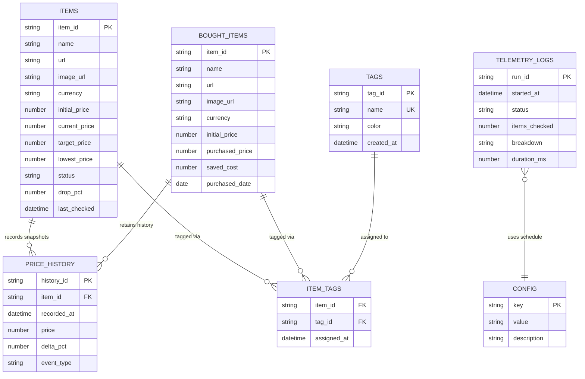

# PricePulse — Google Sheets Data Structure & Entity Relations

This document defines the canonical **Google Sheets** database schema, entity-relationship model, formulas, and lifecycle transitions for **PricePulse**, aligned with the unified **1-level flat Tags** architecture (`ui_prototype.html` v1.12).

---

## 1. Workbook Overview (Sheet Tabs)

A single Google Spreadsheet acts as the persistence store, partitioned into **7 structured tabs**:

| Tab Name | Purpose | Cardinality / Volume |
| :--- | :--- | :--- |
| `Items` | Currently tracked active product positions | ~1–500 rows (99 in benchmark) |
| `Bought_Items` | Purchased & archived items (polling frozen) for realized savings | Grows over time |
| `Tags` | Central 1-level flat Tag Registry (name + color theme) | ~10–100 rows |
| `Item_Tags` | Many-to-many junction linking `Items` / `Bought_Items` to `Tags` | ~2–5x item count |
| `Price_History` | Append-only time-series snapshots for trajectory & sparklines | ~5–100x item count |
| `Telemetry_Logs` | Scraper batch execution logs shown in **System Health** | Append-only run log |
| `Config` | Key-value settings (Gmail alert recipient, schedule, currency) | ~5–15 rows |

---

## 2. Entity-Relationship Diagram

---

## 3. Sheet-by-Sheet Schema Definitions

### 3.1 `Items` (Active Tracked Positions)

Stores all products currently monitored by the scraper.

| Col | Field | Type | Key / Rule | Formula / Notes | Example |
| :--- | :--- | :--- | :--- | :--- | :--- |
| `A` | `item_id` | `string` | **PK**, Immutable | UUID or `item-<seq>` | `item-1` |
| `B` | `name` | `string` | Required | Product display title | `Sony WH-1000XM5 Wireless Headphones` |
| `C` | `url` | `string` | Required, URL | Target retailer product URL | `https://amazon.com/dp/...` |
| `D` | `image_url` | `string` | Optional, URL | Product thumbnail URL | `https://images.unsplash.com/...` |
| `E` | `currency` | `string` | Required | ISO symbol (`$`, `€`, `₴`) | `$` |
| `F` | `initial_price` | `number` | Required (> 0) | Baseline price at time of creation (0% reference) | `399.99` |
| `G` | `current_price` | `number` | Required | Latest scraped price | `299.99` |
| `H` | `target_price` | `number` | Required | User-configured alert threshold | `320.00` |
| `I` | `lowest_price` | `number` | Computed / Stored | `MIN` historical price observed | `299.99` |
| `J` | `status` | `enum` | Formula | `=IF(G2<=H2, "DISCOUNT", "ACTIVE")` | `DISCOUNT` |
| `K` | `drop_pct` | `number` | Formula (%) | `=IF(F2>0, ROUND(((F2-G2)/F2)*100, 1), 0)` | `25.0` |
| `L` | `last_checked` | `datetime` | ISO 8601 | Timestamp of last scraper check | `2026-11-13T14:30:00Z` |

---

### 3.2 `Bought_Items` (Purchased Archive & Realized Savings)

Stores items moved out of `Items` when the user clicks **Buy**. Scraper polling ignores this tab.

| Col | Field | Type | Key / Rule | Formula / Notes | Example |
| :--- | :--- | :--- | :--- | :--- | :--- |
| `A` | `item_id` | `string` | **PK** | Preserved from `Items.item_id` (enables *Resume Tracking*) | `item-104` |
| `B` | `name` | `string` | Required | Product display title | `Apple AirPods Pro (2nd Gen)` |
| `C` | `url` | `string` | Required, URL | Target retailer product URL | `https://apple.com/...` |
| `D` | `image_url` | `string` | Optional, URL | Product thumbnail URL | `https://images.unsplash.com/...` |
| `E` | `currency` | `string` | Required | Currency symbol | `$` |
| `F` | `initial_price` | `number` | Required | Original baseline price | `249.00` |
| `G` | `purchased_price` | `number` | Required | Final price confirmed/entered by user at purchase | `189.00` |
| `H` | `saved_cost` | `number` | Formula | `=MAX(0, F2-G2)` | `60.00` |
| `I` | `purchased_date` | `date` | ISO Date | Date of purchase | `2026-11-10` |

---

### 3.3 `Tags` (1-Level Flat Tag Registry)

Central registry backing the **Tag Manager** page. There are no taxonomy types, categories, or retailer hierarchies — every label is a flat tag.

| Col | Field | Type | Key / Rule | Notes | Example |
| :--- | :--- | :--- | :--- | :--- | :--- |
| `A` | `tag_id` | `string` | **PK**, Immutable | Stable ID so renames never break relations | `tag-01` |
| `B` | `name` | `string` | **UK**, Required | Case-insensitive unique display name | `Black Friday` |
| `C` | `color` | `enum` | Required | `purple`, `amber`, `emerald`, `blue`, `rose`, `cyan`, `slate` | `amber` |
| `D` | `created_at` | `datetime` | ISO 8601 | Creation timestamp | `2026-11-01T10:00:00Z` |

---

### 3.4 `Item_Tags` (Many-to-Many Junction)

Resolves the many-to-many relationship between products (`Items` or `Bought_Items`) and `Tags`.

| Col | Field | Type | Key / Rule | Notes | Example |
| :--- | :--- | :--- | :--- | :--- | :--- |
| `A` | `item_id` | `string` | **FK** (Composite PK) | References `Items.item_id` or `Bought_Items.item_id` | `item-1` |
| `B` | `tag_id` | `string` | **FK** (Composite PK) | References `Tags.tag_id` | `tag-01` |
| `C` | `assigned_at` | `datetime` | ISO 8601 | When the tag was attached | `2026-11-03T12:15:00Z` |

> [!TIP]
> **Why `Item_Tags` instead of a comma-separated column in `Items`?**
> 1. **O(1) Rename Safety:** Renaming `Black Friday` &rarr; `BF 2026` only updates **1 cell** in `Tags!B`, and all 99+ items reflect the new name immediately.
> 2. **Clean Deletion:** Deleting a tag removes its rows from `Tags` and `Item_Tags` without string-parsing errors.
> 3. **Exact Filtering:** Avoids partial-substring bugs (e.g., `Audio` vs `Pro Audio`).

---

### 3.5 `Price_History` (Time-Series Snapshots)

Append-only log powering the **Total Price Dynamic & Market Trajectory (%)** multi-series chart, row sparklines, and Item Card detail charts.

| Col | Field | Type | Key / Rule | Formula / Notes | Example |
| :--- | :--- | :--- | :--- | :--- | :--- |
| `A` | `history_id` | `string` | **PK** | Unique snapshot ID | `hist-8821` |
| `B` | `item_id` | `string` | **FK** | References `Items.item_id` or `Bought_Items.item_id` | `item-1` |
| `C` | `recorded_at` | `datetime` | ISO 8601 | Snapshot timestamp | `2026-11-13T14:30:00Z` |
| `D` | `price` | `number` | Required | Observed price at `recorded_at` | `299.99` |
| `E` | `delta_pct` | `number` | Computed | `((price - initial_price) / initial_price) * 100` (negative = drop) | `-25.0` |
| `F` | `event_type` | `enum` | Required | `INITIAL`, `CHECK`, `BOUGHT`, `RESUMED` | `CHECK` |

---

### 3.6 `Telemetry_Logs` (System Health)

Stores batch execution diagnostics viewed in the **User Avatar &rarr; System Health** modal/panel.

| Col | Field | Type | Key / Rule | Notes | Example |
| :--- | :--- | :--- | :--- | :--- | :--- |
| `A` | `run_id` | `string` | **PK** | Batch run identifier | `run-9041` |
| `B` | `started_at` | `datetime` | ISO 8601 | Run start timestamp | `2026-11-13T14:00:00Z` |
| `C` | `status` | `enum` | Required | `SUCCESS`, `PARTIAL`, `ERROR` | `SUCCESS` |
| `D` | `items_checked` | `number` | Required | Number of active URLs polled | `99` |
| `E` | `breakdown` | `string` | Required | Summary string | `99/99 URLs Checked & Saved` |
| `F` | `duration_ms` | `number` | Required | Total batch execution time in ms | `18420` |

---

### 3.7 `Config` (Workspace & Alert Settings)

| Col | Field | Type | Key / Rule | Notes | Example |
| :--- | :--- | :--- | :--- | :--- | :--- |
| `A` | `key` | `string` | **PK** | Setting identifier | `gmail_alert_recipient` |
| `B` | `value` | `string` | Required | Setting value | `eugene.g@gmail.com` |
| `C` | `description` | `string` | Optional | Human-readable note | `Recipient for target_price alerts` |

---

## 4. Core Entity Lifecycle & State Transitions

1. **Track New URL (`+ Track URL`):**
   - Appends 1 row to `Items` (`initial_price = current_price`).
   - Appends 1 `INITIAL` row to `Price_History` (`delta_pct = 0`).
   - Inserts any missing tag names into `Tags` and links them in `Item_Tags`.
2. **Scheduled Price Check (`Run Check`):**
   - Reads active `Items` (`values.get`).
   - Updates `current_price`, `lowest_price`, `last_checked` in `Items` (`values.batchUpdate`).
   - Appends `CHECK` rows to `Price_History` (`values.append`).
   - Triggers Gmail alert if `current_price <= target_price`.
   - Appends 1 summary row to `Telemetry_Logs`.
3. **Purchase & Archive (`Buy` button):**
   - Appends 1 row to `Bought_Items` with `purchased_price` and `purchased_date`.
   - Deletes the corresponding row from `Items` (retaining `item_id` in `Bought_Items`, `Item_Tags`, and `Price_History`).
   - Appends a `BOUGHT` snapshot to `Price_History` and ensures the `Purchased` tag is linked in `Item_Tags`.
4. **Resume Tracking (from `Bought_Items` Item Card):**
   - Moves the row from `Bought_Items` back to `Items` with the same `item_id`, preserving full `Price_History` and `Item_Tags` (removing the `Purchased` tag link).
5. **Tag Manager Operations:**
   - **Rename:** Updates `Tags.name` for the matching `tag_id`. All grids and charts automatically reflect the new name on next read.
   - **Delete:** Deletes the row in `Tags` and all matching `tag_id` rows in `Item_Tags`.

---

## 5. Google Sheets API Performance Notes (99+ Items)

- **Batch Reads:** Fetch `Items!A2:L`, `Bought_Items!A2:I`, `Tags!A2:D`, `Item_Tags!A2:C`, and `Price_History!A2:F` in a single `spreadsheets.values.batchGet` call on dashboard load (1 HTTP request instead of 5).
- **Batch Writes:** Use `spreadsheets.values.batchUpdate` after pooled scraping runs to update all 99 `Items` rows in 1 API call, staying well within Google Sheets API per-minute write quotas.
- **Row Deletion:** When moving an item to `Bought_Items` or deleting a tag, use `spreadsheets.batchUpdate` (`DeleteDimensionRequest`) in descending row-index order to avoid index shifting.
